# RtlFxToFnFrame

- RVA: `0x00437F10`–`0x0043829F` (길이 `911` bytes)
- VA: `0x0000000140437F10`
- 실행 섹션: `.text`
- PDB 이름 있음: `예`; PDB Function 태그: `예`
- unwind 정보 RVA: `0x000A33C8`
- 디코드: `209`개 명령, `911/911` bytes 표시
- 미해석 바이트: `0` (있으면 어셈블리에 `.byte`로 보존)

> 이 문서는 커널 이미지의 기계어와 PDB 기호를 분석해 생성했습니다. 4번과 5번은 함수 원형과 자료형을 바이너리 사용 방식에서 추정한 C 해석이며 원본 소스 복구 결과는 아닙니다.

## 1. Dependencies

- 직접 호출 지점: **0**; 고유 호출 대상: **0**
- 직접 호출자로 확인된 함수: **1**
- RIP 상대 이미지 참조: **0**

### Outgoing calls
- 직접 디코드된 call 명령이 없습니다.

### Direct callers
- [RtlpWow64CtxFromAmd64](../../page/A1/RtlpWow64CtxFromAmd64_function_00A12394.md) at `0x00A12524`

### Static image references
- 디코드된 RIP-relative 메모리 참조가 없습니다.

## 2. Other-region calls and transfers

- 다른 실행 섹션으로 향하는 call: **0**
- call이 아닌 외부 분기/꼬리 이동: **8**
  - `0x00438116` → [sub_006EF288](../6E/Unknown_function_006EF288.md) (`tail-transfer`)
  - `0x00438145` → [sub_006EF288 + 0x1C](../6E/Unknown_function_006EF288.md) (`tail-transfer`)
  - `0x0043817A` → [sub_006EF288 + 0x39](../6E/Unknown_function_006EF288.md) (`tail-transfer`)
  - `0x004381AF` → [sub_006EF288 + 0x56](../6E/Unknown_function_006EF288.md) (`tail-transfer`)
  - `0x004381E4` → [sub_006EF288 + 0x73](../6E/Unknown_function_006EF288.md) (`tail-transfer`)
  - `0x00438219` → [sub_006EF288 + 0x90](../6E/Unknown_function_006EF288.md) (`tail-transfer`)
  - `0x0043824E` → [sub_006EF288 + 0xAD](../6E/Unknown_function_006EF288.md) (`tail-transfer`)
  - `0x00438282` → [sub_006EF288 + 0xCA](../6E/Unknown_function_006EF288.md) (`tail-transfer`)

## 3. Assembly (complete function range)

```asm
00437F10  48 89 5C 24 08                  mov qword ptr [rsp + 8], rbx
00437F15  48 89 74 24 10                  mov qword ptr [rsp + 0x10], rsi
00437F1A  48 89 7C 24 18                  mov qword ptr [rsp + 0x18], rdi
00437F1F  0F B7 02                        movzx eax, word ptr [rdx]
00437F22  4C 8B D2                        mov r10, rdx
00437F25  89 01                           mov dword ptr [rcx], eax
00437F27  4C 8B C9                        mov r9, rcx
00437F2A  0F B7 42 02                     movzx eax, word ptr [rdx + 2]
00437F2E  BE FF 7F 00 00                  mov esi, 0x7fff
00437F33  89 41 04                        mov dword ptr [rcx + 4], eax
00437F36  8B 42 08                        mov eax, dword ptr [rdx + 8]
00437F39  89 41 0C                        mov dword ptr [rcx + 0xc], eax
00437F3C  0F B7 42 0C                     movzx eax, word ptr [rdx + 0xc]
00437F40  44 0F B7 42 06                  movzx r8d, word ptr [rdx + 6]
00437F45  41 C1 E0 10                     shl r8d, 0x10
00437F49  44 0B C0                        or r8d, eax
00437F4C  44 89 41 10                     mov dword ptr [rcx + 0x10], r8d
00437F50  41 B8 07 00 00 00               mov r8d, 7
00437F56  8B 42 10                        mov eax, dword ptr [rdx + 0x10]
00437F59  89 41 14                        mov dword ptr [rcx + 0x14], eax
00437F5C  0F B7 42 14                     movzx eax, word ptr [rdx + 0x14]
00437F60  89 41 18                        mov dword ptr [rcx + 0x18], eax
00437F63  41 0F B7 42 02                  movzx eax, word ptr [r10 + 2]
00437F68  0F B6 52 04                     movzx edx, byte ptr [rdx + 4]
00437F6C  F2 41 0F 10 42 20               movsd xmm0, qword ptr [r10 + 0x20]
00437F72  C1 E8 0B                        shr eax, 0xb
00437F75  83 E0 07                        and eax, 7
00437F78  F2 0F 11 41 1C                  movsd qword ptr [rcx + 0x1c], xmm0
00437F7D  44 2B C0                        sub r8d, eax
00437F80  41 0F B7 42 28                  movzx eax, word ptr [r10 + 0x28]
00437F85  66 89 41 24                     mov word ptr [rcx + 0x24], ax
00437F89  84 D2                           test dl, dl
00437F8B  0F 88 6C 01 00 00               js 0x1404380fd
00437F91  B8 03 00 00 00                  mov eax, 3
00437F96  F2 41 0F 10 42 30               movsd xmm0, qword ptr [r10 + 0x30]
00437F9C  41 FF C8                        dec r8d
00437F9F  F2 41 0F 11 41 26               movsd qword ptr [r9 + 0x26], xmm0
00437FA5  BF FD FF 00 00                  mov edi, 0xfffd
00437FAA  41 0F B7 4A 38                  movzx ecx, word ptr [r10 + 0x38]
00437FAF  41 83 E0 07                     and r8d, 7
00437FB3  66 C1 E0 02                     shl ax, 2
00437FB7  02 D2                           add dl, dl
00437FB9  66 41 89 49 2E                  mov word ptr [r9 + 0x2e], cx
00437FBE  8D 5F FF                        lea ebx, [rdi - 1]
00437FC1  0F 88 66 01 00 00               js 0x14043812d
00437FC7  66 83 C8 03                     or ax, 3
00437FCB  F2 41 0F 10 42 40               movsd xmm0, qword ptr [r10 + 0x40]
00437FD1  41 FF C8                        dec r8d
00437FD4  F2 41 0F 11 41 30               movsd qword ptr [r9 + 0x30], xmm0
00437FDA  41 83 E0 07                     and r8d, 7
00437FDE  41 0F B7 4A 48                  movzx ecx, word ptr [r10 + 0x48]
00437FE3  66 C1 E0 02                     shl ax, 2
00437FE7  02 D2                           add dl, dl
00437FE9  66 41 89 49 38                  mov word ptr [r9 + 0x38], cx
00437FEE  0F 88 6E 01 00 00               js 0x140438162
00437FF4  66 83 C8 03                     or ax, 3
00437FF8  F2 41 0F 10 42 50               movsd xmm0, qword ptr [r10 + 0x50]
00437FFE  41 FF C8                        dec r8d
00438001  F2 41 0F 11 41 3A               movsd qword ptr [r9 + 0x3a], xmm0
00438007  41 83 E0 07                     and r8d, 7
0043800B  41 0F B7 4A 58                  movzx ecx, word ptr [r10 + 0x58]
00438010  66 C1 E0 02                     shl ax, 2
00438014  02 D2                           add dl, dl
00438016  66 41 89 49 42                  mov word ptr [r9 + 0x42], cx
0043801B  0F 88 76 01 00 00               js 0x140438197
00438021  66 83 C8 03                     or ax, 3
00438025  F2 41 0F 10 42 60               movsd xmm0, qword ptr [r10 + 0x60]
0043802B  41 FF C8                        dec r8d
0043802E  F2 41 0F 11 41 44               movsd qword ptr [r9 + 0x44], xmm0
00438034  41 83 E0 07                     and r8d, 7
00438038  41 0F B7 4A 68                  movzx ecx, word ptr [r10 + 0x68]
0043803D  66 C1 E0 02                     shl ax, 2
00438041  02 D2                           add dl, dl
00438043  66 41 89 49 4C                  mov word ptr [r9 + 0x4c], cx
00438048  0F 88 7E 01 00 00               js 0x1404381cc
0043804E  66 83 C8 03                     or ax, 3
00438052  F2 41 0F 10 42 70               movsd xmm0, qword ptr [r10 + 0x70]
00438058  41 FF C8                        dec r8d
0043805B  F2 41 0F 11 41 4E               movsd qword ptr [r9 + 0x4e], xmm0
00438061  41 83 E0 07                     and r8d, 7
00438065  41 0F B7 4A 78                  movzx ecx, word ptr [r10 + 0x78]
0043806A  66 C1 E0 02                     shl ax, 2
0043806E  02 D2                           add dl, dl
00438070  66 41 89 49 56                  mov word ptr [r9 + 0x56], cx
00438075  0F 88 86 01 00 00               js 0x140438201
0043807B  66 83 C8 03                     or ax, 3
0043807F  F2 41 0F 10 82 80 00 00 00      movsd xmm0, qword ptr [r10 + 0x80]
00438088  41 FF C8                        dec r8d
0043808B  F2 41 0F 11 41 58               movsd qword ptr [r9 + 0x58], xmm0
00438091  41 83 E0 07                     and r8d, 7
00438095  41 0F B7 8A 88 00 00 00         movzx ecx, word ptr [r10 + 0x88]
0043809D  66 C1 E0 02                     shl ax, 2
004380A1  02 D2                           add dl, dl
004380A3  66 41 89 49 60                  mov word ptr [r9 + 0x60], cx
004380A8  0F 88 88 01 00 00               js 0x140438236
004380AE  66 83 C8 03                     or ax, 3
004380B2  F2 41 0F 10 82 90 00 00 00      movsd xmm0, qword ptr [r10 + 0x90]
004380BB  41 FF C8                        dec r8d
004380BE  F2 41 0F 11 41 62               movsd qword ptr [r9 + 0x62], xmm0
004380C4  41 83 E0 07                     and r8d, 7
004380C8  41 0F B7 8A 98 00 00 00         movzx ecx, word ptr [r10 + 0x98]
004380D0  66 C1 E0 02                     shl ax, 2
004380D4  02 D2                           add dl, dl
004380D6  66 41 89 49 6A                  mov word ptr [r9 + 0x6a], cx
004380DB  0F 88 8A 01 00 00               js 0x14043826b
004380E1  66 83 C8 03                     or ax, 3
004380E5  48 8B 5C 24 08                  mov rbx, qword ptr [rsp + 8]
004380EA  48 8B 74 24 10                  mov rsi, qword ptr [rsp + 0x10]
004380EF  48 8B 7C 24 18                  mov rdi, qword ptr [rsp + 0x18]
004380F4  0F B7 C8                        movzx ecx, ax
004380F7  41 89 49 08                     mov dword ptr [r9 + 8], ecx
004380FB  C3                              ret
004380FC  CC                              int3
004380FD  41 8B C8                        mov ecx, r8d
00438100  44 8B DE                        mov r11d, esi
00438103  48 83 C1 02                     add rcx, 2
00438107  B8 02 00 00 00                  mov eax, 2
0043810C  48 C1 E1 04                     shl rcx, 4
00438110  66 46 23 5C 11 08               and r11w, word ptr [rcx + r10 + 8]
00438116  0F 85 6C 71 2B 00               jne 0x1406ef288
0043811C  33 C0                           xor eax, eax
0043811E  4A 39 04 11                     cmp qword ptr [rcx + r10], rax
00438122  0F 95 C0                        setne al
00438125  66 FF C0                        inc ax
00438128  E9 69 FE FF FF                  jmp 0x140437f96
0043812D  41 8B C8                        mov ecx, r8d
00438130  66 83 C8 02                     or ax, 2
00438134  48 83 C1 02                     add rcx, 2
00438138  44 8B DE                        mov r11d, esi
0043813B  48 C1 E1 04                     shl rcx, 4
0043813F  66 46 23 5C 11 08               and r11w, word ptr [rcx + r10 + 8]
00438145  0F 85 59 71 2B 00               jne 0x1406ef2a4
0043814B  4A 83 3C 11 00                  cmp qword ptr [rcx + r10], 0
00438150  0F 85 75 FE FF FF               jne 0x140437fcb
00438156  66 23 C7                        and ax, di
00438159  66 83 C8 01                     or ax, 1
0043815D  E9 69 FE FF FF                  jmp 0x140437fcb
00438162  41 8B C8                        mov ecx, r8d
00438165  66 83 C8 02                     or ax, 2
00438169  48 83 C1 02                     add rcx, 2
0043816D  44 8B DE                        mov r11d, esi
00438170  48 C1 E1 04                     shl rcx, 4
00438174  66 46 23 5C 11 08               and r11w, word ptr [rcx + r10 + 8]
0043817A  0F 85 41 71 2B 00               jne 0x1406ef2c1
00438180  4A 83 3C 11 00                  cmp qword ptr [rcx + r10], 0
00438185  0F 85 6D FE FF FF               jne 0x140437ff8
0043818B  66 23 C7                        and ax, di
0043818E  66 83 C8 01                     or ax, 1
00438192  E9 61 FE FF FF                  jmp 0x140437ff8
00438197  41 8B C8                        mov ecx, r8d
0043819A  66 83 C8 02                     or ax, 2
0043819E  48 83 C1 02                     add rcx, 2
004381A2  44 8B DE                        mov r11d, esi
004381A5  48 C1 E1 04                     shl rcx, 4
004381A9  66 46 23 5C 11 08               and r11w, word ptr [rcx + r10 + 8]
004381AF  0F 85 29 71 2B 00               jne 0x1406ef2de
004381B5  4A 83 3C 11 00                  cmp qword ptr [rcx + r10], 0
004381BA  0F 85 65 FE FF FF               jne 0x140438025
004381C0  66 23 C7                        and ax, di
004381C3  66 83 C8 01                     or ax, 1
004381C7  E9 59 FE FF FF                  jmp 0x140438025
004381CC  41 8B C8                        mov ecx, r8d
004381CF  66 83 C8 02                     or ax, 2
004381D3  48 83 C1 02                     add rcx, 2
004381D7  44 8B DE                        mov r11d, esi
004381DA  48 C1 E1 04                     shl rcx, 4
004381DE  66 46 23 5C 11 08               and r11w, word ptr [rcx + r10 + 8]
004381E4  0F 85 11 71 2B 00               jne 0x1406ef2fb
004381EA  4A 83 3C 11 00                  cmp qword ptr [rcx + r10], 0
004381EF  0F 85 5D FE FF FF               jne 0x140438052
004381F5  66 23 C7                        and ax, di
004381F8  66 83 C8 01                     or ax, 1
004381FC  E9 51 FE FF FF                  jmp 0x140438052
00438201  41 8B C8                        mov ecx, r8d
00438204  66 83 C8 02                     or ax, 2
00438208  48 83 C1 02                     add rcx, 2
0043820C  44 8B DE                        mov r11d, esi
0043820F  48 C1 E1 04                     shl rcx, 4
00438213  66 46 23 5C 11 08               and r11w, word ptr [rcx + r10 + 8]
00438219  0F 85 F9 70 2B 00               jne 0x1406ef318
0043821F  4A 83 3C 11 00                  cmp qword ptr [rcx + r10], 0
00438224  0F 85 55 FE FF FF               jne 0x14043807f
0043822A  66 23 C7                        and ax, di
0043822D  66 83 C8 01                     or ax, 1
00438231  E9 49 FE FF FF                  jmp 0x14043807f
00438236  41 8B C8                        mov ecx, r8d
00438239  66 83 C8 02                     or ax, 2
0043823D  48 83 C1 02                     add rcx, 2
00438241  44 8B DE                        mov r11d, esi
00438244  48 C1 E1 04                     shl rcx, 4
00438248  66 46 23 5C 11 08               and r11w, word ptr [rcx + r10 + 8]
0043824E  0F 85 E1 70 2B 00               jne 0x1406ef335
00438254  4A 83 3C 11 00                  cmp qword ptr [rcx + r10], 0
00438259  0F 85 53 FE FF FF               jne 0x1404380b2
0043825F  66 23 C7                        and ax, di
00438262  66 83 C8 01                     or ax, 1
00438266  E9 47 FE FF FF                  jmp 0x1404380b2
0043826B  41 8B C8                        mov ecx, r8d
0043826E  66 83 C8 02                     or ax, 2
00438272  48 83 C1 02                     add rcx, 2
00438276  8B D6                           mov edx, esi
00438278  48 C1 E1 04                     shl rcx, 4
0043827C  66 42 23 54 11 08               and dx, word ptr [rcx + r10 + 8]
00438282  0F 85 CA 70 2B 00               jne 0x1406ef352
00438288  4A 83 3C 11 00                  cmp qword ptr [rcx + r10], 0
0043828D  0F 85 52 FE FF FF               jne 0x1404380e5
00438293  66 23 C7                        and ax, di
00438296  66 83 C8 01                     or ax, 1
0043829A  E9 46 FE FF FF                  jmp 0x1404380e5
```

## 4. C-style interpretation (structured pseudocode)

```c
__int64 __fastcall RtlFxToFnFrame(__int64 a1, __int64 a2)
{
    __int64 result;
    __int64 v_r11;
    unsigned __int64 v_stack_p10;
    unsigned __int64 v_stack_p18;
    unsigned __int64 v_stack_p8;

    v_stack_p8 = v_rbx;
    v_stack_p10 = v_rsi;
    v_stack_p18 = v_rdi;
    *(unsigned int *)(a1) = (unsigned int)(*(unsigned __int16 *)(a2));
    *(unsigned int *)(a1 + 4) = (unsigned int)(*(unsigned __int16 *)(a2 + 2));
    *(unsigned int *)(a1 + 12) = (unsigned int)((unsigned int)(*(unsigned int *)(a2 + 8)));
    a3 = (unsigned int)((*(unsigned __int16 *)(a2 + 6)) << (16));
    a3 = (unsigned int)((a3) | ((unsigned int)(*(unsigned __int16 *)(a2 + 12))));
    *(unsigned int *)(a1 + 16) = (unsigned int)(a3);
    *(unsigned int *)(a1 + 20) = (unsigned int)((unsigned int)(*(unsigned int *)(a2 + 16)));
    *(unsigned int *)(a1 + 24) = (unsigned int)(*(unsigned __int16 *)(a2 + 20));
    result = (unsigned int)((*(unsigned __int16 *)(a2 + 2)) >> (11));
    result = (unsigned int)((result) & (7));
    *(unsigned __int64 *)(a1 + 28) = v_xmm0;
    a3 = (unsigned int)((7) - ((unsigned int)(result)));
    *(unsigned __int16 *)(a1 + 36) = (unsigned __int16)(*(unsigned __int16 *)(a2 + 40));
    if (sign_flag) goto loc_004380FD;
loc_00437F96:
    a3 = (unsigned int)((a3) - 1);
    *(unsigned __int64 *)(a1 + 38) = v_xmm0;
    a3 = (unsigned int)((a3) & (7));
    result = (unsigned __int16)((3) << (2));
    a2 = (unsigned __int8)((*(unsigned __int8 *)(a2 + 4)) + ((unsigned __int8)(*(unsigned __int8 *)(a2 + 4))));
    *(unsigned __int16 *)(a1 + 46) = (unsigned __int16)(*(unsigned __int16 *)(a2 + 56));
    if (sign_flag) goto loc_0043812D;
    result = (unsigned __int16)((result) | (3));
loc_00437FCB:
    a3 = (unsigned int)((a3) - 1);
    *(unsigned __int64 *)(a1 + 48) = v_xmm0;
    a3 = (unsigned int)((a3) & (7));
    result = (unsigned __int16)((result) << (2));
    a2 = (unsigned __int8)((a2) + ((unsigned __int8)(a2)));
    *(unsigned __int16 *)(a1 + 56) = (unsigned __int16)(*(unsigned __int16 *)(a2 + 72));
    if (sign_flag) goto loc_00438162;
    result = (unsigned __int16)((result) | (3));
loc_00437FF8:
    a3 = (unsigned int)((a3) - 1);
    *(unsigned __int64 *)(a1 + 58) = v_xmm0;
    a3 = (unsigned int)((a3) & (7));
    result = (unsigned __int16)((result) << (2));
    a2 = (unsigned __int8)((a2) + ((unsigned __int8)(a2)));
    *(unsigned __int16 *)(a1 + 66) = (unsigned __int16)(*(unsigned __int16 *)(a2 + 88));
    if (sign_flag) goto loc_00438197;
    result = (unsigned __int16)((result) | (3));
loc_00438025:
    a3 = (unsigned int)((a3) - 1);
    *(unsigned __int64 *)(a1 + 68) = v_xmm0;
    a3 = (unsigned int)((a3) & (7));
    result = (unsigned __int16)((result) << (2));
    a2 = (unsigned __int8)((a2) + ((unsigned __int8)(a2)));
    *(unsigned __int16 *)(a1 + 76) = (unsigned __int16)(*(unsigned __int16 *)(a2 + 104));
    if (sign_flag) goto loc_004381CC;
    result = (unsigned __int16)((result) | (3));
loc_00438052:
    a3 = (unsigned int)((a3) - 1);
    *(unsigned __int64 *)(a1 + 78) = v_xmm0;
    a3 = (unsigned int)((a3) & (7));
    result = (unsigned __int16)((result) << (2));
    a2 = (unsigned __int8)((a2) + ((unsigned __int8)(a2)));
    *(unsigned __int16 *)(a1 + 86) = (unsigned __int16)(*(unsigned __int16 *)(a2 + 120));
    if (sign_flag) goto loc_00438201;
    result = (unsigned __int16)((result) | (3));
loc_0043807F:
    a3 = (unsigned int)((a3) - 1);
    *(unsigned __int64 *)(a1 + 88) = v_xmm0;
    a3 = (unsigned int)((a3) & (7));
    result = (unsigned __int16)((result) << (2));
    a2 = (unsigned __int8)((a2) + ((unsigned __int8)(a2)));
    *(unsigned __int16 *)(a1 + 96) = (unsigned __int16)(*(unsigned __int16 *)(a2 + 136));
    if (sign_flag) goto loc_00438236;
    result = (unsigned __int16)((result) | (3));
loc_004380B2:
    a3 = (unsigned int)((a3) - 1);
    *(unsigned __int64 *)(a1 + 98) = v_xmm0;
    a3 = (unsigned int)((a3) & (7));
    result = (unsigned __int16)((result) << (2));
    a2 = (unsigned __int8)((a2) + ((unsigned __int8)(a2)));
    *(unsigned __int16 *)(a1 + 106) = (unsigned __int16)(*(unsigned __int16 *)(a2 + 152));
    if (sign_flag) goto loc_0043826B;
    result = (unsigned __int16)((result) | (3));
loc_004380E5:
    *(unsigned int *)(a1 + 8) = (unsigned int)((unsigned __int16)(result));
    return result;
loc_004380FD:
    a1 = ((unsigned int)((unsigned int)(a3))) + (2);
    a1 = (a1) << (4);
    v_r11 = (unsigned __int16)(((unsigned int)((unsigned int)(v_stack_p10))) & (*(unsigned __int16 *)(a1 + a2 * 1 + 8)));
    result = 0;
    result = ((*(unsigned __int64 *)(a1 + a2 * 1)) != 0) ? 1 : 0;
    result = (unsigned __int16)((result) + 1);
    goto loc_00437F96;
loc_0043812D:
    result = (unsigned __int16)((result) | (2));
    a1 = ((unsigned int)((unsigned int)(a3))) + (2);
    a1 = (a1) << (4);
    v_r11 = (unsigned __int16)(((unsigned int)((unsigned int)(v_stack_p10))) & (*(unsigned __int16 *)(a1 + a2 * 1 + 8)));
    if ((*(unsigned __int64 *)(a1 + a2 * 1)) != 0) goto loc_00437FCB;
    result = (unsigned __int16)((result) & ((unsigned __int16)(v_stack_p18)));
    result = (unsigned __int16)((result) | (1));
    goto loc_00437FCB;
loc_00438162:
    result = (unsigned __int16)((result) | (2));
    a1 = ((unsigned int)((unsigned int)(a3))) + (2);
    a1 = (a1) << (4);
    v_r11 = (unsigned __int16)(((unsigned int)((unsigned int)(v_stack_p10))) & (*(unsigned __int16 *)(a1 + a2 * 1 + 8)));
    if ((*(unsigned __int64 *)(a1 + a2 * 1)) != 0) goto loc_00437FF8;
    result = (unsigned __int16)((result) & ((unsigned __int16)(v_stack_p18)));
    result = (unsigned __int16)((result) | (1));
    goto loc_00437FF8;
loc_00438197:
    result = (unsigned __int16)((result) | (2));
    a1 = ((unsigned int)((unsigned int)(a3))) + (2);
    a1 = (a1) << (4);
    v_r11 = (unsigned __int16)(((unsigned int)((unsigned int)(v_stack_p10))) & (*(unsigned __int16 *)(a1 + a2 * 1 + 8)));
    if ((*(unsigned __int64 *)(a1 + a2 * 1)) != 0) goto loc_00438025;
    result = (unsigned __int16)((result) & ((unsigned __int16)(v_stack_p18)));
    result = (unsigned __int16)((result) | (1));
    goto loc_00438025;
loc_004381CC:
    result = (unsigned __int16)((result) | (2));
    a1 = ((unsigned int)((unsigned int)(a3))) + (2);
    a1 = (a1) << (4);
    v_r11 = (unsigned __int16)(((unsigned int)((unsigned int)(v_stack_p10))) & (*(unsigned __int16 *)(a1 + a2 * 1 + 8)));
    if ((*(unsigned __int64 *)(a1 + a2 * 1)) != 0) goto loc_00438052;
    result = (unsigned __int16)((result) & ((unsigned __int16)(v_stack_p18)));
    result = (unsigned __int16)((result) | (1));
    goto loc_00438052;
loc_00438201:
    result = (unsigned __int16)((result) | (2));
    a1 = ((unsigned int)((unsigned int)(a3))) + (2);
    a1 = (a1) << (4);
    v_r11 = (unsigned __int16)(((unsigned int)((unsigned int)(v_stack_p10))) & (*(unsigned __int16 *)(a1 + a2 * 1 + 8)));
    if ((*(unsigned __int64 *)(a1 + a2 * 1)) != 0) goto loc_0043807F;
    result = (unsigned __int16)((result) & ((unsigned __int16)(v_stack_p18)));
    result = (unsigned __int16)((result) | (1));
    goto loc_0043807F;
loc_00438236:
    result = (unsigned __int16)((result) | (2));
    a1 = ((unsigned int)((unsigned int)(a3))) + (2);
    a1 = (a1) << (4);
    v_r11 = (unsigned __int16)(((unsigned int)((unsigned int)(v_stack_p10))) & (*(unsigned __int16 *)(a1 + a2 * 1 + 8)));
    if ((*(unsigned __int64 *)(a1 + a2 * 1)) != 0) goto loc_004380B2;
    result = (unsigned __int16)((result) & ((unsigned __int16)(v_stack_p18)));
    result = (unsigned __int16)((result) | (1));
    goto loc_004380B2;
loc_0043826B:
    result = (unsigned __int16)((result) | (2));
    a1 = ((unsigned int)((unsigned int)(a3))) + (2);
    a1 = (a1) << (4);
    a2 = (unsigned __int16)(((unsigned int)((unsigned int)(v_stack_p10))) & (*(unsigned __int16 *)(a1 + a2 * 1 + 8)));
    if ((*(unsigned __int64 *)(a1 + a2 * 1)) != 0) goto loc_004380E5;
    result = (unsigned __int16)((result) & ((unsigned __int16)(v_stack_p18)));
    result = (unsigned __int16)((result) | (1));
    goto loc_004380E5;
}
```

## 5. (Beta) C Style

```c
int64_t RtlFxToFnFrame(void *Arg1, void *Arg2)
{
    uint8_t *arg1 = (uint8_t *)Arg1;
    uint8_t *arg2 = (uint8_t *)Arg2;

    int64_t result;
    int64_t local_r11;
    uint64_t v_stack_p10;
    uint64_t v_stack_p18;
    uint64_t v_stack_p8;

    v_stack_p8 = local_rbx;
    v_stack_p10 = local_rsi;
    v_stack_p18 = local_rdi;
    *(uint32_t *)(arg1) = (uint32_t)(*(uint16_t *)(arg2));
    *(uint32_t *)(arg1 + 0x4) = (uint32_t)(*(uint16_t *)(arg2 + 0x2));
    *(uint32_t *)(arg1 + 0xC) = (uint32_t)((uint32_t)(*(uint32_t *)(arg2 + 0x8)));
    a3 = (uint32_t)((*(uint16_t *)(arg2 + 0x6)) << (16));
    a3 = (uint32_t)((a3) | ((uint32_t)(*(uint16_t *)(arg2 + 0xC))));
    *(uint32_t *)(arg1 + 0x10) = (uint32_t)(a3);
    *(uint32_t *)(arg1 + 0x14) = (uint32_t)((uint32_t)(*(uint32_t *)(arg2 + 0x10)));
    *(uint32_t *)(arg1 + 0x18) = (uint32_t)(*(uint16_t *)(arg2 + 0x14));
    result = (uint32_t)((*(uint16_t *)(arg2 + 0x2)) >> (11));
    result = (uint32_t)((result) & (7));
    *(uint64_t *)(arg1 + 0x1C) = v_xmm0;
    a3 = (uint32_t)((7) - ((uint32_t)(result)));
    *(uint16_t *)(arg1 + 0x24) = (uint16_t)(*(uint16_t *)(arg2 + 0x28));
    if (sign_flag) goto loc_004380FD;
loc_00437F96:
    a3 = (uint32_t)((a3) - 1);
    *(uint64_t *)(arg1 + 0x26) = v_xmm0;
    a3 = (uint32_t)((a3) & (7));
    result = (uint16_t)((3) << (2));
    Arg2 = (uint8_t)((*(uint8_t *)(arg2 + 0x4)) + ((uint8_t)(*(uint8_t *)(arg2 + 0x4))));
    *(uint16_t *)(arg1 + 0x2E) = (uint16_t)(*(uint16_t *)(arg2 + 0x38));
    if (sign_flag) goto loc_0043812D;
    result = (uint16_t)((result) | (3));
loc_00437FCB:
    a3 = (uint32_t)((a3) - 1);
    *(uint64_t *)(arg1 + 0x30) = v_xmm0;
    a3 = (uint32_t)((a3) & (7));
    result = (uint16_t)((result) << (2));
    Arg2 = (uint8_t)((Arg2) + ((uint8_t)(Arg2)));
    *(uint16_t *)(arg1 + 0x38) = (uint16_t)(*(uint16_t *)(arg2 + 0x48));
    if (sign_flag) goto loc_00438162;
    result = (uint16_t)((result) | (3));
loc_00437FF8:
    a3 = (uint32_t)((a3) - 1);
    *(uint64_t *)(arg1 + 0x3A) = v_xmm0;
    a3 = (uint32_t)((a3) & (7));
    result = (uint16_t)((result) << (2));
    Arg2 = (uint8_t)((Arg2) + ((uint8_t)(Arg2)));
    *(uint16_t *)(arg1 + 0x42) = (uint16_t)(*(uint16_t *)(arg2 + 0x58));
    if (sign_flag) goto loc_00438197;
    result = (uint16_t)((result) | (3));
loc_00438025:
    a3 = (uint32_t)((a3) - 1);
    *(uint64_t *)(arg1 + 0x44) = v_xmm0;
    a3 = (uint32_t)((a3) & (7));
    result = (uint16_t)((result) << (2));
    Arg2 = (uint8_t)((Arg2) + ((uint8_t)(Arg2)));
    *(uint16_t *)(arg1 + 0x4C) = (uint16_t)(*(uint16_t *)(arg2 + 0x68));
    if (sign_flag) goto loc_004381CC;
    result = (uint16_t)((result) | (3));
loc_00438052:
    a3 = (uint32_t)((a3) - 1);
    *(uint64_t *)(arg1 + 0x4E) = v_xmm0;
    a3 = (uint32_t)((a3) & (7));
    result = (uint16_t)((result) << (2));
    Arg2 = (uint8_t)((Arg2) + ((uint8_t)(Arg2)));
    *(uint16_t *)(arg1 + 0x56) = (uint16_t)(*(uint16_t *)(arg2 + 0x78));
    if (sign_flag) goto loc_00438201;
    result = (uint16_t)((result) | (3));
loc_0043807F:
    a3 = (uint32_t)((a3) - 1);
    *(uint64_t *)(arg1 + 0x58) = v_xmm0;
    a3 = (uint32_t)((a3) & (7));
    result = (uint16_t)((result) << (2));
    Arg2 = (uint8_t)((Arg2) + ((uint8_t)(Arg2)));
    *(uint16_t *)(arg1 + 0x60) = (uint16_t)(*(uint16_t *)(arg2 + 0x88));
    if (sign_flag) goto loc_00438236;
    result = (uint16_t)((result) | (3));
loc_004380B2:
    a3 = (uint32_t)((a3) - 1);
    *(uint64_t *)(arg1 + 0x62) = v_xmm0;
    a3 = (uint32_t)((a3) & (7));
    result = (uint16_t)((result) << (2));
    Arg2 = (uint8_t)((Arg2) + ((uint8_t)(Arg2)));
    *(uint16_t *)(arg1 + 0x6A) = (uint16_t)(*(uint16_t *)(arg2 + 0x98));
    if (sign_flag) goto loc_0043826B;
    result = (uint16_t)((result) | (3));
loc_004380E5:
    *(uint32_t *)(arg1 + 0x8) = (uint32_t)((uint16_t)(result));
    return result;
loc_004380FD:
    Arg1 = ((uint32_t)((uint32_t)(a3))) + (2);
    Arg1 = (Arg1) << (4);
    local_r11 = (uint16_t)(((uint32_t)((uint32_t)(v_stack_p10))) & (*(uint16_t *)(arg1 + arg2 * 1 + 0x8)));
    result = 0;
    result = ((*(uint64_t *)(arg1 + arg2 * 1)) != 0) ? 1 : 0;
    result = (uint16_t)((result) + 1);
    goto loc_00437F96;
loc_0043812D:
    result = (uint16_t)((result) | (2));
    Arg1 = ((uint32_t)((uint32_t)(a3))) + (2);
    Arg1 = (Arg1) << (4);
    local_r11 = (uint16_t)(((uint32_t)((uint32_t)(v_stack_p10))) & (*(uint16_t *)(arg1 + arg2 * 1 + 0x8)));
    if ((*(uint64_t *)(arg1 + arg2 * 1)) != 0) goto loc_00437FCB;
    result = (uint16_t)((result) & ((uint16_t)(v_stack_p18)));
    result = (uint16_t)((result) | (1));
    goto loc_00437FCB;
loc_00438162:
    result = (uint16_t)((result) | (2));
    Arg1 = ((uint32_t)((uint32_t)(a3))) + (2);
    Arg1 = (Arg1) << (4);
    local_r11 = (uint16_t)(((uint32_t)((uint32_t)(v_stack_p10))) & (*(uint16_t *)(arg1 + arg2 * 1 + 0x8)));
    if ((*(uint64_t *)(arg1 + arg2 * 1)) != 0) goto loc_00437FF8;
    result = (uint16_t)((result) & ((uint16_t)(v_stack_p18)));
    result = (uint16_t)((result) | (1));
    goto loc_00437FF8;
loc_00438197:
    result = (uint16_t)((result) | (2));
    Arg1 = ((uint32_t)((uint32_t)(a3))) + (2);
    Arg1 = (Arg1) << (4);
    local_r11 = (uint16_t)(((uint32_t)((uint32_t)(v_stack_p10))) & (*(uint16_t *)(arg1 + arg2 * 1 + 0x8)));
    if ((*(uint64_t *)(arg1 + arg2 * 1)) != 0) goto loc_00438025;
    result = (uint16_t)((result) & ((uint16_t)(v_stack_p18)));
    result = (uint16_t)((result) | (1));
    goto loc_00438025;
loc_004381CC:
    result = (uint16_t)((result) | (2));
    Arg1 = ((uint32_t)((uint32_t)(a3))) + (2);
    Arg1 = (Arg1) << (4);
    local_r11 = (uint16_t)(((uint32_t)((uint32_t)(v_stack_p10))) & (*(uint16_t *)(arg1 + arg2 * 1 + 0x8)));
    if ((*(uint64_t *)(arg1 + arg2 * 1)) != 0) goto loc_00438052;
    result = (uint16_t)((result) & ((uint16_t)(v_stack_p18)));
    result = (uint16_t)((result) | (1));
    goto loc_00438052;
loc_00438201:
    result = (uint16_t)((result) | (2));
    Arg1 = ((uint32_t)((uint32_t)(a3))) + (2);
    Arg1 = (Arg1) << (4);
    local_r11 = (uint16_t)(((uint32_t)((uint32_t)(v_stack_p10))) & (*(uint16_t *)(arg1 + arg2 * 1 + 0x8)));
    if ((*(uint64_t *)(arg1 + arg2 * 1)) != 0) goto loc_0043807F;
    result = (uint16_t)((result) & ((uint16_t)(v_stack_p18)));
    result = (uint16_t)((result) | (1));
    goto loc_0043807F;
loc_00438236:
    result = (uint16_t)((result) | (2));
    Arg1 = ((uint32_t)((uint32_t)(a3))) + (2);
    Arg1 = (Arg1) << (4);
    local_r11 = (uint16_t)(((uint32_t)((uint32_t)(v_stack_p10))) & (*(uint16_t *)(arg1 + arg2 * 1 + 0x8)));
    if ((*(uint64_t *)(arg1 + arg2 * 1)) != 0) goto loc_004380B2;
    result = (uint16_t)((result) & ((uint16_t)(v_stack_p18)));
    result = (uint16_t)((result) | (1));
    goto loc_004380B2;
loc_0043826B:
    result = (uint16_t)((result) | (2));
    Arg1 = ((uint32_t)((uint32_t)(a3))) + (2);
    Arg1 = (Arg1) << (4);
    Arg2 = (uint16_t)(((uint32_t)((uint32_t)(v_stack_p10))) & (*(uint16_t *)(arg1 + arg2 * 1 + 0x8)));
    if ((*(uint64_t *)(arg1 + arg2 * 1)) != 0) goto loc_004380E5;
    result = (uint16_t)((result) & ((uint16_t)(v_stack_p18)));
    result = (uint16_t)((result) | (1));
    goto loc_004380E5;
}
```

### 관측된 메모리 오프셋

구조체 형식이 확인되지 않은 접근은 인자 기준의 오프셋으로만 기록했습니다.

| 기준 인자 | 오프셋 표현 | 폭 (bit) | 접근 |
|---|---:|---:|---|
| `Arg1` | `+ 0x0` | `32` | `W` |
| `Arg1` | `+ 0x4` | `32` | `W` |
| `Arg1` | `+ 0x8` | `32` | `W` |
| `Arg1` | `+ 0xC` | `32` | `W` |
| `Arg1` | `+ 0x10` | `32` | `W` |
| `Arg1` | `+ 0x14` | `32` | `W` |
| `Arg1` | `+ 0x18` | `32` | `W` |
| `Arg1` | `+ 0x1C` | `64` | `W` |
| `Arg1` | `+ 0x24` | `16` | `W` |
| `Arg1` | `+ 0x26` | `64` | `W` |
| `Arg1` | `+ 0x2E` | `16` | `W` |
| `Arg1` | `+ 0x30` | `64` | `W` |
| `Arg1` | `+ 0x38` | `16` | `W` |
| `Arg1` | `+ 0x3A` | `64` | `W` |
| `Arg1` | `+ 0x42` | `16` | `W` |
| `Arg1` | `+ 0x44` | `64` | `W` |
| `Arg1` | `+ 0x4C` | `16` | `W` |
| `Arg1` | `+ 0x4E` | `64` | `W` |
| `Arg1` | `+ 0x56` | `16` | `W` |
| `Arg1` | `+ 0x58` | `64` | `W` |
| `Arg1` | `+ 0x60` | `16` | `W` |
| `Arg1` | `+ 0x62` | `64` | `W` |
| `Arg1` | `+ 0x6A` | `16` | `W` |
| `Arg2` | `+ 0x0` | `16` | `R` |
| `Arg2` | `+ 0x2` | `16` | `R` |
| `Arg2` | `+ 0x4` | `8` | `R` |
| `Arg2` | `+ 0x6` | `16` | `R` |
| `Arg2` | `+ 0x8` | `32` | `R` |
| `Arg2` | `+ 0xC` | `16` | `R` |
| `Arg2` | `+ 0x10` | `32` | `R` |
| `Arg2` | `+ 0x14` | `16` | `R` |
| `Arg2` | `+ 0x20` | `64` | `R` |

추가 오프셋 15개는 표에서 생략했습니다.

## 6. Execution-region graph

[열기: 2D/3D 그래프와 함수 탐색 컨트롤 패널](../../../control-panel.html?section=text&rva=0x00437F10&view=graph)

- 2D 그래프는 위에서 아래로 흐르고, 3D 그래프는 빈 공간을 드래그해 회전합니다. Shift+드래그는 이동, 휠은 확대·축소, 함수 노드 선택은 대상 보고서 이동입니다.

### Static fallback

```mermaid
flowchart TD
  bb_00437F10[BB_00437F10]
  bb_00437F91[BB_00437F91]
  bb_00437F96[BB_00437F96]
  bb_00437FC7[BB_00437FC7]
  bb_00437FCB[BB_00437FCB]
  bb_00437FF4[BB_00437FF4]
  bb_00437FF8[BB_00437FF8]
  bb_00438021[BB_00438021]
  bb_00438025[BB_00438025]
  bb_0043804E[BB_0043804E]
  bb_00438052[BB_00438052]
  bb_0043807B[BB_0043807B]
  bb_0043807F[BB_0043807F]
  bb_004380AE[BB_004380AE]
  bb_004380B2[BB_004380B2]
  bb_004380E1[BB_004380E1]
  bb_004380E5[BB_004380E5]
  bb_004380FC[BB_004380FC]
  bb_004380FD[BB_004380FD]
  bb_0043811C[BB_0043811C]
  bb_0043812D[BB_0043812D]
  bb_0043814B[BB_0043814B]
  bb_00438156[BB_00438156]
  bb_00438162[BB_00438162]
  bb_00438180[BB_00438180]
  bb_0043818B[BB_0043818B]
  bb_00438197[BB_00438197]
  bb_004381B5[BB_004381B5]
  bb_004381C0[BB_004381C0]
  bb_004381CC[BB_004381CC]
  bb_004381EA[BB_004381EA]
  bb_004381F5[BB_004381F5]
  bb_00438201[BB_00438201]
  bb_0043821F[BB_0043821F]
  bb_0043822A[BB_0043822A]
  bb_00438236[BB_00438236]
  bb_00438254[BB_00438254]
  bb_0043825F[BB_0043825F]
  bb_0043826B[BB_0043826B]
  bb_00438288[BB_00438288]
  bb_00438293[BB_00438293]
  bb_00437F10 -->|branch| bb_004380FD
  bb_00437F10 -->|fallthrough| bb_00437F91
  bb_00437F91 -->|flow| bb_00437F96
  bb_00437F96 -->|branch| bb_0043812D
  bb_00437F96 -->|fallthrough| bb_00437FC7
  bb_00437FC7 -->|flow| bb_00437FCB
  bb_00437FCB -->|branch| bb_00438162
  bb_00437FCB -->|fallthrough| bb_00437FF4
  bb_00437FF4 -->|flow| bb_00437FF8
  bb_00437FF8 -->|branch| bb_00438197
  bb_00437FF8 -->|fallthrough| bb_00438021
  bb_00438021 -->|flow| bb_00438025
  bb_00438025 -->|branch| bb_004381CC
  bb_00438025 -->|fallthrough| bb_0043804E
  bb_0043804E -->|flow| bb_00438052
  bb_00438052 -->|branch| bb_00438201
  bb_00438052 -->|fallthrough| bb_0043807B
  bb_0043807B -->|flow| bb_0043807F
  bb_0043807F -->|branch| bb_00438236
  bb_0043807F -->|fallthrough| bb_004380AE
  bb_004380AE -->|flow| bb_004380B2
  bb_004380B2 -->|branch| bb_0043826B
  bb_004380B2 -->|fallthrough| bb_004380E1
  bb_004380E1 -->|flow| bb_004380E5
  bb_004380FC -->|flow| bb_004380FD
  bb_004380FD -->|fallthrough| bb_0043811C
  bb_0043811C -->|branch| bb_00437F96
  bb_0043812D -->|fallthrough| bb_0043814B
  bb_0043814B -->|branch| bb_00437FCB
  bb_0043814B -->|fallthrough| bb_00438156
  bb_00438156 -->|branch| bb_00437FCB
  bb_00438162 -->|fallthrough| bb_00438180
  bb_00438180 -->|branch| bb_00437FF8
  bb_00438180 -->|fallthrough| bb_0043818B
  bb_0043818B -->|branch| bb_00437FF8
  bb_00438197 -->|fallthrough| bb_004381B5
  bb_004381B5 -->|branch| bb_00438025
  bb_004381B5 -->|fallthrough| bb_004381C0
  bb_004381C0 -->|branch| bb_00438025
  bb_004381CC -->|fallthrough| bb_004381EA
  bb_004381EA -->|branch| bb_00438052
  bb_004381EA -->|fallthrough| bb_004381F5
  bb_004381F5 -->|branch| bb_00438052
  bb_00438201 -->|fallthrough| bb_0043821F
  bb_0043821F -->|branch| bb_0043807F
  bb_0043821F -->|fallthrough| bb_0043822A
  bb_0043822A -->|branch| bb_0043807F
  bb_00438236 -->|fallthrough| bb_00438254
  bb_00438254 -->|branch| bb_004380B2
  bb_00438254 -->|fallthrough| bb_0043825F
  bb_0043825F -->|branch| bb_004380B2
  bb_0043826B -->|fallthrough| bb_00438288
  bb_00438288 -->|branch| bb_004380E5
  bb_00438288 -->|fallthrough| bb_00438293
  bb_00438293 -->|branch| bb_004380E5
```


