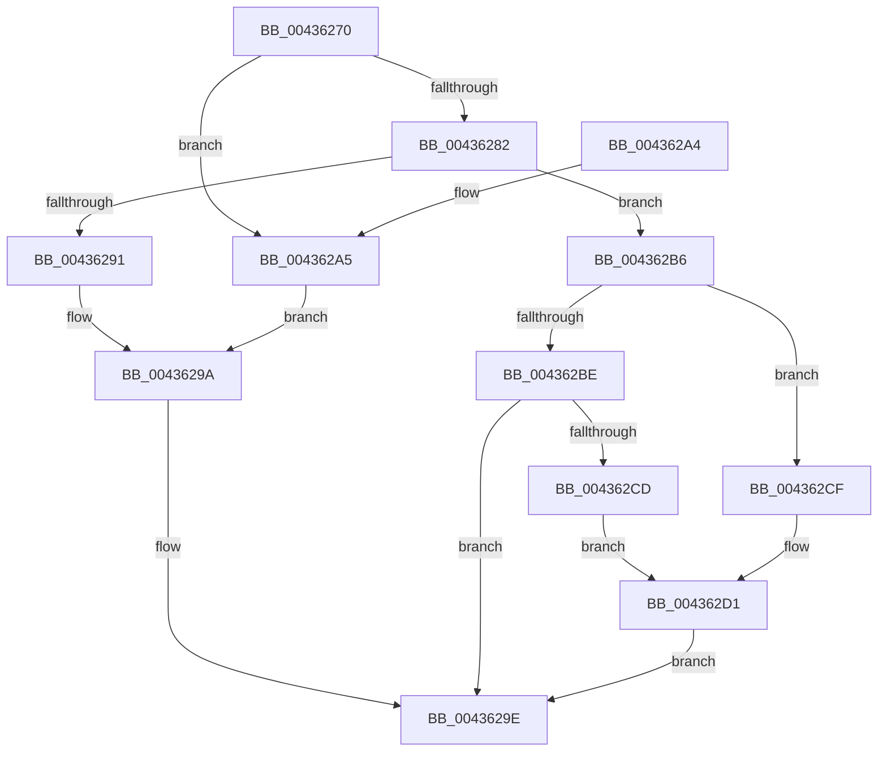

# RtlGetNtProductType

- RVA: `0x00436270`–`0x004362D9` (길이 `105` bytes)
- VA: `0x0000000140436270`
- 실행 섹션: `.text`
- PDB 이름 있음: `예`; PDB Function 태그: `아니요`
- unwind 정보 RVA: `0x000A2DA8`
- 디코드: `32`개 명령, `105/105` bytes 표시
- 미해석 바이트: `0` (있으면 어셈블리에 `.byte`로 보존)

> 이 문서는 커널 이미지의 기계어와 PDB 기호를 분석해 생성했습니다. 4번과 5번은 함수 원형과 자료형을 바이너리 사용 방식에서 추정한 C 해석이며 원본 소스 복구 결과는 아닙니다.

## 1. Dependencies

- 직접 호출 지점: **3**; 고유 호출 대상: **3**
- 직접 호출자로 확인된 함수: **7**
- RIP 상대 이미지 참조: **0**

### Outgoing calls
- `0x00436279` → [PsIsCurrentThreadInServerSilo](PsIsCurrentThreadInServerSilo_function_004362E0.md) (function, `0x004362E0`)
- `0x004362A5` → [PsGetCurrentServerSiloGlobals](../2F/PsGetCurrentServerSiloGlobals_function_002FE1F0.md) (function, `0x002FE1F0`)
- `0x004362C1` → [RtlpGetNtProductTypeFromRegistry](../../page/AA/RtlpGetNtProductTypeFromRegistry_function_00AA26D8.md) (function, `0x00AA26D8`)

### Direct callers
- [KeCapturePersistentThreadState](KeCapturePersistentThreadState_function_00435D90.md) at `0x00435F6D`
- [IoFillDumpHeader](../59/IoFillDumpHeader_function_00591ECC.md) at `0x00592173`
- [MmWriteTriageInformation](../67/MmWriteTriageInformation_function_0067DF6C.md) at `0x0067DFA6`
- [RtlRestoreBootStatusDefaults](../../page/79/RtlRestoreBootStatusDefaults_function_00790758.md) at `0x007907A8`
- [IopCreateDefaultDeviceSecurityDescriptor](../../page/9A/IopCreateDefaultDeviceSecurityDescriptor_function_009A5008.md) at `0x009A50EF`
- [RtlGetVersion](../../page/A1/RtlGetVersion_function_00A19110.md) at `0x00A19189`
- [IoInitSystemPreDrivers](../../init/C2/IoInitSystemPreDrivers_function_00C2AC3C.md) at `0x00C2B596`

### Static image references
- 디코드된 RIP-relative 메모리 참조가 없습니다.

## 2. Other-region calls and transfers

- 다른 실행 섹션으로 향하는 call: **1**
  - `0x004362C1` → [RtlpGetNtProductTypeFromRegistry](../../page/AA/RtlpGetNtProductTypeFromRegistry_function_00AA26D8.md) (`.text` → `PAGE`)
- 별도 외부 분기/꼬리 이동을 확인하지 못했습니다.

## 3. Assembly (complete function range)

```asm
00436270  40 53                           push rbx
00436272  48 83 EC 20                     sub rsp, 0x20
00436276  48 8B D9                        mov rbx, rcx
00436279  E8 62 00 00 00                  call 0x1404362e0
0043627E  84 C0                           test al, al
00436280  75 23                           jne 0x1404362a5
00436282  48 B8 68 02 00 00 80 F7 FF FF   movabs rax, 0xfffff78000000268
0043628C  80 38 00                        cmp byte ptr [rax], 0
0043628F  74 25                           je 0x1404362b6
00436291  A1 64 02 00 00 80 F7 FF FF      movabs eax, dword ptr [0xfffff78000000264]
0043629A  89 03                           mov dword ptr [rbx], eax
0043629C  B0 01                           mov al, 1
0043629E  48 83 C4 20                     add rsp, 0x20
004362A2  5B                              pop rbx
004362A3  C3                              ret
004362A4  CC                              int3
004362A5  E8 46 7F EC FF                  call 0x1402fe1f0
004362AA  48 8B 88 08 05 00 00            mov rcx, qword ptr [rax + 0x508]
004362B1  8B 41 10                        mov eax, dword ptr [rcx + 0x10]
004362B4  EB E4                           jmp 0x14043629a
004362B6  44 0F 20 C0                     mov rax, cr8
004362BA  3C 01                           cmp al, 1
004362BC  77 11                           ja 0x1404362cf
004362BE  48 8B CB                        mov rcx, rbx
004362C1  E8 12 C4 66 00                  call 0x140aa26d8
004362C6  C1 E8 1F                        shr eax, 0x1f
004362C9  34 01                           xor al, 1
004362CB  75 D1                           jne 0x14043629e
004362CD  EB 02                           jmp 0x1404362d1
004362CF  32 C0                           xor al, al
004362D1  C7 03 01 00 00 00               mov dword ptr [rbx], 1
004362D7  EB C5                           jmp 0x14043629e
```

## 4. C-style interpretation (structured pseudocode)

```c
__int64 __fastcall RtlGetNtProductType(__int64 a1)
{
    __int64 result;
    __int64 v_rsp;

    v_rsp = (v_rsp) - (32);
    result = PsIsCurrentThreadInServerSilo(a1, a2, a3, a4);
    if ((unsigned __int8)(result) != 0) goto loc_004362A5;
    if ((*(unsigned __int8 *)(result)) == 0) goto loc_004362B6;
loc_0043629A:
    *(unsigned int *)(a1) = (unsigned int)(result);
loc_0043629E:
    v_rsp = (v_rsp) + (32);
    return 1;
loc_004362A5:
    result = PsGetCurrentServerSiloGlobals(a1, a2, a3, a4);
    goto loc_0043629A;
loc_004362B6:
    if (((unsigned __int8)(v_cr8)) > 1) goto loc_004362CF;
    result = RtlpGetNtProductTypeFromRegistry(a1, a2, a3, a4);
    result = (unsigned int)((result) >> (31));
    result = (unsigned __int8)((result) ^ (1));
    if (condition_is_not_equal) goto loc_0043629E;
    goto loc_004362D1;
loc_004362CF:
    result = 0;
loc_004362D1:
    *(unsigned int *)(a1) = 1;
    goto loc_0043629E;
}
```

## 5. (Beta) C Style

```c
int64_t RtlGetNtProductType(void *Arg1)
{
    uint8_t *arg1 = (uint8_t *)Arg1;

    int64_t result;
    int64_t local_rsp;

    local_rsp = (local_rsp) - (32);
    result = PsIsCurrentThreadInServerSilo(Arg1, a2, a3, a4);
    if ((uint8_t)(result) != 0) goto loc_004362A5;
    if ((*(uint8_t *)(result)) == 0) goto loc_004362B6;
loc_0043629A:
    *(uint32_t *)(arg1) = (uint32_t)(result);
loc_0043629E:
    local_rsp = (local_rsp) + (32);
    return 1;
loc_004362A5:
    result = PsGetCurrentServerSiloGlobals(Arg1, a2, a3, a4);
    goto loc_0043629A;
loc_004362B6:
    if (((uint8_t)(v_cr8)) > 1) goto loc_004362CF;
    result = RtlpGetNtProductTypeFromRegistry(Arg1, a2, a3, a4);
    result = (uint32_t)((result) >> (31));
    result = (uint8_t)((result) ^ (1));
    if (condition_is_not_equal) goto loc_0043629E;
    goto loc_004362D1;
loc_004362CF:
    result = 0;
loc_004362D1:
    *(uint32_t *)(arg1) = 1;
    goto loc_0043629E;
}
```

### 관측된 메모리 오프셋

구조체 형식이 확인되지 않은 접근은 인자 기준의 오프셋으로만 기록했습니다.

| 기준 인자 | 오프셋 표현 | 폭 (bit) | 접근 |
|---|---:|---:|---|
| `Arg1` | `+ 0x0` | `32` | `W` |

## 6. Execution-region graph

[열기: 2D/3D 그래프와 함수 탐색 컨트롤 패널](../../../control-panel.html?section=text&rva=0x00436270&view=graph)

- 2D 그래프는 위에서 아래로 흐르고, 3D 그래프는 빈 공간을 드래그해 회전합니다. Shift+드래그는 이동, 휠은 확대·축소, 함수 노드 선택은 대상 보고서 이동입니다.

### Static fallback


