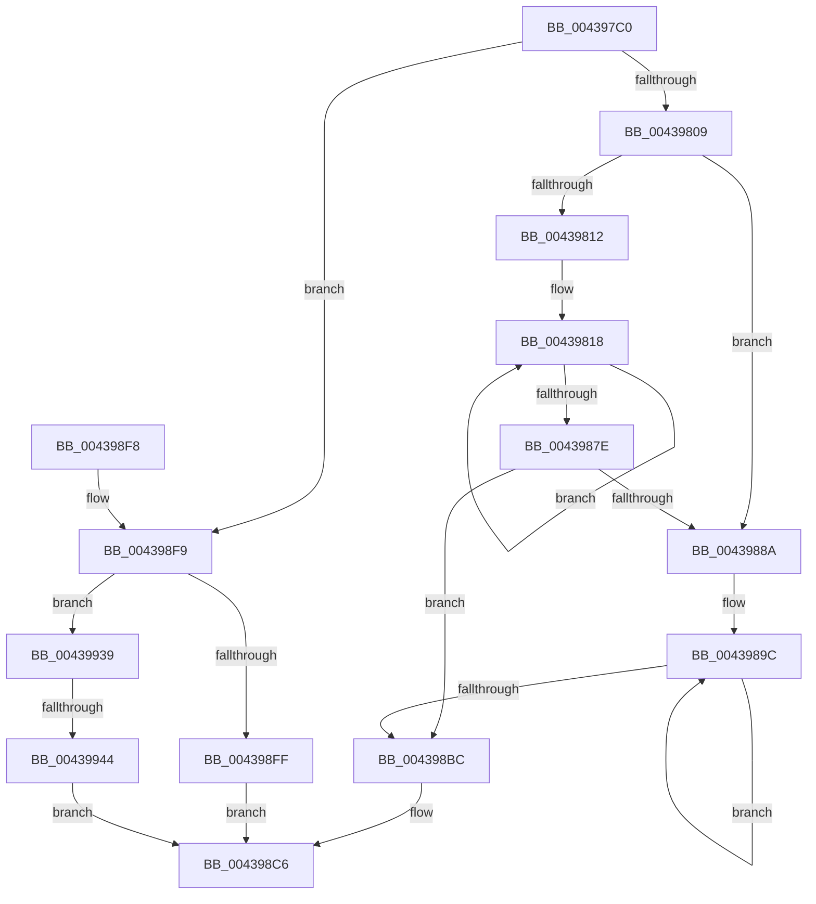

# RtlHashBytes2

- RVA: `0x004397C0`–`0x0043996C` (길이 `428` bytes)
- VA: `0x00000001404397C0`
- 실행 섹션: `.text`
- PDB 이름 있음: `예`; PDB Function 태그: `예`
- unwind 정보 RVA: `0x000A419C`
- 디코드: `117`개 명령, `428/428` bytes 표시
- 미해석 바이트: `0` (있으면 어셈블리에 `.byte`로 보존)

> 이 문서는 커널 이미지의 기계어와 PDB 기호를 분석해 생성했습니다. 4번과 5번은 함수 원형과 자료형을 바이너리 사용 방식에서 추정한 C 해석이며 원본 소스 복구 결과는 아닙니다.

## 1. Dependencies

- 직접 호출 지점: **0**; 고유 호출 대상: **0**
- 직접 호출자로 확인된 함수: **2**
- RIP 상대 이미지 참조: **0**

### Outgoing calls
- 직접 디코드된 call 명령이 없습니다.

### Direct callers
- [MiFindUserSidHotPatchContext](../../page/80/MiFindUserSidHotPatchContext_function_0080360C.md) at `0x00803630`
- [MiLoadHotPatchForUserSid](../../page/AB/MiLoadHotPatchForUserSid_function_00AB4F08.md) at `0x00AB4FE9`

### Static image references
- 디코드된 RIP-relative 메모리 참조가 없습니다.

## 2. Other-region calls and transfers

- 다른 실행 섹션으로 향하는 call: **0**
- call이 아닌 외부 분기/꼬리 이동: **1**
  - `0x0043993E` → [sub_006EF4FE](../6E/Unknown_function_006EF4FE.md) (`tail-transfer`)

## 3. Assembly (complete function range)

```asm
004397C0  48 89 5C 24 10                  mov qword ptr [rsp + 0x10], rbx
004397C5  48 89 6C 24 18                  mov qword ptr [rsp + 0x18], rbp
004397CA  48 89 74 24 20                  mov qword ptr [rsp + 0x20], rsi
004397CF  57                              push rdi
004397D0  4C 8B DA                        mov r11, rdx
004397D3  48 BE C9 AC 2E 96 93 4B B8 8B   movabs rsi, 0x8bb84b93962eacc9
004397DD  48 BD A5 78 6C AA CC 8D 35 2D   movabs rbp, 0x2d358dccaa6c78a5
004397E7  4D 8B C8                        mov r9, r8
004397EA  4C 33 CD                        xor r9, rbp
004397ED  48 8B C6                        mov rax, rsi
004397F0  49 F7 E1                        mul r9
004397F3  4C 8B D1                        mov r10, rcx
004397F6  4C 8B C8                        mov r9, rax
004397F9  4C 33 CA                        xor r9, rdx
004397FC  4D 33 C8                        xor r9, r8
004397FF  49 83 FB 10                     cmp r11, 0x10
00439803  0F 86 F0 00 00 00               jbe 0x1404398f9
00439809  49 8B DB                        mov rbx, r11
0043980C  49 83 FB 30                     cmp r11, 0x30
00439810  72 78                           jb 0x14043988a
00439812  49 8B F9                        mov rdi, r9
00439815  4D 8B C1                        mov r8, r9
00439818  4D 33 4A 08                     xor r9, qword ptr [r10 + 8]
0043981C  48 83 EB 30                     sub rbx, 0x30
00439820  49 33 7A 18                     xor rdi, qword ptr [r10 + 0x18]
00439824  49 8B C1                        mov rax, r9
00439827  4D 33 42 28                     xor r8, qword ptr [r10 + 0x28]
0043982B  49 8B 0A                        mov rcx, qword ptr [r10]
0043982E  48 33 CE                        xor rcx, rsi
00439831  48 F7 E1                        mul rcx
00439834  49 8B 4A 10                     mov rcx, qword ptr [r10 + 0x10]
00439838  4C 8B C8                        mov r9, rax
0043983B  48 B8 A3 D4 33 D4 2E A6 33 4B   movabs rax, 0x4b33a62ed433d4a3
00439845  48 33 C8                        xor rcx, rax
00439848  4C 33 CA                        xor r9, rdx
0043984B  48 8B C7                        mov rax, rdi
0043984E  48 F7 E1                        mul rcx
00439851  49 8B 4A 20                     mov rcx, qword ptr [r10 + 0x20]
00439855  49 83 C2 30                     add r10, 0x30
00439859  48 8B F8                        mov rdi, rax
0043985C  48 B8 47 AA E1 1D A5 2D 5A 4D   movabs rax, 0x4d5a2da51de1aa47
00439866  48 33 C8                        xor rcx, rax
00439869  48 33 FA                        xor rdi, rdx
0043986C  49 8B C0                        mov rax, r8
0043986F  48 F7 E1                        mul rcx
00439872  4C 8B C0                        mov r8, rax
00439875  4C 33 C2                        xor r8, rdx
00439878  48 83 FB 30                     cmp rbx, 0x30
0043987C  73 9A                           jae 0x140439818
0043987E  4C 33 C7                        xor r8, rdi
00439881  4D 33 C8                        xor r9, r8
00439884  48 83 FB 10                     cmp rbx, 0x10
00439888  76 32                           jbe 0x1404398bc
0043988A  4C 8D 43 EF                     lea r8, [rbx - 0x11]
0043988E  49 C1 E8 04                     shr r8, 4
00439892  49 FF C0                        inc r8
00439895  49 6B C0 F0                     imul rax, r8, -0x10
00439899  48 03 D8                        add rbx, rax
0043989C  4D 33 4A 08                     xor r9, qword ptr [r10 + 8]
004398A0  49 8B 0A                        mov rcx, qword ptr [r10]
004398A3  49 8B C1                        mov rax, r9
004398A6  48 33 CE                        xor rcx, rsi
004398A9  49 83 C2 10                     add r10, 0x10
004398AD  48 F7 E1                        mul rcx
004398B0  4C 8B C8                        mov r9, rax
004398B3  4C 33 CA                        xor r9, rdx
004398B6  49 83 E8 01                     sub r8, 1
004398BA  75 E0                           jne 0x14043989c
004398BC  4A 8B 54 13 F0                  mov rdx, qword ptr [rbx + r10 - 0x10]
004398C1  4A 8B 4C 13 F8                  mov rcx, qword ptr [rbx + r10 - 8]
004398C6  48 8B 5C 24 18                  mov rbx, qword ptr [rsp + 0x18]
004398CB  49 33 C9                        xor rcx, r9
004398CE  48 33 D6                        xor rdx, rsi
004398D1  48 8B C1                        mov rax, rcx
004398D4  48 F7 E2                        mul rdx
004398D7  48 8B C8                        mov rcx, rax
004398DA  48 33 D6                        xor rdx, rsi
004398DD  48 8B 74 24 28                  mov rsi, qword ptr [rsp + 0x28]
004398E2  49 33 CB                        xor rcx, r11
004398E5  48 33 CD                        xor rcx, rbp
004398E8  48 8B C2                        mov rax, rdx
004398EB  48 8B 6C 24 20                  mov rbp, qword ptr [rsp + 0x20]
004398F0  48 F7 E1                        mul rcx
004398F3  48 33 C2                        xor rax, rdx
004398F6  5F                              pop rdi
004398F7  C3                              ret
004398F8  CC                              int3
004398F9  49 83 FB 04                     cmp r11, 4
004398FD  72 3A                           jb 0x140439939
004398FF  48 B8 FC FF FF FF FF FF FF 7F   movabs rax, 0x7ffffffffffffffc
00439909  49 8B CB                        mov rcx, r11
0043990C  48 D1 E9                        shr rcx, 1
0043990F  48 23 C8                        and rcx, rax
00439912  41 8B 02                        mov eax, dword ptr [r10]
00439915  48 C1 E0 20                     shl rax, 0x20
00439919  42 8B 14 11                     mov edx, dword ptr [rcx + r10]
0043991D  48 0B D0                        or rdx, rax
00439920  49 8B C2                        mov rax, r10
00439923  48 2B C1                        sub rax, rcx
00439926  42 8B 4C 18 FC                  mov ecx, dword ptr [rax + r11 - 4]
0043992B  43 8B 44 1A FC                  mov eax, dword ptr [r10 + r11 - 4]
00439930  48 C1 E0 20                     shl rax, 0x20
00439934  48 0B C8                        or rcx, rax
00439937  EB 8D                           jmp 0x1404398c6
00439939  33 C9                           xor ecx, ecx
0043993B  4D 85 DB                        test r11, r11
0043993E  0F 84 BA 5B 2B 00               je 0x1406ef4fe
00439944  49 8B C3                        mov rax, r11
00439947  48 D1 E8                        shr rax, 1
0043994A  42 0F B6 14 10                  movzx edx, byte ptr [rax + r10]
0043994F  41 0F B6 02                     movzx eax, byte ptr [r10]
00439953  48 C1 E0 08                     shl rax, 8
00439957  48 0B D0                        or rdx, rax
0043995A  43 0F B6 44 1A FF               movzx eax, byte ptr [r10 + r11 - 1]
00439960  48 C1 E2 08                     shl rdx, 8
00439964  48 0B D0                        or rdx, rax
00439967  E9 5A FF FF FF                  jmp 0x1404398c6
```

## 4. C-style interpretation (structured pseudocode)

```c
__int64 __fastcall RtlHashBytes2(__int64 a1, __int64 a2, __int64 a3)
{
    __int64 result;
    __int64 v_r10;
    __int64 v_rbx;
    __int64 v_rdi;
    unsigned __int64 v_stack_p10;
    unsigned __int64 v_stack_p18;
    unsigned __int64 v_stack_p20;

    v_stack_p10 = v_rbx;
    v_stack_p18 = v_rbp;
    v_stack_p20 = v_rsi;
    a4 = (a3) ^ (v_rbp);
    a4 = (v_rsi) ^ (a2);
    a4 = (a4) ^ (a3);
    if (a2 <= 16) goto loc_004398F9;
    if (a2 < 48) goto loc_0043988A;
loc_00439818:
    a4 = (a4) ^ (*(unsigned __int64 *)(a1 + 8));
    v_rbx = (a2) - (48);
    v_rdi = (a4) ^ (*(unsigned __int64 *)(a1 + 24));
    a3 = (a4) ^ (*(unsigned __int64 *)(a1 + 40));
    a1 = (*(unsigned __int64 *)(a1)) ^ (v_rsi);
    a1 = (*(unsigned __int64 *)(a1 + 16)) ^ (a4);
    a4 = (a4) ^ (a2);
    v_r10 = (a1) + (48);
    a1 = (*(unsigned __int64 *)(a1 + 32)) ^ (v_rdi);
    v_rdi = (v_rdi) ^ (a2);
    a3 = (a3) ^ (a2);
    if (v_rbx >= 48) goto loc_00439818;
    a3 = (a3) ^ (v_rdi);
    a4 = (a4) ^ (a3);
    if (v_rbx <= 16) goto loc_004398BC;
loc_0043988A:
    a3 = (v_rbx - 17) >> (4);
    a3 = (a3) + 1;
    result = (a3) * (a3);
    v_rbx = (v_rbx) + (result);
loc_0043989C:
    a4 = (a4) ^ (*(unsigned __int64 *)(v_r10 + 8));
    a1 = (*(unsigned __int64 *)(v_r10)) ^ (v_rsi);
    v_r10 = (v_r10) + (16);
    a4 = (a4) ^ (a2);
    a3 = (a3) - (1);
    if (condition_is_not_equal) goto loc_0043989C;
loc_004398BC:
loc_004398C6:
    a1 = (*(unsigned __int64 *)(v_rbx + v_r10 * 1 - 8)) ^ (a4);
    a2 = (*(unsigned __int64 *)(v_rbx + v_r10 * 1 - 16)) ^ (v_rsi);
    a2 = (a2) ^ (v_rsi);
    a1 = (a1) ^ (a2);
    a1 = (a1) ^ (v_rbp);
    result = (a2) ^ (a2);
    return result;
loc_004398F9:
    if (a2 < 4) goto loc_00439939;
    a1 = (a2) >> (1);
    a1 = (a1) & (result);
    result = ((unsigned int)(*(unsigned int *)(v_r10))) << (32);
    a2 = ((unsigned int)(*(unsigned int *)(a1 + v_r10 * 1))) | (result);
    result = (v_r10) - (a1);
    result = ((unsigned int)(*(unsigned int *)(v_r10 + a2 * 1 - 4))) << (32);
    a1 = ((unsigned int)(*(unsigned int *)(result + a2 * 1 - 4))) | (result);
    goto loc_004398C6;
loc_00439939:
    a1 = 0;
    result = (a2) >> (1);
    result = (*(unsigned __int8 *)(v_r10)) << (8);
    a2 = (*(unsigned __int8 *)(result + v_r10 * 1)) | (result);
    a2 = (a2) << (8);
    a2 = (a2) | (*(unsigned __int8 *)(v_r10 + a2 * 1 - 1));
    goto loc_004398C6;
}
```

## 5. (Beta) C Style

```c
int64_t RtlHashBytes2(void *Arg1, int64_t Arg2, int64_t Arg3)
{
    uint8_t *arg1 = (uint8_t *)Arg1;

    int64_t result;
    int64_t local_r10;
    int64_t local_rbx;
    int64_t local_rdi;
    uint64_t v_stack_p10;
    uint64_t v_stack_p18;
    uint64_t v_stack_p20;

    v_stack_p10 = local_rbx;
    v_stack_p18 = local_rbp;
    v_stack_p20 = local_rsi;
    a4 = (Arg3) ^ (local_rbp);
    a4 = (local_rsi) ^ (Arg2);
    a4 = (a4) ^ (Arg3);
    if (Arg2 <= 16) goto loc_004398F9;
    if (Arg2 < 48) goto loc_0043988A;
loc_00439818:
    a4 = (a4) ^ (*(uint64_t *)(arg1 + 0x8));
    local_rbx = (Arg2) - (48);
    local_rdi = (a4) ^ (*(uint64_t *)(arg1 + 0x18));
    Arg3 = (a4) ^ (*(uint64_t *)(arg1 + 0x28));
    Arg1 = (*(uint64_t *)(arg1)) ^ (local_rsi);
    Arg1 = (*(uint64_t *)(arg1 + 0x10)) ^ (a4);
    a4 = (a4) ^ (Arg2);
    local_r10 = (Arg1) + (48);
    Arg1 = (*(uint64_t *)(arg1 + 0x20)) ^ (local_rdi);
    local_rdi = (local_rdi) ^ (Arg2);
    Arg3 = (Arg3) ^ (Arg2);
    if (local_rbx >= 48) goto loc_00439818;
    Arg3 = (Arg3) ^ (local_rdi);
    a4 = (a4) ^ (Arg3);
    if (local_rbx <= 16) goto loc_004398BC;
loc_0043988A:
    Arg3 = (local_rbx - 17) >> (4);
    Arg3 = (Arg3) + 1;
    result = (Arg3) * (Arg3);
    local_rbx = (local_rbx) + (result);
loc_0043989C:
    a4 = (a4) ^ (*(uint64_t *)(local_r10 + 0x8));
    Arg1 = (*(uint64_t *)(local_r10)) ^ (local_rsi);
    local_r10 = (local_r10) + (16);
    a4 = (a4) ^ (Arg2);
    Arg3 = (Arg3) - (1);
    if (condition_is_not_equal) goto loc_0043989C;
loc_004398BC:
loc_004398C6:
    Arg1 = (*(uint64_t *)(local_rbx + local_r10 * 1 - 0x8)) ^ (a4);
    Arg2 = (*(uint64_t *)(local_rbx + local_r10 * 1 - 0x10)) ^ (local_rsi);
    Arg2 = (Arg2) ^ (local_rsi);
    Arg1 = (Arg1) ^ (Arg2);
    Arg1 = (Arg1) ^ (local_rbp);
    result = (Arg2) ^ (Arg2);
    return result;
loc_004398F9:
    if (Arg2 < 4) goto loc_00439939;
    Arg1 = (Arg2) >> (1);
    Arg1 = (Arg1) & (result);
    result = ((uint32_t)(*(uint32_t *)(local_r10))) << (32);
    Arg2 = ((uint32_t)(*(uint32_t *)(arg1 + local_r10 * 1))) | (result);
    result = (local_r10) - (Arg1);
    result = ((uint32_t)(*(uint32_t *)(local_r10 + Arg2 * 1 - 0x4))) << (32);
    Arg1 = ((uint32_t)(*(uint32_t *)(result + Arg2 * 1 - 0x4))) | (result);
    goto loc_004398C6;
loc_00439939:
    Arg1 = 0;
    result = (Arg2) >> (1);
    result = (*(uint8_t *)(local_r10)) << (8);
    Arg2 = (*(uint8_t *)(result + local_r10 * 1)) | (result);
    Arg2 = (Arg2) << (8);
    Arg2 = (Arg2) | (*(uint8_t *)(local_r10 + Arg2 * 1 - 0x1));
    goto loc_004398C6;
}
```

### 관측된 메모리 오프셋

구조체 형식이 확인되지 않은 접근은 인자 기준의 오프셋으로만 기록했습니다.

| 기준 인자 | 오프셋 표현 | 폭 (bit) | 접근 |
|---|---:|---:|---|
| `Arg1` | `- 0x4 + r11*1` | `32` | `R` |
| `Arg1` | `- 0x1 + r11*1` | `8` | `R` |
| `Arg1` | `+ 0x0` | `8` | `R` |
| `Arg1` | `+ 0x0` | `32` | `R` |
| `Arg1` | `+ 0x0` | `64` | `R` |
| `Arg1` | `+ 0x8` | `64` | `R` |
| `Arg1` | `+ 0x10` | `64` | `R` |
| `Arg1` | `+ 0x18` | `64` | `R` |
| `Arg1` | `+ 0x20` | `64` | `R` |
| `Arg1` | `+ 0x28` | `64` | `R` |

## 6. Execution-region graph

[열기: 2D/3D 그래프와 함수 탐색 컨트롤 패널](../../../control-panel.html?section=text&rva=0x004397C0&view=graph)

- 2D 그래프는 위에서 아래로 흐르고, 3D 그래프는 빈 공간을 드래그해 회전합니다. Shift+드래그는 이동, 휠은 확대·축소, 함수 노드 선택은 대상 보고서 이동입니다.

### Static fallback


