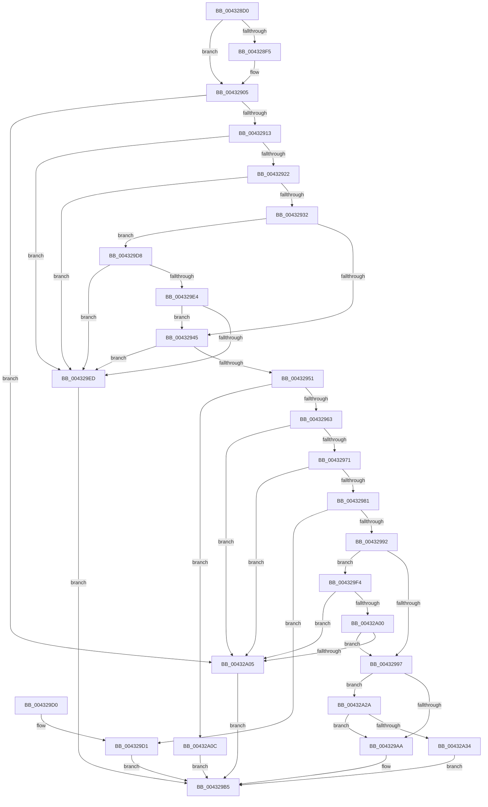

# RtlImageDirectoryEntryToData

- RVA: `0x004328D0`–`0x00432A54` (길이 `388` bytes)
- VA: `0x00000001404328D0`
- 실행 섹션: `.text`
- PDB 이름 있음: `예`; PDB Function 태그: `아니요`
- unwind 정보 RVA: `0x000A231C`
- 디코드: `99`개 명령, `388/388` bytes 표시
- 미해석 바이트: `0` (있으면 어셈블리에 `.byte`로 보존)

> 이 문서는 커널 이미지의 기계어와 PDB 기호를 분석해 생성했습니다. 4번과 5번은 함수 원형과 자료형을 바이너리 사용 방식에서 추정한 C 해석이며 원본 소스 복구 결과는 아닙니다.

## 1. Dependencies

- 직접 호출 지점: **2**; 고유 호출 대상: **2**
- 직접 호출자로 확인된 함수: **43**
- RIP 상대 이미지 참조: **0**

### Outgoing calls
- `0x00432A21` → [RtlpImageDirectoryEntryToData32](RtlpImageDirectoryEntryToData32_function_00432BE4.md) (function, `0x00432BE4`)
- `0x00432A37` → [RtlAddressInSectionTable](RtlAddressInSectionTable_function_00432C90.md) (function, `0x00432C90`)

### Direct callers
- [RtlpLookupUserFunctionTable](../2F/RtlpLookupUserFunctionTable_function_002F3CD0.md) at `0x002F3D74`
- [RtlInsertInvertedFunctionTable](RtlInsertInvertedFunctionTable_function_00432138.md) at `0x00432160`
- [RtlCaptureImageExceptionValues](RtlCaptureImageExceptionValues_function_00432890.md) at `0x004328AB`
- [LdrImageDirectoryEntryToLoadConfigEx](../4F/LdrImageDirectoryEntryToLoadConfigEx_function_004F087C.md) at `0x004F08FE`
- [KiIsPgiKernel](../5B/KiIsPgiKernel_function_005BF348.md) at `0x005BF36A`
- [RtlpGetKernelScpFunctionTable](../5E/RtlpGetKernelScpFunctionTable_function_005EF210.md) at `0x005EF23D`
- [MmProtectDriverSection](../67/MmProtectDriverSection_function_00670A80.md) at `0x00670C0D`
- [MiReplaceImportEntry](../67/MiReplaceImportEntry_function_00671440.md) at `0x00671476`
- [MiLockPatchIatForDV](../68/MiLockPatchIatForDV_function_00682050.md) at `0x00682089`
- [MiReapplyImportOptimizationForDriverVerifier](../68/MiReapplyImportOptimizationForDriverVerifier_function_00682268.md) at `0x00682338`
- [MiReplacePatchImportEntry](../68/MiReplacePatchImportEntry_function_00683D80.md) at `0x00683DA9`
- [KsepPatchDriverImportsTable](../../page/74/KsepPatchDriverImportsTable_function_00749F64.md) at `0x00749FAC`
- [LdrEnumResources](../../page/78/LdrEnumResources_function_0078BA00.md) at `0x0078BA58`
- [MmReplaceImportEntriesForVerifier](../../page/7F/MmReplaceImportEntriesForVerifier_function_007FE040.md) at `0x007FE072`
- [RtlFindHotPatchInformation](../../page/84/RtlFindHotPatchInformation_function_00840F24.md) at `0x00840F7E`
- [EtwpFindDebugId](../../page/8D/EtwpFindDebugId_function_008D9D58.md) at `0x008D9DAD`
- [RtlFindExportedRoutineByName](../../page/90/RtlFindExportedRoutineByName_function_0090F0A0.md) at `0x0090F0C5`
- [MiCaptureRetpolineRelocationTables](../../page/94/MiCaptureRetpolineRelocationTables_function_00942E14.md) at `0x00942E5F`
- [MiInitializeWowPeb](../../page/98/MiInitializeWowPeb_function_0098079C.md) at `0x00980B45`
- [MmCreatePeb](../../page/98/MmCreatePeb_function_00980FB4.md) at `0x009812C0`
- [LdrpSearchResourceSection_U](../../page/99/LdrpSearchResourceSection_U_function_0099B2DC.md) at `0x0099BA6B`
- [LdrpAccessResourceData](../../page/99/LdrpAccessResourceData_function_0099BE1C.md) at `0x0099BE6A`
- [LdrpAccessResourceDataNoMultipleLanguage](../../page/99/LdrpAccessResourceDataNoMultipleLanguage_function_0099BF00.md) at `0x0099BF3D`
- [MiResolveImageReferences](../../page/A2/MiResolveImageReferences_function_00A23BE4.md) at `0x00A23C73`
- [MiSnapThunk](../../page/A2/MiSnapThunk_function_00A24004.md) at `0x00A24050`
- [MiSnapUnresolvedImport](../../page/A2/MiSnapUnresolvedImport_function_00A24438.md) at `0x00A24458`
- [MiMarkKernelImageCfgBits](../../page/A4/MiMarkKernelImageCfgBits_function_00A4B1E0.md) at `0x00A4B24D`
- [MiProcessKernelCfgImageLoadConfig](../../page/A7/MiProcessKernelCfgImageLoadConfig_function_00A7FE40.md) at `0x00A7FE97`
- [MiMarkKernelCfgAddressTakenImports](../../page/AA/MiMarkKernelCfgAddressTakenImports_function_00AA262C.md) at `0x00AA2657`
- [MiSetImportTableProtection](../../page/AC/MiSetImportTableProtection_function_00AC2D2C.md) at `0x00AC2D6B`
- [MiSetImportTableProtection](../../page/AC/MiSetImportTableProtection_function_00AC2D2C.md) at `0x00AC2DED`
- [MiCacheImageSymbols](../../page/AD/MiCacheImageSymbols_function_00AD9410.md) at `0x00AD9457`
- [NtSetSystemInformation](../../page/AF/NtSetSystemInformation_function_00AF4A60.md) at `0x00AF53E8`
- [sub_00B49200](../../page/B4/Unknown_function_00B49200.md) at `0x00B4922D`
- [ViXdvDriverLoadImage](../../pagevrfy/B9/ViXdvDriverLoadImage_function_00B9A9A0.md) at `0x00B9A9C8`
- [VfThunkApplyDriverAddedThunks](../../pagevrfy/BA/VfThunkApplyDriverAddedThunks_function_00BA7008.md) at `0x00BA7085`
- [VfThunkApplyThunksCurrentSession](../../pagevrfy/BA/VfThunkApplyThunksCurrentSession_function_00BA719C.md) at `0x00BA71E8`
- [ViThunkApplyPristineCurrentSession](../../pagevrfy/BA/ViThunkApplyPristineCurrentSession_function_00BA72E4.md) at `0x00BA7315`
- [ViThunkFindAllThunkedImports](../../pagevrfy/BA/ViThunkFindAllThunkedImports_function_00BA7678.md) at `0x00BA76AA`
- [ViThunkSnapSharedExportByName](../../pagevrfy/BB/ViThunkSnapSharedExportByName_function_00BB65BC.md) at `0x00BB65FA`
- [ViThunkSnapSharedExportByName](../../pagevrfy/BB/ViThunkSnapSharedExportByName_function_00BB65BC.md) at `0x00BB6610`
- [sub_00BF16D0](../../init/BF/Unknown_function_00BF16D0.md) at `0x00BF1901`
- [sub_00BF16D0](../../init/BF/Unknown_function_00BF16D0.md) at `0x00BF45A1`
- [ViThunkFindExportAddress](../../init/C4/ViThunkFindExportAddress_function_00C4C6A0.md) at `0x00C4C6F7`
- [MiApplyDynamicRelocations](../../init/C6/MiApplyDynamicRelocations_function_00C696C0.md) at `0x00C6970E`
- [MiBuildImportsForBootDrivers](../../init/C6/MiBuildImportsForBootDrivers_function_00C6B2E8.md) at `0x00C6B391`

### Static image references
- 디코드된 RIP-relative 메모리 참조가 없습니다.

## 2. Other-region calls and transfers

- 다른 실행 섹션으로 향하는 call: **0**
- 별도 외부 분기/꼬리 이동을 확인하지 못했습니다.

## 3. Assembly (complete function range)

```asm
004328D0  48 89 5C 24 10                  mov qword ptr [rsp + 0x10], rbx
004328D5  48 89 74 24 18                  mov qword ptr [rsp + 0x18], rsi
004328DA  57                              push rdi
004328DB  48 83 EC 30                     sub rsp, 0x30
004328DF  33 FF                           xor edi, edi
004328E1  44 0F B6 DA                     movzx r11d, dl
004328E5  48 89 7C 24 40                  mov qword ptr [rsp + 0x40], rdi
004328EA  49 8B D9                        mov rbx, r9
004328ED  4C 8B D1                        mov r10, rcx
004328F0  F6 C1 03                        test cl, 3
004328F3  74 10                           je 0x140432905
004328F5  49 83 E2 FC                     and r10, 0xfffffffffffffffc
004328F9  F6 C1 01                        test cl, 1
004328FC  8B CF                           mov ecx, edi
004328FE  41 0F 44 CB                     cmove ecx, r11d
00432902  44 8A D9                        mov r11b, cl
00432905  49 8D 42 FF                     lea rax, [r10 - 1]
00432909  48 83 F8 FD                     cmp rax, -3
0043290D  0F 87 F2 00 00 00               ja 0x140432a05
00432913  B8 4D 5A 00 00                  mov eax, 0x5a4d
00432918  66 41 39 02                     cmp word ptr [r10], ax
0043291C  0F 85 CB 00 00 00               jne 0x1404329ed
00432922  41 8B 4A 3C                     mov ecx, dword ptr [r10 + 0x3c]
00432926  49 03 CA                        add rcx, r10
00432929  49 3B CA                        cmp rcx, r10
0043292C  0F 82 BB 00 00 00               jb 0x1404329ed
00432932  48 BE FF FF FE FF FF 7F 00 00   movabs rsi, 0x7ffffffeffff
0043293C  4C 3B D6                        cmp r10, rsi
0043293F  0F 86 93 00 00 00               jbe 0x1404329d8
00432945  81 39 50 45 00 00               cmp dword ptr [rcx], 0x4550
0043294B  0F 85 9C 00 00 00               jne 0x1404329ed
00432951  0F B7 41 18                     movzx eax, word ptr [rcx + 0x18]
00432955  BA 0B 01 00 00                  mov edx, 0x10b
0043295A  66 3B C2                        cmp ax, dx
0043295D  0F 84 A9 00 00 00               je 0x140432a0c
00432963  BA 0B 02 00 00                  mov edx, 0x20b
00432968  66 3B C2                        cmp ax, dx
0043296B  0F 85 94 00 00 00               jne 0x140432a05
00432971  41 0F B7 C0                     movzx eax, r8w
00432975  3B 81 84 00 00 00               cmp eax, dword ptr [rcx + 0x84]
0043297B  0F 83 84 00 00 00               jae 0x140432a05
00432981  45 0F B7 C8                     movzx r9d, r8w
00432985  46 8B 84 C9 88 00 00 00         mov r8d, dword ptr [rcx + r9*8 + 0x88]
0043298D  45 85 C0                        test r8d, r8d
00432990  74 3F                           je 0x1404329d1
00432992  4C 3B D6                        cmp r10, rsi
00432995  76 5D                           jbe 0x1404329f4
00432997  42 8B 84 C9 8C 00 00 00         mov eax, dword ptr [rcx + r9*8 + 0x8c]
0043299F  89 03                           mov dword ptr [rbx], eax
004329A1  45 84 DB                        test r11b, r11b
004329A4  0F 84 80 00 00 00               je 0x140432a2a
004329AA  4B 8D 04 10                     lea rax, [r8 + r10]
004329AE  8B D7                           mov edx, edi
004329B0  48 89 44 24 40                  mov qword ptr [rsp + 0x40], rax
004329B5  48 8B 44 24 40                  mov rax, qword ptr [rsp + 0x40]
004329BA  85 D2                           test edx, edx
004329BC  48 8B 5C 24 48                  mov rbx, qword ptr [rsp + 0x48]
004329C1  48 8B 74 24 50                  mov rsi, qword ptr [rsp + 0x50]
004329C6  48 0F 48 C7                     cmovs rax, rdi
004329CA  48 83 C4 30                     add rsp, 0x30
004329CE  5F                              pop rdi
004329CF  C3                              ret
004329D0  CC                              int3
004329D1  BA 02 00 00 C0                  mov edx, 0xc0000002
004329D6  EB DD                           jmp 0x1404329b5
004329D8  48 8D 81 07 01 00 00            lea rax, [rcx + 0x107]
004329DF  48 3B C1                        cmp rax, rcx
004329E2  72 09                           jb 0x1404329ed
004329E4  48 3B C6                        cmp rax, rsi
004329E7  0F 86 58 FF FF FF               jbe 0x140432945
004329ED  BA 7B 00 00 C0                  mov edx, 0xc000007b
004329F2  EB C1                           jmp 0x1404329b5
004329F4  49 8D 42 FF                     lea rax, [r10 - 1]
004329F8  49 03 C0                        add rax, r8
004329FB  48 3B C6                        cmp rax, rsi
004329FE  77 05                           ja 0x140432a05
00432A00  49 3B C2                        cmp rax, r10
00432A03  73 92                           jae 0x140432997
00432A05  BA 0D 00 00 C0                  mov edx, 0xc000000d
00432A0A  EB A9                           jmp 0x1404329b5
00432A0C  48 8D 44 24 40                  lea rax, [rsp + 0x40]
00432A11  41 8A D3                        mov dl, r11b
00432A14  48 89 44 24 28                  mov qword ptr [rsp + 0x28], rax
00432A19  48 89 4C 24 20                  mov qword ptr [rsp + 0x20], rcx
00432A1E  49 8B CA                        mov rcx, r10
00432A21  E8 BE 01 00 00                  call 0x140432be4
00432A26  8B D0                           mov edx, eax
00432A28  EB 8B                           jmp 0x1404329b5
00432A2A  44 3B 41 54                     cmp r8d, dword ptr [rcx + 0x54]
00432A2E  0F 82 76 FF FF FF               jb 0x1404329aa
00432A34  49 8B D2                        mov rdx, r10
00432A37  E8 54 02 00 00                  call 0x140432c90
00432A3C  48 89 44 24 40                  mov qword ptr [rsp + 0x40], rax
00432A41  BA 0D 00 00 C0                  mov edx, 0xc000000d
00432A46  48 F7 D8                        neg rax
00432A49  1B C9                           sbb ecx, ecx
00432A4B  F7 D1                           not ecx
00432A4D  23 D1                           and edx, ecx
00432A4F  E9 61 FF FF FF                  jmp 0x1404329b5
```

## 4. C-style interpretation (structured pseudocode)

```c
__int64 __fastcall RtlImageDirectoryEntryToData(__int64 a1, unsigned __int8 a2, unsigned __int16 a3, __int64 a4)
{
    __int64 result;
    __int64 v_r10;
    __int64 v_r11;
    __int64 v_rdi;
    __int64 v_rsp;
    unsigned __int64 v_stack_p10;
    unsigned __int64 v_stack_p18;
    unsigned __int64 v_stack_p20;
    unsigned __int64 v_stack_p28;
    unsigned __int64 v_stack_p40;
    unsigned __int64 v_stack_p8;

    v_stack_p10 = v_rbx;
    v_stack_p18 = v_rsi;
    v_rsp = (v_rsp) - (48);
    v_rdi = 0;
    v_stack_p8 = 0;
    v_r10 = a1;
    v_r11 = a2;
    if ((((unsigned __int8)(a1)) & (3)) != 0) {
        v_r10 = (a1) & (-4);
        a1 = 0;
        if ((((unsigned __int8)(a1)) & (1)) == 0) { a1 = a2; }
        v_r11 = (unsigned __int8)(a1);
    }
    if ((v_r10 - 1) > -3) goto loc_00432A05;
    if ((*(unsigned __int16 *)(v_r10)) != ((unsigned __int16)((unsigned int)(0x5A4DULL)))) goto loc_004329ED;
    a1 = ((unsigned int)(*(unsigned int *)(v_r10 + 60))) + (v_r10);
    if (a1 < v_r10) goto loc_004329ED;
    if (v_r10 <= v_rsi) goto loc_004329D8;
loc_00432945:
    if ((*(unsigned int *)(a1)) != 0x4550ULL) goto loc_004329ED;
    if (((unsigned __int16)(*(unsigned __int16 *)(a1 + 24))) == 267) goto loc_00432A0C;
    if (((unsigned __int16)(*(unsigned __int16 *)(a1 + 24))) != 523) goto loc_00432A05;
    if (a3 >= (*(unsigned int *)(a1 + 132))) goto loc_00432A05;
    if ((unsigned int)((unsigned int)(*(unsigned int *)(a1 + a3 * 8 + 136))) == 0) goto loc_004329D1;
    if (v_r10 <= v_rsi) goto loc_004329F4;
loc_00432997:
    *(unsigned int *)(a4) = (unsigned int)((unsigned int)(*(unsigned int *)(a1 + a3 * 8 + 140)));
    if ((unsigned __int8)(v_r11) == 0) goto loc_00432A2A;
loc_004329AA:
    v_stack_p8 = (unsigned int)(*(unsigned int *)(a1 + a3 * 8 + 136)) + v_r10 * 1;
loc_004329B5:
    result = v_stack_p8;
    if (sign_flag) { result = 0; }
    v_rsp = (v_rsp) + (48);
    return result;
loc_004329D1:
    goto loc_004329B5;
loc_004329D8:
    if ((a1 + 263) < a1) goto loc_004329ED;
    if ((a1 + 263) <= v_stack_p18) goto loc_00432945;
loc_004329ED:
    goto loc_004329B5;
loc_004329F4:
    result = (v_r10 - 1) + ((unsigned int)(*(unsigned int *)(a1 + a3 * 8 + 136)));
    if (result > v_stack_p18) goto loc_00432A05;
    if (result >= v_r10) goto loc_00432997;
loc_00432A05:
    goto loc_004329B5;
loc_00432A0C:
    v_stack_p28 = v_stack_p40;
    v_stack_p20 = a1;
    result = RtlpImageDirectoryEntryToData32(v_r10, (unsigned __int8)(v_r11), (unsigned int)(*(unsigned int *)(a1 + a3 * 8 + 136)), a3);
    goto loc_004329B5;
loc_00432A2A:
    if (((unsigned int)((unsigned int)(*(unsigned int *)(a1 + a3 * 8 + 136)))) < (*(unsigned int *)(v_r10 + 84))) goto loc_004329AA;
    result = RtlAddressInSectionTable(v_r10, v_r10, (unsigned int)(*(unsigned int *)(a1 + a3 * 8 + 136)), a3);
    v_stack_p40 = result;
    result = -(result);
    a1 = (unsigned int)(~(v_r10));
    a2 = (unsigned int)(((unsigned int)(0xC000000DULL)) & ((unsigned int)(a1)));
    goto loc_004329B5;
}
```

## 5. (Beta) C Style

```c
int64_t RtlImageDirectoryEntryToData(void *Arg1, uint8_t Arg2, uint16_t Arg3, void *Arg4)
{
    uint8_t *arg1 = (uint8_t *)Arg1;
    uint8_t *arg4 = (uint8_t *)Arg4;

    int64_t result;
    int64_t local_r10;
    int64_t local_r11;
    int64_t local_rdi;
    int64_t local_rsp;
    uint64_t v_stack_p10;
    uint64_t v_stack_p18;
    uint64_t v_stack_p20;
    uint64_t v_stack_p28;
    uint64_t v_stack_p40;
    uint64_t v_stack_p8;

    v_stack_p10 = local_rbx;
    v_stack_p18 = local_rsi;
    local_rsp = (local_rsp) - (48);
    local_rdi = 0;
    v_stack_p8 = 0;
    local_r10 = Arg1;
    local_r11 = Arg2;
    if ((((uint8_t)(Arg1)) & (3)) != 0) {
        local_r10 = (Arg1) & (-4);
        Arg1 = 0;
        if ((((uint8_t)(Arg1)) & (1)) == 0) { Arg1 = Arg2; }
        local_r11 = (uint8_t)(Arg1);
    }
    if ((local_r10 - 1) > -3) goto loc_00432A05;
    if ((*(uint16_t *)(local_r10)) != ((uint16_t)((uint32_t)(0x5A4DULL)))) goto loc_004329ED;
    Arg1 = ((uint32_t)(*(uint32_t *)(local_r10 + 0x3C))) + (local_r10);
    if (Arg1 < local_r10) goto loc_004329ED;
    if (local_r10 <= local_rsi) goto loc_004329D8;
loc_00432945:
    if ((*(uint32_t *)(arg1)) != 0x4550ULL) goto loc_004329ED;
    if (((uint16_t)(*(uint16_t *)(arg1 + 0x18))) == 267) goto loc_00432A0C;
    if (((uint16_t)(*(uint16_t *)(arg1 + 0x18))) != 523) goto loc_00432A05;
    if (Arg3 >= (*(uint32_t *)(arg1 + 0x84))) goto loc_00432A05;
    if ((uint32_t)((uint32_t)(*(uint32_t *)(arg1 + Arg3 * 8 + 0x88))) == 0) goto loc_004329D1;
    if (local_r10 <= local_rsi) goto loc_004329F4;
loc_00432997:
    *(uint32_t *)(arg4) = (uint32_t)((uint32_t)(*(uint32_t *)(arg1 + Arg3 * 8 + 0x8C)));
    if ((uint8_t)(local_r11) == 0) goto loc_00432A2A;
loc_004329AA:
    v_stack_p8 = (uint32_t)(*(uint32_t *)(arg1 + Arg3 * 8 + 0x88)) + local_r10 * 1;
loc_004329B5:
    result = v_stack_p8;
    if (sign_flag) { result = 0; }
    local_rsp = (local_rsp) + (48);
    return result;
loc_004329D1:
    goto loc_004329B5;
loc_004329D8:
    if ((Arg1 + 263) < Arg1) goto loc_004329ED;
    if ((Arg1 + 263) <= v_stack_p18) goto loc_00432945;
loc_004329ED:
    goto loc_004329B5;
loc_004329F4:
    result = (local_r10 - 1) + ((uint32_t)(*(uint32_t *)(arg1 + Arg3 * 8 + 0x88)));
    if (result > v_stack_p18) goto loc_00432A05;
    if (result >= local_r10) goto loc_00432997;
loc_00432A05:
    goto loc_004329B5;
loc_00432A0C:
    v_stack_p28 = v_stack_p40;
    v_stack_p20 = Arg1;
    result = RtlpImageDirectoryEntryToData32(local_r10, (uint8_t)(local_r11), (uint32_t)(*(uint32_t *)(arg1 + Arg3 * 8 + 0x88)), Arg3);
    goto loc_004329B5;
loc_00432A2A:
    if (((uint32_t)((uint32_t)(*(uint32_t *)(arg1 + Arg3 * 8 + 0x88)))) < (*(uint32_t *)(local_r10 + 0x54))) goto loc_004329AA;
    result = RtlAddressInSectionTable(local_r10, local_r10, (uint32_t)(*(uint32_t *)(arg1 + Arg3 * 8 + 0x88)), Arg3);
    v_stack_p40 = result;
    result = -(result);
    Arg1 = (uint32_t)(~(local_r10));
    Arg2 = (uint32_t)(((uint32_t)(0xC000000DULL)) & ((uint32_t)(Arg1)));
    goto loc_004329B5;
}
```

### 관측된 메모리 오프셋

구조체 형식이 확인되지 않은 접근은 인자 기준의 오프셋으로만 기록했습니다.

| 기준 인자 | 오프셋 표현 | 폭 (bit) | 접근 |
|---|---:|---:|---|
| `Arg1` | `- 0x1` | `64` | `R` |
| `Arg1` | `+ 0x0` | `16` | `R` |
| `Arg1` | `+ 0x3C` | `32` | `R` |
| `Arg4` | `+ 0x0` | `32` | `W` |

## 6. Execution-region graph

[열기: 2D/3D 그래프와 함수 탐색 컨트롤 패널](../../../control-panel.html?section=text&rva=0x004328D0&view=graph)

- 2D 그래프는 위에서 아래로 흐르고, 3D 그래프는 빈 공간을 드래그해 회전합니다. Shift+드래그는 이동, 휠은 확대·축소, 함수 노드 선택은 대상 보고서 이동입니다.

### Static fallback


