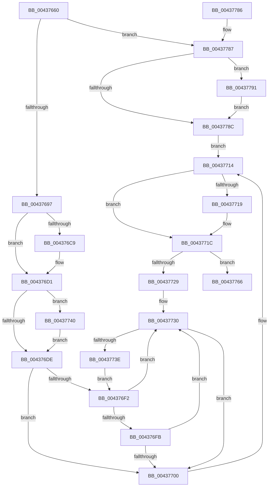

# RtlInsertEntryHashTable

- RVA: `0x00437660`–`0x0043779B` (길이 `315` bytes)
- VA: `0x0000000140437660`
- 실행 섹션: `.text`
- PDB 이름 있음: `예`; PDB Function 태그: `아니요`
- unwind 정보 RVA: `0x000A3194`
- 디코드: `94`개 명령, `315/315` bytes 표시
- 미해석 바이트: `0` (있으면 어셈블리에 `.byte`로 보존)

> 이 문서는 커널 이미지의 기계어와 PDB 기호를 분석해 생성했습니다. 4번과 5번은 함수 원형과 자료형을 바이너리 사용 방식에서 추정한 C 해석이며 원본 소스 복구 결과는 아닙니다.

## 1. Dependencies

- 직접 호출 지점: **1**; 고유 호출 대상: **1**
- 직접 호출자로 확인된 함수: **6**
- RIP 상대 이미지 참조: **0**

### Outgoing calls
- `0x00437794` → [RtlpPopulateContext](../3F/RtlpPopulateContext_function_003FCFD0.md) (function, `0x003FCFD0`)

### Direct callers
- [SepGetAntiTamperEntry](../60/SepGetAntiTamperEntry_function_0060AEE4.md) at `0x0060B086`
- [SepInsertOrReferenceSharedSidEntries](../../page/7A/SepInsertOrReferenceSharedSidEntries_function_007A32A8.md) at `0x007A33DB`
- [SepReadAndInsertCaps](../../page/7A/SepReadAndInsertCaps_function_007A3960.md) at `0x007A3C16`
- [SepGetCachedHandlesEntry](../../page/9A/SepGetCachedHandlesEntry_function_009A95C0.md) at `0x009A9668`
- [SepAddLuidToIndexEntry](../../page/A4/SepAddLuidToIndexEntry_function_00A425C0.md) at `0x00A426D2`
- [SepGetLowBoxNumberEntry](../../page/A6/SepGetLowBoxNumberEntry_function_00A65040.md) at `0x00A651B7`

### Static image references
- 디코드된 RIP-relative 메모리 참조가 없습니다.

## 2. Other-region calls and transfers

- 다른 실행 섹션으로 향하는 call: **0**
- 별도 외부 분기/꼬리 이동을 확인하지 못했습니다.

## 3. Assembly (complete function range)

```asm
00437660  48 89 5C 24 10                  mov qword ptr [rsp + 0x10], rbx
00437665  48 89 74 24 18                  mov qword ptr [rsp + 0x18], rsi
0043766A  57                              push rdi
0043766B  48 83 EC 40                     sub rsp, 0x40
0043766F  33 C0                           xor eax, eax
00437671  4C 89 42 10                     mov qword ptr [rdx + 0x10], r8
00437675  FF 41 14                        inc dword ptr [rcx + 0x14]
00437678  0F 57 C0                        xorps xmm0, xmm0
0043767B  48 89 44 24 30                  mov qword ptr [rsp + 0x30], rax
00437680  49 8B D9                        mov rbx, r9
00437683  48 8B F2                        mov rsi, rdx
00437686  48 8B F9                        mov rdi, rcx
00437689  0F 11 44 24 20                  movups xmmword ptr [rsp + 0x20], xmm0
0043768E  4D 85 C9                        test r9, r9
00437691  0F 85 F0 00 00 00               jne 0x140437787
00437697  8B 49 04                        mov ecx, dword ptr [rcx + 4]
0043769A  41 8B C0                        mov eax, r8d
0043769D  D3 E8                           shr eax, cl
0043769F  69 C8 6D 4E C6 41               imul ecx, eax, 0x41c64e6d
004376A5  69 C0 CD 0D 01 00               imul eax, eax, 0x10dcd
004376AB  81 C1 39 30 00 00               add ecx, 0x3039
004376B1  FF C0                           inc eax
004376B3  C1 E9 10                        shr ecx, 0x10
004376B6  25 00 00 FF FF                  and eax, 0xffff0000
004376BB  0B C8                           or ecx, eax
004376BD  8B 47 10                        mov eax, dword ptr [rdi + 0x10]
004376C0  8B D0                           mov edx, eax
004376C2  23 D1                           and edx, ecx
004376C4  3B 57 0C                        cmp edx, dword ptr [rdi + 0xc]
004376C7  73 08                           jae 0x1404376d1
004376C9  8D 14 00                        lea edx, [rax + rax]
004376CC  83 CA 01                        or edx, 1
004376CF  23 D1                           and edx, ecx
004376D1  81 7F 08 80 00 00 00            cmp dword ptr [rdi + 8], 0x80
004376D8  4C 8B 4F 20                     mov r9, qword ptr [rdi + 0x20]
004376DC  77 62                           ja 0x140437740
004376DE  8B C2                           mov eax, edx
004376E0  48 C1 E0 04                     shl rax, 4
004376E4  49 03 C1                        add rax, r9
004376E7  4C 8B C8                        mov r9, rax
004376EA  48 8B 10                        mov rdx, qword ptr [rax]
004376ED  48 3B D0                        cmp rdx, rax
004376F0  74 0E                           je 0x140437700
004376F2  48 8B 4A 10                     mov rcx, qword ptr [rdx + 0x10]
004376F6  48 85 C9                        test rcx, rcx
004376F9  74 35                           je 0x140437730
004376FB  49 3B C8                        cmp rcx, r8
004376FE  72 30                           jb 0x140437730
00437700  48 89 44 24 20                  mov qword ptr [rsp + 0x20], rax
00437705  48 8D 5C 24 20                  lea rbx, [rsp + 0x20]
0043770A  4C 89 4C 24 28                  mov qword ptr [rsp + 0x28], r9
0043770F  4C 89 44 24 30                  mov qword ptr [rsp + 0x30], r8
00437714  48 39 00                        cmp qword ptr [rax], rax
00437717  75 03                           jne 0x14043771c
00437719  FF 47 18                        inc dword ptr [rdi + 0x18]
0043771C  48 8B 43 08                     mov rax, qword ptr [rbx + 8]
00437720  48 8B 08                        mov rcx, qword ptr [rax]
00437723  48 39 41 08                     cmp qword ptr [rcx + 8], rax
00437727  74 3D                           je 0x140437766
00437729  B9 03 00 00 00                  mov ecx, 3
0043772E  CD 29                           int 0x29
00437730  48 8B 0A                        mov rcx, qword ptr [rdx]
00437733  4C 8B CA                        mov r9, rdx
00437736  48 8B D1                        mov rdx, rcx
00437739  48 3B C8                        cmp rcx, rax
0043773C  74 C2                           je 0x140437700
0043773E  EB B2                           jmp 0x1404376f2
00437740  8D 82 80 00 00 00               lea eax, [rdx + 0x80]
00437746  C7 44 24 50 00 00 00 00         mov dword ptr [rsp + 0x50], 0
0043774E  0F BD C8                        bsr ecx, eax
00437751  BA 01 00 00 00                  mov edx, 1
00437756  D3 E2                           shl edx, cl
00437758  33 D0                           xor edx, eax
0043775A  8D 41 F9                        lea eax, [rcx - 7]
0043775D  4D 8B 0C C1                     mov r9, qword ptr [r9 + rax*8]
00437761  E9 78 FF FF FF                  jmp 0x1404376de
00437766  48 8B 5C 24 58                  mov rbx, qword ptr [rsp + 0x58]
0043776B  48 89 46 08                     mov qword ptr [rsi + 8], rax
0043776F  48 89 0E                        mov qword ptr [rsi], rcx
00437772  48 89 71 08                     mov qword ptr [rcx + 8], rsi
00437776  48 89 30                        mov qword ptr [rax], rsi
00437779  B0 01                           mov al, 1
0043777B  48 8B 74 24 60                  mov rsi, qword ptr [rsp + 0x60]
00437780  48 83 C4 40                     add rsp, 0x40
00437784  5F                              pop rdi
00437785  C3                              ret
00437786  CC                              int3
00437787  49 39 01                        cmp qword ptr [r9], rax
0043778A  74 05                           je 0x140437791
0043778C  48 8B 03                        mov rax, qword ptr [rbx]
0043778F  EB 83                           jmp 0x140437714
00437791  48 8B D3                        mov rdx, rbx
00437794  E8 37 58 FC FF                  call 0x1403fcfd0
00437799  EB F1                           jmp 0x14043778c
```

## 4. C-style interpretation (structured pseudocode)

```c
__int64 __fastcall RtlInsertEntryHashTable(__int64 a1, __int64 a2, __int64 a3, __int64 a4)
{
    __int64 result;
    __int64 v_rsp;
    unsigned __int64 v_stack_m18;
    unsigned __int64 v_stack_m20;
    unsigned __int64 v_stack_m28;
    unsigned __int64 v_stack_p10;
    unsigned __int64 v_stack_p18;
    unsigned int v_stack_p8;

    v_stack_p10 = v_rbx;
    v_stack_p18 = v_rsi;
    v_rsp = (v_rsp) - (64);
    result = 0;
    *(unsigned __int64 *)(a2 + 16) = a3;
    v_stack_m18 = 0;
    v_stack_m28 = v_xmm0;
    if (a4 != 0) goto loc_00437787;
    result = (unsigned int)(((unsigned int)((unsigned int)(a3))) >> ((unsigned __int8)((unsigned int)(*(unsigned int *)(a1 + 4)))));
    a1 = (unsigned int)(((unsigned int)(*(unsigned int *)(a1 + 4))) * ((unsigned int)(result)));
    result = (unsigned int)((result) * ((unsigned int)(result)));
    a1 = (unsigned int)((a1) + (0x3039ULL));
    result = (unsigned int)((result) + 1);
    a1 = (unsigned int)((a1) >> (16));
    result = (unsigned int)((result) & (0xFFFF0000ULL));
    a1 = (unsigned int)((a1) | ((unsigned int)(result)));
    a2 = (unsigned int)(((unsigned int)((unsigned int)((unsigned int)(*(unsigned int *)(a1 + 16))))) & ((unsigned int)(a1)));
    if (((unsigned int)(a2)) < (*(unsigned int *)(a1 + 12))) {
        a2 = (unsigned int)(*(unsigned int *)(a1 + 16)) + (unsigned int)(*(unsigned int *)(a1 + 16)) * 1;
        a2 = (unsigned int)((a2) | (1));
        a2 = (unsigned int)((a2) & ((unsigned int)(a1)));
    }
    if ((*(unsigned int *)(a1 + 8)) > 128) goto loc_00437740;
loc_004376DE:
    result = ((unsigned int)((unsigned int)(a2))) << (4);
    result = (result) + (*(unsigned __int64 *)(a1 + 32));
    if ((*(unsigned __int64 *)(result)) == result) goto loc_00437700;
loc_004376F2:
    if (*(unsigned __int64 *)(*(unsigned __int64 *)(result) + 16) == 0) goto loc_00437730;
    if ((*(unsigned __int64 *)(*(unsigned __int64 *)(result) + 16)) < a3) goto loc_00437730;
loc_00437700:
    v_stack_m28 = result;
    v_stack_m20 = result;
    v_stack_m18 = a3;
loc_00437714:
    if ((*(unsigned __int64 *)(result)) == result) {
    }
    if ((*(unsigned __int64 *)(*(unsigned __int64 *)(*(unsigned __int64 *)(v_stack_m28 + 8)) + 8)) == (*(unsigned __int64 *)(v_stack_m28 + 8))) goto loc_00437766;
loc_00437730:
    if ((*(unsigned __int64 *)(*(unsigned __int64 *)(result))) == (*(unsigned __int64 *)(v_stack_m28 + 8))) goto loc_00437700;
    goto loc_004376F2;
loc_00437740:
    v_stack_p8 = 0;
    a2 = (unsigned int)((1) << ((unsigned __int8)(*(unsigned __int64 *)(*(unsigned __int64 *)(result)))));
    a2 = (unsigned int)((a2) ^ ((unsigned int)(*(unsigned __int64 *)(*(unsigned __int64 *)(result)) + 128)));
    goto loc_004376DE;
loc_00437766:
    *(unsigned __int64 *)(a2 + 8) = *(unsigned __int64 *)(*(unsigned __int64 *)(result)) - 7;
    *(unsigned __int64 *)(a2) = *(unsigned __int64 *)(*(unsigned __int64 *)(result));
    *(unsigned __int64 *)(*(unsigned __int64 *)(*(unsigned __int64 *)(result)) + 8) = a2;
    *(unsigned __int64 *)(*(unsigned __int64 *)(*(unsigned __int64 *)(result)) - 7) = a2;
    v_rsp = (v_rsp) + (64);
    return 1;
loc_00437787:
    if ((*(unsigned __int64 *)(*(unsigned __int64 *)(*(unsigned __int64 *)(result) + *(unsigned __int64 *)(*(unsigned __int64 *)(result)) - 7 * 8))) == 1) goto loc_00437791;
loc_0043778C:
    goto loc_00437714;
loc_00437791:
    result = RtlpPopulateContext(*(unsigned __int64 *)(*(unsigned __int64 *)(result)), v_stack_p10, a3, *(unsigned __int64 *)(*(unsigned __int64 *)(result) + *(unsigned __int64 *)(*(unsigned __int64 *)(result)) - 7 * 8));
    goto loc_0043778C;
}
```

## 5. (Beta) C Style

```c
int64_t RtlInsertEntryHashTable(void *Arg1, void *Arg2, int64_t Arg3, void *Arg4)
{
    uint8_t *arg1 = (uint8_t *)Arg1;
    uint8_t *arg2 = (uint8_t *)Arg2;
    uint8_t *arg4 = (uint8_t *)Arg4;

    int64_t result;
    int64_t local_rsp;
    uint64_t v_stack_m18;
    uint64_t v_stack_m20;
    uint64_t v_stack_m28;
    uint64_t v_stack_p10;
    uint64_t v_stack_p18;
    uint32_t v_stack_p8;

    v_stack_p10 = local_rbx;
    v_stack_p18 = local_rsi;
    local_rsp = (local_rsp) - (64);
    result = 0;
    *(uint64_t *)(arg2 + 0x10) = Arg3;
    v_stack_m18 = 0;
    v_stack_m28 = v_xmm0;
    if (Arg4 != NULL) goto loc_00437787;
    result = (uint32_t)(((uint32_t)((uint32_t)(Arg3))) >> ((uint8_t)((uint32_t)(*(uint32_t *)(arg1 + 0x4)))));
    Arg1 = (uint32_t)(((uint32_t)(*(uint32_t *)(arg1 + 0x4))) * ((uint32_t)(result)));
    result = (uint32_t)((result) * ((uint32_t)(result)));
    Arg1 = (uint32_t)((Arg1) + (0x3039ULL));
    result = (uint32_t)((result) + 1);
    Arg1 = (uint32_t)((Arg1) >> (16));
    result = (uint32_t)((result) & (0xFFFF0000ULL));
    Arg1 = (uint32_t)((Arg1) | ((uint32_t)(result)));
    Arg2 = (uint32_t)(((uint32_t)((uint32_t)((uint32_t)(*(uint32_t *)(arg1 + 0x10))))) & ((uint32_t)(Arg1)));
    if (((uint32_t)(Arg2)) < (*(uint32_t *)(arg1 + 0xC))) {
        Arg2 = (uint32_t)(*(uint32_t *)(arg1 + 0x10)) + (uint32_t)(*(uint32_t *)(arg1 + 0x10)) * 1;
        Arg2 = (uint32_t)((Arg2) | (1));
        Arg2 = (uint32_t)((Arg2) & ((uint32_t)(Arg1)));
    }
    if ((*(uint32_t *)(arg1 + 0x8)) > 128) goto loc_00437740;
loc_004376DE:
    result = ((uint32_t)((uint32_t)(Arg2))) << (4);
    result = (result) + (*(uint64_t *)(arg1 + 0x20));
    if ((*(uint64_t *)(result)) == result) goto loc_00437700;
loc_004376F2:
    if (*(uint64_t *)(*(uint64_t *)(result) + 0x10) == 0) goto loc_00437730;
    if ((*(uint64_t *)(*(uint64_t *)(result) + 0x10)) < Arg3) goto loc_00437730;
loc_00437700:
    v_stack_m28 = result;
    v_stack_m20 = result;
    v_stack_m18 = Arg3;
loc_00437714:
    if ((*(uint64_t *)(result)) == result) {
    }
    if ((*(uint64_t *)(*(uint64_t *)(*(uint64_t *)(v_stack_m28 + 0x8)) + 0x8)) == (*(uint64_t *)(v_stack_m28 + 0x8))) goto loc_00437766;
loc_00437730:
    if ((*(uint64_t *)(*(uint64_t *)(result))) == (*(uint64_t *)(v_stack_m28 + 0x8))) goto loc_00437700;
    goto loc_004376F2;
loc_00437740:
    v_stack_p8 = 0;
    Arg2 = (uint32_t)((1) << ((uint8_t)(*(uint64_t *)(*(uint64_t *)(result)))));
    Arg2 = (uint32_t)((Arg2) ^ ((uint32_t)(*(uint64_t *)(*(uint64_t *)(result)) + 128)));
    goto loc_004376DE;
loc_00437766:
    *(uint64_t *)(arg2 + 0x8) = *(uint64_t *)(*(uint64_t *)(result)) - 7;
    *(uint64_t *)(arg2) = *(uint64_t *)(*(uint64_t *)(result));
    *(void **)(*(uint64_t *)(*(uint64_t *)(result)) + 0x8) = Arg2;
    *(void **)(*(uint64_t *)(*(uint64_t *)(result)) - 0x7) = Arg2;
    local_rsp = (local_rsp) + (64);
    return 1;
loc_00437787:
    if ((*(uint64_t *)(*(uint64_t *)(*(uint64_t *)(result) + *(uint64_t *)(*(uint64_t *)(result)) - 0x7 * 8))) == 1) goto loc_00437791;
loc_0043778C:
    goto loc_00437714;
loc_00437791:
    result = RtlpPopulateContext(*(uint64_t *)(*(uint64_t *)(result)), v_stack_p10, Arg3, *(uint64_t *)(*(uint64_t *)(result) + *(uint64_t *)(*(uint64_t *)(result)) - 0x7 * 8));
    goto loc_0043778C;
}
```

### 관측된 메모리 오프셋

구조체 형식이 확인되지 않은 접근은 인자 기준의 오프셋으로만 기록했습니다.

| 기준 인자 | 오프셋 표현 | 폭 (bit) | 접근 |
|---|---:|---:|---|
| `Arg1` | `+ 0x4` | `32` | `R` |
| `Arg1` | `+ 0x8` | `32` | `R` |
| `Arg1` | `+ 0xC` | `32` | `R` |
| `Arg1` | `+ 0x10` | `32` | `R` |
| `Arg1` | `+ 0x14` | `32` | `R/W` |
| `Arg1` | `+ 0x18` | `32` | `R/W` |
| `Arg1` | `+ 0x20` | `64` | `R` |
| `Arg2` | `+ 0x0` | `64` | `W` |
| `Arg2` | `+ 0x8` | `64` | `W` |
| `Arg2` | `+ 0x10` | `64` | `W` |
| `Arg4` | `+ 0x0` | `64` | `R` |

## 6. Execution-region graph

[열기: 2D/3D 그래프와 함수 탐색 컨트롤 패널](../../../control-panel.html?section=text&rva=0x00437660&view=graph)

- 2D 그래프는 위에서 아래로 흐르고, 3D 그래프는 빈 공간을 드래그해 회전합니다. Shift+드래그는 이동, 휠은 확대·축소, 함수 노드 선택은 대상 보고서 이동입니다.

### Static fallback


