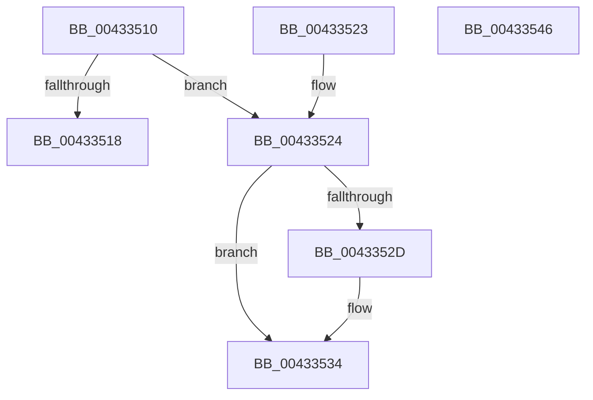

# RtlInsertHeadCircularList

- RVA: `0x00433510`–`0x00433547` (길이 `55` bytes)
- VA: `0x0000000140433510`
- 실행 섹션: `.text`
- PDB 이름 있음: `예`; PDB Function 태그: `아니요`
- unwind 정보 RVA: `0x000DB714`
- 디코드: `20`개 명령, `55/55` bytes 표시
- 미해석 바이트: `0` (있으면 어셈블리에 `.byte`로 보존)

> 이 문서는 커널 이미지의 기계어와 PDB 기호를 분석해 생성했습니다. 4번과 5번은 함수 원형과 자료형을 바이너리 사용 방식에서 추정한 C 해석이며 원본 소스 복구 결과는 아닙니다.

## 1. Dependencies

- 직접 호출 지점: **0**; 고유 호출 대상: **0**
- 직접 호출자로 확인된 함수: **3**
- RIP 상대 이미지 참조: **0**

### Outgoing calls
- 직접 디코드된 call 명령이 없습니다.

### Direct callers
- [ExpAcquireSharedStarveExclusive](../34/ExpAcquireSharedStarveExclusive_function_003411C0.md) at `0x003417A4`
- [sub_006E96C4](../6E/Unknown_function_006E96C4.md) at `0x006E9712`
- [VrpWaitForDiffHiveEntryTransitionOwnerToLeave](../../page/93/VrpWaitForDiffHiveEntryTransitionOwnerToLeave_function_00937128.md) at `0x0093717E`

### Static image references
- 디코드된 RIP-relative 메모리 참조가 없습니다.

## 2. Other-region calls and transfers

- 다른 실행 섹션으로 향하는 call: **0**
- 별도 외부 분기/꼬리 이동을 확인하지 못했습니다.

## 3. Assembly (complete function range)

```asm
00433510  48 8B 01                        mov rax, qword ptr [rcx]
00433513  48 85 C0                        test rax, rax
00433516  75 0C                           jne 0x140433524
00433518  48 89 52 08                     mov qword ptr [rdx + 8], rdx
0043351C  48 89 12                        mov qword ptr [rdx], rdx
0043351F  48 89 11                        mov qword ptr [rcx], rdx
00433522  C3                              ret
00433523  CC                              int3
00433524  4C 8B 40 08                     mov r8, qword ptr [rax + 8]
00433528  49 39 00                        cmp qword ptr [r8], rax
0043352B  74 07                           je 0x140433534
0043352D  B9 03 00 00 00                  mov ecx, 3
00433532  CD 29                           int 0x29
00433534  48 89 02                        mov qword ptr [rdx], rax
00433537  4C 89 42 08                     mov qword ptr [rdx + 8], r8
0043353B  49 89 10                        mov qword ptr [r8], rdx
0043353E  48 89 50 08                     mov qword ptr [rax + 8], rdx
00433542  48 89 11                        mov qword ptr [rcx], rdx
00433545  C3                              ret
00433546  CC                              int3
```

## 4. C-style interpretation (structured pseudocode)

```c
__int64 __fastcall RtlInsertHeadCircularList(__int64 a1, __int64 a2)
{
    if (*(unsigned __int64 *)(a1) != 0) goto loc_00433524;
    *(unsigned __int64 *)(a2 + 8) = a2;
    *(unsigned __int64 *)(a2) = a2;
    *(unsigned __int64 *)(a1) = a2;
    return *(unsigned __int64 *)(a1);
loc_00433524:
    if ((*(unsigned __int64 *)(*(unsigned __int64 *)(*(unsigned __int64 *)(a1) + 8))) != (*(unsigned __int64 *)(a1))) {
        a1 = 3;
    }
    *(unsigned __int64 *)(a2) = *(unsigned __int64 *)(a1);
    *(unsigned __int64 *)(a2 + 8) = *(unsigned __int64 *)(*(unsigned __int64 *)(a1) + 8);
    *(unsigned __int64 *)(*(unsigned __int64 *)(*(unsigned __int64 *)(a1) + 8)) = a2;
    *(unsigned __int64 *)(*(unsigned __int64 *)(a1) + 8) = a2;
    *(unsigned __int64 *)(a1) = a2;
    return *(unsigned __int64 *)(a1);
}
```

## 5. (Beta) C Style

```c
int64_t RtlInsertHeadCircularList(void *Arg1, void *Arg2)
{
    uint8_t *arg1 = (uint8_t *)Arg1;
    uint8_t *arg2 = (uint8_t *)Arg2;

    if (*(uint64_t *)(arg1) != 0) goto loc_00433524;
    *(void **)(arg2 + 0x8) = Arg2;
    *(void **)(arg2) = Arg2;
    *(void **)(arg1) = Arg2;
    return *(uint64_t *)(arg1);
loc_00433524:
    if ((*(uint64_t *)(*(uint64_t *)(*(uint64_t *)(arg1) + 0x8))) != (*(uint64_t *)(arg1))) {
        Arg1 = 3;
    }
    *(uint64_t *)(arg2) = *(uint64_t *)(arg1);
    *(uint64_t *)(arg2 + 0x8) = *(uint64_t *)(*(uint64_t *)(arg1) + 0x8);
    *(void **)(*(uint64_t *)(*(uint64_t *)(arg1) + 0x8)) = Arg2;
    *(void **)(*(uint64_t *)(arg1) + 0x8) = Arg2;
    *(void **)(arg1) = Arg2;
    return *(uint64_t *)(arg1);
}
```

### 관측된 메모리 오프셋

구조체 형식이 확인되지 않은 접근은 인자 기준의 오프셋으로만 기록했습니다.

| 기준 인자 | 오프셋 표현 | 폭 (bit) | 접근 |
|---|---:|---:|---|
| `Arg1` | `+ 0x0` | `64` | `R` |
| `Arg1` | `+ 0x0` | `64` | `W` |
| `Arg2` | `+ 0x0` | `64` | `W` |
| `Arg2` | `+ 0x8` | `64` | `W` |

## 6. Execution-region graph

[열기: 2D/3D 그래프와 함수 탐색 컨트롤 패널](../../../control-panel.html?section=text&rva=0x00433510&view=graph)

- 2D 그래프는 위에서 아래로 흐르고, 3D 그래프는 빈 공간을 드래그해 회전합니다. Shift+드래그는 이동, 휠은 확대·축소, 함수 노드 선택은 대상 보고서 이동입니다.

### Static fallback


