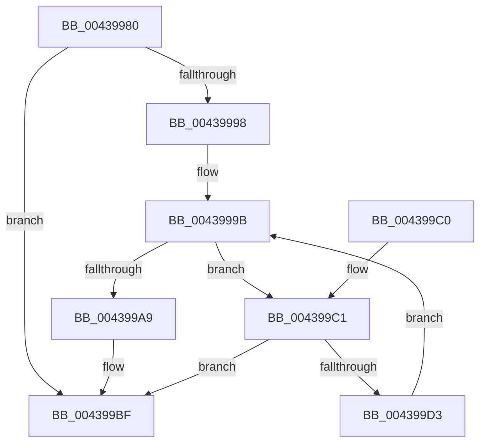

# RtlIntersectBitMapsEx

- RVA: `0x00439980`–`0x004399D5` (길이 `85` bytes)
- VA: `0x0000000140439980`
- 실행 섹션: `.text`
- PDB 이름 있음: `예`; PDB Function 태그: `아니요`
- unwind 정보 RVA: `0x000DB714`
- 디코드: `27`개 명령, `85/85` bytes 표시
- 미해석 바이트: `0` (있으면 어셈블리에 `.byte`로 보존)

> 이 문서는 커널 이미지의 기계어와 PDB 기호를 분석해 생성했습니다. 4번과 5번은 함수 원형과 자료형을 바이너리 사용 방식에서 추정한 C 해석이며 원본 소스 복구 결과는 아닙니다.

## 1. Dependencies

- 직접 호출 지점: **0**; 고유 호출 대상: **0**
- 직접 호출자로 확인된 함수: **0**
- RIP 상대 이미지 참조: **0**

### Outgoing calls
- 직접 디코드된 call 명령이 없습니다.

### Direct callers
- 이 함수 시작 RVA로 연결되는 직접 call은 확인되지 않았습니다. 간접 호출은 완전히 역산할 수 없습니다.

### Static image references
- 디코드된 RIP-relative 메모리 참조가 없습니다.

## 2. Other-region calls and transfers

- 다른 실행 섹션으로 향하는 call: **0**
- 별도 외부 분기/꼬리 이동을 확인하지 못했습니다.

## 3. Assembly (complete function range)

```asm
00439980  48 8B 02                        mov rax, qword ptr [rdx]
00439983  4C 8B D1                        mov r10, rcx
00439986  48 8B 09                        mov rcx, qword ptr [rcx]
00439989  4C 8B CA                        mov r9, rdx
0043998C  48 3B C8                        cmp rcx, rax
0043998F  48 0F 43 C8                     cmovae rcx, rax
00439993  48 85 C9                        test rcx, rcx
00439996  74 27                           je 0x1404399bf
00439998  45 33 DB                        xor r11d, r11d
0043999B  4D 8B 42 08                     mov r8, qword ptr [r10 + 8]
0043999F  49 8B 41 08                     mov rax, qword ptr [r9 + 8]
004399A3  48 83 F9 40                     cmp rcx, 0x40
004399A7  73 18                           jae 0x1404399c1
004399A9  BA 01 00 00 00                  mov edx, 1
004399AE  48 D3 E2                        shl rdx, cl
004399B1  48 FF CA                        dec rdx
004399B4  48 F7 D2                        not rdx
004399B7  49 0B 14 03                     or rdx, qword ptr [r11 + rax]
004399BB  4B 21 14 18                     and qword ptr [r8 + r11], rdx
004399BF  C3                              ret
004399C0  CC                              int3
004399C1  49 8B 14 03                     mov rdx, qword ptr [r11 + rax]
004399C5  4B 21 14 18                     and qword ptr [r8 + r11], rdx
004399C9  49 83 C3 08                     add r11, 8
004399CD  48 83 E9 40                     sub rcx, 0x40
004399D1  74 EC                           je 0x1404399bf
004399D3  EB C6                           jmp 0x14043999b
```

## 4. C-style interpretation (structured pseudocode)

```c
__int64 __fastcall RtlIntersectBitMapsEx(__int64 a1, __int64 a2)
{
    __int64 v_r11;

    a1 = *(unsigned __int64 *)(a1);
    if ((*(unsigned __int64 *)(a1)) >= (*(unsigned __int64 *)(a2))) { a1 = *(unsigned __int64 *)(a2); }
    if (a1 == 0) goto loc_004399BF;
    v_r11 = 0;
loc_0043999B:
    if (a1 >= 64) goto loc_004399C1;
    a2 = (1) << ((unsigned __int8)(a1));
    a2 = (a2) - 1;
    a2 = ~(a2);
    a2 = (a2) | (*(unsigned __int64 *)(v_r11 + *(unsigned __int64 *)(a2 + 8) * 1));
loc_004399BF:
    return *(unsigned __int64 *)(a2 + 8);
loc_004399C1:
    v_r11 = (v_r11) + (8);
    a1 = (a1) - (64);
    if (condition_is_equal) goto loc_004399BF;
    goto loc_0043999B;
}
```

## 5. (Beta) C Style

```c
int64_t RtlIntersectBitMapsEx(void *Arg1, void *Arg2)
{
    uint8_t *arg1 = (uint8_t *)Arg1;
    uint8_t *arg2 = (uint8_t *)Arg2;

    int64_t local_r11;

    Arg1 = *(uint64_t *)(arg1);
    if ((*(uint64_t *)(arg1)) >= (*(uint64_t *)(arg2))) { Arg1 = *(uint64_t *)(arg2); }
    if (Arg1 == NULL) goto loc_004399BF;
    local_r11 = 0;
loc_0043999B:
    if (Arg1 >= 64) goto loc_004399C1;
    Arg2 = (1) << ((uint8_t)(Arg1));
    Arg2 = (Arg2) - 1;
    Arg2 = ~(Arg2);
    Arg2 = (Arg2) | (*(uint64_t *)(local_r11 + *(uint64_t *)(arg2 + 0x8) * 1));
loc_004399BF:
    return *(uint64_t *)(arg2 + 0x8);
loc_004399C1:
    local_r11 = (local_r11) + (8);
    Arg1 = (Arg1) - (64);
    if (condition_is_equal) goto loc_004399BF;
    goto loc_0043999B;
}
```

### 관측된 메모리 오프셋

구조체 형식이 확인되지 않은 접근은 인자 기준의 오프셋으로만 기록했습니다.

| 기준 인자 | 오프셋 표현 | 폭 (bit) | 접근 |
|---|---:|---:|---|
| `Arg1` | `+ 0x0` | `64` | `R` |
| `Arg1` | `+ 0x8` | `64` | `R` |
| `Arg2` | `+ 0x0` | `64` | `R` |
| `Arg2` | `+ 0x8` | `64` | `R` |

## 6. Execution-region graph

[열기: 2D/3D 그래프와 함수 탐색 컨트롤 패널](../../../control-panel.html?section=text&rva=0x00439980&view=graph)

- 2D 그래프는 위에서 아래로 흐르고, 3D 그래프는 빈 공간을 드래그해 회전합니다. Shift+드래그는 이동, 휠은 확대·축소, 함수 노드 선택은 대상 보고서 이동입니다.

### Static fallback


