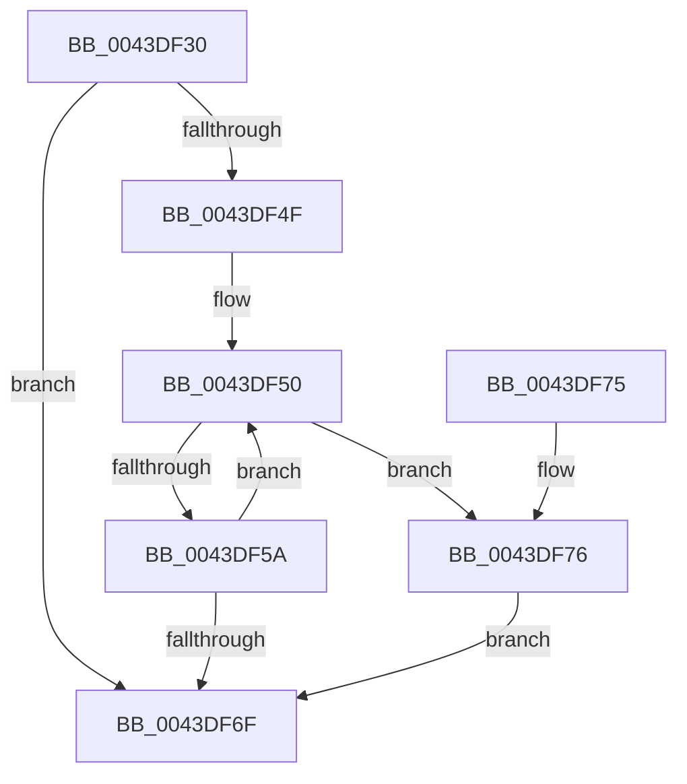

# RtlMergeBitMaps

- RVA: `0x0043DF30`–`0x0043DF91` (길이 `97` bytes)
- VA: `0x000000014043DF30`
- 실행 섹션: `.text`
- PDB 이름 있음: `예`; PDB Function 태그: `아니요`
- unwind 정보 RVA: `0x00081C50`
- 디코드: `31`개 명령, `97/97` bytes 표시
- 미해석 바이트: `0` (있으면 어셈블리에 `.byte`로 보존)

> 이 문서는 커널 이미지의 기계어와 PDB 기호를 분석해 생성했습니다. 4번과 5번은 함수 원형과 자료형을 바이너리 사용 방식에서 추정한 C 해석이며 원본 소스 복구 결과는 아닙니다.

## 1. Dependencies

- 직접 호출 지점: **0**; 고유 호출 대상: **0**
- 직접 호출자로 확인된 함수: **5**
- RIP 상대 이미지 참조: **0**

### Outgoing calls
- 직접 디코드된 call 명령이 없습니다.

### Direct callers
- [HvUnCOWReconciledPages](HvUnCOWReconciledPages_function_0043DC20.md) at `0x0043DC6E`
- [HvUnCOWReconciledPages](HvUnCOWReconciledPages_function_0043DC20.md) at `0x0043DCB5`
- [HvUnCOWReconciledPages](HvUnCOWReconciledPages_function_0043DC20.md) at `0x0043DCC1`
- [HvUnCOWReconciledPages](HvUnCOWReconciledPages_function_0043DC20.md) at `0x0043DEE8`
- [CmpFlushHive](../../page/9B/CmpFlushHive_function_009B3DC0.md) at `0x009B43C8`
- [CmpFlushHive](../../page/9B/CmpFlushHive_function_009B3DC0.md) at `0x009B46B5`
- [HvStoreModifiedData](../../page/9B/HvStoreModifiedData_function_009B4FB4.md) at `0x009B5270`
- [HvpPerformLogFileRecovery](../../page/9B/HvpPerformLogFileRecovery_function_009B7994.md) at `0x009B7C76`
- [HvpPerformLogFileRecovery](../../page/9B/HvpPerformLogFileRecovery_function_009B7994.md) at `0x009B7D31`
- [HvFoldBackUnreconciledData](../../page/AC/HvFoldBackUnreconciledData_function_00AC27A8.md) at `0x00AC27C0`

### Static image references
- 디코드된 RIP-relative 메모리 참조가 없습니다.

## 2. Other-region calls and transfers

- 다른 실행 섹션으로 향하는 call: **0**
- 별도 외부 분기/꼬리 이동을 확인하지 못했습니다.

## 3. Assembly (complete function range)

```asm
0043DF30  48 89 5C 24 08                  mov qword ptr [rsp + 8], rbx
0043DF35  44 8B 09                        mov r9d, dword ptr [rcx]
0043DF38  4C 8B DA                        mov r11, rdx
0043DF3B  8B 02                           mov eax, dword ptr [rdx]
0043DF3D  48 8B D9                        mov rbx, rcx
0043DF40  44 3B C8                        cmp r9d, eax
0043DF43  44 0F 43 C8                     cmovae r9d, eax
0043DF47  45 33 D2                        xor r10d, r10d
0043DF4A  45 85 C9                        test r9d, r9d
0043DF4D  74 20                           je 0x14043df6f
0043DF4F  90                              nop
0043DF50  4C 8B 43 08                     mov r8, qword ptr [rbx + 8]
0043DF54  41 83 F9 20                     cmp r9d, 0x20
0043DF58  72 1C                           jb 0x14043df76
0043DF5A  49 8B 4B 08                     mov rcx, qword ptr [r11 + 8]
0043DF5E  42 8B 14 91                     mov edx, dword ptr [rcx + r10*4]
0043DF62  43 09 14 90                     or dword ptr [r8 + r10*4], edx
0043DF66  41 FF C2                        inc r10d
0043DF69  41 83 C1 E0                     add r9d, -0x20
0043DF6D  75 E1                           jne 0x14043df50
0043DF6F  48 8B 5C 24 08                  mov rbx, qword ptr [rsp + 8]
0043DF74  C3                              ret
0043DF75  CC                              int3
0043DF76  41 8B C9                        mov ecx, r9d
0043DF79  BA 01 00 00 00                  mov edx, 1
0043DF7E  48 D3 E2                        shl rdx, cl
0043DF81  49 8B 4B 08                     mov rcx, qword ptr [r11 + 8]
0043DF85  FF CA                           dec edx
0043DF87  42 23 14 91                     and edx, dword ptr [rcx + r10*4]
0043DF8B  43 09 14 90                     or dword ptr [r8 + r10*4], edx
0043DF8F  EB DE                           jmp 0x14043df6f
```

## 4. C-style interpretation (structured pseudocode)

```c
__int64 __fastcall RtlMergeBitMaps(__int64 a1, __int64 a2)
{
    __int64 v_r10;
    unsigned __int64 v_stack_p8;

    v_stack_p8 = v_rbx;
    a4 = (unsigned int)(*(unsigned int *)(a1));
    if (((unsigned int)((unsigned int)(*(unsigned int *)(a1)))) >= ((unsigned int)((unsigned int)(*(unsigned int *)(a2))))) { a4 = (unsigned int)((unsigned int)(*(unsigned int *)(a2))); }
    v_r10 = 0;
    if ((unsigned int)(a4) == 0) goto loc_0043DF6F;
loc_0043DF50:
    if (((unsigned int)(a4)) < 32) goto loc_0043DF76;
    v_r10 = (unsigned int)((v_r10) + 1);
    a4 = (unsigned int)((a4) + (-32));
    if (condition_is_not_equal) goto loc_0043DF50;
loc_0043DF6F:
    return (unsigned int)(*(unsigned int *)(a2));
loc_0043DF76:
    a2 = (1) << ((unsigned __int8)((unsigned int)((unsigned int)(a4))));
    a2 = (unsigned int)((a2) - 1);
    a2 = (unsigned int)((a2) & (*(unsigned int *)(*(unsigned __int64 *)(a2 + 8) + v_r10 * 4)));
    goto loc_0043DF6F;
}
```

## 5. (Beta) C Style

```c
int64_t RtlMergeBitMaps(void *Arg1, void *Arg2)
{
    uint8_t *arg1 = (uint8_t *)Arg1;
    uint8_t *arg2 = (uint8_t *)Arg2;

    int64_t local_r10;
    uint64_t v_stack_p8;

    v_stack_p8 = local_rbx;
    a4 = (uint32_t)(*(uint32_t *)(arg1));
    if (((uint32_t)((uint32_t)(*(uint32_t *)(arg1)))) >= ((uint32_t)((uint32_t)(*(uint32_t *)(arg2))))) { a4 = (uint32_t)((uint32_t)(*(uint32_t *)(arg2))); }
    local_r10 = 0;
    if ((uint32_t)(a4) == 0) goto loc_0043DF6F;
loc_0043DF50:
    if (((uint32_t)(a4)) < 32) goto loc_0043DF76;
    local_r10 = (uint32_t)((local_r10) + 1);
    a4 = (uint32_t)((a4) + (-32));
    if (condition_is_not_equal) goto loc_0043DF50;
loc_0043DF6F:
    return (uint32_t)(*(uint32_t *)(arg2));
loc_0043DF76:
    Arg2 = (1) << ((uint8_t)((uint32_t)((uint32_t)(a4))));
    Arg2 = (uint32_t)((Arg2) - 1);
    Arg2 = (uint32_t)((Arg2) & (*(uint32_t *)(*(uint64_t *)(arg2 + 0x8) + local_r10 * 4)));
    goto loc_0043DF6F;
}
```

### 관측된 메모리 오프셋

구조체 형식이 확인되지 않은 접근은 인자 기준의 오프셋으로만 기록했습니다.

| 기준 인자 | 오프셋 표현 | 폭 (bit) | 접근 |
|---|---:|---:|---|
| `Arg1` | `+ 0x0` | `32` | `R` |
| `Arg1` | `+ 0x8` | `64` | `R` |
| `Arg2` | `+ 0x0` | `32` | `R` |
| `Arg2` | `+ 0x8` | `64` | `R` |

## 6. Execution-region graph

[열기: 2D/3D 그래프와 함수 탐색 컨트롤 패널](../../../control-panel.html?section=text&rva=0x0043DF30&view=graph)

- 2D 그래프는 위에서 아래로 흐르고, 3D 그래프는 빈 공간을 드래그해 회전합니다. Shift+드래그는 이동, 휠은 확대·축소, 함수 노드 선택은 대상 보고서 이동입니다.

### Static fallback


