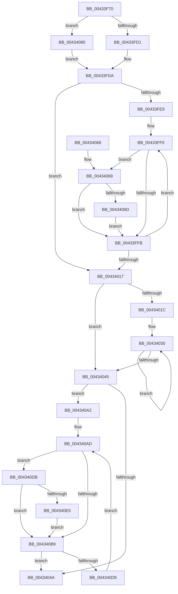

# RtlNumberOfSetBits

- RVA: `0x00433F70`–`0x004340F0` (길이 `384` bytes)
- VA: `0x0000000140433F70`
- 실행 섹션: `.text`
- PDB 이름 있음: `예`; PDB Function 태그: `아니요`
- unwind 정보 RVA: `0x000A2704`
- 디코드: `112`개 명령, `384/384` bytes 표시
- 미해석 바이트: `0` (있으면 어셈블리에 `.byte`로 보존)

> 이 문서는 커널 이미지의 기계어와 PDB 기호를 분석해 생성했습니다. 4번과 5번은 함수 원형과 자료형을 바이너리 사용 방식에서 추정한 C 해석이며 원본 소스 복구 결과는 아닙니다.

## 1. Dependencies

- 직접 호출 지점: **0**; 고유 호출 대상: **0**
- 직접 호출자로 확인된 함수: **25**
- RIP 상대 이미지 참조: **1**

### Outgoing calls
- 직접 디코드된 call 명령이 없습니다.

### Direct callers
- [ST_STORE&lt;SM_TRAITS&gt;::StDmCleanup](../3A/ST_STORE_SM_TRAITS_StDmCleanup_function_003AF8D4.md) at `0x003AFB21`
- [ST_STORE&lt;SM_TRAITS&gt;::StStart](../3B/ST_STORE_SM_TRAITS_StStart_function_003B1BBC.md) at `0x003B1F7F`
- [HalpDmaAllocateScatterPagesFromContiguousPoolV2](../3E/HalpDmaAllocateScatterPagesFromContiguousPoolV2_function_003E1DC4.md) at `0x003E1F80`
- [HvpGenerateLogEntryDirtyData](HvpGenerateLogEntryDirtyData_function_00433ABC.md) at `0x00433B6A`
- [ST_STORE&lt;SM_TRAITS&gt;::StGetStatsWorker](ST_STORE_SM_TRAITS_StGetStatsWorker_function_00433C80.md) at `0x00433DBC`
- [ST_STORE&lt;SM_TRAITS&gt;::StGetStatsWorker](ST_STORE_SM_TRAITS_StGetStatsWorker_function_00433C80.md) at `0x00433E37`
- [RtlNumberOfClearBits](RtlNumberOfClearBits_function_00433F40.md) at `0x00433F49`
- [HalpDmaAllocateScatterPagesFromContiguousPoolV3](../4E/HalpDmaAllocateScatterPagesFromContiguousPoolV3_function_004E380C.md) at `0x004E387D`
- [SepGetAntiTamperEntry](../60/SepGetAntiTamperEntry_function_0060AEE4.md) at `0x0060AFC4`
- [CmpLoadHiveThread](../../page/7D/CmpLoadHiveThread_function_007DB040.md) at `0x007DB87D`
- [CmpMountPreloadedHives](../../page/7D/CmpMountPreloadedHives_function_007DBE18.md) at `0x007DC33E`
- [HvpBuildMapForMemoryBackedHive](../../page/7F/HvpBuildMapForMemoryBackedHive_function_007F3B4C.md) at `0x007F3BA9`
- [HvpBuildMapForMemoryBackedHive](../../page/7F/HvpBuildMapForMemoryBackedHive_function_007F3B4C.md) at `0x007F3BD7`
- [HvpApplyLegacyLogFile](../../page/7F/HvpApplyLegacyLogFile_function_007F66D0.md) at `0x007F67AF`
- [PopEvaluateGlobalUserStatus](../../page/91/PopEvaluateGlobalUserStatus_function_009155C8.md) at `0x009155E9`
- [PspQueryRateControlHistory](../../page/91/PspQueryRateControlHistory_function_00918D1C.md) at `0x00918EC6`
- [HvWriteHivePrimaryFile](../../page/9B/HvWriteHivePrimaryFile_function_009B2374.md) at `0x009B24F8`
- [CmpFlushHive](../../page/9B/CmpFlushHive_function_009B3DC0.md) at `0x009B43D1`
- [HvpGenerateLogEntry](../../page/9B/HvpGenerateLogEntry_function_009B65F0.md) at `0x009B6646`
- [HvpPerformLogFileRecovery](../../page/9B/HvpPerformLogFileRecovery_function_009B7994.md) at `0x009B7C7E`
- [HvpPerformLogFileRecovery](../../page/9B/HvpPerformLogFileRecovery_function_009B7994.md) at `0x009B7D39`
- [SepAddLuidToIndexEntry](../../page/A4/SepAddLuidToIndexEntry_function_00A425C0.md) at `0x00A42740`
- [SepGetLowBoxNumberEntry](../../page/A6/SepGetLowBoxNumberEntry_function_00A65040.md) at `0x00A6510E`
- [MiReleaseDriverPtes](../../page/A7/MiReleaseDriverPtes_function_00A7F1B4.md) at `0x00A7F29E`
- [HvFoldBackUnreconciledData](../../page/AC/HvFoldBackUnreconciledData_function_00AC27A8.md) at `0x00AC27C9`
- [EtwQueryPerformanceTraceInformation](../../page/AF/EtwQueryPerformanceTraceInformation_function_00AF28A4.md) at `0x00AF2C18`
- [HvpAddBin](../../page/AF/HvpAddBin_function_00AF7D48.md) at `0x00AF80FB`
- [HvpAddBin](../../page/AF/HvpAddBin_function_00AF7D48.md) at `0x00AF811B`
- [sub_00B3E78C](../../page/B3/Unknown_function_00B3E78C.md) at `0x00B3E928`
- [sub_00B3E78C](../../page/B3/Unknown_function_00B3E78C.md) at `0x00B3E933`

### Static image references
- `0x00433FDA` → RVA `0x00000000` (`image boundary/outside`; read)

## 2. Other-region calls and transfers

- 다른 실행 섹션으로 향하는 call: **0**
- 별도 외부 분기/꼬리 이동을 확인하지 못했습니다.

## 3. Assembly (complete function range)

```asm
00433F70  48 89 5C 24 08                  mov qword ptr [rsp + 8], rbx
00433F75  48 89 6C 24 10                  mov qword ptr [rsp + 0x10], rbp
00433F7A  48 89 74 24 18                  mov qword ptr [rsp + 0x18], rsi
00433F7F  48 89 7C 24 20                  mov qword ptr [rsp + 0x20], rdi
00433F84  41 54                           push r12
00433F86  41 56                           push r14
00433F88  41 57                           push r15
00433F8A  44 8B 39                        mov r15d, dword ptr [rcx]
00433F8D  45 33 C0                        xor r8d, r8d
00433F90  48 8B 41 08                     mov rax, qword ptr [rcx + 8]
00433F94  41 8B E8                        mov ebp, r8d
00433F97  45 8B D7                        mov r10d, r15d
00433F9A  41 8B DF                        mov ebx, r15d
00433F9D  41 C1 EA 03                     shr r10d, 3
00433FA1  44 8B D8                        mov r11d, eax
00433FA4  83 E3 07                        and ebx, 7
00433FA7  41 B9 08 00 00 00               mov r9d, 8
00433FAD  41 8B D1                        mov edx, r9d
00433FB0  40 0F 95 C5                     setne bpl
00433FB4  41 83 E3 07                     and r11d, 7
00433FB8  41 8B CB                        mov ecx, r11d
00433FBB  41 03 EA                        add ebp, r10d
00433FBE  48 2B D1                        sub rdx, rcx
00433FC1  41 8B CF                        mov ecx, r15d
00433FC4  48 C1 E9 03                     shr rcx, 3
00433FC8  48 3B D1                        cmp rdx, rcx
00433FCB  0F 86 AF 00 00 00               jbe 0x140434080
00433FD1  44 8B CD                        mov r9d, ebp
00433FD4  45 8B F0                        mov r14d, r8d
00433FD7  45 8B D8                        mov r11d, r8d
00433FDA  4C 8D 25 1F C0 BC FF            lea r12, [rip - 0x433fe1]
00433FE1  41 8B F0                        mov esi, r8d
00433FE4  45 85 C9                        test r9d, r9d
00433FE7  74 2E                           je 0x140434017
00433FE9  44 8D 55 FF                     lea r10d, [rbp - 1]
00433FED  0F 1F 00                        nop dword ptr [rax]
00433FF0  0F B6 10                        movzx edx, byte ptr [rax]
00433FF3  48 FF C0                        inc rax
00433FF6  41 3B F2                        cmp esi, r10d
00433FF9  74 6E                           je 0x140434069
00433FFB  0F B6 CA                        movzx ecx, dl
00433FFE  FF C6                           inc esi
00434000  F7 D1                           not ecx
00434002  0F B6 D1                        movzx edx, cl
00434005  42 0F B6 8C 22 40 41 03 00      movzx ecx, byte ptr [rdx + r12 + 0x34140]
0043400E  44 03 C1                        add r8d, ecx
00434011  41 83 C1 FF                     add r9d, -1
00434015  75 D9                           jne 0x140433ff0
00434017  45 85 DB                        test r11d, r11d
0043401A  74 29                           je 0x140434045
0043401C  41 8D 4B FF                     lea ecx, [r11 - 1]
00434020  C1 E9 03                        shr ecx, 3
00434023  FF C1                           inc ecx
00434025  8B D1                           mov edx, ecx
00434027  8D 34 CE                        lea esi, [rsi + rcx*8]
0043402A  66 0F 1F 44 00 00               nop word ptr [rax + rax]
00434030  48 8B 08                        mov rcx, qword ptr [rax]
00434033  48 83 C0 08                     add rax, 8
00434037  F3 48 0F B8 C9                  popcnt rcx, rcx
0043403C  44 03 C1                        add r8d, ecx
0043403F  48 83 EA 01                     sub rdx, 1
00434043  75 EB                           jne 0x140434030
00434045  45 85 F6                        test r14d, r14d
00434048  75 58                           jne 0x1404340a2
0043404A  48 8B 5C 24 20                  mov rbx, qword ptr [rsp + 0x20]
0043404F  41 8B C0                        mov eax, r8d
00434052  48 8B 6C 24 28                  mov rbp, qword ptr [rsp + 0x28]
00434057  48 8B 74 24 30                  mov rsi, qword ptr [rsp + 0x30]
0043405C  48 8B 7C 24 38                  mov rdi, qword ptr [rsp + 0x38]
00434061  41 5F                           pop r15
00434063  41 5E                           pop r14
00434065  41 5C                           pop r12
00434067  C3                              ret
00434068  CC                              int3
00434069  85 DB                           test ebx, ebx
0043406B  74 8E                           je 0x140433ffb
0043406D  49 8B CF                        mov rcx, r15
00434070  83 E1 07                        and ecx, 7
00434073  42 22 94 21 90 C8 02 00         and dl, byte ptr [rcx + r12 + 0x2c890]
0043407B  E9 7B FF FF FF                  jmp 0x140433ffb
00434080  45 2B CB                        sub r9d, r11d
00434083  44 8B DD                        mov r11d, ebp
00434086  45 2B D1                        sub r10d, r9d
00434089  41 83 E2 07                     and r10d, 7
0043408D  85 DB                           test ebx, ebx
0043408F  45 8D 72 01                     lea r14d, [r10 + 1]
00434093  45 0F 44 F2                     cmove r14d, r10d
00434097  45 2B DE                        sub r11d, r14d
0043409A  45 2B D9                        sub r11d, r9d
0043409D  E9 38 FF FF FF                  jmp 0x140433fda
004340A2  45 8B CF                        mov r9d, r15d
004340A5  44 8D 55 FF                     lea r10d, [rbp - 1]
004340A9  41 83 E1 07                     and r9d, 7
004340AD  0F B6 10                        movzx edx, byte ptr [rax]
004340B0  48 8D 40 01                     lea rax, [rax + 1]
004340B4  41 3B F2                        cmp esi, r10d
004340B7  74 22                           je 0x1404340db
004340B9  0F B6 CA                        movzx ecx, dl
004340BC  FF C6                           inc esi
004340BE  F7 D1                           not ecx
004340C0  0F B6 D1                        movzx edx, cl
004340C3  42 0F B6 8C 22 40 41 03 00      movzx ecx, byte ptr [rdx + r12 + 0x34140]
004340CC  44 03 C1                        add r8d, ecx
004340CF  41 83 C6 FF                     add r14d, -1
004340D3  0F 84 71 FF FF FF               je 0x14043404a
004340D9  EB D2                           jmp 0x1404340ad
004340DB  45 85 C9                        test r9d, r9d
004340DE  74 D9                           je 0x1404340b9
004340E0  49 8B CF                        mov rcx, r15
004340E3  83 E1 07                        and ecx, 7
004340E6  42 22 94 21 90 C8 02 00         and dl, byte ptr [rcx + r12 + 0x2c890]
004340EE  EB C9                           jmp 0x1404340b9
```

## 4. C-style interpretation (structured pseudocode)

```c
__int64 __fastcall RtlNumberOfSetBits(__int64 a1, __int64 a2, int a3)
{
    __int64 result;
    __int64 v_r10;
    __int64 v_r11;
    __int64 v_r14;
    __int64 v_rbp;
    __int64 v_rbx;
    __int64 v_rsi;
    unsigned __int64 v_stack_p10;
    unsigned __int64 v_stack_p18;
    unsigned __int64 v_stack_p20;
    unsigned __int64 v_stack_p8;

    v_stack_p8 = v_rbx;
    v_stack_p10 = v_rbp;
    v_stack_p18 = v_rsi;
    v_stack_p20 = v_rdi;
    a3 = 0;
    v_r10 = (unsigned int)(((unsigned int)((unsigned int)((unsigned int)(*(unsigned int *)(a1))))) >> (3));
    v_rbx = (unsigned int)(((unsigned int)((unsigned int)((unsigned int)(*(unsigned int *)(a1))))) & (7));
    v_rbp = (condition_is_not_equal) ? 1 : 0;
    v_r11 = (unsigned int)(((unsigned int)((unsigned int)(*(unsigned __int64 *)(a1 + 8)))) & (7));
    v_rbp = (unsigned int)((v_rbp) + ((unsigned int)(v_r10)));
    a2 = (8) - ((unsigned int)((unsigned int)(v_r11)));
    a1 = ((unsigned int)((unsigned int)((unsigned int)(*(unsigned int *)(a1))))) >> (3);
    if (a2 <= a1) goto loc_00434080;
loc_00433FDA:
    if ((unsigned int)((unsigned int)((unsigned int)(v_rbp))) == 0) goto loc_00434017;
loc_00433FF0:
    result = (*(unsigned __int64 *)(a1 + 8)) + 1;
    if (0 == ((unsigned int)(v_rbp - 1))) goto loc_00434069;
loc_00433FFB:
    v_rsi = (unsigned int)((0) + 1);
    a1 = (unsigned int)(~((unsigned __int8)(*(unsigned __int8 *)(*(unsigned __int64 *)(a1 + 8)))));
    a3 = (unsigned int)((a3) + ((unsigned int)(*(unsigned __int8 *)((unsigned __int8)(a1) + v_rip - 4407265 * 1 + 213312))));
    a4 = (unsigned int)(((unsigned int)((unsigned int)(v_rbp))) + (-1));
    if (condition_is_not_equal) goto loc_00433FF0;
loc_00434017:
    if (0 == 0) goto loc_00434045;
    a1 = (unsigned int)((0 - 1) >> (3));
    a1 = (unsigned int)((a1) + 1);
loc_00434030:
    result = (result) + (8);
    a3 = (unsigned int)((a3) + ((unsigned int)(*(unsigned __int64 *)(result))));
    a2 = ((unsigned int)((unsigned int)(a1))) - (1);
    if (condition_is_not_equal) goto loc_00434030;
loc_00434045:
    if (0 != 0) goto loc_004340A2;
loc_0043404A:
    return (unsigned int)(a3);
loc_00434069:
    if ((unsigned int)(v_stack_p8) == 0) goto loc_00433FFB;
    a1 = (unsigned int)(((unsigned int)(*(unsigned int *)(a1))) & (7));
    a2 = (unsigned __int8)((a2) & (*(unsigned __int8 *)(a1 + v_rip - 4407265 * 1 + 182416)));
    goto loc_00433FFB;
loc_00434080:
    a4 = (unsigned int)((a4) - (0));
    v_r10 = (unsigned int)((v_rbp - 1) - ((unsigned int)(a4)));
    v_r10 = (unsigned int)((v_r10) & (7));
    v_r14 = v_r10 + 1;
    if ((unsigned int)(v_stack_p8) == 0) { v_r14 = (unsigned int)(v_r10); }
    v_r11 = (unsigned int)(((unsigned int)((unsigned int)(v_stack_p10))) - ((unsigned int)(v_r14)));
    v_r11 = (unsigned int)((v_r11) - ((unsigned int)(a4)));
    goto loc_00433FDA;
loc_004340A2:
    a4 = (unsigned int)(((unsigned int)((unsigned int)((unsigned int)(*(unsigned int *)(a1))))) & (7));
loc_004340AD:
    if (((unsigned int)(v_stack_p18)) == ((unsigned int)(v_stack_p10 - 1))) goto loc_004340DB;
loc_004340B9:
    v_rsi = (unsigned int)((v_stack_p18) + 1);
    a1 = (unsigned int)(~((unsigned __int8)(*(unsigned __int8 *)((unsigned int)(a3)))));
    a3 = (unsigned int)((a3) + ((unsigned int)(*(unsigned __int8 *)((unsigned __int8)(a1) + v_rip - 4407265 * 1 + 213312))));
    v_r14 = (unsigned int)((v_r14) + (-1));
    if (condition_is_equal) goto loc_0043404A;
    goto loc_004340AD;
loc_004340DB:
    if ((unsigned int)(a4) == 0) goto loc_004340B9;
    a1 = (unsigned int)(((unsigned int)(*(unsigned int *)(a1))) & (7));
    a2 = (unsigned __int8)(((unsigned __int8)(a1)) & (*(unsigned __int8 *)(a1 + v_rip - 4407265 * 1 + 182416)));
    goto loc_004340B9;
}
```

## 5. (Beta) C Style

```c
int64_t RtlNumberOfSetBits(void *Arg1, int64_t Arg2, int32_t Arg3)
{
    uint8_t *arg1 = (uint8_t *)Arg1;

    int64_t result;
    int64_t local_r10;
    int64_t local_r11;
    int64_t local_r14;
    int64_t local_rbp;
    int64_t local_rbx;
    int64_t local_rsi;
    uint64_t v_stack_p10;
    uint64_t v_stack_p18;
    uint64_t v_stack_p20;
    uint64_t v_stack_p8;

    v_stack_p8 = local_rbx;
    v_stack_p10 = local_rbp;
    v_stack_p18 = local_rsi;
    v_stack_p20 = local_rdi;
    Arg3 = 0;
    local_r10 = (uint32_t)(((uint32_t)((uint32_t)((uint32_t)(*(uint32_t *)(arg1))))) >> (3));
    local_rbx = (uint32_t)(((uint32_t)((uint32_t)((uint32_t)(*(uint32_t *)(arg1))))) & (7));
    local_rbp = (condition_is_not_equal) ? 1 : 0;
    local_r11 = (uint32_t)(((uint32_t)((uint32_t)(*(uint64_t *)(arg1 + 0x8)))) & (7));
    local_rbp = (uint32_t)((local_rbp) + ((uint32_t)(local_r10)));
    Arg2 = (8) - ((uint32_t)((uint32_t)(local_r11)));
    Arg1 = ((uint32_t)((uint32_t)((uint32_t)(*(uint32_t *)(arg1))))) >> (3);
    if (Arg2 <= Arg1) goto loc_00434080;
loc_00433FDA:
    if ((uint32_t)((uint32_t)((uint32_t)(local_rbp))) == 0) goto loc_00434017;
loc_00433FF0:
    result = (*(uint64_t *)(arg1 + 0x8)) + 1;
    if (0 == ((uint32_t)(local_rbp - 1))) goto loc_00434069;
loc_00433FFB:
    local_rsi = (uint32_t)((0) + 1);
    Arg1 = (uint32_t)(~((uint8_t)(*(uint8_t *)(*(uint64_t *)(arg1 + 0x8)))));
    Arg3 = (uint32_t)((Arg3) + ((uint32_t)(*(uint8_t *)((uint8_t)(arg1) + v_rip - 0x433FE1 * 1 + 0x34140))));
    a4 = (uint32_t)(((uint32_t)((uint32_t)(local_rbp))) + (-1));
    if (condition_is_not_equal) goto loc_00433FF0;
loc_00434017:
    if (0 == 0) goto loc_00434045;
    Arg1 = (uint32_t)((0 - 1) >> (3));
    Arg1 = (uint32_t)((Arg1) + 1);
loc_00434030:
    result = (result) + (8);
    Arg3 = (uint32_t)((Arg3) + ((uint32_t)(*(uint64_t *)(result))));
    Arg2 = ((uint32_t)((uint32_t)(Arg1))) - (1);
    if (condition_is_not_equal) goto loc_00434030;
loc_00434045:
    if (0 != 0) goto loc_004340A2;
loc_0043404A:
    return (uint32_t)(Arg3);
loc_00434069:
    if ((uint32_t)(v_stack_p8) == 0) goto loc_00433FFB;
    Arg1 = (uint32_t)(((uint32_t)(*(uint32_t *)(arg1))) & (7));
    Arg2 = (uint8_t)((Arg2) & (*(uint8_t *)(arg1 + v_rip - 0x433FE1 * 1 + 0x2C890)));
    goto loc_00433FFB;
loc_00434080:
    a4 = (uint32_t)((a4) - (0));
    local_r10 = (uint32_t)((local_rbp - 1) - ((uint32_t)(a4)));
    local_r10 = (uint32_t)((local_r10) & (7));
    local_r14 = local_r10 + 1;
    if ((uint32_t)(v_stack_p8) == 0) { local_r14 = (uint32_t)(local_r10); }
    local_r11 = (uint32_t)(((uint32_t)((uint32_t)(v_stack_p10))) - ((uint32_t)(local_r14)));
    local_r11 = (uint32_t)((local_r11) - ((uint32_t)(a4)));
    goto loc_00433FDA;
loc_004340A2:
    a4 = (uint32_t)(((uint32_t)((uint32_t)((uint32_t)(*(uint32_t *)(arg1))))) & (7));
loc_004340AD:
    if (((uint32_t)(v_stack_p18)) == ((uint32_t)(v_stack_p10 - 1))) goto loc_004340DB;
loc_004340B9:
    local_rsi = (uint32_t)((v_stack_p18) + 1);
    Arg1 = (uint32_t)(~((uint8_t)(*(uint8_t *)((uint32_t)(Arg3)))));
    Arg3 = (uint32_t)((Arg3) + ((uint32_t)(*(uint8_t *)((uint8_t)(arg1) + v_rip - 0x433FE1 * 1 + 0x34140))));
    local_r14 = (uint32_t)((local_r14) + (-1));
    if (condition_is_equal) goto loc_0043404A;
    goto loc_004340AD;
loc_004340DB:
    if ((uint32_t)(a4) == 0) goto loc_004340B9;
    Arg1 = (uint32_t)(((uint32_t)(*(uint32_t *)(arg1))) & (7));
    Arg2 = (uint8_t)(((uint8_t)(Arg1)) & (*(uint8_t *)(arg1 + v_rip - 0x433FE1 * 1 + 0x2C890)));
    goto loc_004340B9;
}
```

### 관측된 메모리 오프셋

구조체 형식이 확인되지 않은 접근은 인자 기준의 오프셋으로만 기록했습니다.

| 기준 인자 | 오프셋 표현 | 폭 (bit) | 접근 |
|---|---:|---:|---|
| `Arg1` | `+ 0x0` | `32` | `R` |
| `Arg1` | `+ 0x8` | `64` | `R` |

## 6. Execution-region graph

[열기: 2D/3D 그래프와 함수 탐색 컨트롤 패널](../../../control-panel.html?section=text&rva=0x00433F70&view=graph)

- 2D 그래프는 위에서 아래로 흐르고, 3D 그래프는 빈 공간을 드래그해 회전합니다. Shift+드래그는 이동, 휠은 확대·축소, 함수 노드 선택은 대상 보고서 이동입니다.

### Static fallback


