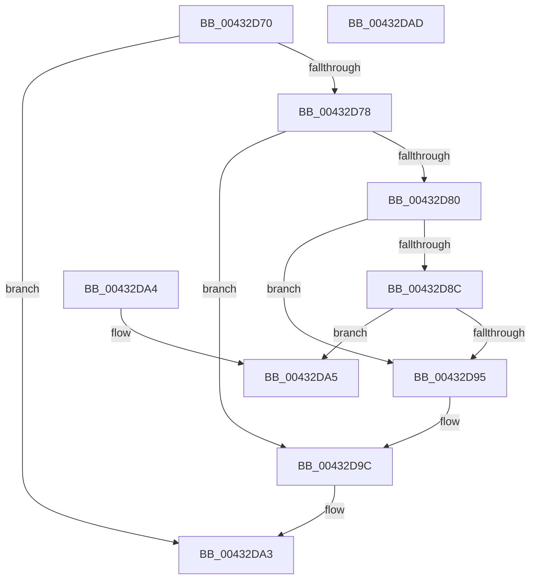

# RtlRemoveHeadCircularList

- RVA: `0x00432D70`–`0x00432DAE` (길이 `62` bytes)
- VA: `0x0000000140432D70`
- 실행 섹션: `.text`
- PDB 이름 있음: `예`; PDB Function 태그: `아니요`
- unwind 정보 RVA: `0x000DB714`
- 디코드: `22`개 명령, `62/62` bytes 표시
- 미해석 바이트: `0` (있으면 어셈블리에 `.byte`로 보존)

> 이 문서는 커널 이미지의 기계어와 PDB 기호를 분석해 생성했습니다. 4번과 5번은 함수 원형과 자료형을 바이너리 사용 방식에서 추정한 C 해석이며 원본 소스 복구 결과는 아닙니다.

## 1. Dependencies

- 직접 호출 지점: **0**; 고유 호출 대상: **0**
- 직접 호출자로 확인된 함수: **2**
- RIP 상대 이미지 참조: **0**

### Outgoing calls
- 직접 디코드된 call 명령이 없습니다.

### Direct callers
- [sub_00260366](../26/Unknown_function_00260366.md) at `0x00260BA7`
- [sub_0027475D](../27/Unknown_function_0027475D.md) at `0x00274FFF`

### Static image references
- 디코드된 RIP-relative 메모리 참조가 없습니다.

## 2. Other-region calls and transfers

- 다른 실행 섹션으로 향하는 call: **0**
- 별도 외부 분기/꼬리 이동을 확인하지 못했습니다.

## 3. Assembly (complete function range)

```asm
00432D70  48 8B 01                        mov rax, qword ptr [rcx]
00432D73  48 85 C0                        test rax, rax
00432D76  74 2B                           je 0x140432da3
00432D78  48 8B 10                        mov rdx, qword ptr [rax]
00432D7B  48 3B D0                        cmp rdx, rax
00432D7E  74 1C                           je 0x140432d9c
00432D80  48 89 11                        mov qword ptr [rcx], rdx
00432D83  48 8B 10                        mov rdx, qword ptr [rax]
00432D86  48 39 42 08                     cmp qword ptr [rdx + 8], rax
00432D8A  75 09                           jne 0x140432d95
00432D8C  48 8B 48 08                     mov rcx, qword ptr [rax + 8]
00432D90  48 39 01                        cmp qword ptr [rcx], rax
00432D93  74 10                           je 0x140432da5
00432D95  B9 03 00 00 00                  mov ecx, 3
00432D9A  CD 29                           int 0x29
00432D9C  48 C7 01 00 00 00 00            mov qword ptr [rcx], 0
00432DA3  C3                              ret
00432DA4  CC                              int3
00432DA5  48 89 11                        mov qword ptr [rcx], rdx
00432DA8  48 89 4A 08                     mov qword ptr [rdx + 8], rcx
00432DAC  C3                              ret
00432DAD  CC                              int3
```

## 4. C-style interpretation (structured pseudocode)

```c
__int64 __fastcall RtlRemoveHeadCircularList(__int64 a1)
{
    if (*(unsigned __int64 *)(a1) == 0) goto loc_00432DA3;
    if ((*(unsigned __int64 *)(*(unsigned __int64 *)(a1))) == (*(unsigned __int64 *)(a1))) goto loc_00432D9C;
    *(unsigned __int64 *)(a1) = *(unsigned __int64 *)(*(unsigned __int64 *)(a1));
    if ((*(unsigned __int64 *)(*(unsigned __int64 *)(*(unsigned __int64 *)(a1)) + 8)) != (*(unsigned __int64 *)(a1))) goto loc_00432D95;
    if ((*(unsigned __int64 *)(*(unsigned __int64 *)(*(unsigned __int64 *)(a1) + 8))) == (*(unsigned __int64 *)(a1))) goto loc_00432DA5;
loc_00432D95:
loc_00432D9C:
    *(unsigned __int64 *)(3) = 0;
loc_00432DA3:
    return *(unsigned __int64 *)(a1);
loc_00432DA5:
    *(unsigned __int64 *)(3) = *(unsigned __int64 *)(*(unsigned __int64 *)(a1));
    *(unsigned __int64 *)(*(unsigned __int64 *)(*(unsigned __int64 *)(a1)) + 8) = 3;
    return *(unsigned __int64 *)(a1);
}
```

## 5. (Beta) C Style

```c
int64_t RtlRemoveHeadCircularList(void *Arg1)
{
    uint8_t *arg1 = (uint8_t *)Arg1;

    if (*(uint64_t *)(arg1) == 0) goto loc_00432DA3;
    if ((*(uint64_t *)(*(uint64_t *)(arg1))) == (*(uint64_t *)(arg1))) goto loc_00432D9C;
    *(uint64_t *)(arg1) = *(uint64_t *)(*(uint64_t *)(arg1));
    if ((*(uint64_t *)(*(uint64_t *)(*(uint64_t *)(arg1)) + 0x8)) != (*(uint64_t *)(arg1))) goto loc_00432D95;
    if ((*(uint64_t *)(*(uint64_t *)(*(uint64_t *)(arg1) + 0x8))) == (*(uint64_t *)(arg1))) goto loc_00432DA5;
loc_00432D95:
loc_00432D9C:
    *(uint64_t *)(3) = 0;
loc_00432DA3:
    return *(uint64_t *)(arg1);
loc_00432DA5:
    *(uint64_t *)(3) = *(uint64_t *)(*(uint64_t *)(arg1));
    *(uint64_t *)(*(uint64_t *)(*(uint64_t *)(arg1)) + 0x8) = 3;
    return *(uint64_t *)(arg1);
}
```

### 관측된 메모리 오프셋

구조체 형식이 확인되지 않은 접근은 인자 기준의 오프셋으로만 기록했습니다.

| 기준 인자 | 오프셋 표현 | 폭 (bit) | 접근 |
|---|---:|---:|---|
| `Arg1` | `+ 0x0` | `64` | `R` |
| `Arg1` | `+ 0x0` | `64` | `W` |

## 6. Execution-region graph

[열기: 2D/3D 그래프와 함수 탐색 컨트롤 패널](../../../control-panel.html?section=text&rva=0x00432D70&view=graph)

- 2D 그래프는 위에서 아래로 흐르고, 3D 그래프는 빈 공간을 드래그해 회전합니다. Shift+드래그는 이동, 휠은 확대·축소, 함수 노드 선택은 대상 보고서 이동입니다.

### Static fallback


