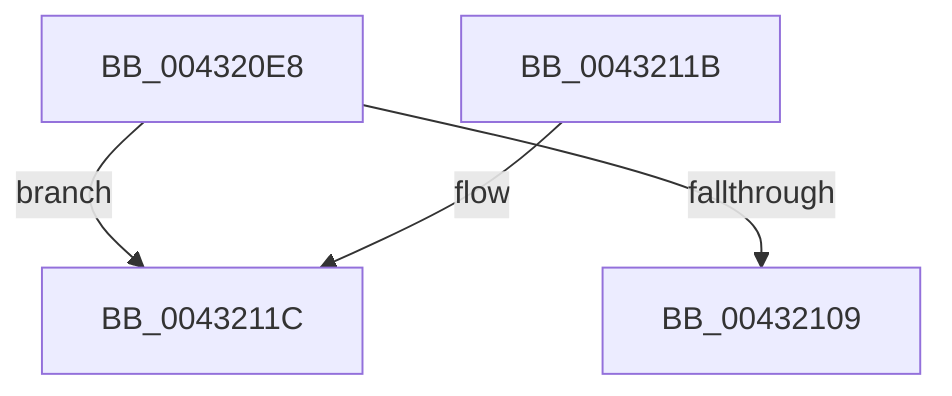

# RtlRemoveInvertedFunctionTable

- RVA: `0x004320E8`–`0x00432130` (길이 `72` bytes)
- VA: `0x00000001404320E8`
- 실행 섹션: `.text`
- PDB 이름 있음: `예`; PDB Function 태그: `예`
- unwind 정보 RVA: `0x000A2244`
- 디코드: `20`개 명령, `72/72` bytes 표시
- 미해석 바이트: `0` (있으면 어셈블리에 `.byte`로 보존)

> 이 문서는 커널 이미지의 기계어와 PDB 기호를 분석해 생성했습니다. 4번과 5번은 함수 원형과 자료형을 바이너리 사용 방식에서 추정한 C 해석이며 원본 소스 복구 결과는 아닙니다.

## 1. Dependencies

- 직접 호출 지점: **2**; 고유 호출 대상: **2**
- 직접 호출자로 확인된 함수: **2**
- RIP 상대 이미지 참조: **2**

### Outgoing calls
- `0x004320F5` → [MmLockLoadedModuleListExclusive](MmLockLoadedModuleListExclusive_function_0043229C.md) (function, `0x0043229C`)
- `0x0043210B` → [MmUnlockLoadedModuleListExclusive](MmUnlockLoadedModuleListExclusive_function_004322E0.md) (function, `0x004322E0`)

### Direct callers
- [MiRemoveLoaderEntry](../67/MiRemoveLoaderEntry_function_006713C8.md) at `0x006713E6`
- [MiInitializeLoadedModuleList](../../init/C6/MiInitializeLoadedModuleList_function_00C6BCDC.md) at `0x00C6BEA2`

### Static image references
- `0x004320FA` → RVA `0x01200020` (`CFGRO`; read)
- `0x00432120` → RVA `0x01200038` (`CFGRO`; read)

## 2. Other-region calls and transfers

- 다른 실행 섹션으로 향하는 call: **0**
- call이 아닌 외부 분기/꼬리 이동: **1**
  - `0x0043212B` → [sub_006EE978](../6E/Unknown_function_006EE978.md) (`tail-transfer`)

## 3. Assembly (complete function range)

```asm
004320E8  48 89 5C 24 08                  mov qword ptr [rsp + 8], rbx
004320ED  57                              push rdi
004320EE  48 83 EC 20                     sub rsp, 0x20
004320F2  48 8B F9                        mov rdi, rcx
004320F5  E8 A2 01 00 00                  call 0x14043229c
004320FA  44 8B 0D 1F DF DC 00            mov r9d, dword ptr [rip + 0xdcdf1f]
00432101  8A D8                           mov bl, al
00432103  41 83 E9 01                     sub r9d, 1
00432107  75 13                           jne 0x14043211c
00432109  8A CB                           mov cl, bl
0043210B  E8 D0 01 00 00                  call 0x1404322e0
00432110  48 8B 5C 24 30                  mov rbx, qword ptr [rsp + 0x30]
00432115  48 83 C4 20                     add rsp, 0x20
00432119  5F                              pop rdi
0043211A  C3                              ret
0043211B  CC                              int3
0043211C  4F 8D 04 49                     lea r8, [r9 + r9*2]
00432120  48 8D 05 11 DF DC 00            lea rax, [rip + 0xdcdf11]
00432127  4A 8D 14 C0                     lea rdx, [rax + r8*8]
0043212B  E9 48 C8 2B 00                  jmp 0x1406ee978
```

## 4. C-style interpretation (structured pseudocode)

```c
__int64 __fastcall RtlRemoveInvertedFunctionTable(__int64 a1)
{
    __int64 result;
    __int64 v_rsp;
    unsigned __int64 v_stack_p8;

    v_stack_p8 = v_rbx;
    v_rsp = (v_rsp) - (32);
    result = MmLockLoadedModuleListExclusive(a1, a2, a3, a4);
    a4 = (unsigned int)(((unsigned int)(*(unsigned int *)(v_rip + 14475039))) - (1));
    if (condition_is_not_equal) goto loc_0043211C;
    result = MmUnlockLoadedModuleListExclusive((unsigned __int8)((unsigned __int8)(result)), a2, a3, a4);
    v_rsp = (v_rsp) + (32);
    return result;
loc_0043211C:
}
```

## 5. (Beta) C Style

```c
int64_t RtlRemoveInvertedFunctionTable(int64_t Arg1)
{
    int64_t result;
    int64_t local_rsp;
    uint64_t v_stack_p8;

    v_stack_p8 = local_rbx;
    local_rsp = (local_rsp) - (32);
    result = MmLockLoadedModuleListExclusive(Arg1, a2, a3, a4);
    a4 = (uint32_t)(((uint32_t)(*(uint32_t *)(v_rip + 0xDCDF1F))) - (1));
    if (condition_is_not_equal) goto loc_0043211C;
    result = MmUnlockLoadedModuleListExclusive((uint8_t)((uint8_t)(result)), a2, a3, a4);
    local_rsp = (local_rsp) + (32);
    return result;
loc_0043211C:
}
```

## 6. Execution-region graph

[열기: 2D/3D 그래프와 함수 탐색 컨트롤 패널](../../../control-panel.html?section=text&rva=0x004320E8&view=graph)

- 2D 그래프는 위에서 아래로 흐르고, 3D 그래프는 빈 공간을 드래그해 회전합니다. Shift+드래그는 이동, 휠은 확대·축소, 함수 노드 선택은 대상 보고서 이동입니다.

### Static fallback


