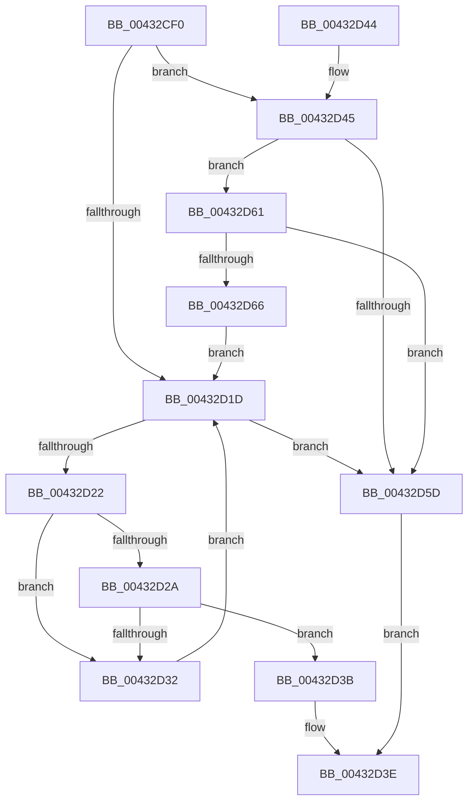

# RtlSectionTableFromVirtualAddress

- RVA: `0x00432CF0`–`0x00432D68` (길이 `120` bytes)
- VA: `0x0000000140432CF0`
- 실행 섹션: `.text`
- PDB 이름 있음: `예`; PDB Function 태그: `아니요`
- unwind 정보 RVA: `0x000A23B0`
- 디코드: `38`개 명령, `120/120` bytes 표시
- 미해석 바이트: `0` (있으면 어셈블리에 `.byte`로 보존)

> 이 문서는 커널 이미지의 기계어와 PDB 기호를 분석해 생성했습니다. 4번과 5번은 함수 원형과 자료형을 바이너리 사용 방식에서 추정한 C 해석이며 원본 소스 복구 결과는 아닙니다.

## 1. Dependencies

- 직접 호출 지점: **0**; 고유 호출 대상: **0**
- 직접 호출자로 확인된 함수: **11**
- RIP 상대 이미지 참조: **0**

### Outgoing calls
- 직접 디코드된 call 명령이 없습니다.

### Direct callers
- [KeQueryKvaShadowRegion](KeQueryKvaShadowRegion_function_00432424.md) at `0x004324DA`
- [RtlAddressInSectionTable](RtlAddressInSectionTable_function_00432C90.md) at `0x00432CA0`
- [KiLockExtendedServiceTable](../50/KiLockExtendedServiceTable_function_00509F48.md) at `0x0050A077`
- [KiShadowKernelSectionByAddress](../5C/KiShadowKernelSectionByAddress_function_005C5040.md) at `0x005C507D`
- [KiUnshadowKernelSectionByAddress](../5C/KiUnshadowKernelSectionByAddress_function_005C50B4.md) at `0x005C50F1`
- [KiTpIsSupportedKernelTracepointLocation](../../page/74/KiTpIsSupportedKernelTracepointLocation_function_007488C8.md) at `0x007488F2`
- [EtwpIsValidImageAddress](../../page/8D/EtwpIsValidImageAddress_function_008D9F70.md) at `0x008D9FC0`
- [LdrpAccessResourceDataNoMultipleLanguage](../../page/99/LdrpAccessResourceDataNoMultipleLanguage_function_0099BF00.md) at `0x0099BFF9`
- [LdrpAccessResourceDataNoMultipleLanguage](../../page/99/LdrpAccessResourceDataNoMultipleLanguage_function_0099BF00.md) at `0x0099C0A8`
- [CcInitializeBcbProfiler](../../init/BE/CcInitializeBcbProfiler_function_00BEF294.md) at `0x00BEF412`
- [sub_00BF16D0](../../init/BF/Unknown_function_00BF16D0.md) at `0x00BF231A`
- [sub_00BF16D0](../../init/BF/Unknown_function_00BF16D0.md) at `0x00BF61CC`
- [sub_00BF16D0](../../init/BF/Unknown_function_00BF16D0.md) at `0x00C16CFA`
- [sub_00BF16D0](../../init/BF/Unknown_function_00BF16D0.md) at `0x00C170F6`
- [sub_00C7EB3D](../../init/C7/Unknown_function_00C7EB3D.md) at `0x00C7F161`
- [sub_00C7EB3D](../../init/C7/Unknown_function_00C7EB3D.md) at `0x00C7F660`

### Static image references
- 디코드된 RIP-relative 메모리 참조가 없습니다.

## 2. Other-region calls and transfers

- 다른 실행 섹션으로 향하는 call: **0**
- 별도 외부 분기/꼬리 이동을 확인하지 못했습니다.

## 3. Assembly (complete function range)

```asm
00432CF0  48 89 5C 24 08                  mov qword ptr [rsp + 8], rbx
00432CF5  44 0F B7 49 14                  movzx r9d, word ptr [rcx + 0x14]
00432CFA  45 8B D0                        mov r10d, r8d
00432CFD  0F B7 41 06                     movzx eax, word ptr [rcx + 6]
00432D01  4C 03 C9                        add r9, rcx
00432D04  48 BB FF FF FE FF FF 7F 00 00   movabs rbx, 0x7ffffffeffff
00432D0E  45 33 C0                        xor r8d, r8d
00432D11  44 8B D8                        mov r11d, eax
00432D14  49 8D 51 18                     lea rdx, [r9 + 0x18]
00432D18  48 3B CB                        cmp rcx, rbx
00432D1B  76 28                           jbe 0x140432d45
00432D1D  45 3B C3                        cmp r8d, r11d
00432D20  73 3B                           jae 0x140432d5d
00432D22  8B 4A 0C                        mov ecx, dword ptr [rdx + 0xc]
00432D25  44 3B D1                        cmp r10d, ecx
00432D28  72 08                           jb 0x140432d32
00432D2A  03 4A 10                        add ecx, dword ptr [rdx + 0x10]
00432D2D  44 3B D1                        cmp r10d, ecx
00432D30  72 09                           jb 0x140432d3b
00432D32  48 83 C2 28                     add rdx, 0x28
00432D36  41 FF C0                        inc r8d
00432D39  EB E2                           jmp 0x140432d1d
00432D3B  48 8B C2                        mov rax, rdx
00432D3E  48 8B 5C 24 08                  mov rbx, qword ptr [rsp + 8]
00432D43  C3                              ret
00432D44  CC                              int3
00432D45  48 8D 04 80                     lea rax, [rax + rax*4]
00432D49  4D 8D 0C C1                     lea r9, [r9 + rax*8]
00432D4D  49 83 C1 17                     add r9, 0x17
00432D51  45 85 DB                        test r11d, r11d
00432D54  4C 0F 44 CA                     cmove r9, rdx
00432D58  4C 3B CA                        cmp r9, rdx
00432D5B  73 04                           jae 0x140432d61
00432D5D  33 C0                           xor eax, eax
00432D5F  EB DD                           jmp 0x140432d3e
00432D61  4C 3B CB                        cmp r9, rbx
00432D64  77 F7                           ja 0x140432d5d
00432D66  EB B5                           jmp 0x140432d1d
```

## 4. C-style interpretation (structured pseudocode)

```c
__int64 __fastcall RtlSectionTableFromVirtualAddress(__int64 a1, __int64 a2, int a3)
{
    __int64 result;
    unsigned __int64 v_stack_p8;

    v_stack_p8 = v_rbx;
    a4 = (*(unsigned __int16 *)(a1 + 20)) + (a1);
    a3 = 0;
    if (a1 <= v_rbx) goto loc_00432D45;
loc_00432D1D:
    if (0 >= ((unsigned int)((unsigned int)((unsigned int)(*(unsigned __int16 *)(a1 + 6)))))) goto loc_00432D5D;
    if (((unsigned int)((unsigned int)(a3))) < ((unsigned int)((unsigned int)(*(unsigned int *)(a4 + 24 + 12))))) goto loc_00432D32;
    a1 = (unsigned int)(((unsigned int)(*(unsigned int *)(a4 + 24 + 12))) + (*(unsigned int *)(a4 + 24 + 16)));
    if (((unsigned int)((unsigned int)(a3))) < ((unsigned int)(a1))) goto loc_00432D3B;
loc_00432D32:
    a2 = (a4 + 24) + (40);
    a3 = (unsigned int)((a3) + 1);
    goto loc_00432D1D;
loc_00432D3B:
loc_00432D3E:
    return a2;
loc_00432D45:
    a4 = (a4 + a2 + a2 * 4 * 8) + (23);
    if ((unsigned int)((unsigned int)((unsigned int)(*(unsigned __int16 *)(a1 + 6)))) == 0) { a4 = a2; }
    if (a4 >= a2) goto loc_00432D61;
loc_00432D5D:
    result = 0;
    goto loc_00432D3E;
loc_00432D61:
    if (a4 > v_stack_p8) goto loc_00432D5D;
    goto loc_00432D1D;
}
```

## 5. (Beta) C Style

```c
int64_t RtlSectionTableFromVirtualAddress(void *Arg1, int64_t Arg2, int32_t Arg3)
{
    uint8_t *arg1 = (uint8_t *)Arg1;

    int64_t result;
    uint64_t v_stack_p8;

    v_stack_p8 = local_rbx;
    a4 = (*(uint16_t *)(arg1 + 0x14)) + (Arg1);
    Arg3 = 0;
    if (Arg1 <= local_rbx) goto loc_00432D45;
loc_00432D1D:
    if (0 >= ((uint32_t)((uint32_t)((uint32_t)(*(uint16_t *)(arg1 + 0x6)))))) goto loc_00432D5D;
    if (((uint32_t)((uint32_t)(Arg3))) < ((uint32_t)((uint32_t)(*(uint32_t *)(a4 + 0x18 + 0xC))))) goto loc_00432D32;
    Arg1 = (uint32_t)(((uint32_t)(*(uint32_t *)(a4 + 0x18 + 0xC))) + (*(uint32_t *)(a4 + 0x18 + 0x10)));
    if (((uint32_t)((uint32_t)(Arg3))) < ((uint32_t)(Arg1))) goto loc_00432D3B;
loc_00432D32:
    Arg2 = (a4 + 24) + (40);
    Arg3 = (uint32_t)((Arg3) + 1);
    goto loc_00432D1D;
loc_00432D3B:
loc_00432D3E:
    return Arg2;
loc_00432D45:
    a4 = (a4 + Arg2 + Arg2 * 4 * 8) + (23);
    if ((uint32_t)((uint32_t)((uint32_t)(*(uint16_t *)(arg1 + 0x6)))) == 0) { a4 = Arg2; }
    if (a4 >= Arg2) goto loc_00432D61;
loc_00432D5D:
    result = 0;
    goto loc_00432D3E;
loc_00432D61:
    if (a4 > v_stack_p8) goto loc_00432D5D;
    goto loc_00432D1D;
}
```

### 관측된 메모리 오프셋

구조체 형식이 확인되지 않은 접근은 인자 기준의 오프셋으로만 기록했습니다.

| 기준 인자 | 오프셋 표현 | 폭 (bit) | 접근 |
|---|---:|---:|---|
| `Arg1` | `+ 0x6` | `16` | `R` |
| `Arg1` | `+ 0x14` | `16` | `R` |

## 6. Execution-region graph

[열기: 2D/3D 그래프와 함수 탐색 컨트롤 패널](../../../control-panel.html?section=text&rva=0x00432CF0&view=graph)

- 2D 그래프는 위에서 아래로 흐르고, 3D 그래프는 빈 공간을 드래그해 회전합니다. Shift+드래그는 이동, 휠은 확대·축소, 함수 노드 선택은 대상 보고서 이동입니다.

### Static fallback


