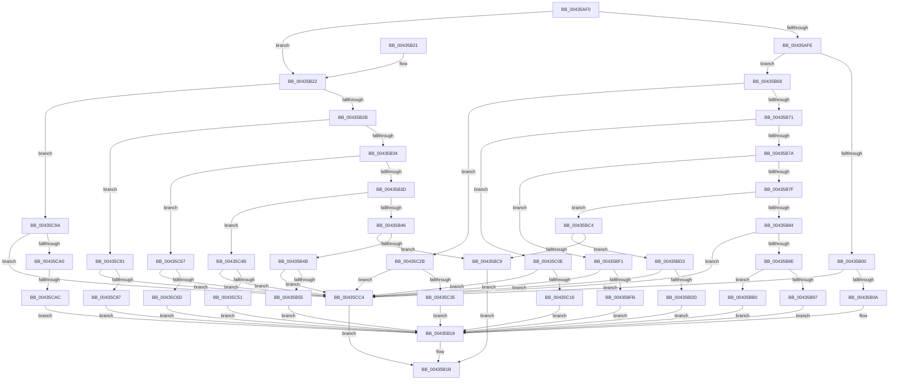

# RtlSetSystemGlobalData

- RVA: `0x00435AF0`–`0x00435CCE` (길이 `478` bytes)
- VA: `0x0000000140435AF0`
- 실행 섹션: `.text`
- PDB 이름 있음: `예`; PDB Function 태그: `예`
- unwind 정보 RVA: `0x000A2D34`
- 디코드: `111`개 명령, `478/478` bytes 표시
- 미해석 바이트: `0` (있으면 어셈블리에 `.byte`로 보존)

> 이 문서는 커널 이미지의 기계어와 PDB 기호를 분석해 생성했습니다. 4번과 5번은 함수 원형과 자료형을 바이너리 사용 방식에서 추정한 C 해석이며 원본 소스 복구 결과는 아닙니다.

## 1. Dependencies

- 직접 호출 지점: **2**; 고유 호출 대상: **2**
- 직접 호출자로 확인된 함수: **4**
- RIP 상대 이미지 참조: **1**

### Outgoing calls
- `0x00435B8E` → [PsIsCurrentThreadInServerSilo](PsIsCurrentThreadInServerSilo_function_004362E0.md) (function, `0x004362E0`)
- `0x00435B97` → [PsGetCurrentServerSiloGlobals](../2F/PsGetCurrentServerSiloGlobals_function_002FE1F0.md) (function, `0x002FE1F0`)

### Direct callers
- [HalpTscFallback](../54/HalpTscFallback_function_0054AC40.md) at `0x0054ACE7`
- [HalpTimerConfigureQpcBypass](../54/HalpTimerConfigureQpcBypass_function_0054BDAC.md) at `0x0054BE5F`
- [HalpTimerConfigureQpcBypass](../54/HalpTimerConfigureQpcBypass_function_0054BDAC.md) at `0x0054BE9B`
- [sub_006FA5DC](../6F/Unknown_function_006FA5DC.md) at `0x006FA5F0`
- [ExpRefreshTimeZoneInformation](../../page/A6/ExpRefreshTimeZoneInformation_function_00A6B46C.md) at `0x00A6B94C`

### Static image references
- `0x00435B0A` → RVA `0x00FC5008` (`ALMOSTRO`; read)

## 2. Other-region calls and transfers

- 다른 실행 섹션으로 향하는 call: **0**
- call이 아닌 외부 분기/꼬리 이동: **1**
  - `0x00435CA6` → [sub_006EEE48](../6E/Unknown_function_006EEE48.md) (`tail-transfer`)

## 3. Assembly (complete function range)

```asm
00435AF0  40 53                           push rbx
00435AF2  48 83 EC 20                     sub rsp, 0x20
00435AF6  48 8B DA                        mov rbx, rdx
00435AF9  83 F9 0D                        cmp ecx, 0xd
00435AFC  7F 24                           jg 0x140435b22
00435AFE  75 68                           jne 0x140435b68
00435B00  41 83 F8 04                     cmp r8d, 4
00435B04  0F 85 BA 01 00 00               jne 0x140435cc4
00435B0A  48 8B 05 F7 F4 B8 00            mov rax, qword ptr [rip + 0xb8f4f7]
00435B11  8B 0A                           mov ecx, dword ptr [rdx]
00435B13  89 88 E4 02 00 00               mov dword ptr [rax + 0x2e4], ecx
00435B19  33 C0                           xor eax, eax
00435B1B  48 83 C4 20                     add rsp, 0x20
00435B1F  5B                              pop rbx
00435B20  C3                              ret
00435B21  CC                              int3
00435B22  83 E9 0E                        sub ecx, 0xe
00435B25  0F 84 6F 01 00 00               je 0x140435c9a
00435B2B  83 E9 01                        sub ecx, 1
00435B2E  0F 84 4D 01 00 00               je 0x140435c81
00435B34  83 E9 01                        sub ecx, 1
00435B37  0F 84 2A 01 00 00               je 0x140435c67
00435B3D  83 E9 01                        sub ecx, 1
00435B40  0F 84 05 01 00 00               je 0x140435c4b
00435B46  83 F9 01                        cmp ecx, 1
00435B49  75 7E                           jne 0x140435bc9
00435B4B  41 83 F8 08                     cmp r8d, 8
00435B4F  0F 85 6F 01 00 00               jne 0x140435cc4
00435B55  48 8B 05 AC F4 B8 00            mov rax, qword ptr [rip + 0xb8f4ac]
00435B5C  48 8B 0A                        mov rcx, qword ptr [rdx]
00435B5F  48 89 88 B8 03 00 00            mov qword ptr [rax + 0x3b8], rcx
00435B66  EB B1                           jmp 0x140435b19
00435B68  83 E9 01                        sub ecx, 1
00435B6B  0F 84 BA 00 00 00               je 0x140435c2b
00435B71  83 E9 03                        sub ecx, 3
00435B74  0F 84 94 00 00 00               je 0x140435c0e
00435B7A  83 E9 01                        sub ecx, 1
00435B7D  74 72                           je 0x140435bf1
00435B7F  83 E9 01                        sub ecx, 1
00435B82  75 40                           jne 0x140435bc4
00435B84  41 83 F8 04                     cmp r8d, 4
00435B88  0F 85 36 01 00 00               jne 0x140435cc4
00435B8E  E8 4D 07 00 00                  call 0x1404362e0
00435B93  84 C0                           test al, al
00435B95  74 19                           je 0x140435bb0
00435B97  E8 54 86 EC FF                  call 0x1402fe1f0
00435B9C  48 8B 88 08 05 00 00            mov rcx, qword ptr [rax + 0x508]
00435BA3  8B 03                           mov eax, dword ptr [rbx]
00435BA5  89 81 48 02 00 00               mov dword ptr [rcx + 0x248], eax
00435BAB  E9 69 FF FF FF                  jmp 0x140435b19
00435BB0  48 8B 05 51 F4 B8 00            mov rax, qword ptr [rip + 0xb8f451]
00435BB7  8B 0B                           mov ecx, dword ptr [rbx]
00435BB9  89 88 40 02 00 00               mov dword ptr [rax + 0x240], ecx
00435BBF  E9 55 FF FF FF                  jmp 0x140435b19
00435BC4  83 F9 04                        cmp ecx, 4
00435BC7  74 0A                           je 0x140435bd3
00435BC9  B8 0D 00 00 C0                  mov eax, 0xc000000d
00435BCE  E9 48 FF FF FF                  jmp 0x140435b1b
00435BD3  41 83 F8 01                     cmp r8d, 1
00435BD7  0F 85 E7 00 00 00               jne 0x140435cc4
00435BDD  48 8B 05 24 F4 B8 00            mov rax, qword ptr [rip + 0xb8f424]
00435BE4  8A 0A                           mov cl, byte ptr [rdx]
00435BE6  88 88 D4 02 00 00               mov byte ptr [rax + 0x2d4], cl
00435BEC  E9 28 FF FF FF                  jmp 0x140435b19
00435BF1  41 83 F8 02                     cmp r8d, 2
00435BF5  0F 85 C9 00 00 00               jne 0x140435cc4
00435BFB  48 8B 05 06 F4 B8 00            mov rax, qword ptr [rip + 0xb8f406]
00435C02  0F B7 0A                        movzx ecx, word ptr [rdx]
00435C05  66 89 48 2E                     mov word ptr [rax + 0x2e], cx
00435C09  E9 0B FF FF FF                  jmp 0x140435b19
00435C0E  41 83 F8 02                     cmp r8d, 2
00435C12  0F 85 AC 00 00 00               jne 0x140435cc4
00435C18  48 8B 05 E9 F3 B8 00            mov rax, qword ptr [rip + 0xb8f3e9]
00435C1F  0F B7 0A                        movzx ecx, word ptr [rdx]
00435C22  66 89 48 2C                     mov word ptr [rax + 0x2c], cx
00435C26  E9 EE FE FF FF                  jmp 0x140435b19
00435C2B  41 83 F8 08                     cmp r8d, 8
00435C2F  0F 85 8F 00 00 00               jne 0x140435cc4
00435C35  48 8B 05 CC F3 B8 00            mov rax, qword ptr [rip + 0xb8f3cc]
00435C3C  48 8B 0A                        mov rcx, qword ptr [rdx]
00435C3F  48 89 88 50 02 00 00            mov qword ptr [rax + 0x250], rcx
00435C46  E9 CE FE FF FF                  jmp 0x140435b19
00435C4B  41 83 F8 02                     cmp r8d, 2
00435C4F  75 73                           jne 0x140435cc4
00435C51  48 8B 05 B0 F3 B8 00            mov rax, qword ptr [rip + 0xb8f3b0]
00435C58  0F B7 0A                        movzx ecx, word ptr [rdx]
00435C5B  66 89 88 C6 03 00 00            mov word ptr [rax + 0x3c6], cx
00435C62  E9 B2 FE FF FF                  jmp 0x140435b19
00435C67  41 83 F8 01                     cmp r8d, 1
00435C6B  75 57                           jne 0x140435cc4
00435C6D  48 8B 05 94 F3 B8 00            mov rax, qword ptr [rip + 0xb8f394]
00435C74  8A 0A                           mov cl, byte ptr [rdx]
00435C76  88 88 C6 03 00 00               mov byte ptr [rax + 0x3c6], cl
00435C7C  E9 98 FE FF FF                  jmp 0x140435b19
00435C81  41 83 F8 02                     cmp r8d, 2
00435C85  75 3D                           jne 0x140435cc4
00435C87  48 8B 05 7A F3 B8 00            mov rax, qword ptr [rip + 0xb8f37a]
00435C8E  0F B7 0A                        movzx ecx, word ptr [rdx]
00435C91  66 89 48 30                     mov word ptr [rax + 0x30], cx
00435C95  E9 7F FE FF FF                  jmp 0x140435b19
00435C9A  41 83 F8 04                     cmp r8d, 4
00435C9E  75 24                           jne 0x140435cc4
00435CA0  8B 0A                           mov ecx, dword ptr [rdx]
00435CA2  0F BA E1 1E                     bt ecx, 0x1e
00435CA6  0F 83 9C 91 2B 00               jae 0x1406eee48
00435CAC  48 8B 05 55 F3 B8 00            mov rax, qword ptr [rip + 0xb8f355]
00435CB3  0F BA F1 1E                     btr ecx, 0x1e
00435CB7  F0 0F AB 88 F0 02 00 00         lock bts dword ptr [rax + 0x2f0], ecx
00435CBF  E9 55 FE FF FF                  jmp 0x140435b19
00435CC4  B8 06 02 00 C0                  mov eax, 0xc0000206
00435CC9  E9 4D FE FF FF                  jmp 0x140435b1b
```

## 4. C-style interpretation (structured pseudocode)

```c
__int64 __fastcall RtlSetSystemGlobalData(int a1, __int64 a2, int a3)
{
    __int64 result;
    __int64 v_rsp;

    v_rsp = (v_rsp) - (32);
    if (a1 > 13) goto loc_00435B22;
    if (a1 != 13) goto loc_00435B68;
    if (a3 != 4) goto loc_00435CC4;
    *(unsigned int *)(*(unsigned __int64 *)(v_rip + 12121335) + 740) = (unsigned int)((unsigned int)(*(unsigned int *)(a2)));
loc_00435B19:
    result = 0;
loc_00435B1B:
    v_rsp = (v_rsp) + (32);
    return result;
loc_00435B22:
    a1 = (unsigned int)(((unsigned int)(*(unsigned int *)(a2))) - (14));
    if (condition_is_equal) goto loc_00435C9A;
    a1 = (unsigned int)((a1) - (1));
    if (condition_is_equal) goto loc_00435C81;
    a1 = (unsigned int)((a1) - (1));
    if (condition_is_equal) goto loc_00435C67;
    a1 = (unsigned int)((a1) - (1));
    if (condition_is_equal) goto loc_00435C4B;
    if (a1 != 1) goto loc_00435BC9;
    if (a3 != 8) goto loc_00435CC4;
    *(unsigned __int64 *)(*(unsigned __int64 *)(v_rip + 12121260) + 952) = *(unsigned __int64 *)(a2);
    goto loc_00435B19;
loc_00435B68:
    a1 = (unsigned int)((*(unsigned __int64 *)(a2)) - (1));
    if (condition_is_equal) goto loc_00435C2B;
    a1 = (unsigned int)((a1) - (3));
    if (condition_is_equal) goto loc_00435C0E;
    a1 = (unsigned int)((a1) - (1));
    if (condition_is_equal) goto loc_00435BF1;
    a1 = (unsigned int)((a1) - (1));
    if (condition_is_not_equal) goto loc_00435BC4;
    if (a3 != 4) goto loc_00435CC4;
    result = PsIsCurrentThreadInServerSilo(a1, a2, a3, a4);
    if ((unsigned __int8)(result) == 0) goto loc_00435BB0;
    result = PsGetCurrentServerSiloGlobals(a1, a2, a3, a4);
    *(unsigned int *)(*(unsigned __int64 *)(result + 1288) + 584) = (unsigned int)((unsigned int)(*(unsigned int *)(a2)));
    goto loc_00435B19;
loc_00435BB0:
    *(unsigned int *)(*(unsigned __int64 *)(v_rip + 12121169) + 576) = (unsigned int)((unsigned int)(*(unsigned int *)(a2)));
    goto loc_00435B19;
loc_00435BC4:
    if (((unsigned int)((unsigned int)(*(unsigned int *)(a2)))) == 4) goto loc_00435BD3;
loc_00435BC9:
    goto loc_00435B1B;
loc_00435BD3:
    if (a3 != 1) goto loc_00435CC4;
    *(unsigned __int8 *)(*(unsigned __int64 *)(v_rip + 12121124) + 724) = (unsigned __int8)(*(unsigned __int8 *)(a2));
    goto loc_00435B19;
loc_00435BF1:
    if (a3 != 2) goto loc_00435CC4;
    *(unsigned __int16 *)(*(unsigned __int64 *)(v_rip + 12121094) + 46) = (unsigned __int16)(*(unsigned __int16 *)(a2));
    goto loc_00435B19;
loc_00435C0E:
    if (a3 != 2) goto loc_00435CC4;
    *(unsigned __int16 *)(*(unsigned __int64 *)(v_rip + 12121065) + 44) = (unsigned __int16)(*(unsigned __int16 *)(a2));
    goto loc_00435B19;
loc_00435C2B:
    if (a3 != 8) goto loc_00435CC4;
    *(unsigned __int64 *)(*(unsigned __int64 *)(v_rip + 12121036) + 592) = *(unsigned __int64 *)(a2);
    goto loc_00435B19;
loc_00435C4B:
    if (a3 != 2) goto loc_00435CC4;
    *(unsigned __int16 *)(*(unsigned __int64 *)(v_rip + 12121008) + 966) = (unsigned __int16)(*(unsigned __int16 *)(a2));
    goto loc_00435B19;
loc_00435C67:
    if (a3 != 1) goto loc_00435CC4;
    *(unsigned __int8 *)(*(unsigned __int64 *)(v_rip + 12120980) + 966) = (unsigned __int8)(*(unsigned __int8 *)(a2));
    goto loc_00435B19;
loc_00435C81:
    if (a3 != 2) goto loc_00435CC4;
    *(unsigned __int16 *)(*(unsigned __int64 *)(v_rip + 12120954) + 48) = (unsigned __int16)(*(unsigned __int16 *)(a2));
    goto loc_00435B19;
loc_00435C9A:
    if (a3 != 4) goto loc_00435CC4;
    goto loc_00435B19;
loc_00435CC4:
    goto loc_00435B1B;
}
```

## 5. (Beta) C Style

```c
int64_t RtlSetSystemGlobalData(int32_t Arg1, void *Arg2, int32_t Arg3)
{
    uint8_t *arg2 = (uint8_t *)Arg2;

    int64_t result;
    int64_t local_rsp;

    local_rsp = (local_rsp) - (32);
    if (Arg1 > 13) goto loc_00435B22;
    if (Arg1 != 13) goto loc_00435B68;
    if (Arg3 != 4) goto loc_00435CC4;
    *(uint32_t *)(*(uint64_t *)(v_rip + 0xB8F4F7) + 0x2E4) = (uint32_t)((uint32_t)(*(uint32_t *)(arg2)));
loc_00435B19:
    result = 0;
loc_00435B1B:
    local_rsp = (local_rsp) + (32);
    return result;
loc_00435B22:
    Arg1 = (uint32_t)(((uint32_t)(*(uint32_t *)(arg2))) - (14));
    if (condition_is_equal) goto loc_00435C9A;
    Arg1 = (uint32_t)((Arg1) - (1));
    if (condition_is_equal) goto loc_00435C81;
    Arg1 = (uint32_t)((Arg1) - (1));
    if (condition_is_equal) goto loc_00435C67;
    Arg1 = (uint32_t)((Arg1) - (1));
    if (condition_is_equal) goto loc_00435C4B;
    if (Arg1 != 1) goto loc_00435BC9;
    if (Arg3 != 8) goto loc_00435CC4;
    *(uint64_t *)(*(uint64_t *)(v_rip + 0xB8F4AC) + 0x3B8) = *(uint64_t *)(arg2);
    goto loc_00435B19;
loc_00435B68:
    Arg1 = (uint32_t)((*(uint64_t *)(arg2)) - (1));
    if (condition_is_equal) goto loc_00435C2B;
    Arg1 = (uint32_t)((Arg1) - (3));
    if (condition_is_equal) goto loc_00435C0E;
    Arg1 = (uint32_t)((Arg1) - (1));
    if (condition_is_equal) goto loc_00435BF1;
    Arg1 = (uint32_t)((Arg1) - (1));
    if (condition_is_not_equal) goto loc_00435BC4;
    if (Arg3 != 4) goto loc_00435CC4;
    result = PsIsCurrentThreadInServerSilo(Arg1, Arg2, Arg3, a4);
    if ((uint8_t)(result) == 0) goto loc_00435BB0;
    result = PsGetCurrentServerSiloGlobals(Arg1, Arg2, Arg3, a4);
    *(uint32_t *)(*(uint64_t *)(result + 0x508) + 0x248) = (uint32_t)((uint32_t)(*(uint32_t *)(arg2)));
    goto loc_00435B19;
loc_00435BB0:
    *(uint32_t *)(*(uint64_t *)(v_rip + 0xB8F451) + 0x240) = (uint32_t)((uint32_t)(*(uint32_t *)(arg2)));
    goto loc_00435B19;
loc_00435BC4:
    if (((uint32_t)((uint32_t)(*(uint32_t *)(arg2)))) == 4) goto loc_00435BD3;
loc_00435BC9:
    goto loc_00435B1B;
loc_00435BD3:
    if (Arg3 != 1) goto loc_00435CC4;
    *(uint8_t *)(*(uint64_t *)(v_rip + 0xB8F424) + 0x2D4) = (uint8_t)(*(uint8_t *)(arg2));
    goto loc_00435B19;
loc_00435BF1:
    if (Arg3 != 2) goto loc_00435CC4;
    *(uint16_t *)(*(uint64_t *)(v_rip + 0xB8F406) + 0x2E) = (uint16_t)(*(uint16_t *)(arg2));
    goto loc_00435B19;
loc_00435C0E:
    if (Arg3 != 2) goto loc_00435CC4;
    *(uint16_t *)(*(uint64_t *)(v_rip + 0xB8F3E9) + 0x2C) = (uint16_t)(*(uint16_t *)(arg2));
    goto loc_00435B19;
loc_00435C2B:
    if (Arg3 != 8) goto loc_00435CC4;
    *(uint64_t *)(*(uint64_t *)(v_rip + 0xB8F3CC) + 0x250) = *(uint64_t *)(arg2);
    goto loc_00435B19;
loc_00435C4B:
    if (Arg3 != 2) goto loc_00435CC4;
    *(uint16_t *)(*(uint64_t *)(v_rip + 0xB8F3B0) + 0x3C6) = (uint16_t)(*(uint16_t *)(arg2));
    goto loc_00435B19;
loc_00435C67:
    if (Arg3 != 1) goto loc_00435CC4;
    *(uint8_t *)(*(uint64_t *)(v_rip + 0xB8F394) + 0x3C6) = (uint8_t)(*(uint8_t *)(arg2));
    goto loc_00435B19;
loc_00435C81:
    if (Arg3 != 2) goto loc_00435CC4;
    *(uint16_t *)(*(uint64_t *)(v_rip + 0xB8F37A) + 0x30) = (uint16_t)(*(uint16_t *)(arg2));
    goto loc_00435B19;
loc_00435C9A:
    if (Arg3 != 4) goto loc_00435CC4;
    goto loc_00435B19;
loc_00435CC4:
    goto loc_00435B1B;
}
```

### 관측된 메모리 오프셋

구조체 형식이 확인되지 않은 접근은 인자 기준의 오프셋으로만 기록했습니다.

| 기준 인자 | 오프셋 표현 | 폭 (bit) | 접근 |
|---|---:|---:|---|
| `Arg2` | `+ 0x0` | `8` | `R` |
| `Arg2` | `+ 0x0` | `16` | `R` |
| `Arg2` | `+ 0x0` | `32` | `R` |
| `Arg2` | `+ 0x0` | `64` | `R` |

## 6. Execution-region graph

[열기: 2D/3D 그래프와 함수 탐색 컨트롤 패널](../../../control-panel.html?section=text&rva=0x00435AF0&view=graph)

- 2D 그래프는 위에서 아래로 흐르고, 3D 그래프는 빈 공간을 드래그해 회전합니다. Shift+드래그는 이동, 휠은 확대·축소, 함수 노드 선택은 대상 보고서 이동입니다.

### Static fallback


