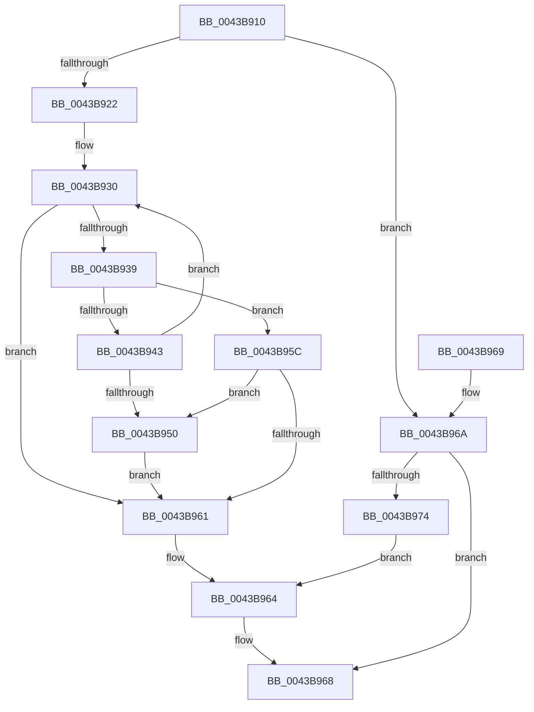

# RtlStringCbCopyW

- RVA: `0x0043B910`–`0x0043B979` (길이 `105` bytes)
- VA: `0x000000014043B910`
- 실행 섹션: `.text`
- PDB 이름 있음: `예`; PDB Function 태그: `아니요`
- unwind 정보 RVA: `0x000DB714`
- 디코드: `34`개 명령, `105/105` bytes 표시
- 미해석 바이트: `0` (있으면 어셈블리에 `.byte`로 보존)

> 이 문서는 커널 이미지의 기계어와 PDB 기호를 분석해 생성했습니다. 4번과 5번은 함수 원형과 자료형을 바이너리 사용 방식에서 추정한 C 해석이며 원본 소스 복구 결과는 아닙니다.

## 1. Dependencies

- 직접 호출 지점: **0**; 고유 호출 대상: **0**
- 직접 호출자로 확인된 함수: **27**
- RIP 상대 이미지 참조: **0**

### Outgoing calls
- 직접 디코드된 call 명령이 없습니다.

### Direct callers
- [SeSetLearningModeObjectInformation](../4C/SeSetLearningModeObjectInformation_function_004C7098.md) at `0x004C7251`
- [PopIdleWakeNotifyWakeSource](../5D/PopIdleWakeNotifyWakeSource_function_005DC204.md) at `0x005DC293`
- [RtlpGetNameFromLangInfoNode](../5E/RtlpGetNameFromLangInfoNode_function_005EBCCC.md) at `0x005EBD48`
- [sub_006EF3AA](../6E/Unknown_function_006EF3AA.md) at `0x006EF3EB`
- [PiDcResetChildDeviceContainerCallback](../../page/73/PiDcResetChildDeviceContainerCallback_function_00730DE0.md) at `0x00730FAA`
- [PfSnParametersRead](../../page/75/PfSnParametersRead_function_00752970.md) at `0x00752AA6`
- [PfSnParametersRead](../../page/75/PfSnParametersRead_function_00752970.md) at `0x00752B02`
- [PfSnParametersRead](../../page/75/PfSnParametersRead_function_00752970.md) at `0x00752B62`
- [RtlpGetDynamicTimeZoneInfoHandle](../../page/78/RtlpGetDynamicTimeZoneInfoHandle_function_0078FD78.md) at `0x0078FDC1`
- [SepRmFetchGlobalSacl](../../page/7A/SepRmFetchGlobalSacl_function_007A298C.md) at `0x007A29EA`
- [PerfDiagpStartPerfDiagLogger](../../page/7A/PerfDiagpStartPerfDiagLogger_function_007AF144.md) at `0x007AF1A1`
- [WmipAddMofResource](../../page/7B/WmipAddMofResource_function_007B4188.md) at `0x007B4261`
- [WmipAddMofResource](../../page/7B/WmipAddMofResource_function_007B4188.md) at `0x007B4270`
- [WmipGenerateBinaryMofNotification](../../page/7B/WmipGenerateBinaryMofNotification_function_007B4348.md) at `0x007B4468`
- [PiSwCompleteCreate](../../page/8D/PiSwCompleteCreate_function_008DAB90.md) at `0x008DAF04`
- [PiSwIrpStartCreateWorker](../../page/8D/PiSwIrpStartCreateWorker_function_008DB398.md) at `0x008DB7EC`
- [PiSwIrpInterfaceRegister](../../page/94/PiSwIrpInterfaceRegister_function_0094F01C.md) at `0x0094F1A3`
- [WmipIncludeStaticNames](../../page/9D/WmipIncludeStaticNames_function_009DF754.md) at `0x009DF8F7`
- [WmipIncludeStaticNames](../../page/9D/WmipIncludeStaticNames_function_009DF754.md) at `0x009DF996`
- [WmipInsertStaticNames](../../page/9E/WmipInsertStaticNames_function_009E1064.md) at `0x009E1303`
- [DbgkSendSystemDllMessages](../../page/A1/DbgkSendSystemDllMessages_function_00A10C04.md) at `0x00A10D74`
- [PipMakeGloballyUniqueId](../../page/A6/PipMakeGloballyUniqueId_function_00A6F428.md) at `0x00A6F5CA`
- [PopPowerInformationInternal](../../page/A8/PopPowerInformationInternal_function_00A8B7C0.md) at `0x00A8C69B`
- [WmipEnumerateMofResources](../../page/A9/WmipEnumerateMofResources_function_00A94410.md) at `0x00A94539`
- [WmipEnumerateMofResources](../../page/A9/WmipEnumerateMofResources_function_00A94410.md) at `0x00A9456C`
- [PiSwFindSwDevice](../../page/A9/PiSwFindSwDevice_function_00A9CA84.md) at `0x00A9CAED`
- [EtwTimLogRedirectionTrustPolicy](../../page/AB/EtwTimLogRedirectionTrustPolicy_function_00ABA7E0.md) at `0x00ABAA67`
- [ExpressionConvertToString](../../page/AD/ExpressionConvertToString_function_00AD83F8.md) at `0x00AD84CD`
- [sub_00B266CA](../../page/B2/Unknown_function_00B266CA.md) at `0x00B268D4`
- [MfgInitSystem](../../init/C1/MfgInitSystem_function_00C1C390.md) at `0x00C1C47C`
- [PfSnParametersSetDefaults](../../init/C3/PfSnParametersSetDefaults_function_00C3CE0C.md) at `0x00C3CEA8`
- [PfSnParametersSetDefaults](../../init/C3/PfSnParametersSetDefaults_function_00C3CE0C.md) at `0x00C3CEC7`
- [ViMakeVerifierSettings](../../init/C4/ViMakeVerifierSettings_function_00C4CF3C.md) at `0x00C4D00A`

### Static image references
- 디코드된 RIP-relative 메모리 참조가 없습니다.

## 2. Other-region calls and transfers

- 다른 실행 섹션으로 향하는 call: **0**
- 별도 외부 분기/꼬리 이동을 확인하지 못했습니다.

## 3. Assembly (complete function range)

```asm
0043B910  48 D1 EA                        shr rdx, 1
0043B913  41 B9 FE FF FF 7F               mov r9d, 0x7ffffffe
0043B919  48 8D 42 FF                     lea rax, [rdx - 1]
0043B91D  49 3B C1                        cmp rax, r9
0043B920  77 48                           ja 0x14043b96a
0043B922  45 33 D2                        xor r10d, r10d
0043B925  4C 2B CA                        sub r9, rdx
0043B928  45 8B DA                        mov r11d, r10d
0043B92B  4C 2B C1                        sub r8, rcx
0043B92E  66 90                           nop
0043B930  49 8D 04 11                     lea rax, [r9 + rdx]
0043B934  48 85 C0                        test rax, rax
0043B937  74 28                           je 0x14043b961
0043B939  41 0F B7 04 08                  movzx eax, word ptr [r8 + rcx]
0043B93E  66 85 C0                        test ax, ax
0043B941  74 19                           je 0x14043b95c
0043B943  66 89 01                        mov word ptr [rcx], ax
0043B946  48 83 C1 02                     add rcx, 2
0043B94A  48 83 EA 01                     sub rdx, 1
0043B94E  75 E0                           jne 0x14043b930
0043B950  48 83 E9 02                     sub rcx, 2
0043B954  41 BB 05 00 00 80               mov r11d, 0x80000005
0043B95A  EB 05                           jmp 0x14043b961
0043B95C  48 85 D2                        test rdx, rdx
0043B95F  74 EF                           je 0x14043b950
0043B961  41 8B C3                        mov eax, r11d
0043B964  66 44 89 11                     mov word ptr [rcx], r10w
0043B968  C3                              ret
0043B969  CC                              int3
0043B96A  B8 0D 00 00 C0                  mov eax, 0xc000000d
0043B96F  48 85 D2                        test rdx, rdx
0043B972  74 F4                           je 0x14043b968
0043B974  45 33 D2                        xor r10d, r10d
0043B977  EB EB                           jmp 0x14043b964
```

## 4. C-style interpretation (structured pseudocode)

```c
__int64 __fastcall RtlStringCbCopyW(__int64 a1, __int64 a2, __int64 a3)
{
    __int64 v_r10;

    a2 = (a2) >> (1);
    if ((a2 - 1) > ((unsigned int)(0x7FFFFFFEULL))) goto loc_0043B96A;
    v_r10 = 0;
    a4 = ((unsigned int)(0x7FFFFFFEULL)) - (a2);
    a3 = (a3) - (a1);
loc_0043B930:
    if (a4 + a2 * 1 == 0) goto loc_0043B961;
    if ((unsigned __int16)(*(unsigned __int16 *)(a3 + a1 * 1)) == 0) goto loc_0043B95C;
    *(unsigned __int16 *)(a1) = (unsigned __int16)(*(unsigned __int16 *)(a3 + a1 * 1));
    a1 = (a1) + (2);
    a2 = (a2) - (1);
    if (condition_is_not_equal) goto loc_0043B930;
loc_0043B950:
    a1 = (a1) - (2);
    goto loc_0043B961;
loc_0043B95C:
    if (a2 == 0) goto loc_0043B950;
loc_0043B961:
loc_0043B964:
    *(unsigned __int16 *)(a1) = 0;
loc_0043B968:
    return (unsigned int)((unsigned int)((unsigned int)(0x80000005ULL)));
loc_0043B96A:
    if (a2 == 0) goto loc_0043B968;
    v_r10 = 0;
    goto loc_0043B964;
}
```

## 5. (Beta) C Style

```c
int64_t RtlStringCbCopyW(void *Arg1, int64_t Arg2, void *Arg3)
{
    uint8_t *arg1 = (uint8_t *)Arg1;
    uint8_t *arg3 = (uint8_t *)Arg3;

    int64_t local_r10;

    Arg2 = (Arg2) >> (1);
    if ((Arg2 - 1) > ((uint32_t)(0x7FFFFFFEULL))) goto loc_0043B96A;
    local_r10 = 0;
    a4 = ((uint32_t)(0x7FFFFFFEULL)) - (Arg2);
    Arg3 = (Arg3) - (Arg1);
loc_0043B930:
    if (a4 + Arg2 * 1 == 0) goto loc_0043B961;
    if ((uint16_t)(*(uint16_t *)(arg3 + arg1 * 1)) == 0) goto loc_0043B95C;
    *(uint16_t *)(arg1) = (uint16_t)(*(uint16_t *)(arg3 + arg1 * 1));
    Arg1 = (Arg1) + (2);
    Arg2 = (Arg2) - (1);
    if (condition_is_not_equal) goto loc_0043B930;
loc_0043B950:
    Arg1 = (Arg1) - (2);
    goto loc_0043B961;
loc_0043B95C:
    if (Arg2 == 0) goto loc_0043B950;
loc_0043B961:
loc_0043B964:
    *(uint16_t *)(arg1) = 0;
loc_0043B968:
    return (uint32_t)((uint32_t)((uint32_t)(0x80000005ULL)));
loc_0043B96A:
    if (Arg2 == 0) goto loc_0043B968;
    local_r10 = 0;
    goto loc_0043B964;
}
```

### 관측된 메모리 오프셋

구조체 형식이 확인되지 않은 접근은 인자 기준의 오프셋으로만 기록했습니다.

| 기준 인자 | 오프셋 표현 | 폭 (bit) | 접근 |
|---|---:|---:|---|
| `Arg1` | `+ 0x0` | `16` | `W` |
| `Arg3` | `+ 0x0 + rcx*1` | `16` | `R` |

## 6. Execution-region graph

[열기: 2D/3D 그래프와 함수 탐색 컨트롤 패널](../../../control-panel.html?section=text&rva=0x0043B910&view=graph)

- 2D 그래프는 위에서 아래로 흐르고, 3D 그래프는 빈 공간을 드래그해 회전합니다. Shift+드래그는 이동, 휠은 확대·축소, 함수 노드 선택은 대상 보고서 이동입니다.

### Static fallback


