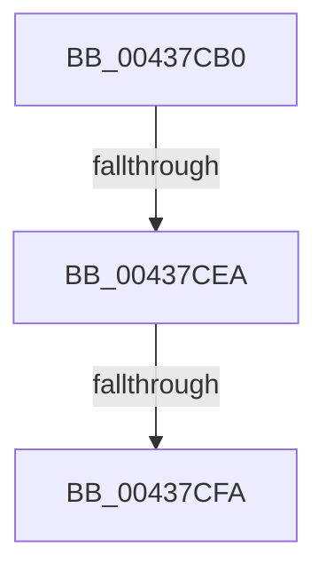

# RtlStringCchCopyNExW

- RVA: `0x00437CB0`–`0x00437D03` (길이 `83` bytes)
- VA: `0x0000000140437CB0`
- 실행 섹션: `.text`
- PDB 이름 있음: `예`; PDB Function 태그: `아니요`
- unwind 정보 RVA: `0x000A3314`
- 디코드: `21`개 명령, `83/83` bytes 표시
- 미해석 바이트: `0` (있으면 어셈블리에 `.byte`로 보존)

> 이 문서는 커널 이미지의 기계어와 PDB 기호를 분석해 생성했습니다. 4번과 5번은 함수 원형과 자료형을 바이너리 사용 방식에서 추정한 C 해석이며 원본 소스 복구 결과는 아닙니다.

## 1. Dependencies

- 직접 호출 지점: **0**; 고유 호출 대상: **0**
- 직접 호출자로 확인된 함수: **5**
- RIP 상대 이미지 참조: **0**

### Outgoing calls
- 직접 디코드된 call 명령이 없습니다.

### Direct callers
- [punycode_encode](../../page/79/punycode_encode_function_007926F4.md) at `0x007927F9`
- [EtwpQueryTokenPackageInfo](../../page/8A/EtwpQueryTokenPackageInfo_function_008A5878.md) at `0x008A59A7`
- [EtwpQueryTokenPackageInfo](../../page/8A/EtwpQueryTokenPackageInfo_function_008A5878.md) at `0x008A59E2`
- [EtwpQueryTokenPackageInfo](../../page/8A/EtwpQueryTokenPackageInfo_function_008A5878.md) at `0x008A5AD2`
- [CmGetDeviceInterfaceSymbolicLinkName](../../page/95/CmGetDeviceInterfaceSymbolicLinkName_function_00951DA4.md) at `0x00951E4A`
- [DrvDbSplitDeviceIdDriverInfMatch](../../page/A6/DrvDbSplitDeviceIdDriverInfMatch_function_00A62808.md) at `0x00A62893`
- [CmSplitDevicePanelId](../../page/AC/CmSplitDevicePanelId_function_00ACEA18.md) at `0x00ACEAB8`
- [CmSplitDevicePanelId](../../page/AC/CmSplitDevicePanelId_function_00ACEA18.md) at `0x00ACEB37`

### Static image references
- 디코드된 RIP-relative 메모리 참조가 없습니다.

## 2. Other-region calls and transfers

- 다른 실행 섹션으로 향하는 call: **0**
- call이 아닌 외부 분기/꼬리 이동: **3**
  - `0x00437CE4` → [sub_00437EAC](Unknown_function_00437EAC.md) (`tail-transfer`)
  - `0x00437CF4` → [sub_00437EAC + 0x19](Unknown_function_00437EAC.md) (`tail-transfer`)
  - `0x00437CFD` → [sub_00437E40](Unknown_function_00437E40.md) (`tail-transfer`)

## 3. Assembly (complete function range)

```asm
00437CB0  40 53                           push rbx
00437CB2  41 54                           push r12
00437CB4  41 55                           push r13
00437CB6  41 56                           push r14
00437CB8  41 57                           push r15
00437CBA  48 83 EC 40                     sub rsp, 0x40
00437CBE  44 8B A4 24 A0 00 00 00         mov r12d, dword ptr [rsp + 0xa0]
00437CC6  4D 8B D0                        mov r10, r8
00437CC9  45 33 ED                        xor r13d, r13d
00437CCC  45 8B C4                        mov r8d, r12d
00437CCF  4C 8B F2                        mov r14, rdx
00437CD2  4C 8B F9                        mov r15, rcx
00437CD5  45 8B DD                        mov r11d, r13d
00437CD8  BB 0D 00 00 C0                  mov ebx, 0xc000000d
00437CDD  41 81 E0 00 01 00 00            and r8d, 0x100
00437CE4  0F 85 C2 01 00 00               jne 0x140437eac
00437CEA  48 8D 42 FF                     lea rax, [rdx - 1]
00437CEE  48 3D FE FF FF 7F               cmp rax, 0x7ffffffe
00437CF4  0F 87 CB 01 00 00               ja 0x140437ec5
00437CFA  45 85 DB                        test r11d, r11d
00437CFD  0F 88 3D 01 00 00               js 0x140437e40
```

## 4. C-style interpretation (structured pseudocode)

```c
__int64 __fastcall RtlStringCchCopyNExW(__int64 a1, __int64 a2, __int64 a3, __int64 a4, __int64 a5, __int64 a6, unsigned int a7)
{
    __int64 v_r13;
    __int64 v_rsp;

    v_rsp = (v_rsp) - (64);
    v_r13 = 0;
    a3 = (unsigned int)(((unsigned int)((unsigned int)((unsigned int)(a7)))) & (256));
}
```

## 5. (Beta) C Style

```c
int64_t RtlStringCchCopyNExW(int64_t Arg1, void *Arg2, int64_t Arg3, int64_t Arg4, uint64_t Arg5, uint64_t Arg6, uint32_t Arg7)
{
    uint8_t *arg2 = (uint8_t *)Arg2;

    int64_t local_r13;
    int64_t local_rsp;

    local_rsp = (local_rsp) - (64);
    local_r13 = 0;
    Arg3 = (uint32_t)(((uint32_t)((uint32_t)((uint32_t)(Arg7)))) & (256));
}
```

### 관측된 메모리 오프셋

구조체 형식이 확인되지 않은 접근은 인자 기준의 오프셋으로만 기록했습니다.

| 기준 인자 | 오프셋 표현 | 폭 (bit) | 접근 |
|---|---:|---:|---|
| `Arg2` | `- 0x1` | `64` | `R` |

## 6. Execution-region graph

[열기: 2D/3D 그래프와 함수 탐색 컨트롤 패널](../../../control-panel.html?section=text&rva=0x00437CB0&view=graph)

- 2D 그래프는 위에서 아래로 흐르고, 3D 그래프는 빈 공간을 드래그해 회전합니다. Shift+드래그는 이동, 휠은 확대·축소, 함수 노드 선택은 대상 보고서 이동입니다.

### Static fallback


