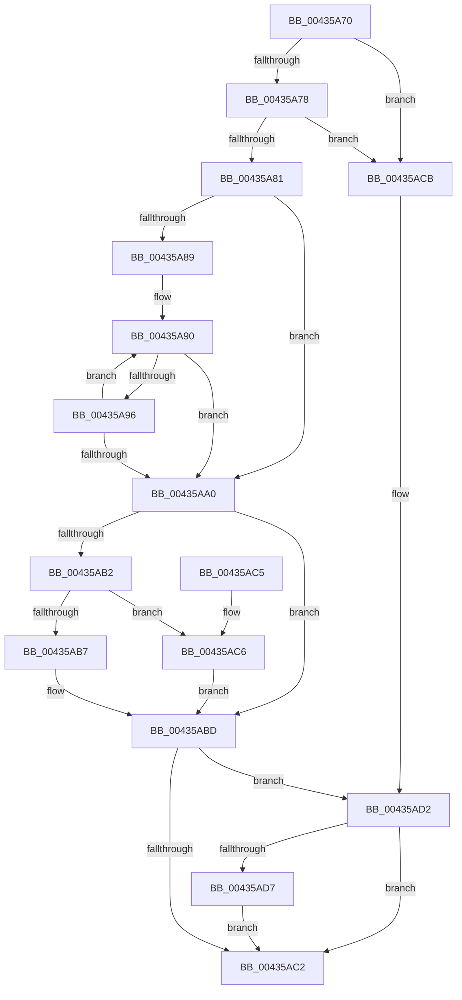

# RtlStringCchLengthW

- RVA: `0x00435A70`–`0x00435ADC` (길이 `108` bytes)
- VA: `0x0000000140435A70`
- 실행 섹션: `.text`
- PDB 이름 있음: `예`; PDB Function 태그: `아니요`
- unwind 정보 RVA: `0x000DB714`
- 디코드: `37`개 명령, `108/108` bytes 표시
- 미해석 바이트: `0` (있으면 어셈블리에 `.byte`로 보존)

> 이 문서는 커널 이미지의 기계어와 PDB 기호를 분석해 생성했습니다. 4번과 5번은 함수 원형과 자료형을 바이너리 사용 방식에서 추정한 C 해석이며 원본 소스 복구 결과는 아닙니다.

## 1. Dependencies

- 직접 호출 지점: **0**; 고유 호출 대상: **0**
- 직접 호출자로 확인된 함수: **15**
- RIP 상대 이미지 참조: **0**

### Outgoing calls
- 직접 디코드된 call 명령이 없습니다.

### Direct callers
- [RtlpIdnToUnicodeWorker](../5E/RtlpIdnToUnicodeWorker_function_005ECB3C.md) at `0x005ECBC4`
- [RtlpNameprepAsciiRealWorker](../5E/RtlpNameprepAsciiRealWorker_function_005ECDF8.md) at `0x005ECEA4`
- [PiCMGenerateDeviceInstance](../../page/73/PiCMGenerateDeviceInstance_function_0073B69C.md) at `0x0073B6F3`
- [PpmRegisterProfiles](../../page/77/PpmRegisterProfiles_function_007709F0.md) at `0x00770B11`
- [PopPlInitWString](../../page/77/PopPlInitWString_function_0077252C.md) at `0x00772561`
- [TtmNotifyDeviceArrival](../../page/77/TtmNotifyDeviceArrival_function_007754F0.md) at `0x0077558C`
- [RtlpValidAttribute](../../page/78/RtlpValidAttribute_function_0078E0A4.md) at `0x0078E0D2`
- [SdbpGetMergeRedirectPathInternal](../../page/81/SdbpGetMergeRedirectPathInternal_function_00812B00.md) at `0x00812C12`
- [SdbpGetMergeRedirectPathInternal](../../page/81/SdbpGetMergeRedirectPathInternal_function_00812B00.md) at `0x00812F15`
- [SdbpSafeAllocAndConcatW](../../page/81/SdbpSafeAllocAndConcatW_function_00813198.md) at `0x00813207`
- [SdbpSafeAllocAndConcatW](../../page/81/SdbpSafeAllocAndConcatW_function_00813198.md) at `0x00813248`
- [AslPathCombine](../../page/81/AslPathCombine_function_0081B100.md) at `0x0081B14C`
- [AslPathCombine](../../page/81/AslPathCombine_function_0081B100.md) at `0x0081B166`
- [PiUEventCopyEventData](../../page/9C/PiUEventCopyEventData_function_009C2E90.md) at `0x009C31CA`
- [PiUEventHandleRegistration](../../page/9C/PiUEventHandleRegistration_function_009C3304.md) at `0x009C3384`
- [PiUEventHandleRegistration](../../page/9C/PiUEventHandleRegistration_function_009C3304.md) at `0x009C341C`
- [PiUEventHandleRegistration](../../page/9C/PiUEventHandleRegistration_function_009C3304.md) at `0x009C343B`
- [DbgkWerCaptureLiveKernelDump2](../../page/AC/DbgkWerCaptureLiveKernelDump2_function_00AC1F10.md) at `0x00AC2039`
- [PiCMCreateDevice](../../page/AC/PiCMCreateDevice_function_00ACB824.md) at `0x00ACBF0D`
- [sub_00B33DD8](../../page/B3/Unknown_function_00B33DD8.md) at `0x00B33E50`
- [sub_00B33DD8](../../page/B3/Unknown_function_00B33DD8.md) at `0x00B33F17`

### Static image references
- 디코드된 RIP-relative 메모리 참조가 없습니다.

## 2. Other-region calls and transfers

- 다른 실행 섹션으로 향하는 call: **0**
- 별도 외부 분기/꼬리 이동을 확인하지 못했습니다.

## 3. Assembly (complete function range)

```asm
00435A70  4C 8B CA                        mov r9, rdx
00435A73  48 85 C9                        test rcx, rcx
00435A76  74 53                           je 0x140435acb
00435A78  48 81 FA FF FF FF 7F            cmp rdx, 0x7fffffff
00435A7F  77 4A                           ja 0x140435acb
00435A81  48 8B C2                        mov rax, rdx
00435A84  48 85 D2                        test rdx, rdx
00435A87  74 17                           je 0x140435aa0
00435A89  0F 1F 80 00 00 00 00            nop dword ptr [rax]
00435A90  66 83 39 00                     cmp word ptr [rcx], 0
00435A94  74 0A                           je 0x140435aa0
00435A96  48 83 C1 02                     add rcx, 2
00435A9A  48 83 E8 01                     sub rax, 1
00435A9E  75 F0                           jne 0x140435a90
00435AA0  33 D2                           xor edx, edx
00435AA2  B9 0D 00 00 C0                  mov ecx, 0xc000000d
00435AA7  48 85 C0                        test rax, rax
00435AAA  0F 45 CA                        cmovne ecx, edx
00435AAD  4D 85 C0                        test r8, r8
00435AB0  74 0B                           je 0x140435abd
00435AB2  48 85 C0                        test rax, rax
00435AB5  74 0F                           je 0x140435ac6
00435AB7  4C 2B C8                        sub r9, rax
00435ABA  4D 89 08                        mov qword ptr [r8], r9
00435ABD  48 85 C0                        test rax, rax
00435AC0  74 10                           je 0x140435ad2
00435AC2  8B C1                           mov eax, ecx
00435AC4  C3                              ret
00435AC5  CC                              int3
00435AC6  49 89 10                        mov qword ptr [r8], rdx
00435AC9  EB F2                           jmp 0x140435abd
00435ACB  B9 0D 00 00 C0                  mov ecx, 0xc000000d
00435AD0  33 D2                           xor edx, edx
00435AD2  4D 85 C0                        test r8, r8
00435AD5  74 EB                           je 0x140435ac2
00435AD7  49 89 10                        mov qword ptr [r8], rdx
00435ADA  EB E6                           jmp 0x140435ac2
```

## 4. C-style interpretation (structured pseudocode)

```c
__int64 __fastcall RtlStringCchLengthW(__int64 a1, __int64 a2, __int64 a3)
{
    __int64 result;

    if (a1 == 0) goto loc_00435ACB;
    if (a2 > 0x7FFFFFFFULL) goto loc_00435ACB;
    if (a2 == 0) goto loc_00435AA0;
loc_00435A90:
    if ((*(unsigned __int16 *)(a1)) == 0) goto loc_00435AA0;
    a1 = (a1) + (2);
    result = (a2) - (1);
    if (condition_is_not_equal) goto loc_00435A90;
loc_00435AA0:
    a2 = 0;
    a1 = (unsigned int)(0xC000000DULL);
    if (result != 0) { a1 = 0; }
    if (a3 == 0) goto loc_00435ABD;
    if (result == 0) goto loc_00435AC6;
    a4 = (a2) - (result);
    *(unsigned __int64 *)(a3) = a4;
loc_00435ABD:
    if (result == 0) goto loc_00435AD2;
loc_00435AC2:
    return (unsigned int)((unsigned int)(a1));
loc_00435AC6:
    *(unsigned __int64 *)(a3) = 0;
    goto loc_00435ABD;
loc_00435ACB:
    a2 = 0;
loc_00435AD2:
    if (a3 == 0) goto loc_00435AC2;
    *(unsigned __int64 *)(a3) = 0;
    goto loc_00435AC2;
}
```

## 5. (Beta) C Style

```c
int64_t RtlStringCchLengthW(int64_t Arg1, int64_t Arg2, int64_t Arg3)
{
    int64_t result;

    if (Arg1 == 0) goto loc_00435ACB;
    if (Arg2 > 0x7FFFFFFFULL) goto loc_00435ACB;
    if (Arg2 == 0) goto loc_00435AA0;
loc_00435A90:
    if ((*(uint16_t *)(Arg1)) == 0) goto loc_00435AA0;
    Arg1 = (Arg1) + (2);
    result = (Arg2) - (1);
    if (condition_is_not_equal) goto loc_00435A90;
loc_00435AA0:
    Arg2 = 0;
    Arg1 = (uint32_t)(0xC000000DULL);
    if (result != 0) { Arg1 = 0; }
    if (Arg3 == 0) goto loc_00435ABD;
    if (result == 0) goto loc_00435AC6;
    a4 = (Arg2) - (result);
    *(uint64_t *)(Arg3) = a4;
loc_00435ABD:
    if (result == 0) goto loc_00435AD2;
loc_00435AC2:
    return (uint32_t)((uint32_t)(Arg1));
loc_00435AC6:
    *(uint64_t *)(Arg3) = 0;
    goto loc_00435ABD;
loc_00435ACB:
    Arg2 = 0;
loc_00435AD2:
    if (Arg3 == 0) goto loc_00435AC2;
    *(uint64_t *)(Arg3) = 0;
    goto loc_00435AC2;
}
```

## 6. Execution-region graph

[열기: 2D/3D 그래프와 함수 탐색 컨트롤 패널](../../../control-panel.html?section=text&rva=0x00435A70&view=graph)

- 2D 그래프는 위에서 아래로 흐르고, 3D 그래프는 빈 공간을 드래그해 회전합니다. Shift+드래그는 이동, 휠은 확대·축소, 함수 노드 선택은 대상 보고서 이동입니다.

### Static fallback


