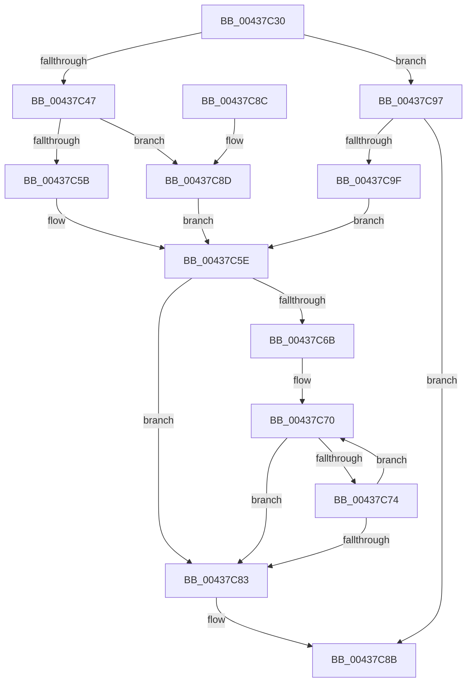

# RtlTimelineBitmapUpdateRange

- RVA: `0x00437C30`–`0x00437CAA` (길이 `122` bytes)
- VA: `0x0000000140437C30`
- 실행 섹션: `.text`
- PDB 이름 있음: `예`; PDB Function 태그: `아니요`
- unwind 정보 RVA: `0x000DB714`
- 디코드: `40`개 명령, `122/122` bytes 표시
- 미해석 바이트: `0` (있으면 어셈블리에 `.byte`로 보존)

> 이 문서는 커널 이미지의 기계어와 PDB 기호를 분석해 생성했습니다. 4번과 5번은 함수 원형과 자료형을 바이너리 사용 방식에서 추정한 C 해석이며 원본 소스 복구 결과는 아닙니다.

## 1. Dependencies

- 직접 호출 지점: **0**; 고유 호출 대상: **0**
- 직접 호출자로 확인된 함수: **3**
- RIP 상대 이미지 참조: **0**

### Outgoing calls
- 직접 디코드된 call 명령이 없습니다.

### Direct callers
- [PoEnergyContextCleanup](../../page/90/PoEnergyContextCleanup_function_00907A38.md) at `0x00907B7F`
- [PsQueryProcessEnergyValues](../../page/91/PsQueryProcessEnergyValues_function_0091A4E0.md) at `0x0091A848`
- [PsQueryProcessEnergyValues](../../page/91/PsQueryProcessEnergyValues_function_0091A4E0.md) at `0x0091A868`
- [PoEnergyContextUpdateComponentPower](../../page/98/PoEnergyContextUpdateComponentPower_function_0098CA08.md) at `0x0098CE7D`
- [PoEnergyContextUpdateComponentPower](../../page/98/PoEnergyContextUpdateComponentPower_function_0098CA08.md) at `0x0098CEA4`

### Static image references
- 디코드된 RIP-relative 메모리 참조가 없습니다.

## 2. Other-region calls and transfers

- 다른 실행 섹션으로 향하는 call: **0**
- 별도 외부 분기/꼬리 이동을 확인하지 못했습니다.

## 3. Assembly (complete function range)

```asm
00437C30  48 8B 01                        mov rax, qword ptr [rcx]
00437C33  4C 8B D1                        mov r10, rcx
00437C36  4C 8B C8                        mov r9, rax
00437C39  48 89 44 24 08                  mov qword ptr [rsp + 8], rax
00437C3E  49 C1 E9 20                     shr r9, 0x20
00437C42  44 3B C0                        cmp r8d, eax
00437C45  76 50                           jbe 0x140437c97
00437C47  41 8B C8                        mov ecx, r8d
00437C4A  44 89 44 24 08                  mov dword ptr [rsp + 8], r8d
00437C4F  2B C8                           sub ecx, eax
00437C51  B8 01 00 00 00                  mov eax, 1
00437C56  83 F9 20                        cmp ecx, 0x20
00437C59  72 32                           jb 0x140437c8d
00437C5B  45 33 C9                        xor r9d, r9d
00437C5E  44 0B C8                        or r9d, eax
00437C61  44 89 4C 24 0C                  mov dword ptr [rsp + 0xc], r9d
00437C66  41 3B D0                        cmp edx, r8d
00437C69  73 18                           jae 0x140437c83
00437C6B  0F 1F 44 00 00                  nop dword ptr [rax + rax]
00437C70  03 C0                           add eax, eax
00437C72  74 0F                           je 0x140437c83
00437C74  44 0B C8                        or r9d, eax
00437C77  FF C2                           inc edx
00437C79  44 89 4C 24 0C                  mov dword ptr [rsp + 0xc], r9d
00437C7E  41 3B D0                        cmp edx, r8d
00437C81  72 ED                           jb 0x140437c70
00437C83  48 8B 44 24 08                  mov rax, qword ptr [rsp + 8]
00437C88  49 89 02                        mov qword ptr [r10], rax
00437C8B  C3                              ret
00437C8C  CC                              int3
00437C8D  44 8B 4C 24 0C                  mov r9d, dword ptr [rsp + 0xc]
00437C92  41 D3 E1                        shl r9d, cl
00437C95  EB C7                           jmp 0x140437c5e
00437C97  41 2B C0                        sub eax, r8d
00437C9A  83 F8 20                        cmp eax, 0x20
00437C9D  73 EC                           jae 0x140437c8b
00437C9F  8B C8                           mov ecx, eax
00437CA1  B8 01 00 00 00                  mov eax, 1
00437CA6  D3 E0                           shl eax, cl
00437CA8  EB B4                           jmp 0x140437c5e
```

## 4. C-style interpretation (structured pseudocode)

```c
__int64 __fastcall RtlTimelineBitmapUpdateRange(__int64 a1, int a2, int a3)
{
    __int64 result;
    unsigned __int64 v_stack_p8;
    unsigned int v_stack_pC;

    v_stack_p8 = *(unsigned __int64 *)(a1);
    a4 = (*(unsigned __int64 *)(a1)) >> (32);
    if (a3 <= ((unsigned int)(*(unsigned __int64 *)(a1)))) goto loc_00437C97;
    v_stack_p8 = a3;
    a1 = (unsigned int)(((unsigned int)(a3)) - ((unsigned int)(*(unsigned __int64 *)(a1))));
    if (((unsigned int)(a1)) < 32) goto loc_00437C8D;
    a4 = 0;
loc_00437C5E:
    a4 = (unsigned int)((a4) | (1));
    v_stack_pC = (unsigned int)(a4);
    if (a2 >= a3) goto loc_00437C83;
loc_00437C70:
    result = (unsigned int)((1) + (1));
    if (condition_is_equal) goto loc_00437C83;
    a4 = (unsigned int)((a4) | ((unsigned int)(result)));
    a2 = (unsigned int)((a2) + 1);
    v_stack_pC = (unsigned int)(a4);
    if (a2 < a3) goto loc_00437C70;
loc_00437C83:
    *(unsigned __int64 *)(a1) = v_stack_p8;
loc_00437C8B:
    return v_stack_p8;
loc_00437C8D:
    a4 = (unsigned int)(((unsigned int)(v_stack_pC)) << ((unsigned __int8)(a1)));
    goto loc_00437C5E;
loc_00437C97:
    result = (unsigned int)((v_stack_p8) - (a3));
    if (((unsigned int)(result)) >= 32) goto loc_00437C8B;
    result = (unsigned int)((1) << ((unsigned __int8)((unsigned int)((unsigned int)(result)))));
    goto loc_00437C5E;
}
```

## 5. (Beta) C Style

```c
int64_t RtlTimelineBitmapUpdateRange(void *Arg1, int32_t Arg2, int32_t Arg3)
{
    uint8_t *arg1 = (uint8_t *)Arg1;

    int64_t result;
    uint64_t v_stack_p8;
    uint32_t v_stack_pC;

    v_stack_p8 = *(uint64_t *)(arg1);
    a4 = (*(uint64_t *)(arg1)) >> (32);
    if (Arg3 <= ((uint32_t)(*(uint64_t *)(arg1)))) goto loc_00437C97;
    v_stack_p8 = Arg3;
    Arg1 = (uint32_t)(((uint32_t)(Arg3)) - ((uint32_t)(*(uint64_t *)(arg1))));
    if (((uint32_t)(Arg1)) < 32) goto loc_00437C8D;
    a4 = 0;
loc_00437C5E:
    a4 = (uint32_t)((a4) | (1));
    v_stack_pC = (uint32_t)(a4);
    if (Arg2 >= Arg3) goto loc_00437C83;
loc_00437C70:
    result = (uint32_t)((1) + (1));
    if (condition_is_equal) goto loc_00437C83;
    a4 = (uint32_t)((a4) | ((uint32_t)(result)));
    Arg2 = (uint32_t)((Arg2) + 1);
    v_stack_pC = (uint32_t)(a4);
    if (Arg2 < Arg3) goto loc_00437C70;
loc_00437C83:
    *(uint64_t *)(arg1) = v_stack_p8;
loc_00437C8B:
    return v_stack_p8;
loc_00437C8D:
    a4 = (uint32_t)(((uint32_t)(v_stack_pC)) << ((uint8_t)(Arg1)));
    goto loc_00437C5E;
loc_00437C97:
    result = (uint32_t)((v_stack_p8) - (Arg3));
    if (((uint32_t)(result)) >= 32) goto loc_00437C8B;
    result = (uint32_t)((1) << ((uint8_t)((uint32_t)((uint32_t)(result)))));
    goto loc_00437C5E;
}
```

### 관측된 메모리 오프셋

구조체 형식이 확인되지 않은 접근은 인자 기준의 오프셋으로만 기록했습니다.

| 기준 인자 | 오프셋 표현 | 폭 (bit) | 접근 |
|---|---:|---:|---|
| `Arg1` | `+ 0x0` | `64` | `R` |
| `Arg1` | `+ 0x0` | `64` | `W` |

## 6. Execution-region graph

[열기: 2D/3D 그래프와 함수 탐색 컨트롤 패널](../../../control-panel.html?section=text&rva=0x00437C30&view=graph)

- 2D 그래프는 위에서 아래로 흐르고, 3D 그래프는 빈 공간을 드래그해 회전합니다. Shift+드래그는 이동, 휠은 확대·축소, 함수 노드 선택은 대상 보고서 이동입니다.

### Static fallback


