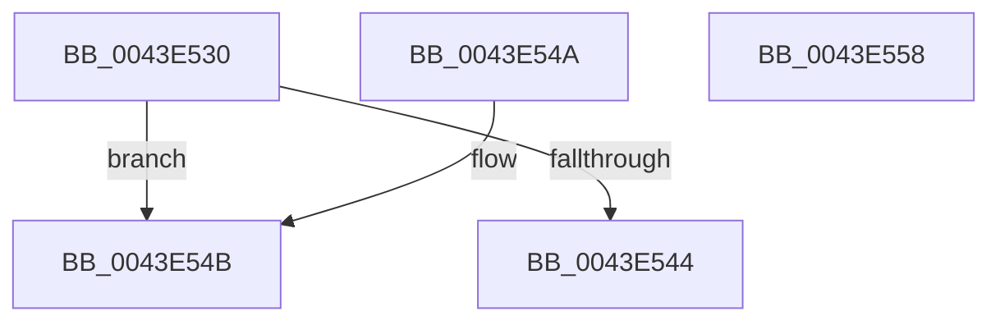

# RtlULongLongMult

- RVA: `0x0043E530`–`0x0043E559` (길이 `41` bytes)
- VA: `0x000000014043E530`
- 실행 섹션: `.text`
- PDB 이름 있음: `예`; PDB Function 태그: `아니요`
- unwind 정보 RVA: `0x000DB714`
- 디코드: `13`개 명령, `41/41` bytes 표시
- 미해석 바이트: `0` (있으면 어셈블리에 `.byte`로 보존)

> 이 문서는 커널 이미지의 기계어와 PDB 기호를 분석해 생성했습니다. 4번과 5번은 함수 원형과 자료형을 바이너리 사용 방식에서 추정한 C 해석이며 원본 소스 복구 결과는 아닙니다.

## 1. Dependencies

- 직접 호출 지점: **0**; 고유 호출 대상: **0**
- 직접 호출자로 확인된 함수: **24**
- RIP 상대 이미지 참조: **0**

### Outgoing calls
- 직접 디코드된 call 명령이 없습니다.

### Direct callers
- [HalpTimerConvertPerformanceCounterToAuxiliaryCounter](../53/HalpTimerConvertPerformanceCounterToAuxiliaryCounter_function_0053C4E0.md) at `0x0053C581`
- [HalpTimerSchedulePeriodicQueries](../53/HalpTimerSchedulePeriodicQueries_function_0053D388.md) at `0x0053D3F7`
- [HalpTimerSchedulePeriodicQueries](../53/HalpTimerSchedulePeriodicQueries_function_0053D388.md) at `0x0053D43E`
- [HalpSetResumeTime](../55/HalpSetResumeTime_function_0055BC08.md) at `0x0055BCD9`
- [RtlpFcValidateGovernedFeatures](../5F/RtlpFcValidateGovernedFeatures_function_005F0E18.md) at `0x005F0E9E`
- [RtlpFcValidateGovernedFeatures](../5F/RtlpFcValidateGovernedFeatures_function_005F0E18.md) at `0x005F0EB5`
- [RtlpHpVaMgrCtxStart](../60/RtlpHpVaMgrCtxStart_function_00603E2C.md) at `0x00603E5E`
- [RtlpHpVaMgrCtxStart](../60/RtlpHpVaMgrCtxStart_function_00603E2C.md) at `0x00603E74`
- [ExPoolQueryLimits](../65/ExPoolQueryLimits_function_006562A0.md) at `0x00656384`
- [ExPoolSetLimit](../65/ExPoolSetLimit_function_00656498.md) at `0x0065656C`
- [PopFxPepPerfInfoQuery](../../page/75/PopFxPepPerfInfoQuery_function_00759564.md) at `0x00759677`
- [PopFxRegisterComponentPerfStates](../../page/75/PopFxRegisterComponentPerfStates_function_00759764.md) at `0x0075982D`
- [PopFxRegisterComponentPerfStates](../../page/75/PopFxRegisterComponentPerfStates_function_00759764.md) at `0x00759876`
- [PopFxRegisterComponentPerfStates](../../page/75/PopFxRegisterComponentPerfStates_function_00759764.md) at `0x007598CC`
- [PopFxRegisterComponentPerfStates](../../page/75/PopFxRegisterComponentPerfStates_function_00759764.md) at `0x00759944`
- [PpmRegisterProfiles](../../page/77/PpmRegisterProfiles_function_007709F0.md) at `0x00770A36`
- [NtAlertMultipleThreadByThreadId](../../page/78/NtAlertMultipleThreadByThreadId_function_00789650.md) at `0x007896CA`
- [SdbpResolveMatchingFile](../../page/81/SdbpResolveMatchingFile_function_00816A20.md) at `0x00816B78`
- [RtlpMuiRegGetOrAddStringToPool](../../page/83/RtlpMuiRegGetOrAddStringToPool_function_0083E970.md) at `0x0083EA4E`
- [AuthzBasepGetClaimAttributeValueCopyoutBufferSize](../../page/A1/AuthzBasepGetClaimAttributeValueCopyoutBufferSize_function_00A18470.md) at `0x00A1854A`
- [RtlpFcCalculateRequiredSizeForNewUsageSubscriptionTable](../../page/A4/RtlpFcCalculateRequiredSizeForNewUsageSubscriptionTable_function_00A44FEC.md) at `0x00A450D2`
- [RtlpFcCalculateRequiredSizeForNewFeatureTable](../../page/AA/RtlpFcCalculateRequiredSizeForNewFeatureTable_function_00AAF250.md) at `0x00AAF361`
- [PopReadResumeContext](../../page/AC/PopReadResumeContext_function_00AC8E20.md) at `0x00AC8EC8`
- [PopFxConvertV1Components](../../page/AD/PopFxConvertV1Components_function_00AD6508.md) at `0x00AD6574`
- [sub_00B2A9C6](../../page/B2/Unknown_function_00B2A9C6.md) at `0x00B2A9D6`
- [sub_00B37182](../../page/B3/Unknown_function_00B37182.md) at `0x00B371A0`
- [sub_00B37182](../../page/B3/Unknown_function_00B37182.md) at `0x00B37204`
- [PopDiagTraceFirmwareS3Stats](../../pagelk/B7/PopDiagTraceFirmwareS3Stats_function_00B710B8.md) at `0x00B71239`
- [AnFwDisplayBackgroundUpdate](../../pagebgfx/BC/AnFwDisplayBackgroundUpdate_function_00BC1E44.md) at `0x00BC1EA3`
- [AnFwpBackgroundUpdateTimer](../../pagebgfx/BC/AnFwpBackgroundUpdateTimer_function_00BC21B0.md) at `0x00BC21E0`
- [GetBootSystemTime](../../init/C1/GetBootSystemTime_function_00C1AFCC.md) at `0x00C1B055`

### Static image references
- 디코드된 RIP-relative 메모리 참조가 없습니다.

## 2. Other-region calls and transfers

- 다른 실행 섹션으로 향하는 call: **0**
- 별도 외부 분기/꼬리 이동을 확인하지 못했습니다.

## 3. Assembly (complete function range)

```asm
0043E530  48 8B C2                        mov rax, rdx
0043E533  48 C7 44 24 20 00 00 00 00      mov qword ptr [rsp + 0x20], 0
0043E53C  48 F7 E1                        mul rcx
0043E53F  48 85 D2                        test rdx, rdx
0043E542  75 07                           jne 0x14043e54b
0043E544  49 89 00                        mov qword ptr [r8], rax
0043E547  33 C0                           xor eax, eax
0043E549  C3                              ret
0043E54A  CC                              int3
0043E54B  49 C7 00 FF FF FF FF            mov qword ptr [r8], 0xffffffffffffffff
0043E552  B8 95 00 00 C0                  mov eax, 0xc0000095
0043E557  C3                              ret
0043E558  CC                              int3
```

## 4. C-style interpretation (structured pseudocode)

```c
__int64 __fastcall RtlULongLongMult(__int64 a1, __int64 a2, __int64 a3)
{
    __int64 result;
    unsigned __int64 v_stack_p20;

    v_stack_p20 = 0;
    if (a2 != 0) goto loc_0043E54B;
    *(unsigned __int64 *)(a3) = a2;
    result = 0;
    return result;
loc_0043E54B:
    *(unsigned __int64 *)(a3) = -1;
    return (unsigned int)(0xC0000095ULL);
}
```

## 5. (Beta) C Style

```c
int64_t RtlULongLongMult(int64_t Arg1, int64_t Arg2, void *Arg3)
{
    uint8_t *arg3 = (uint8_t *)Arg3;

    int64_t result;
    uint64_t v_stack_p20;

    v_stack_p20 = 0;
    if (Arg2 != 0) goto loc_0043E54B;
    *(uint64_t *)(arg3) = Arg2;
    result = 0;
    return result;
loc_0043E54B:
    *(uint64_t *)(arg3) = -1;
    return (uint32_t)(0xC0000095ULL);
}
```

### 관측된 메모리 오프셋

구조체 형식이 확인되지 않은 접근은 인자 기준의 오프셋으로만 기록했습니다.

| 기준 인자 | 오프셋 표현 | 폭 (bit) | 접근 |
|---|---:|---:|---|
| `Arg3` | `+ 0x0` | `64` | `W` |

## 6. Execution-region graph

[열기: 2D/3D 그래프와 함수 탐색 컨트롤 패널](../../../control-panel.html?section=text&rva=0x0043E530&view=graph)

- 2D 그래프는 위에서 아래로 흐르고, 3D 그래프는 빈 공간을 드래그해 회전합니다. Shift+드래그는 이동, 휠은 확대·축소, 함수 노드 선택은 대상 보고서 이동입니다.

### Static fallback


