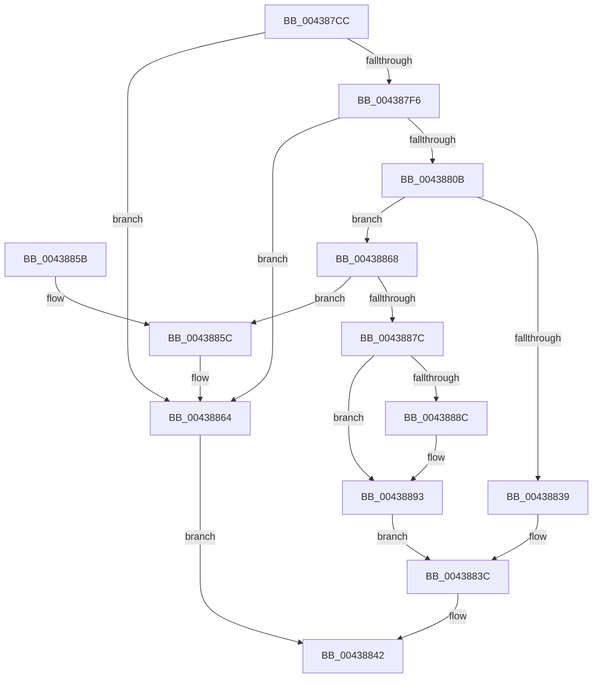

# RtlpAllocateAtomTableEntry

- RVA: `0x004387CC`–`0x004388A3` (길이 `215` bytes)
- VA: `0x00000001404387CC`
- 실행 섹션: `.text`
- PDB 이름 있음: `예`; PDB Function 태그: `아니요`
- unwind 정보 RVA: `0x00064D44`
- 디코드: `65`개 명령, `215/215` bytes 표시
- 미해석 바이트: `0` (있으면 어셈블리에 `.byte`로 보존)

> 이 문서는 커널 이미지의 기계어와 PDB 기호를 분석해 생성했습니다. 4번과 5번은 함수 원형과 자료형을 바이너리 사용 방식에서 추정한 C 해석이며 원본 소스 복구 결과는 아닙니다.

## 1. Dependencies

- 직접 호출 지점: **4**; 고유 호출 대상: **3**
- 직접 호출자로 확인된 함수: **1**
- RIP 상대 이미지 참조: **0**

### Outgoing calls
- `0x004387FB` → [RtlpAllocateAtom](../../page/99/RtlpAllocateAtom_function_0099E2B4.md) (function, `0x0099E2B4`)
- `0x0043882E` → [RtlpQueryLowBoxId](RtlpQueryLowBoxId_function_00438A50.md) (function, `0x00438A50`)
- `0x0043885F` → [RtlpFreeAtom](../../page/8B/RtlpFreeAtom_function_008BD87C.md) (function, `0x008BD87C`)
- `0x00438872` → [RtlpAllocateAtom](../../page/99/RtlpAllocateAtom_function_0099E2B4.md) (function, `0x0099E2B4`)

### Direct callers
- [RtlAddAtomToAtomTableEx](RtlAddAtomToAtomTableEx_function_00438550.md) at `0x00438675`

### Static image references
- 디코드된 RIP-relative 메모리 참조가 없습니다.

## 2. Other-region calls and transfers

- 다른 실행 섹션으로 향하는 call: **3**
  - `0x004387FB` → [RtlpAllocateAtom](../../page/99/RtlpAllocateAtom_function_0099E2B4.md) (`.text` → `PAGE`)
  - `0x0043885F` → [RtlpFreeAtom](../../page/8B/RtlpFreeAtom_function_008BD87C.md) (`.text` → `PAGE`)
  - `0x00438872` → [RtlpAllocateAtom](../../page/99/RtlpAllocateAtom_function_0099E2B4.md) (`.text` → `PAGE`)
- 별도 외부 분기/꼬리 이동을 확인하지 못했습니다.

## 3. Assembly (complete function range)

```asm
004387CC  48 89 5C 24 08                  mov qword ptr [rsp + 8], rbx
004387D1  48 89 6C 24 10                  mov qword ptr [rsp + 0x10], rbp
004387D6  48 89 74 24 18                  mov qword ptr [rsp + 0x18], rsi
004387DB  57                              push rdi
004387DC  41 56                           push r14
004387DE  41 57                           push r15
004387E0  48 83 EC 20                     sub rsp, 0x20
004387E4  8B C9                           mov ecx, ecx
004387E6  41 8B D8                        mov ebx, r8d
004387E9  48 83 C1 2C                     add rcx, 0x2c
004387ED  48 8B F2                        mov rsi, rdx
004387F0  48 83 F9 2C                     cmp rcx, 0x2c
004387F4  72 6E                           jb 0x140438864
004387F6  BA 41 74 6D 41                  mov edx, 0x416d7441
004387FB  E8 B4 5A 56 00                  call 0x14099e2b4
00438800  45 33 F6                        xor r14d, r14d
00438803  48 8B F8                        mov rdi, rax
00438806  48 85 C0                        test rax, rax
00438809  74 59                           je 0x140438864
0043880B  4C 89 30                        mov qword ptr [rax], r14
0043880E  45 8D 7E 01                     lea r15d, [r14 + 1]
00438812  66 44 89 78 24                  mov word ptr [rax + 0x24], r15w
00438817  66 83 E3 02                     and bx, 2
0043881B  66 89 58 26                     mov word ptr [rax + 0x26], bx
0043881F  48 8D 58 10                     lea rbx, [rax + 0x10]
00438823  44 89 70 20                     mov dword ptr [rax + 0x20], r14d
00438827  48 89 5B 08                     mov qword ptr [rbx + 8], rbx
0043882B  48 89 1B                        mov qword ptr [rbx], rbx
0043882E  E8 1D 02 00 00                  call 0x140438a50
00438833  8B E8                           mov ebp, eax
00438835  85 C0                           test eax, eax
00438837  75 2F                           jne 0x140438868
00438839  48 8B C3                        mov rax, rbx
0043883C  48 89 06                        mov qword ptr [rsi], rax
0043883F  48 8B C7                        mov rax, rdi
00438842  48 8B 5C 24 40                  mov rbx, qword ptr [rsp + 0x40]
00438847  48 8B 6C 24 48                  mov rbp, qword ptr [rsp + 0x48]
0043884C  48 8B 74 24 50                  mov rsi, qword ptr [rsp + 0x50]
00438851  48 83 C4 20                     add rsp, 0x20
00438855  41 5F                           pop r15
00438857  41 5E                           pop r14
00438859  5F                              pop rdi
0043885A  C3                              ret
0043885B  CC                              int3
0043885C  48 8B CF                        mov rcx, rdi
0043885F  E8 18 50 48 00                  call 0x1408bd87c
00438864  33 C0                           xor eax, eax
00438866  EB DA                           jmp 0x140438842
00438868  BA 41 74 6D 4C                  mov edx, 0x4c6d7441
0043886D  B9 18 00 00 00                  mov ecx, 0x18
00438872  E8 3D 5A 56 00                  call 0x14099e2b4
00438877  48 85 C0                        test rax, rax
0043887A  74 E0                           je 0x14043885c
0043887C  44 89 78 14                     mov dword ptr [rax + 0x14], r15d
00438880  89 68 10                        mov dword ptr [rax + 0x10], ebp
00438883  48 8B 0B                        mov rcx, qword ptr [rbx]
00438886  48 39 59 08                     cmp qword ptr [rcx + 8], rbx
0043888A  74 07                           je 0x140438893
0043888C  B9 03 00 00 00                  mov ecx, 3
00438891  CD 29                           int 0x29
00438893  48 89 08                        mov qword ptr [rax], rcx
00438896  48 89 58 08                     mov qword ptr [rax + 8], rbx
0043889A  48 89 41 08                     mov qword ptr [rcx + 8], rax
0043889E  48 89 03                        mov qword ptr [rbx], rax
004388A1  EB 99                           jmp 0x14043883c
```

## 4. C-style interpretation (structured pseudocode)

```c
__int64 __fastcall RtlpAllocateAtomTableEntry(int a1, __int64 a2, int a3)
{
    __int64 result;
    __int64 v_r14;
    __int64 v_rbx;
    __int64 v_rsp;
    unsigned __int64 v_stack_p10;
    unsigned __int64 v_stack_p18;
    unsigned __int64 v_stack_p8;

    v_stack_p8 = v_rbx;
    v_stack_p10 = v_rbp;
    v_stack_p18 = v_rsi;
    v_rsp = (v_rsp) - (32);
    a1 = ((unsigned int)(a1)) + (44);
    if (a1 < 44) goto loc_00438864;
    result = RtlpAllocateAtom(a1, (unsigned int)(0x416D7441ULL), a3, a4);
    v_r14 = 0;
    if (result == 0) goto loc_00438864;
    *(unsigned __int64 *)(result) = 0;
    *(unsigned __int16 *)(result + 36) = (unsigned __int16)(v_r14 + 1);
    v_rbx = (unsigned __int16)(((unsigned int)(a3)) & (2));
    *(unsigned __int16 *)(result + 38) = (unsigned __int16)(v_rbx);
    *(unsigned int *)(result + 32) = 0;
    *(unsigned __int64 *)(result + 16 + 8) = result + 16;
    *(unsigned __int64 *)(result + 16) = result + 16;
    result = RtlpQueryLowBoxId(a1, (unsigned int)(0x416D7441ULL), a3, a4);
    if ((unsigned int)(result) != 0) goto loc_00438868;
loc_0043883C:
    *(unsigned __int64 *)(a2) = result + 16;
loc_00438842:
    v_rsp = (v_rsp) + (32);
    return result;
loc_0043885C:
    result = RtlpFreeAtom(result, (unsigned int)(0x416D7441ULL), a3, a4);
loc_00438864:
    result = 0;
    goto loc_00438842;
loc_00438868:
    result = RtlpAllocateAtom(24, (unsigned int)(0x4C6D7441ULL), a3, a4);
    if (result == 0) goto loc_0043885C;
    *(unsigned int *)(result + 20) = (unsigned int)(v_r14 + 1);
    *(unsigned int *)(result + 16) = (unsigned int)(v_stack_p10);
    if ((*(unsigned __int64 *)(*(unsigned __int64 *)(v_stack_p8) + 8)) != v_stack_p8) {
        a1 = 3;
    }
    *(unsigned __int64 *)(result) = a1;
    *(unsigned __int64 *)(result + 8) = v_stack_p8;
    *(unsigned __int64 *)(a1 + 8) = result;
    *(unsigned __int64 *)(v_stack_p8) = result;
    goto loc_0043883C;
}
```

## 5. (Beta) C Style

```c
int64_t RtlpAllocateAtomTableEntry(int32_t Arg1, void *Arg2, int32_t Arg3)
{
    uint8_t *arg2 = (uint8_t *)Arg2;

    int64_t result;
    int64_t local_r14;
    int64_t local_rbx;
    int64_t local_rsp;
    uint64_t v_stack_p10;
    uint64_t v_stack_p18;
    uint64_t v_stack_p8;

    v_stack_p8 = local_rbx;
    v_stack_p10 = local_rbp;
    v_stack_p18 = local_rsi;
    local_rsp = (local_rsp) - (32);
    Arg1 = ((uint32_t)(Arg1)) + (44);
    if (Arg1 < 44) goto loc_00438864;
    result = RtlpAllocateAtom(Arg1, (uint32_t)(0x416D7441ULL), Arg3, a4);
    local_r14 = 0;
    if (result == 0) goto loc_00438864;
    *(uint64_t *)(result) = 0;
    *(uint16_t *)(result + 0x24) = (uint16_t)(local_r14 + 1);
    local_rbx = (uint16_t)(((uint32_t)(Arg3)) & (2));
    *(uint16_t *)(result + 0x26) = (uint16_t)(local_rbx);
    *(uint32_t *)(result + 0x20) = 0;
    *(uint64_t *)(result + 0x10 + 0x8) = result + 16;
    *(uint64_t *)(result + 0x10) = result + 16;
    result = RtlpQueryLowBoxId(Arg1, (uint32_t)(0x416D7441ULL), Arg3, a4);
    if ((uint32_t)(result) != 0) goto loc_00438868;
loc_0043883C:
    *(uint64_t *)(arg2) = result + 16;
loc_00438842:
    local_rsp = (local_rsp) + (32);
    return result;
loc_0043885C:
    result = RtlpFreeAtom(result, (uint32_t)(0x416D7441ULL), Arg3, a4);
loc_00438864:
    result = 0;
    goto loc_00438842;
loc_00438868:
    result = RtlpAllocateAtom(24, (uint32_t)(0x4C6D7441ULL), Arg3, a4);
    if (result == 0) goto loc_0043885C;
    *(uint32_t *)(result + 0x14) = (uint32_t)(local_r14 + 1);
    *(uint32_t *)(result + 0x10) = (uint32_t)(v_stack_p10);
    if ((*(uint64_t *)(*(uint64_t *)(v_stack_p8) + 0x8)) != v_stack_p8) {
        Arg1 = 3;
    }
    *(uint64_t *)(result) = Arg1;
    *(uint64_t *)(result + 0x8) = v_stack_p8;
    *(uint64_t *)(Arg1 + 0x8) = result;
    *(uint64_t *)(v_stack_p8) = result;
    goto loc_0043883C;
}
```

### 관측된 메모리 오프셋

구조체 형식이 확인되지 않은 접근은 인자 기준의 오프셋으로만 기록했습니다.

| 기준 인자 | 오프셋 표현 | 폭 (bit) | 접근 |
|---|---:|---:|---|
| `Arg2` | `+ 0x0` | `64` | `W` |

## 6. Execution-region graph

[열기: 2D/3D 그래프와 함수 탐색 컨트롤 패널](../../../control-panel.html?section=text&rva=0x004387CC&view=graph)

- 2D 그래프는 위에서 아래로 흐르고, 3D 그래프는 빈 공간을 드래그해 회전합니다. Shift+드래그는 이동, 휠은 확대·축소, 함수 노드 선택은 대상 보고서 이동입니다.

### Static fallback


