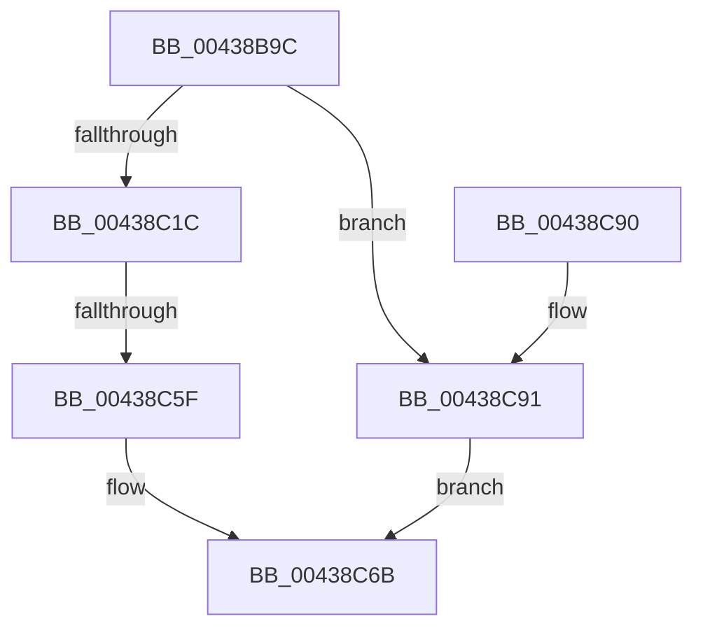

# RtlpAllowsLowBoxAccess

- RVA: `0x00438B9C`–`0x00438C95` (길이 `249` bytes)
- VA: `0x0000000140438B9C`
- 실행 섹션: `.text`
- PDB 이름 있음: `예`; PDB Function 태그: `예`
- unwind 정보 RVA: `0x000A354C`
- 디코드: `58`개 명령, `249/249` bytes 표시
- 미해석 바이트: `0` (있으면 어셈블리에 `.byte`로 보존)

> 이 문서는 커널 이미지의 기계어와 PDB 기호를 분석해 생성했습니다. 4번과 5번은 함수 원형과 자료형을 바이너리 사용 방식에서 추정한 C 해석이며 원본 소스 복구 결과는 아닙니다.

## 1. Dependencies

- 직접 호출 지점: **3**; 고유 호출 대상: **3**
- 직접 호출자로 확인된 함수: **1**
- RIP 상대 이미지 참조: **1**

### Outgoing calls
- `0x00438C43` → [PsReferenceEffectiveToken](../../page/9A/PsReferenceEffectiveToken_function_009A2B40.md) (function, `0x009A2B40`)
- `0x00438C64` → [ObfDereferenceObjectWithTag](../2F/ObfDereferenceObjectWithTag_function_002F78E0.md) (function, `0x002F78E0`)
- `0x00438C72` → [_security_check_cookie](../6A/_security_check_cookie_function_006AC640.md) (function, `0x006AC640`)

### Direct callers
- [RtlpLookupLowBox](RtlpLookupLowBox_function_004388AC.md) at `0x00438912`

### Static image references
- `0x00438BB7` → RVA `0x00E0A740` (`.data`; read)

## 2. Other-region calls and transfers

- 다른 실행 섹션으로 향하는 call: **1**
  - `0x00438C43` → [PsReferenceEffectiveToken](../../page/9A/PsReferenceEffectiveToken_function_009A2B40.md) (`.text` → `PAGE`)
- call이 아닌 외부 분기/꼬리 이동: **1**
  - `0x00438C59` → [sub_006EF3AA](../6E/Unknown_function_006EF3AA.md) (`tail-transfer`)

## 3. Assembly (complete function range)

```asm
00438B9C  48 8B C4                        mov rax, rsp
00438B9F  48 89 58 10                     mov qword ptr [rax + 0x10], rbx
00438BA3  48 89 70 18                     mov qword ptr [rax + 0x18], rsi
00438BA7  48 89 78 20                     mov qword ptr [rax + 0x20], rdi
00438BAB  55                              push rbp
00438BAC  48 8D 68 A8                     lea rbp, [rax - 0x58]
00438BB0  48 81 EC 50 01 00 00            sub rsp, 0x150
00438BB7  48 8B 05 82 1B 9D 00            mov rax, qword ptr [rip + 0x9d1b82]
00438BBE  48 33 C4                        xor rax, rsp
00438BC1  48 89 45 40                     mov qword ptr [rbp + 0x40], rax
00438BC5  83 64 24 68 00                  and dword ptr [rsp + 0x68], 0
00438BCA  0F 57 C0                        xorps xmm0, xmm0
00438BCD  83 64 24 64 00                  and dword ptr [rsp + 0x64], 0
00438BD2  33 C0                           xor eax, eax
00438BD4  F6 41 26 02                     test byte ptr [rcx + 0x26], 2
00438BD8  0F 57 C9                        xorps xmm1, xmm1
00438BDB  48 8B F9                        mov rdi, rcx
00438BDE  C7 45 F8 00 00 02 00            mov dword ptr [rbp - 8], 0x20000
00438BE5  0F 11 45 A0                     movups xmmword ptr [rbp - 0x60], xmm0
00438BE9  C7 45 FC 00 00 03 00            mov dword ptr [rbp - 4], 0x30000
00438BF0  0F 11 45 B0                     movups xmmword ptr [rbp - 0x50], xmm0
00438BF4  C7 45 00 00 00 02 00            mov dword ptr [rbp], 0x20000
00438BFB  C7 45 04 00 00 1F 00            mov dword ptr [rbp + 4], 0x1f0000
00438C02  0F 11 45 C0                     movups xmmword ptr [rbp - 0x40], xmm0
00438C06  48 89 45 F0                     mov qword ptr [rbp - 0x10], rax
00438C0A  0F 11 45 D0                     movups xmmword ptr [rbp - 0x30], xmm0
00438C0E  0F 11 45 E0                     movups xmmword ptr [rbp - 0x20], xmm0
00438C12  0F 11 45 80                     movups xmmword ptr [rbp - 0x80], xmm0
00438C16  0F 11 4D 90                     movups xmmword ptr [rbp - 0x70], xmm1
00438C1A  75 75                           jne 0x140438c91
00438C1C  48 21 44 24 28                  and qword ptr [rsp + 0x28], rax
00438C21  4C 8D 4C 24 60                  lea r9, [rsp + 0x60]
00438C26  65 48 8B 0C 25 88 01 00 00      mov rcx, qword ptr gs:[0x188]
00438C2F  48 8D 44 24 6C                  lea rax, [rsp + 0x6c]
00438C34  4C 8D 44 24 70                  lea r8, [rsp + 0x70]
00438C39  48 89 44 24 20                  mov qword ptr [rsp + 0x20], rax
00438C3E  BA 41 74 6F 6D                  mov edx, 0x6d6f7441
00438C43  E8 F8 9E 56 00                  call 0x1409a2b40
00438C48  48 89 45 B0                     mov qword ptr [rbp - 0x50], rax
00438C4C  48 8B C8                        mov rcx, rax
00438C4F  F7 80 C8 00 00 00 00 00 00 01   test dword ptr [rax + 0xc8], 0x1000000
00438C59  0F 85 4B 67 2B 00               jne 0x1406ef3aa
00438C5F  BA 41 74 6F 6D                  mov edx, 0x6d6f7441
00438C64  E8 77 EC EB FF                  call 0x1402f78e0
00438C69  32 C0                           xor al, al
00438C6B  48 8B 4D 40                     mov rcx, qword ptr [rbp + 0x40]
00438C6F  48 33 CC                        xor rcx, rsp
00438C72  E8 C9 39 27 00                  call 0x1406ac640
00438C77  4C 8D 9C 24 50 01 00 00         lea r11, [rsp + 0x150]
00438C7F  49 8B 5B 18                     mov rbx, qword ptr [r11 + 0x18]
00438C83  49 8B 73 20                     mov rsi, qword ptr [r11 + 0x20]
00438C87  49 8B 7B 28                     mov rdi, qword ptr [r11 + 0x28]
00438C8B  49 8B E3                        mov rsp, r11
00438C8E  5D                              pop rbp
00438C8F  C3                              ret
00438C90  CC                              int3
00438C91  B0 01                           mov al, 1
00438C93  EB D6                           jmp 0x140438c6b
```

## 4. C-style interpretation (structured pseudocode)

```c
__int64 __fastcall RtlpAllowsLowBoxAccess(__int64 a1)
{
    __int64 result;
    __int64 v_rsp;
    unsigned __int64 v_stack_m130;
    unsigned __int64 v_stack_m138;
    unsigned __int64 v_stack_m8;
    unsigned __int64 v_stack_mE8;
    unsigned __int64 v_stack_mEC;
    unsigned int v_stack_mF0;
    unsigned int v_stack_mF4;
    unsigned __int64 v_stack_mF8;

    *(unsigned __int64 *)(v_rsp + 16) = v_rbx;
    *(unsigned __int64 *)(v_rsp + 24) = v_rsi;
    *(unsigned __int64 *)(v_rsp + 32) = v_rdi;
    v_rsp = (v_rsp) - (336);
    result = (*(unsigned __int64 *)(v_rip + 10296194)) ^ (v_rsp);
    *(unsigned __int64 *)(v_rsp - 88 + 64) = result;
    result = 0;
    *(unsigned int *)(v_rsp - 88 - 8) = 0x20000ULL;
    *(unsigned __int64 *)(v_rsp - 88 - 96) = v_xmm0;
    *(unsigned int *)(v_rsp - 88 - 4) = 0x30000ULL;
    *(unsigned __int64 *)(v_rsp - 88 - 80) = v_xmm0;
    *(unsigned int *)(v_rsp - 88) = 0x20000ULL;
    *(unsigned int *)(v_rsp - 88 + 4) = 0x1F0000ULL;
    *(unsigned __int64 *)(v_rsp - 88 - 64) = v_xmm0;
    *(unsigned __int64 *)(v_rsp - 88 - 16) = 0;
    *(unsigned __int64 *)(v_rsp - 88 - 48) = v_xmm0;
    *(unsigned __int64 *)(v_rsp - 88 - 32) = v_xmm0;
    *(unsigned __int64 *)(v_rsp - 88 - 128) = v_xmm0;
    *(unsigned __int64 *)(v_rsp - 88 - 112) = v_xmm1;
    if (((*(unsigned __int8 *)(a1 + 38)) & (2)) != 0) goto loc_00438C91;
    v_stack_m138 = v_stack_mEC;
    result = PsReferenceEffectiveToken(*(unsigned __int64 *)(gs_base + (0 + 392)), (unsigned int)(0x6D6F7441ULL), v_stack_mE8, v_stack_mF8);
    *(unsigned __int64 *)(v_rsp - 88 - 80) = result;
    result = ObfDereferenceObjectWithTag(result, (unsigned int)(0x6D6F7441ULL), v_stack_mE8, v_stack_mF8);
    result = 0;
loc_00438C6B:
    a1 = (*(unsigned __int64 *)(v_rsp - 88 + 64)) ^ (v_rsp);
    result = _security_check_cookie(a1, (unsigned int)(0x6D6F7441ULL), v_stack_mE8, v_stack_mF8);
    return result;
loc_00438C91:
    goto loc_00438C6B;
}
```

## 5. (Beta) C Style

```c
int64_t RtlpAllowsLowBoxAccess(void *Arg1)
{
    uint8_t *arg1 = (uint8_t *)Arg1;

    int64_t result;
    int64_t local_rsp;
    uint64_t v_stack_m130;
    uint64_t v_stack_m138;
    uint64_t v_stack_m8;
    uint64_t v_stack_mE8;
    uint64_t v_stack_mEC;
    uint32_t v_stack_mF0;
    uint32_t v_stack_mF4;
    uint64_t v_stack_mF8;

    *(uint64_t *)(local_rsp + 0x10) = local_rbx;
    *(uint64_t *)(local_rsp + 0x18) = local_rsi;
    *(uint64_t *)(local_rsp + 0x20) = local_rdi;
    local_rsp = (local_rsp) - (336);
    result = (*(uint64_t *)(v_rip + 0x9D1B82)) ^ (local_rsp);
    *(uint64_t *)(local_rsp - 0x58 + 0x40) = result;
    result = 0;
    *(uint32_t *)(local_rsp - 0x58 - 0x8) = 0x20000ULL;
    *(uint64_t *)(local_rsp - 0x58 - 0x60) = v_xmm0;
    *(uint32_t *)(local_rsp - 0x58 - 0x4) = 0x30000ULL;
    *(uint64_t *)(local_rsp - 0x58 - 0x50) = v_xmm0;
    *(uint32_t *)(local_rsp - 0x58) = 0x20000ULL;
    *(uint32_t *)(local_rsp - 0x58 + 0x4) = 0x1F0000ULL;
    *(uint64_t *)(local_rsp - 0x58 - 0x40) = v_xmm0;
    *(uint64_t *)(local_rsp - 0x58 - 0x10) = 0;
    *(uint64_t *)(local_rsp - 0x58 - 0x30) = v_xmm0;
    *(uint64_t *)(local_rsp - 0x58 - 0x20) = v_xmm0;
    *(uint64_t *)(local_rsp - 0x58 - 0x80) = v_xmm0;
    *(uint64_t *)(local_rsp - 0x58 - 0x70) = v_xmm1;
    if (((*(uint8_t *)(arg1 + 0x26)) & (2)) != 0) goto loc_00438C91;
    v_stack_m138 = v_stack_mEC;
    result = PsReferenceEffectiveToken(*(uint64_t *)(gs_base + (0 + 0x188)), (uint32_t)(0x6D6F7441ULL), v_stack_mE8, v_stack_mF8);
    *(uint64_t *)(local_rsp - 0x58 - 0x50) = result;
    result = ObfDereferenceObjectWithTag(result, (uint32_t)(0x6D6F7441ULL), v_stack_mE8, v_stack_mF8);
    result = 0;
loc_00438C6B:
    Arg1 = (*(uint64_t *)(local_rsp - 0x58 + 0x40)) ^ (local_rsp);
    result = _security_check_cookie(Arg1, (uint32_t)(0x6D6F7441ULL), v_stack_mE8, v_stack_mF8);
    return result;
loc_00438C91:
    goto loc_00438C6B;
}
```

### 관측된 메모리 오프셋

구조체 형식이 확인되지 않은 접근은 인자 기준의 오프셋으로만 기록했습니다.

| 기준 인자 | 오프셋 표현 | 폭 (bit) | 접근 |
|---|---:|---:|---|
| `Arg1` | `+ 0x26` | `8` | `R` |

## 6. Execution-region graph

[열기: 2D/3D 그래프와 함수 탐색 컨트롤 패널](../../../control-panel.html?section=text&rva=0x00438B9C&view=graph)

- 2D 그래프는 위에서 아래로 흐르고, 3D 그래프는 빈 공간을 드래그해 회전합니다. Shift+드래그는 이동, 휠은 확대·축소, 함수 노드 선택은 대상 보고서 이동입니다.

### Static fallback


