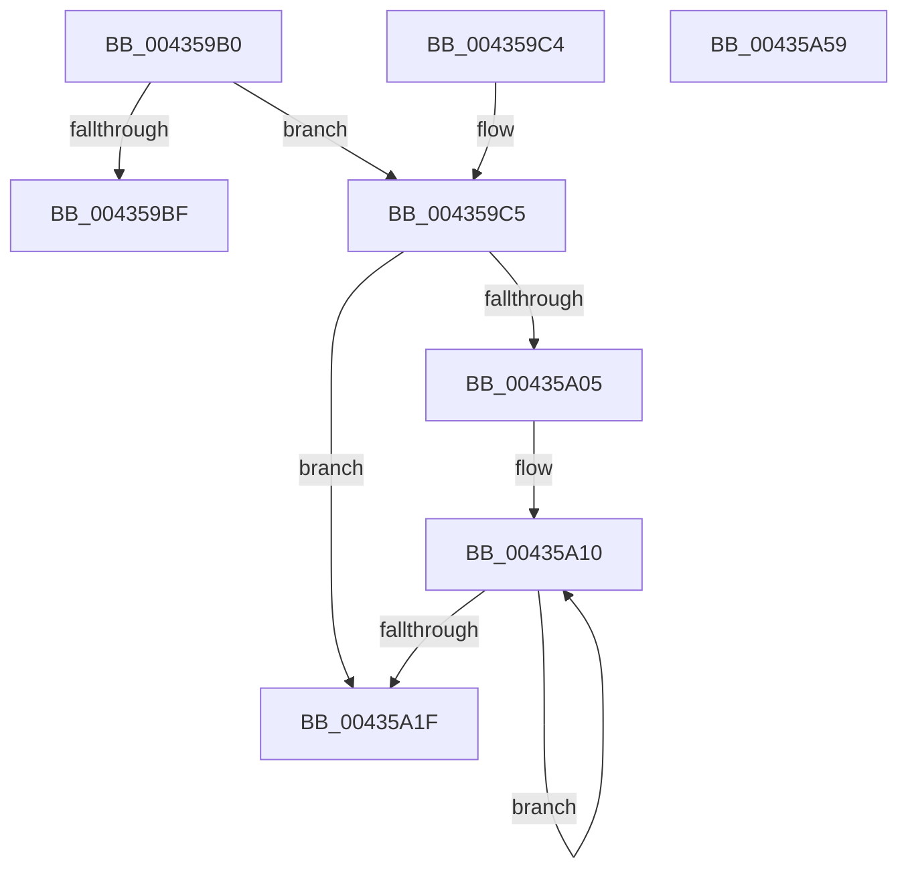

# RtlpHpSegPageRangeSplit

- RVA: `0x004359B0`–`0x00435A5A` (길이 `170` bytes)
- VA: `0x00000001404359B0`
- 실행 섹션: `.text`
- PDB 이름 있음: `예`; PDB Function 태그: `아니요`
- unwind 정보 RVA: `0x000DB714`
- 디코드: `49`개 명령, `170/170` bytes 표시
- 미해석 바이트: `0` (있으면 어셈블리에 `.byte`로 보존)

> 이 문서는 커널 이미지의 기계어와 PDB 기호를 분석해 생성했습니다. 4번과 5번은 함수 원형과 자료형을 바이너리 사용 방식에서 추정한 C 해석이며 원본 소스 복구 결과는 아닙니다.

## 1. Dependencies

- 직접 호출 지점: **0**; 고유 호출 대상: **0**
- 직접 호출자로 확인된 함수: **1**
- RIP 상대 이미지 참조: **0**

### Outgoing calls
- 직접 디코드된 call 명령이 없습니다.

### Direct callers
- [RtlpHpSegLargeRangeAllocate](../2E/RtlpHpSegLargeRangeAllocate_function_002E7398.md) at `0x002E74FE`

### Static image references
- 디코드된 RIP-relative 메모리 참조가 없습니다.

## 2. Other-region calls and transfers

- 다른 실행 섹션으로 향하는 call: **0**
- 별도 외부 분기/꼬리 이동을 확인하지 못했습니다.

## 3. Assembly (complete function range)

```asm
004359B0  0F B6 4A 1F                     movzx ecx, byte ptr [rdx + 0x1f]
004359B4  4C 8B CA                        mov r9, rdx
004359B7  45 8B D0                        mov r10d, r8d
004359BA  41 3B C8                        cmp ecx, r8d
004359BD  75 06                           jne 0x1404359c5
004359BF  33 D2                           xor edx, edx
004359C1  8B C2                           mov eax, edx
004359C3  C3                              ret
004359C4  CC                              int3
004359C5  41 2B CA                        sub ecx, r10d
004359C8  4D 8B DA                        mov r11, r10
004359CB  44 0F B6 C1                     movzx r8d, cl
004359CF  FF C9                           dec ecx
004359D1  49 C1 E3 05                     shl r11, 5
004359D5  4D 03 D9                        add r11, r9
004359D8  48 C1 E1 05                     shl rcx, 5
004359DC  41 8D 50 FF                     lea edx, [r8 - 1]
004359E0  41 0F B6 43 18                  movzx eax, byte ptr [r11 + 0x18]
004359E5  0C 02                           or al, 2
004359E7  41 88 43 18                     mov byte ptr [r11 + 0x18], al
004359EB  49 8B C3                        mov rax, r11
004359EE  42 88 54 19 1A                  mov byte ptr [rcx + r11 + 0x1a], dl
004359F3  33 D2                           xor edx, edx
004359F5  45 88 43 1F                     mov byte ptr [r11 + 0x1f], r8b
004359F9  49 C1 E0 05                     shl r8, 5
004359FD  4D 03 C3                        add r8, r11
00435A00  4D 3B D8                        cmp r11, r8
00435A03  73 1A                           jae 0x140435a1f
00435A05  66 66 66 0F 1F 84 00 00 00 00 00  nop word ptr [rax + rax]
00435A10  0F B6 48 19                     movzx ecx, byte ptr [rax + 0x19]
00435A14  48 83 C0 20                     add rax, 0x20
00435A18  03 D1                           add edx, ecx
00435A1A  49 3B C0                        cmp rax, r8
00435A1D  72 F1                           jb 0x140435a10
00435A1F  66 F7 D2                        not dx
00435A22  41 C7 03 DD CC DD CC            mov dword ptr [r11], 0xccddccdd
00435A29  66 41 89 53 1C                  mov word ptr [r11 + 0x1c], dx
00435A2E  45 8D 42 FF                     lea r8d, [r10 - 1]
00435A32  41 8D 52 FF                     lea edx, [r10 - 1]
00435A36  49 8B C3                        mov rax, r11
00435A39  48 C1 E2 05                     shl rdx, 5
00435A3D  46 88 44 0A 1A                  mov byte ptr [rdx + r9 + 0x1a], r8b
00435A42  45 88 51 1F                     mov byte ptr [r9 + 0x1f], r10b
00435A46  41 0F B7 53 1C                  movzx edx, word ptr [r11 + 0x1c]
00435A4B  66 41 2B 51 1C                  sub dx, word ptr [r9 + 0x1c]
00435A50  66 F7 D2                        not dx
00435A53  66 41 89 51 1C                  mov word ptr [r9 + 0x1c], dx
00435A58  C3                              ret
00435A59  CC                              int3
```

## 4. C-style interpretation (structured pseudocode)

```c
__int64 __fastcall RtlpHpSegPageRangeSplit(__int64 a1, __int64 a2, int a3)
{
    __int64 result;
    __int64 v_r11;

    if (((unsigned int)(*(unsigned __int8 *)(a2 + 31))) != a3) goto loc_004359C5;
    a2 = 0;
    return 0;
loc_004359C5:
    a1 = (unsigned int)((*(unsigned __int8 *)(a2 + 31)) - ((unsigned int)((unsigned int)(a3))));
    a1 = (unsigned int)((a1) - 1);
    v_r11 = ((unsigned int)(a3)) << (5);
    v_r11 = (v_r11) + (0);
    a1 = (a1) << (5);
    result = (unsigned __int8)((*(unsigned __int8 *)(v_r11 + 24)) | (2));
    *(unsigned __int8 *)(v_r11 + 24) = (unsigned __int8)(result);
    *(unsigned __int8 *)(a1 + v_r11 * 1 + 26) = (unsigned __int8)((unsigned __int8)(a1) - 1);
    a2 = 0;
    *(unsigned __int8 *)(v_r11 + 31) = (unsigned __int8)((unsigned __int8)(a1));
    a3 = ((unsigned __int8)(a1)) << (5);
    a3 = (a3) + (v_r11);
    if (v_r11 >= a3) goto loc_00435A1F;
loc_00435A10:
    result = (v_r11) + (32);
    a2 = (unsigned int)((a2) + ((unsigned int)(*(unsigned __int8 *)(v_r11 + 25))));
    if (result < a3) goto loc_00435A10;
loc_00435A1F:
    a2 = (unsigned __int16)(~(a2));
    *(unsigned int *)(v_r11) = 0xCCDDCCDDULL;
    *(unsigned __int16 *)(v_r11 + 28) = (unsigned __int16)(a2);
    a2 = ((unsigned int)(a3) - 1) << (5);
    *(unsigned __int8 *)(a2 + a2 * 1 + 26) = (unsigned __int8)((unsigned int)(a3) - 1);
    *(unsigned __int8 *)(a2 + 31) = (unsigned __int8)((unsigned int)(a3));
    a2 = (unsigned __int16)((*(unsigned __int16 *)(v_r11 + 28)) - (*(unsigned __int16 *)(a2 + 28)));
    a2 = (unsigned __int16)(~(a2));
    *(unsigned __int16 *)(a2 + 28) = (unsigned __int16)(a2);
    return v_r11;
}
```

## 5. (Beta) C Style

```c
int64_t RtlpHpSegPageRangeSplit(int64_t Arg1, void *Arg2, void *Arg3)
{
    uint8_t *arg2 = (uint8_t *)Arg2;
    uint8_t *arg3 = (uint8_t *)Arg3;

    int64_t result;
    int64_t local_r11;

    if (((uint32_t)(*(uint8_t *)(arg2 + 0x1F))) != Arg3) goto loc_004359C5;
    Arg2 = 0;
    return 0;
loc_004359C5:
    Arg1 = (uint32_t)((*(uint8_t *)(arg2 + 0x1F)) - ((uint32_t)((uint32_t)(Arg3))));
    Arg1 = (uint32_t)((Arg1) - 1);
    local_r11 = ((uint32_t)(Arg3)) << (5);
    local_r11 = (local_r11) + (0);
    Arg1 = (Arg1) << (5);
    result = (uint8_t)((*(uint8_t *)(local_r11 + 0x18)) | (2));
    *(uint8_t *)(local_r11 + 0x18) = (uint8_t)(result);
    *(uint8_t *)(Arg1 + local_r11 * 1 + 0x1A) = (uint8_t)((uint8_t)(Arg1) - 1);
    Arg2 = 0;
    *(uint8_t *)(local_r11 + 0x1F) = (uint8_t)((uint8_t)(Arg1));
    Arg3 = ((uint8_t)(Arg1)) << (5);
    Arg3 = (Arg3) + (local_r11);
    if (local_r11 >= Arg3) goto loc_00435A1F;
loc_00435A10:
    result = (local_r11) + (32);
    Arg2 = (uint32_t)((Arg2) + ((uint32_t)(*(uint8_t *)(local_r11 + 0x19))));
    if (result < Arg3) goto loc_00435A10;
loc_00435A1F:
    Arg2 = (uint16_t)(~(Arg2));
    *(uint32_t *)(local_r11) = 0xCCDDCCDDULL;
    *(uint16_t *)(local_r11 + 0x1C) = (uint16_t)(Arg2);
    Arg2 = ((uint32_t)(Arg3) - 1) << (5);
    *(uint8_t *)(arg2 + arg2 * 1 + 0x1A) = (uint8_t)((uint32_t)(Arg3) - 1);
    *(uint8_t *)(arg2 + 0x1F) = (uint8_t)((uint32_t)(Arg3));
    Arg2 = (uint16_t)((*(uint16_t *)(local_r11 + 0x1C)) - (*(uint16_t *)(arg2 + 0x1C)));
    Arg2 = (uint16_t)(~(Arg2));
    *(uint16_t *)(arg2 + 0x1C) = (uint16_t)(Arg2);
    return local_r11;
}
```

### 관측된 메모리 오프셋

구조체 형식이 확인되지 않은 접근은 인자 기준의 오프셋으로만 기록했습니다.

| 기준 인자 | 오프셋 표현 | 폭 (bit) | 접근 |
|---|---:|---:|---|
| `Arg2` | `+ 0x1C` | `16` | `R` |
| `Arg2` | `+ 0x1C` | `16` | `W` |
| `Arg2` | `+ 0x1F` | `8` | `R` |
| `Arg2` | `+ 0x1F` | `8` | `W` |
| `Arg3` | `- 0x1` | `32` | `R` |

## 6. Execution-region graph

[열기: 2D/3D 그래프와 함수 탐색 컨트롤 패널](../../../control-panel.html?section=text&rva=0x004359B0&view=graph)

- 2D 그래프는 위에서 아래로 흐르고, 3D 그래프는 빈 공간을 드래그해 회전합니다. Shift+드래그는 이동, 휠은 확대·축소, 함수 노드 선택은 대상 보고서 이동입니다.

### Static fallback


