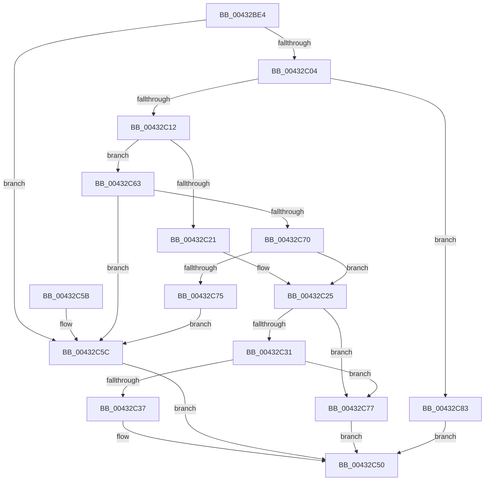

# RtlpImageDirectoryEntryToData32

- RVA: `0x00432BE4`–`0x00432C8A` (길이 `166` bytes)
- VA: `0x0000000140432BE4`
- 실행 섹션: `.text`
- PDB 이름 있음: `예`; PDB Function 태그: `아니요`
- unwind 정보 RVA: `0x00096B0C`
- 디코드: `51`개 명령, `166/166` bytes 표시
- 미해석 바이트: `0` (있으면 어셈블리에 `.byte`로 보존)

> 이 문서는 커널 이미지의 기계어와 PDB 기호를 분석해 생성했습니다. 4번과 5번은 함수 원형과 자료형을 바이너리 사용 방식에서 추정한 C 해석이며 원본 소스 복구 결과는 아닙니다.

## 1. Dependencies

- 직접 호출 지점: **1**; 고유 호출 대상: **1**
- 직접 호출자로 확인된 함수: **2**
- RIP 상대 이미지 참조: **0**

### Outgoing calls
- `0x00432C37` → [RtlAddressInSectionTable](RtlAddressInSectionTable_function_00432C90.md) (function, `0x00432C90`)

### Direct callers
- [RtlImageDirectoryEntryToData](RtlImageDirectoryEntryToData_function_004328D0.md) at `0x00432A21`
- [sub_00432B9F](Unknown_function_00432B9F.md) at `0x00432BC7`

### Static image references
- 디코드된 RIP-relative 메모리 참조가 없습니다.

## 2. Other-region calls and transfers

- 다른 실행 섹션으로 향하는 call: **0**
- 별도 외부 분기/꼬리 이동을 확인하지 못했습니다.

## 3. Assembly (complete function range)

```asm
00432BE4  48 89 5C 24 08                  mov qword ptr [rsp + 8], rbx
00432BE9  57                              push rdi
00432BEA  48 83 EC 20                     sub rsp, 0x20
00432BEE  8A DA                           mov bl, dl
00432BF0  41 0F B7 C0                     movzx eax, r8w
00432BF4  48 8B D1                        mov rdx, rcx
00432BF7  4D 8B D9                        mov r11, r9
00432BFA  48 8B 4C 24 50                  mov rcx, qword ptr [rsp + 0x50]
00432BFF  3B 41 74                        cmp eax, dword ptr [rcx + 0x74]
00432C02  73 58                           jae 0x140432c5c
00432C04  45 0F B7 D0                     movzx r10d, r8w
00432C08  46 8B 44 D1 78                  mov r8d, dword ptr [rcx + r10*8 + 0x78]
00432C0D  45 85 C0                        test r8d, r8d
00432C10  74 71                           je 0x140432c83
00432C12  48 BF FF FF FE FF FF 7F 00 00   movabs rdi, 0x7ffffffeffff
00432C1C  48 3B D7                        cmp rdx, rdi
00432C1F  76 42                           jbe 0x140432c63
00432C21  4E 8D 0C 02                     lea r9, [rdx + r8]
00432C25  42 8B 44 D1 7C                  mov eax, dword ptr [rcx + r10*8 + 0x7c]
00432C2A  41 89 03                        mov dword ptr [r11], eax
00432C2D  84 DB                           test bl, bl
00432C2F  75 46                           jne 0x140432c77
00432C31  44 3B 41 54                     cmp r8d, dword ptr [rcx + 0x54]
00432C35  72 40                           jb 0x140432c77
00432C37  E8 54 00 00 00                  call 0x140432c90
00432C3C  48 8B 4C 24 58                  mov rcx, qword ptr [rsp + 0x58]
00432C41  48 89 01                        mov qword ptr [rcx], rax
00432C44  48 F7 D8                        neg rax
00432C47  1B C0                           sbb eax, eax
00432C49  F7 D0                           not eax
00432C4B  25 0D 00 00 C0                  and eax, 0xc000000d
00432C50  48 8B 5C 24 30                  mov rbx, qword ptr [rsp + 0x30]
00432C55  48 83 C4 20                     add rsp, 0x20
00432C59  5F                              pop rdi
00432C5A  C3                              ret
00432C5B  CC                              int3
00432C5C  B8 0D 00 00 C0                  mov eax, 0xc000000d
00432C61  EB ED                           jmp 0x140432c50
00432C63  4D 8D 0C 10                     lea r9, [r8 + rdx]
00432C67  49 8D 41 FF                     lea rax, [r9 - 1]
00432C6B  48 3B C2                        cmp rax, rdx
00432C6E  72 EC                           jb 0x140432c5c
00432C70  48 3B C7                        cmp rax, rdi
00432C73  76 B0                           jbe 0x140432c25
00432C75  EB E5                           jmp 0x140432c5c
00432C77  48 8B 44 24 58                  mov rax, qword ptr [rsp + 0x58]
00432C7C  4C 89 08                        mov qword ptr [rax], r9
00432C7F  33 C0                           xor eax, eax
00432C81  EB CD                           jmp 0x140432c50
00432C83  B8 02 00 00 C0                  mov eax, 0xc0000002
00432C88  EB C6                           jmp 0x140432c50
```

## 4. C-style interpretation (structured pseudocode)

```c
__int64 __fastcall RtlpImageDirectoryEntryToData32(__int64 a1, unsigned __int8 a2, unsigned __int16 a3, __int64 a4, __int64 a5, __int64 a6)
{
    __int64 result;
    __int64 v_rsp;
    unsigned __int64 v_stack_p8;

    v_stack_p8 = v_rbx;
    v_rsp = (v_rsp) - (32);
    if (a3 >= (*(unsigned int *)(a5 + 116))) goto loc_00432C5C;
    if ((unsigned int)((unsigned int)(*(unsigned int *)(a5 + a3 * 8 + 120))) == 0) goto loc_00432C83;
    if (a1 <= v_rdi) goto loc_00432C63;
loc_00432C25:
    *(unsigned int *)(a4) = (unsigned int)((unsigned int)(*(unsigned int *)(a5 + a3 * 8 + 124)));
    if (a2 != 0) goto loc_00432C77;
    if (((unsigned int)((unsigned int)(*(unsigned int *)(a5 + a3 * 8 + 120)))) < (*(unsigned int *)(a5 + 84))) goto loc_00432C77;
    result = RtlAddressInSectionTable(a5, a1, (unsigned int)(*(unsigned int *)(a5 + a3 * 8 + 120)), a1 + (unsigned int)(*(unsigned int *)(a5 + a3 * 8 + 120)) * 1);
    *(unsigned __int64 *)(a6) = result;
    result = -(result);
    result = (unsigned int)(~(result));
    result = (unsigned int)((result) & (0xC000000DULL));
loc_00432C50:
    v_rsp = (v_rsp) + (32);
    return result;
loc_00432C5C:
    goto loc_00432C50;
loc_00432C63:
    if (((unsigned int)(*(unsigned int *)(a5 + a3 * 8 + 120)) + a1 * 1 - 1) < a1) goto loc_00432C5C;
    if (((unsigned int)(*(unsigned int *)(a5 + a3 * 8 + 120)) + a1 * 1 - 1) <= v_rdi) goto loc_00432C25;
    goto loc_00432C5C;
loc_00432C77:
    *(unsigned __int64 *)(a6) = (unsigned int)(*(unsigned int *)(a5 + a3 * 8 + 120)) + a1 * 1;
    result = 0;
    goto loc_00432C50;
loc_00432C83:
    goto loc_00432C50;
}
```

## 5. (Beta) C Style

```c
int64_t RtlpImageDirectoryEntryToData32(int64_t Arg1, uint8_t Arg2, uint16_t Arg3, void *Arg4, void *Arg5, void *Arg6)
{
    uint8_t *arg4 = (uint8_t *)Arg4;
    uint8_t *arg5 = (uint8_t *)Arg5;
    uint8_t *arg6 = (uint8_t *)Arg6;

    int64_t result;
    int64_t local_rsp;
    uint64_t v_stack_p8;

    v_stack_p8 = local_rbx;
    local_rsp = (local_rsp) - (32);
    if (Arg3 >= (*(uint32_t *)(arg5 + 0x74))) goto loc_00432C5C;
    if ((uint32_t)((uint32_t)(*(uint32_t *)(arg5 + Arg3 * 8 + 0x78))) == 0) goto loc_00432C83;
    if (Arg1 <= local_rdi) goto loc_00432C63;
loc_00432C25:
    *(uint32_t *)(arg4) = (uint32_t)((uint32_t)(*(uint32_t *)(arg5 + Arg3 * 8 + 0x7C)));
    if (Arg2 != 0) goto loc_00432C77;
    if (((uint32_t)((uint32_t)(*(uint32_t *)(arg5 + Arg3 * 8 + 0x78)))) < (*(uint32_t *)(arg5 + 0x54))) goto loc_00432C77;
    result = RtlAddressInSectionTable(Arg5, Arg1, (uint32_t)(*(uint32_t *)(arg5 + Arg3 * 8 + 0x78)), Arg1 + (uint32_t)(*(uint32_t *)(arg5 + Arg3 * 8 + 0x78)) * 1);
    *(uint64_t *)(arg6) = result;
    result = -(result);
    result = (uint32_t)(~(result));
    result = (uint32_t)((result) & (0xC000000DULL));
loc_00432C50:
    local_rsp = (local_rsp) + (32);
    return result;
loc_00432C5C:
    goto loc_00432C50;
loc_00432C63:
    if (((uint32_t)(*(uint32_t *)(arg5 + Arg3 * 8 + 0x78)) + Arg1 * 1 - 1) < Arg1) goto loc_00432C5C;
    if (((uint32_t)(*(uint32_t *)(arg5 + Arg3 * 8 + 0x78)) + Arg1 * 1 - 1) <= local_rdi) goto loc_00432C25;
    goto loc_00432C5C;
loc_00432C77:
    *(uint64_t *)(arg6) = (uint32_t)(*(uint32_t *)(arg5 + Arg3 * 8 + 0x78)) + Arg1 * 1;
    result = 0;
    goto loc_00432C50;
loc_00432C83:
    goto loc_00432C50;
}
```

### 관측된 메모리 오프셋

구조체 형식이 확인되지 않은 접근은 인자 기준의 오프셋으로만 기록했습니다.

| 기준 인자 | 오프셋 표현 | 폭 (bit) | 접근 |
|---|---:|---:|---|
| `Arg4` | `+ 0x0` | `32` | `W` |
| `Arg5` | `+ 0x54` | `32` | `R` |
| `Arg5` | `+ 0x74` | `32` | `R` |
| `Arg5` | `+ 0x78 + r10*8` | `32` | `R` |
| `Arg5` | `+ 0x7C + r10*8` | `32` | `R` |
| `Arg6` | `+ 0x0` | `64` | `W` |

## 6. Execution-region graph

[열기: 2D/3D 그래프와 함수 탐색 컨트롤 패널](../../../control-panel.html?section=text&rva=0x00432BE4&view=graph)

- 2D 그래프는 위에서 아래로 흐르고, 3D 그래프는 빈 공간을 드래그해 회전합니다. Shift+드래그는 이동, 휠은 확대·축소, 함수 노드 선택은 대상 보고서 이동입니다.

### Static fallback


