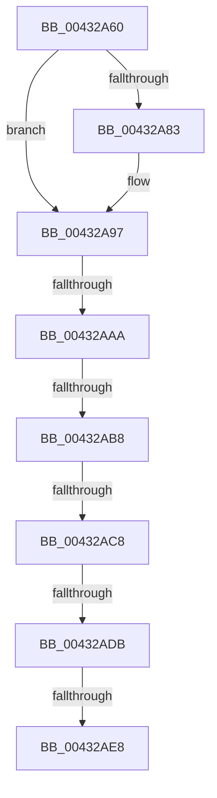

# RtlpImageDirectoryEntryToDataEx

- RVA: `0x00432A60`–`0x00432AF2` (길이 `146` bytes)
- VA: `0x0000000140432A60`
- 실행 섹션: `.text`
- PDB 이름 있음: `예`; PDB Function 태그: `아니요`
- unwind 정보 RVA: `0x000A2330`
- 디코드: `35`개 명령, `146/146` bytes 표시
- 미해석 바이트: `0` (있으면 어셈블리에 `.byte`로 보존)

> 이 문서는 커널 이미지의 기계어와 PDB 기호를 분석해 생성했습니다. 4번과 5번은 함수 원형과 자료형을 바이너리 사용 방식에서 추정한 C 해석이며 원본 소스 복구 결과는 아닙니다.

## 1. Dependencies

- 직접 호출 지점: **0**; 고유 호출 대상: **0**
- 직접 호출자로 확인된 함수: **2**
- RIP 상대 이미지 참조: **0**

### Outgoing calls
- 직접 디코드된 call 명령이 없습니다.

### Direct callers
- [RtlCaptureRetpolineImportRvas](RtlCaptureRetpolineImportRvas_function_004317B4.md) at `0x004317F9`
- [RtlpCaptureRetpolineBinaryInfoForImage](../6A/RtlpCaptureRetpolineBinaryInfoForImage_function_006AA060.md) at `0x006AA0EA`

### Static image references
- 디코드된 RIP-relative 메모리 참조가 없습니다.

## 2. Other-region calls and transfers

- 다른 실행 섹션으로 향하는 call: **0**
- call이 아닌 외부 분기/꼬리 이동: **5**
  - `0x00432AA4` → [sub_00432BD3](Unknown_function_00432BD3.md) (`tail-transfer`)
  - `0x00432AB2` → [sub_00432B83 + 0x15](Unknown_function_00432B83.md) (`tail-transfer`)
  - `0x00432AC2` → [sub_00432B83 + 0x15](Unknown_function_00432B83.md) (`tail-transfer`)
  - `0x00432AD5` → [sub_00432B83](Unknown_function_00432B83.md) (`tail-transfer`)
  - `0x00432AE2` → [sub_00432B83 + 0x15](Unknown_function_00432B83.md) (`tail-transfer`)

## 3. Assembly (complete function range)

```asm
00432A60  48 89 5C 24 18                  mov qword ptr [rsp + 0x18], rbx
00432A65  57                              push rdi
00432A66  48 83 EC 30                     sub rsp, 0x30
00432A6A  48 8B 7C 24 60                  mov rdi, qword ptr [rsp + 0x60]
00432A6F  33 DB                           xor ebx, ebx
00432A71  44 0F B6 D2                     movzx r10d, dl
00432A75  4D 8B D9                        mov r11, r9
00432A78  41 8B C2                        mov eax, r10d
00432A7B  48 89 1F                        mov qword ptr [rdi], rbx
00432A7E  F6 C1 03                        test cl, 3
00432A81  74 14                           je 0x140432a97
00432A83  48 8B D1                        mov rdx, rcx
00432A86  44 8B D3                        mov r10d, ebx
00432A89  83 E2 01                        and edx, 1
00432A8C  48 83 E1 FC                     and rcx, 0xfffffffffffffffc
00432A90  48 85 D2                        test rdx, rdx
00432A93  44 0F 44 D0                     cmove r10d, eax
00432A97  48 8D 41 FF                     lea rax, [rcx - 1]
00432A9B  48 89 6C 24 40                  mov qword ptr [rsp + 0x40], rbp
00432AA0  48 83 F8 FD                     cmp rax, -3
00432AA4  0F 87 29 01 00 00               ja 0x140432bd3
00432AAA  B8 4D 5A 00 00                  mov eax, 0x5a4d
00432AAF  66 39 01                        cmp word ptr [rcx], ax
00432AB2  0F 85 E0 00 00 00               jne 0x140432b98
00432AB8  44 8B 49 3C                     mov r9d, dword ptr [rcx + 0x3c]
00432ABC  4C 03 C9                        add r9, rcx
00432ABF  4C 3B C9                        cmp r9, rcx
00432AC2  0F 82 D0 00 00 00               jb 0x140432b98
00432AC8  48 BD FF FF FE FF FF 7F 00 00   movabs rbp, 0x7ffffffeffff
00432AD2  48 3B CD                        cmp rcx, rbp
00432AD5  0F 86 A8 00 00 00               jbe 0x140432b83
00432ADB  41 81 39 50 45 00 00            cmp dword ptr [r9], 0x4550
00432AE2  0F 85 B0 00 00 00               jne 0x140432b98
00432AE8  41 0F B7 41 18                  movzx eax, word ptr [r9 + 0x18]
00432AED  BA 0B 01 00 00                  mov edx, 0x10b
```

## 4. C-style interpretation (structured pseudocode)

```c
__int64 __fastcall RtlpImageDirectoryEntryToDataEx(__int64 a1, unsigned __int8 a2, __int64 a3, __int64 a4, __int64 a5)
{
    __int64 v_r10;
    __int64 v_rbx;
    __int64 v_rsp;
    unsigned __int64 v_stack_p18;
    unsigned __int64 v_stack_p8;

    v_stack_p18 = v_rbx;
    v_rsp = (v_rsp) - (48);
    v_rbx = 0;
    *(unsigned __int64 *)(a5) = 0;
    v_r10 = a2;
    if ((((unsigned __int8)(a1)) & (3)) != 0) {
        a2 = a1;
        v_r10 = 0;
        a2 = (unsigned int)((a2) & (1));
        a1 = (a1) & (-4);
        if (a2 == 0) { v_r10 = (unsigned int)((unsigned int)(a2)); }
    }
    v_stack_p8 = v_rbp;
    a4 = ((unsigned int)(*(unsigned int *)(a1 + 60))) + (a1);
    return *(unsigned __int16 *)(a4 + 24);
}
```

## 5. (Beta) C Style

```c
int64_t RtlpImageDirectoryEntryToDataEx(int64_t Arg1, uint8_t Arg2, int64_t Arg3, int64_t Arg4, void *Arg5)
{
    uint8_t *arg5 = (uint8_t *)Arg5;

    int64_t local_r10;
    int64_t local_rbx;
    int64_t local_rsp;
    uint64_t v_stack_p18;
    uint64_t v_stack_p8;

    v_stack_p18 = local_rbx;
    local_rsp = (local_rsp) - (48);
    local_rbx = 0;
    *(uint64_t *)(arg5) = 0;
    local_r10 = Arg2;
    if ((((uint8_t)(Arg1)) & (3)) != 0) {
        Arg2 = Arg1;
        local_r10 = 0;
        Arg2 = (uint32_t)((Arg2) & (1));
        Arg1 = (Arg1) & (-4);
        if (Arg2 == 0) { local_r10 = (uint32_t)((uint32_t)(Arg2)); }
    }
    v_stack_p8 = local_rbp;
    Arg4 = ((uint32_t)(*(uint32_t *)(Arg1 + 0x3C))) + (Arg1);
    return *(uint16_t *)(Arg4 + 0x18);
}
```

### 관측된 메모리 오프셋

구조체 형식이 확인되지 않은 접근은 인자 기준의 오프셋으로만 기록했습니다.

| 기준 인자 | 오프셋 표현 | 폭 (bit) | 접근 |
|---|---:|---:|---|
| `Arg5` | `+ 0x0` | `64` | `W` |

## 6. Execution-region graph

[열기: 2D/3D 그래프와 함수 탐색 컨트롤 패널](../../../control-panel.html?section=text&rva=0x00432A60&view=graph)

- 2D 그래프는 위에서 아래로 흐르고, 3D 그래프는 빈 공간을 드래그해 회전합니다. Shift+드래그는 이동, 휠은 확대·축소, 함수 노드 선택은 대상 보고서 이동입니다.

### Static fallback


