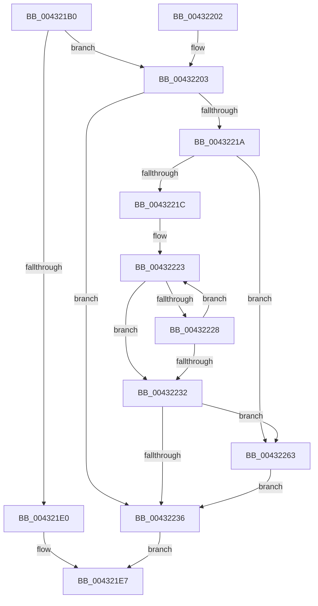

# RtlpInsertInvertedFunctionTableEntry

- RVA: `0x004321B0`–`0x00432293` (길이 `227` bytes)
- VA: `0x00000001404321B0`
- 실행 섹션: `.text`
- PDB 이름 있음: `예`; PDB Function 태그: `아니요`
- unwind 정보 RVA: `0x000A227C`
- 디코드: `61`개 명령, `227/227` bytes 표시
- 미해석 바이트: `0` (있으면 어셈블리에 `.byte`로 보존)

> 이 문서는 커널 이미지의 기계어와 PDB 기호를 분석해 생성했습니다. 4번과 5번은 함수 원형과 자료형을 바이너리 사용 방식에서 추정한 C 해석이며 원본 소스 복구 결과는 아닙니다.

## 1. Dependencies

- 직접 호출 지점: **1**; 고유 호출 대상: **1**
- 직접 호출자로 확인된 함수: **1**
- RIP 상대 이미지 참조: **6**

### Outgoing calls
- `0x0043228C` → [memcpy](../6C/memcpy_function_006C6840.md) (function, `0x006C6840`)

### Direct callers
- [RtlInsertInvertedFunctionTable](RtlInsertInvertedFunctionTable_function_00432138.md) at `0x00432189`

### Static image references
- `0x004321C9` → RVA `0x01200020` (`CFGRO`; read)
- `0x004321D2` → RVA `0x01200024` (`CFGRO`; read)
- `0x004321E0` → RVA `0x0120002C` (`CFGRO`; write)
- `0x00432203` → RVA `0x01200028` (`CFGRO`; read/write)
- `0x0043221C` → RVA `0x01200050` (`CFGRO`; read)
- `0x00432254` → RVA `0x01200020` (`CFGRO`; read/write)

## 2. Other-region calls and transfers

- 다른 실행 섹션으로 향하는 call: **0**
- 별도 외부 분기/꼬리 이동을 확인하지 못했습니다.

## 3. Assembly (complete function range)

```asm
004321B0  48 8B C4                        mov rax, rsp
004321B3  48 89 58 08                     mov qword ptr [rax + 8], rbx
004321B7  48 89 68 10                     mov qword ptr [rax + 0x10], rbp
004321BB  48 89 70 18                     mov qword ptr [rax + 0x18], rsi
004321BF  48 89 78 20                     mov qword ptr [rax + 0x20], rdi
004321C3  41 56                           push r14
004321C5  48 83 EC 20                     sub rsp, 0x20
004321C9  8B 05 51 DE DC 00               mov eax, dword ptr [rip + 0xdcde51]
004321CF  41 8B F1                        mov esi, r9d
004321D2  3B 05 4C DE DC 00               cmp eax, dword ptr [rip + 0xdcde4c]
004321D8  49 8B E8                        mov rbp, r8
004321DB  48 8B FA                        mov rdi, rdx
004321DE  75 23                           jne 0x140432203
004321E0  C6 05 45 DE DC 00 01            mov byte ptr [rip + 0xdcde45], 1
004321E7  48 8B 5C 24 30                  mov rbx, qword ptr [rsp + 0x30]
004321EC  48 8B 6C 24 38                  mov rbp, qword ptr [rsp + 0x38]
004321F1  48 8B 74 24 40                  mov rsi, qword ptr [rsp + 0x40]
004321F6  48 8B 7C 24 48                  mov rdi, qword ptr [rsp + 0x48]
004321FB  48 83 C4 20                     add rsp, 0x20
004321FF  41 5E                           pop r14
00432201  C3                              ret
00432202  CC                              int3
00432203  F0 FF 05 1E DE DC 00            lock inc dword ptr [rip + 0xdcde1e]
0043220A  BB 01 00 00 00                  mov ebx, 1
0043220F  4C 8D 35 0A DE DC 00            lea r14, [rip + 0xdcde0a]
00432216  3B C3                           cmp eax, ebx
00432218  74 1C                           je 0x140432236
0043221A  76 47                           jbe 0x140432263
0043221C  48 8D 0D 2D DE DC 00            lea rcx, [rip + 0xdcde2d]
00432223  48 3B 39                        cmp rdi, qword ptr [rcx]
00432226  72 0A                           jb 0x140432232
00432228  FF C3                           inc ebx
0043222A  48 83 C1 18                     add rcx, 0x18
0043222E  3B D8                           cmp ebx, eax
00432230  72 F1                           jb 0x140432223
00432232  3B D8                           cmp ebx, eax
00432234  75 2D                           jne 0x140432263
00432236  8B C3                           mov eax, ebx
00432238  48 8D 0C 40                     lea rcx, [rax + rax*2]
0043223C  8B 44 24 50                     mov eax, dword ptr [rsp + 0x50]
00432240  49 89 6C CE 10                  mov qword ptr [r14 + rcx*8 + 0x10], rbp
00432245  49 89 7C CE 18                  mov qword ptr [r14 + rcx*8 + 0x18], rdi
0043224A  41 89 74 CE 20                  mov dword ptr [r14 + rcx*8 + 0x20], esi
0043224F  41 89 44 CE 24                  mov dword ptr [r14 + rcx*8 + 0x24], eax
00432254  FF 05 C6 DD DC 00               inc dword ptr [rip + 0xdcddc6]
0043225A  F0 FF 05 C7 DD DC 00            lock inc dword ptr [rip + 0xdcddc7]
00432261  EB 84                           jmp 0x1404321e7
00432263  2B C3                           sub eax, ebx
00432265  4C 8D 04 40                     lea r8, [rax + rax*2]
00432269  8B C3                           mov eax, ebx
0043226B  49 C1 E0 03                     shl r8, 3
0043226F  48 8D 48 01                     lea rcx, [rax + 1]
00432273  48 8D 0C 48                     lea rcx, [rax + rcx*2]
00432277  49 8D 14 CE                     lea rdx, [r14 + rcx*8]
0043227B  8D 43 01                        lea eax, [rbx + 1]
0043227E  8B C8                           mov ecx, eax
00432280  48 83 C1 02                     add rcx, 2
00432284  48 8D 04 41                     lea rax, [rcx + rax*2]
00432288  49 8D 0C C6                     lea rcx, [r14 + rax*8]
0043228C  E8 AF 45 29 00                  call 0x1406c6840
00432291  EB A3                           jmp 0x140432236
```

## 4. C-style interpretation (structured pseudocode)

```c
__int64 __fastcall RtlpInsertInvertedFunctionTableEntry(__int64 a1, __int64 a2, __int64 a3, int a4, unsigned int a5)
{
    __int64 result;
    __int64 v_rbx;
    __int64 v_rsp;
    unsigned __int64 v_stack_p10;
    unsigned __int64 v_stack_p18;
    unsigned __int64 v_stack_p20;
    unsigned __int64 v_stack_p8;

    *(unsigned __int64 *)(v_rsp + 8) = v_rbx;
    *(unsigned __int64 *)(v_rsp + 16) = v_rbp;
    *(unsigned __int64 *)(v_rsp + 24) = v_rsi;
    *(unsigned __int64 *)(v_rsp + 32) = v_rdi;
    v_rsp = (v_rsp) - (32);
    if (((unsigned int)((unsigned int)(*(unsigned int *)(v_rip + 14474833)))) != (*(unsigned int *)(v_rip + 14474828))) goto loc_00432203;
    *(unsigned __int8 *)(v_rip + 14474821) = 1;
loc_004321E7:
    v_rsp = (v_rsp) + (32);
    return (unsigned int)(*(unsigned int *)(v_rip + 14474833));
loc_00432203:
    if (((unsigned int)((unsigned int)(*(unsigned int *)(v_rip + 14474833)))) == 1) goto loc_00432236;
    if (((unsigned int)((unsigned int)(*(unsigned int *)(v_rip + 14474833)))) <= 1) goto loc_00432263;
loc_00432223:
    if (v_stack_p20 < (*(unsigned __int64 *)(v_rip + 14474797))) goto loc_00432232;
    v_rbx = (unsigned int)((1) + 1);
    a1 = (v_rip + 14474797) + (24);
    if (((unsigned int)(v_rbx)) < ((unsigned int)((unsigned int)(*(unsigned int *)(v_rip + 14474833))))) goto loc_00432223;
loc_00432232:
    if (((unsigned int)(v_rbx)) != ((unsigned int)((unsigned int)(*(unsigned int *)(v_rip + 14474833))))) goto loc_00432263;
loc_00432236:
    *(unsigned __int64 *)(v_rip + 14474762 + (unsigned int)((unsigned int)(v_rbx)) + (unsigned int)((unsigned int)(v_rbx)) * 2 * 8 + 16) = v_stack_p10;
    *(unsigned __int64 *)(v_rip + 14474762 + (unsigned int)((unsigned int)(v_rbx)) + (unsigned int)((unsigned int)(v_rbx)) * 2 * 8 + 24) = v_stack_p20;
    *(unsigned int *)(v_rip + 14474762 + (unsigned int)((unsigned int)(v_rbx)) + (unsigned int)((unsigned int)(v_rbx)) * 2 * 8 + 32) = (unsigned int)(v_stack_p18);
    *(unsigned int *)(v_rip + 14474762 + (unsigned int)((unsigned int)(v_rbx)) + (unsigned int)((unsigned int)(v_rbx)) * 2 * 8 + 36) = (unsigned int)((unsigned int)(a5));
    goto loc_004321E7;
loc_00432263:
    result = (unsigned int)(((unsigned int)(a5)) - ((unsigned int)(v_rbx)));
    a3 = (result + result * 2) << (3);
    a1 = ((unsigned int)((unsigned int)(v_rbx + 1))) + (2);
    result = memcpy(v_rip + 14474762 + a1 + v_rbx + 1 * 2 * 8, v_rip + 14474762 + (unsigned int)((unsigned int)(v_rbx)) + (unsigned int)((unsigned int)(v_rbx)) + 1 * 2 * 8, a3, a4);
    goto loc_00432236;
}
```

## 5. (Beta) C Style

```c
int64_t RtlpInsertInvertedFunctionTableEntry(int64_t Arg1, int64_t Arg2, int64_t Arg3, int32_t Arg4, uint32_t Arg5)
{
    int64_t result;
    int64_t local_rbx;
    int64_t local_rsp;
    uint64_t v_stack_p10;
    uint64_t v_stack_p18;
    uint64_t v_stack_p20;
    uint64_t v_stack_p8;

    *(uint64_t *)(local_rsp + 0x8) = local_rbx;
    *(uint64_t *)(local_rsp + 0x10) = local_rbp;
    *(uint64_t *)(local_rsp + 0x18) = local_rsi;
    *(uint64_t *)(local_rsp + 0x20) = local_rdi;
    local_rsp = (local_rsp) - (32);
    if (((uint32_t)((uint32_t)(*(uint32_t *)(v_rip + 0xDCDE51)))) != (*(uint32_t *)(v_rip + 0xDCDE4C))) goto loc_00432203;
    *(uint8_t *)(v_rip + 0xDCDE45) = 1;
loc_004321E7:
    local_rsp = (local_rsp) + (32);
    return (uint32_t)(*(uint32_t *)(v_rip + 0xDCDE51));
loc_00432203:
    if (((uint32_t)((uint32_t)(*(uint32_t *)(v_rip + 0xDCDE51)))) == 1) goto loc_00432236;
    if (((uint32_t)((uint32_t)(*(uint32_t *)(v_rip + 0xDCDE51)))) <= 1) goto loc_00432263;
loc_00432223:
    if (v_stack_p20 < (*(uint64_t *)(v_rip + 0xDCDE2D))) goto loc_00432232;
    local_rbx = (uint32_t)((1) + 1);
    Arg1 = (v_rip + 14474797) + (24);
    if (((uint32_t)(local_rbx)) < ((uint32_t)((uint32_t)(*(uint32_t *)(v_rip + 0xDCDE51))))) goto loc_00432223;
loc_00432232:
    if (((uint32_t)(local_rbx)) != ((uint32_t)((uint32_t)(*(uint32_t *)(v_rip + 0xDCDE51))))) goto loc_00432263;
loc_00432236:
    *(uint64_t *)(v_rip + 0xDCDE0A + (uint32_t)((uint32_t)(local_rbx)) + (uint32_t)((uint32_t)(local_rbx)) * 2 * 8 + 0x10) = v_stack_p10;
    *(uint64_t *)(v_rip + 0xDCDE0A + (uint32_t)((uint32_t)(local_rbx)) + (uint32_t)((uint32_t)(local_rbx)) * 2 * 8 + 0x18) = v_stack_p20;
    *(uint32_t *)(v_rip + 0xDCDE0A + (uint32_t)((uint32_t)(local_rbx)) + (uint32_t)((uint32_t)(local_rbx)) * 2 * 8 + 0x20) = (uint32_t)(v_stack_p18);
    *(uint32_t *)(v_rip + 0xDCDE0A + (uint32_t)((uint32_t)(local_rbx)) + (uint32_t)((uint32_t)(local_rbx)) * 2 * 8 + 0x24) = (uint32_t)((uint32_t)(Arg5));
    goto loc_004321E7;
loc_00432263:
    result = (uint32_t)(((uint32_t)(Arg5)) - ((uint32_t)(local_rbx)));
    Arg3 = (result + result * 2) << (3);
    Arg1 = ((uint32_t)((uint32_t)(local_rbx + 1))) + (2);
    result = memcpy(v_rip + 14474762 + Arg1 + local_rbx + 1 * 2 * 8, v_rip + 14474762 + (uint32_t)((uint32_t)(local_rbx)) + (uint32_t)((uint32_t)(local_rbx)) + 1 * 2 * 8, Arg3, Arg4);
    goto loc_00432236;
}
```

## 6. Execution-region graph

[열기: 2D/3D 그래프와 함수 탐색 컨트롤 패널](../../../control-panel.html?section=text&rva=0x004321B0&view=graph)

- 2D 그래프는 위에서 아래로 흐르고, 3D 그래프는 빈 공간을 드래그해 회전합니다. Shift+드래그는 이동, 휠은 확대·축소, 함수 노드 선택은 대상 보고서 이동입니다.

### Static fallback


