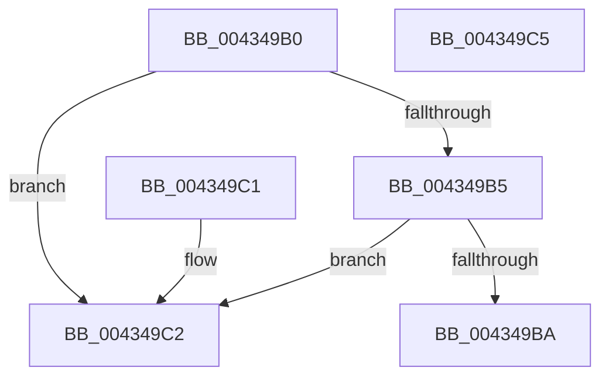

# RtlpIsFrameInBounds

- RVA: `0x004349B0`–`0x004349C6` (길이 `22` bytes)
- VA: `0x00000001404349B0`
- 실행 섹션: `.text`
- PDB 이름 있음: `예`; PDB Function 태그: `아니요`
- unwind 정보 RVA: `0x000DB714`
- 디코드: `11`개 명령, `22/22` bytes 표시
- 미해석 바이트: `0` (있으면 어셈블리에 `.byte`로 보존)

> 이 문서는 커널 이미지의 기계어와 PDB 기호를 분석해 생성했습니다. 4번과 5번은 함수 원형과 자료형을 바이너리 사용 방식에서 추정한 C 해석이며 원본 소스 복구 결과는 아닙니다.

## 1. Dependencies

- 직접 호출 지점: **0**; 고유 호출 대상: **0**
- 직접 호출자로 확인된 함수: **1**
- RIP 상대 이미지 참조: **0**

### Outgoing calls
- 직접 디코드된 call 명령이 없습니다.

### Direct callers
- [sub_006DF0C8](../6D/Unknown_function_006DF0C8.md) at `0x006DF1D1`
- [sub_006DF0C8](../6D/Unknown_function_006DF0C8.md) at `0x006DF22E`

### Static image references
- 디코드된 RIP-relative 메모리 참조가 없습니다.

## 2. Other-region calls and transfers

- 다른 실행 섹션으로 향하는 call: **0**
- 별도 외부 분기/꼬리 이동을 확인하지 못했습니다.

## 3. Assembly (complete function range)

```asm
004349B0  F6 C2 07                        test dl, 7
004349B3  75 0D                           jne 0x1404349c2
004349B5  48 3B 11                        cmp rdx, qword ptr [rcx]
004349B8  72 08                           jb 0x1404349c2
004349BA  49 3B 10                        cmp rdx, qword ptr [r8]
004349BD  0F 92 C0                        setb al
004349C0  C3                              ret
004349C1  CC                              int3
004349C2  32 C0                           xor al, al
004349C4  C3                              ret
004349C5  CC                              int3
```

## 4. C-style interpretation (structured pseudocode)

```c
__int64 __fastcall RtlpIsFrameInBounds(__int64 a1, __int64 a2, __int64 a3)
{
    __int64 result;

    if ((((unsigned __int8)(a2)) & (7)) != 0) goto loc_004349C2;
    if (a2 < (*(unsigned __int64 *)(a1))) goto loc_004349C2;
    result = (a2 < (*(unsigned __int64 *)(a3))) ? 1 : 0;
    return result;
loc_004349C2:
    result = 0;
    return result;
}
```

## 5. (Beta) C Style

```c
int64_t RtlpIsFrameInBounds(void *Arg1, int64_t Arg2, void *Arg3)
{
    uint8_t *arg1 = (uint8_t *)Arg1;
    uint8_t *arg3 = (uint8_t *)Arg3;

    int64_t result;

    if ((((uint8_t)(Arg2)) & (7)) != 0) goto loc_004349C2;
    if (Arg2 < (*(uint64_t *)(arg1))) goto loc_004349C2;
    result = (Arg2 < (*(uint64_t *)(arg3))) ? 1 : 0;
    return result;
loc_004349C2:
    result = 0;
    return result;
}
```

### 관측된 메모리 오프셋

구조체 형식이 확인되지 않은 접근은 인자 기준의 오프셋으로만 기록했습니다.

| 기준 인자 | 오프셋 표현 | 폭 (bit) | 접근 |
|---|---:|---:|---|
| `Arg1` | `+ 0x0` | `64` | `R` |
| `Arg3` | `+ 0x0` | `64` | `R` |

## 6. Execution-region graph

[열기: 2D/3D 그래프와 함수 탐색 컨트롤 패널](../../../control-panel.html?section=text&rva=0x004349B0&view=graph)

- 2D 그래프는 위에서 아래로 흐르고, 3D 그래프는 빈 공간을 드래그해 회전합니다. Shift+드래그는 이동, 휠은 확대·축소, 함수 노드 선택은 대상 보고서 이동입니다.

### Static fallback


