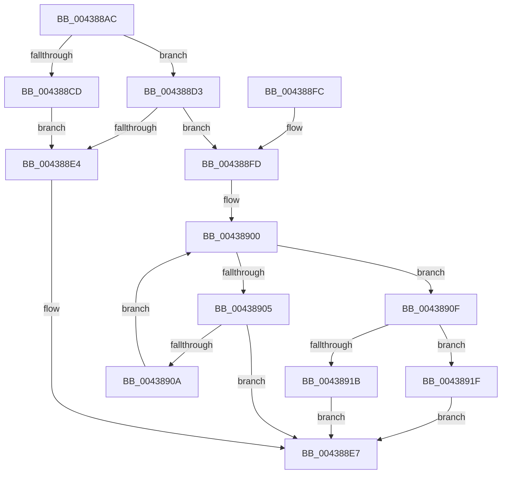

# RtlpLookupLowBox

- RVA: `0x004388AC`–`0x0043892B` (길이 `127` bytes)
- VA: `0x00000001404388AC`
- 실행 섹션: `.text`
- PDB 이름 있음: `예`; PDB Function 태그: `아니요`
- unwind 정보 RVA: `0x000A34EC`
- 디코드: `43`개 명령, `127/127` bytes 표시
- 미해석 바이트: `0` (있으면 어셈블리에 `.byte`로 보존)

> 이 문서는 커널 이미지의 기계어와 PDB 기호를 분석해 생성했습니다. 4번과 5번은 함수 원형과 자료형을 바이너리 사용 방식에서 추정한 C 해석이며 원본 소스 복구 결과는 아닙니다.

## 1. Dependencies

- 직접 호출 지점: **2**; 고유 호출 대상: **2**
- 직접 호출자로 확인된 함수: **4**
- RIP 상대 이미지 참조: **0**

### Outgoing calls
- `0x004388D3` → [RtlpQueryLowBoxId](RtlpQueryLowBoxId_function_00438A50.md) (function, `0x00438A50`)
- `0x00438912` → [RtlpAllowsLowBoxAccess](RtlpAllowsLowBoxAccess_function_00438B9C.md) (function, `0x00438B9C`)

### Direct callers
- [RtlQueryAtomsInAtomTable](../../page/78/RtlQueryAtomsInAtomTable_function_0078E298.md) at `0x0078E2F9`
- [RtlPinAtomInAtomTable](../../page/9C/RtlPinAtomInAtomTable_function_009C44F0.md) at `0x009C4556`
- [RtlDeleteAtomFromAtomTable](../../page/9C/RtlDeleteAtomFromAtomTable_function_009C45C0.md) at `0x009C4625`
- [RtlQueryAtomInAtomTable](../../page/9C/RtlQueryAtomInAtomTable_function_009C4690.md) at `0x009C4804`

### Static image references
- 디코드된 RIP-relative 메모리 참조가 없습니다.

## 2. Other-region calls and transfers

- 다른 실행 섹션으로 향하는 call: **0**
- 별도 외부 분기/꼬리 이동을 확인하지 못했습니다.

## 3. Assembly (complete function range)

```asm
004388AC  48 89 5C 24 08                  mov qword ptr [rsp + 8], rbx
004388B1  48 89 6C 24 10                  mov qword ptr [rsp + 0x10], rbp
004388B6  48 89 74 24 18                  mov qword ptr [rsp + 0x18], rsi
004388BB  57                              push rdi
004388BC  48 83 EC 20                     sub rsp, 0x20
004388C0  8B 41 18                        mov eax, dword ptr [rcx + 0x18]
004388C3  41 8A E8                        mov bpl, r8b
004388C6  48 8B F2                        mov rsi, rdx
004388C9  A8 01                           test al, 1
004388CB  74 06                           je 0x1404388d3
004388CD  48 8D 5A 10                     lea rbx, [rdx + 0x10]
004388D1  EB 11                           jmp 0x1404388e4
004388D3  E8 78 01 00 00                  call 0x140438a50
004388D8  33 FF                           xor edi, edi
004388DA  48 8D 5E 10                     lea rbx, [rsi + 0x10]
004388DE  8B C8                           mov ecx, eax
004388E0  85 C0                           test eax, eax
004388E2  75 19                           jne 0x1404388fd
004388E4  48 8B C3                        mov rax, rbx
004388E7  48 8B 5C 24 30                  mov rbx, qword ptr [rsp + 0x30]
004388EC  48 8B 6C 24 38                  mov rbp, qword ptr [rsp + 0x38]
004388F1  48 8B 74 24 40                  mov rsi, qword ptr [rsp + 0x40]
004388F6  48 83 C4 20                     add rsp, 0x20
004388FA  5F                              pop rdi
004388FB  C3                              ret
004388FC  CC                              int3
004388FD  48 8B 03                        mov rax, qword ptr [rbx]
00438900  48 3B C3                        cmp rax, rbx
00438903  74 0A                           je 0x14043890f
00438905  39 48 10                        cmp dword ptr [rax + 0x10], ecx
00438908  74 DD                           je 0x1404388e7
0043890A  48 8B 00                        mov rax, qword ptr [rax]
0043890D  EB F1                           jmp 0x140438900
0043890F  48 8B CE                        mov rcx, rsi
00438912  E8 85 02 00 00                  call 0x140438b9c
00438917  84 C0                           test al, al
00438919  75 04                           jne 0x14043891f
0043891B  33 C0                           xor eax, eax
0043891D  EB C8                           jmp 0x1404388e7
0043891F  40 84 ED                        test bpl, bpl
00438922  48 0F 44 FB                     cmove rdi, rbx
00438926  48 8B C7                        mov rax, rdi
00438929  EB BC                           jmp 0x1404388e7
```

## 4. C-style interpretation (structured pseudocode)

```c
__int64 __fastcall RtlpLookupLowBox(__int64 a1, __int64 a2, unsigned __int8 a3)
{
    __int64 result;
    __int64 v_rdi;
    __int64 v_rsp;
    unsigned __int64 v_stack_p10;
    unsigned __int64 v_stack_p18;
    unsigned __int64 v_stack_p8;

    v_stack_p8 = v_rbx;
    v_stack_p10 = v_rbp;
    v_stack_p18 = v_rsi;
    v_rsp = (v_rsp) - (32);
    if ((((unsigned __int8)((unsigned int)(*(unsigned int *)(a1 + 24)))) & (1)) == 0) goto loc_004388D3;
    goto loc_004388E4;
loc_004388D3:
    result = RtlpQueryLowBoxId(a1, a2, a3, a4);
    v_rdi = 0;
    if ((unsigned int)(result) != 0) goto loc_004388FD;
loc_004388E4:
loc_004388E7:
    v_rsp = (v_rsp) + (32);
    return a2 + 16;
loc_004388FD:
loc_00438900:
    if ((*(unsigned __int64 *)(v_stack_p8)) == v_stack_p8) goto loc_0043890F;
    if ((*(unsigned int *)(*(unsigned __int64 *)(v_stack_p8) + 16)) == ((unsigned int)((unsigned int)((unsigned int)(result))))) goto loc_004388E7;
    goto loc_00438900;
loc_0043890F:
    result = RtlpAllowsLowBoxAccess(v_stack_p18, a2, a3, a4);
    if ((unsigned __int8)(result) != 0) goto loc_0043891F;
    result = 0;
    goto loc_004388E7;
loc_0043891F:
    if ((unsigned __int8)(v_stack_p10) == 0) { v_rdi = v_stack_p8; }
    goto loc_004388E7;
}
```

## 5. (Beta) C Style

```c
void *RtlpLookupLowBox(void *Arg1, void *Arg2, uint8_t Arg3)
{
    uint8_t *arg1 = (uint8_t *)Arg1;
    uint8_t *arg2 = (uint8_t *)Arg2;

    int64_t result;
    int64_t local_rdi;
    int64_t local_rsp;
    uint64_t v_stack_p10;
    uint64_t v_stack_p18;
    uint64_t v_stack_p8;

    v_stack_p8 = local_rbx;
    v_stack_p10 = local_rbp;
    v_stack_p18 = local_rsi;
    local_rsp = (local_rsp) - (32);
    if ((((uint8_t)((uint32_t)(*(uint32_t *)(arg1 + 0x18)))) & (1)) == 0) goto loc_004388D3;
    goto loc_004388E4;
loc_004388D3:
    result = RtlpQueryLowBoxId(Arg1, Arg2, Arg3, a4);
    local_rdi = 0;
    if ((uint32_t)(result) != 0) goto loc_004388FD;
loc_004388E4:
loc_004388E7:
    local_rsp = (local_rsp) + (32);
    return Arg2 + 16;
loc_004388FD:
loc_00438900:
    if ((*(uint64_t *)(v_stack_p8)) == v_stack_p8) goto loc_0043890F;
    if ((*(uint32_t *)(*(uint64_t *)(v_stack_p8) + 0x10)) == ((uint32_t)((uint32_t)((uint32_t)(result))))) goto loc_004388E7;
    goto loc_00438900;
loc_0043890F:
    result = RtlpAllowsLowBoxAccess(v_stack_p18, Arg2, Arg3, a4);
    if ((uint8_t)(result) != 0) goto loc_0043891F;
    result = 0;
    goto loc_004388E7;
loc_0043891F:
    if ((uint8_t)(v_stack_p10) == 0) { local_rdi = v_stack_p8; }
    goto loc_004388E7;
}
```

### 관측된 메모리 오프셋

구조체 형식이 확인되지 않은 접근은 인자 기준의 오프셋으로만 기록했습니다.

| 기준 인자 | 오프셋 표현 | 폭 (bit) | 접근 |
|---|---:|---:|---|
| `Arg1` | `+ 0x18` | `32` | `R` |
| `Arg2` | `+ 0x0` | `64` | `R` |
| `Arg2` | `+ 0x10` | `64` | `R` |

## 6. Execution-region graph

[열기: 2D/3D 그래프와 함수 탐색 컨트롤 패널](../../../control-panel.html?section=text&rva=0x004388AC&view=graph)

- 2D 그래프는 위에서 아래로 흐르고, 3D 그래프는 빈 공간을 드래그해 회전합니다. Shift+드래그는 이동, 휠은 확대·축소, 함수 노드 선택은 대상 보고서 이동입니다.

### Static fallback


