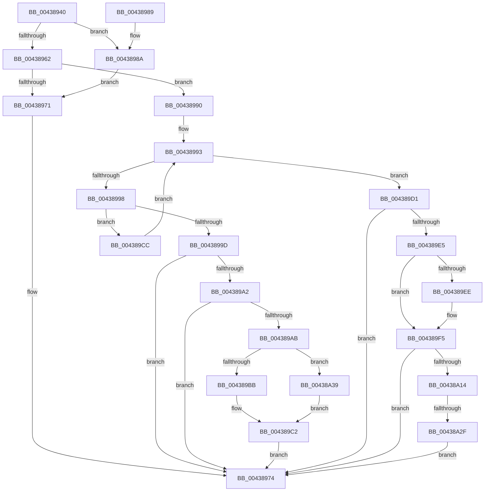

# RtlpLookupOrCreateLowBox

- RVA: `0x00438940`–`0x00438A3F` (길이 `255` bytes)
- VA: `0x0000000140438940`
- 실행 섹션: `.text`
- PDB 이름 있음: `예`; PDB Function 태그: `예`
- unwind 정보 RVA: `0x000A3504`
- 디코드: `74`개 명령, `255/255` bytes 표시
- 미해석 바이트: `0` (있으면 어셈블리에 `.byte`로 보존)

> 이 문서는 커널 이미지의 기계어와 PDB 기호를 분석해 생성했습니다. 4번과 5번은 함수 원형과 자료형을 바이너리 사용 방식에서 추정한 C 해석이며 원본 소스 복구 결과는 아닙니다.

## 1. Dependencies

- 직접 호출 지점: **2**; 고유 호출 대상: **2**
- 직접 호출자로 확인된 함수: **2**
- RIP 상대 이미지 참조: **0**

### Outgoing calls
- `0x00438962` → [RtlpQueryLowBoxId](RtlpQueryLowBoxId_function_00438A50.md) (function, `0x00438A50`)
- `0x004389DB` → [RtlpAllocateAtom](../../page/99/RtlpAllocateAtom_function_0099E2B4.md) (function, `0x0099E2B4`)

### Direct callers
- [RtlLookupAtomInAtomTable](../../page/99/RtlLookupAtomInAtomTable_function_00992DF0.md) at `0x00992FEA`
- [RtlpHashStringToAtom](../../page/99/RtlpHashStringToAtom_function_0099E760.md) at `0x0099E834`

### Static image references
- 디코드된 RIP-relative 메모리 참조가 없습니다.

## 2. Other-region calls and transfers

- 다른 실행 섹션으로 향하는 call: **1**
  - `0x004389DB` → [RtlpAllocateAtom](../../page/99/RtlpAllocateAtom_function_0099E2B4.md) (`.text` → `PAGE`)
- call이 아닌 외부 분기/꼬리 이동: **1**
  - `0x00438A29` → [sub_006EF376](../6E/Unknown_function_006EF376.md) (`tail-transfer`)

## 3. Assembly (complete function range)

```asm
00438940  48 89 5C 24 08                  mov qword ptr [rsp + 8], rbx
00438945  48 89 6C 24 10                  mov qword ptr [rsp + 0x10], rbp
0043894A  48 89 74 24 18                  mov qword ptr [rsp + 0x18], rsi
0043894F  57                              push rdi
00438950  48 83 EC 20                     sub rsp, 0x20
00438954  8B 41 18                        mov eax, dword ptr [rcx + 0x18]
00438957  41 0F B6 E8                     movzx ebp, r8b
0043895B  48 8B FA                        mov rdi, rdx
0043895E  A8 01                           test al, 1
00438960  75 28                           jne 0x14043898a
00438962  E8 E9 00 00 00                  call 0x140438a50
00438967  48 8D 5F 10                     lea rbx, [rdi + 0x10]
0043896B  8B F0                           mov esi, eax
0043896D  85 C0                           test eax, eax
0043896F  75 1F                           jne 0x140438990
00438971  48 8B C3                        mov rax, rbx
00438974  48 8B 5C 24 30                  mov rbx, qword ptr [rsp + 0x30]
00438979  48 8B 6C 24 38                  mov rbp, qword ptr [rsp + 0x38]
0043897E  48 8B 74 24 40                  mov rsi, qword ptr [rsp + 0x40]
00438983  48 83 C4 20                     add rsp, 0x20
00438987  5F                              pop rdi
00438988  C3                              ret
00438989  CC                              int3
0043898A  48 8D 5A 10                     lea rbx, [rdx + 0x10]
0043898E  EB E1                           jmp 0x140438971
00438990  48 8B 03                        mov rax, qword ptr [rbx]
00438993  48 3B C3                        cmp rax, rbx
00438996  74 39                           je 0x1404389d1
00438998  39 70 10                        cmp dword ptr [rax + 0x10], esi
0043899B  75 2F                           jne 0x1404389cc
0043899D  40 84 ED                        test bpl, bpl
004389A0  74 D2                           je 0x140438974
004389A2  0F B7 48 16                     movzx ecx, word ptr [rax + 0x16]
004389A6  F6 C1 04                        test cl, 4
004389A9  75 C9                           jne 0x140438974
004389AB  0F B7 50 14                     movzx edx, word ptr [rax + 0x14]
004389AF  41 B8 FF FF 00 00               mov r8d, 0xffff
004389B5  66 41 3B D0                     cmp dx, r8w
004389B9  74 7E                           je 0x140438a39
004389BB  66 FF C2                        inc dx
004389BE  66 89 50 14                     mov word ptr [rax + 0x14], dx
004389C2  66 83 C9 04                     or cx, 4
004389C6  66 89 48 16                     mov word ptr [rax + 0x16], cx
004389CA  EB A8                           jmp 0x140438974
004389CC  48 8B 00                        mov rax, qword ptr [rax]
004389CF  EB C2                           jmp 0x140438993
004389D1  BA 41 74 6D 4C                  mov edx, 0x4c6d7441
004389D6  B9 18 00 00 00                  mov ecx, 0x18
004389DB  E8 D4 58 56 00                  call 0x14099e2b4
004389E0  48 85 C0                        test rax, rax
004389E3  74 8F                           je 0x140438974
004389E5  48 8B 0B                        mov rcx, qword ptr [rbx]
004389E8  48 39 59 08                     cmp qword ptr [rcx + 8], rbx
004389EC  74 07                           je 0x1404389f5
004389EE  B9 03 00 00 00                  mov ecx, 3
004389F3  CD 29                           int 0x29
004389F5  48 89 08                        mov qword ptr [rax], rcx
004389F8  48 89 58 08                     mov qword ptr [rax + 8], rbx
004389FC  48 89 41 08                     mov qword ptr [rcx + 8], rax
00438A00  33 C9                           xor ecx, ecx
00438A02  48 89 03                        mov qword ptr [rbx], rax
00438A05  89 48 14                        mov dword ptr [rax + 0x14], ecx
00438A08  89 70 10                        mov dword ptr [rax + 0x10], esi
00438A0B  40 84 ED                        test bpl, bpl
00438A0E  0F 84 60 FF FF FF               je 0x140438974
00438A14  C7 40 14 01 00 04 00            mov dword ptr [rax + 0x14], 0x40001
00438A1B  41 B8 FF FF 00 00               mov r8d, 0xffff
00438A21  0F B7 4F 24                     movzx ecx, word ptr [rdi + 0x24]
00438A25  66 41 3B C8                     cmp cx, r8w
00438A29  0F 85 47 69 2B 00               jne 0x1406ef376
00438A2F  66 83 4F 26 01                  or word ptr [rdi + 0x26], 1
00438A34  E9 3B FF FF FF                  jmp 0x140438974
00438A39  66 83 C9 01                     or cx, 1
00438A3D  EB 83                           jmp 0x1404389c2
```

## 4. C-style interpretation (structured pseudocode)

```c
__int64 __fastcall RtlpLookupOrCreateLowBox(__int64 a1, __int64 a2, unsigned __int8 a3)
{
    __int64 result;
    __int64 v_rsp;
    unsigned __int64 v_stack_p10;
    unsigned __int64 v_stack_p18;
    unsigned __int64 v_stack_p8;

    v_stack_p8 = v_rbx;
    v_stack_p10 = v_rbp;
    v_stack_p18 = v_rsi;
    v_rsp = (v_rsp) - (32);
    if ((((unsigned __int8)((unsigned int)(*(unsigned int *)(a1 + 24)))) & (1)) != 0) goto loc_0043898A;
    result = RtlpQueryLowBoxId(a1, a2, a3, a4);
    if ((unsigned int)(result) != 0) goto loc_00438990;
loc_00438971:
loc_00438974:
    v_rsp = (v_rsp) + (32);
    return a2 + 16;
loc_0043898A:
    goto loc_00438971;
loc_00438990:
loc_00438993:
    if ((*(unsigned __int64 *)(a2 + 16)) == (a2 + 16)) goto loc_004389D1;
    if ((*(unsigned int *)(*(unsigned __int64 *)(a2 + 16) + 16)) != ((unsigned int)(v_stack_p18))) goto loc_004389CC;
    if ((unsigned __int8)(v_stack_p10) == 0) goto loc_00438974;
    if ((((unsigned __int8)(*(unsigned __int16 *)(*(unsigned __int64 *)(a2 + 16) + 22))) & (4)) != 0) goto loc_00438974;
    if (((unsigned __int16)(*(unsigned __int16 *)(*(unsigned __int64 *)(a2 + 16) + 20))) == ((unsigned __int16)((unsigned int)(0xFFFFULL)))) goto loc_00438A39;
    a2 = (unsigned __int16)((*(unsigned __int16 *)(*(unsigned __int64 *)(a2 + 16) + 20)) + 1);
    *(unsigned __int16 *)(*(unsigned __int64 *)(a2 + 16) + 20) = (unsigned __int16)(a2);
loc_004389C2:
    a1 = (unsigned __int16)((*(unsigned __int16 *)(*(unsigned __int64 *)(a2 + 16) + 22)) | (4));
    *(unsigned __int16 *)(*(unsigned __int64 *)(a2 + 16) + 22) = (unsigned __int16)(a1);
    goto loc_00438974;
loc_004389CC:
    goto loc_00438993;
loc_004389D1:
    result = RtlpAllocateAtom(24, (unsigned int)(0x4C6D7441ULL), (unsigned int)(0xFFFFULL), a4);
    if (result == 0) goto loc_00438974;
    if ((*(unsigned __int64 *)(*(unsigned __int64 *)(a2 + 16) + 8)) != (a2 + 16)) {
        a1 = 3;
    }
    *(unsigned __int64 *)(result) = a1;
    *(unsigned __int64 *)(result + 8) = a2 + 16;
    *(unsigned __int64 *)(a1 + 8) = result;
    a1 = 0;
    *(unsigned __int64 *)(a2 + 16) = result;
    *(unsigned int *)(result + 20) = 0;
    *(unsigned int *)(result + 16) = (unsigned int)(v_stack_p18);
    if ((unsigned __int8)(v_stack_p10) == 0) goto loc_00438974;
    *(unsigned int *)(result + 20) = 0x40001ULL;
    goto loc_00438974;
loc_00438A39:
    a1 = (unsigned __int16)((*(unsigned __int16 *)(a2 + 36)) | (1));
    goto loc_004389C2;
}
```

## 5. (Beta) C Style

```c
void *RtlpLookupOrCreateLowBox(void *Arg1, void *Arg2, uint8_t Arg3)
{
    uint8_t *arg1 = (uint8_t *)Arg1;
    uint8_t *arg2 = (uint8_t *)Arg2;

    int64_t result;
    int64_t local_rsp;
    uint64_t v_stack_p10;
    uint64_t v_stack_p18;
    uint64_t v_stack_p8;

    v_stack_p8 = local_rbx;
    v_stack_p10 = local_rbp;
    v_stack_p18 = local_rsi;
    local_rsp = (local_rsp) - (32);
    if ((((uint8_t)((uint32_t)(*(uint32_t *)(arg1 + 0x18)))) & (1)) != 0) goto loc_0043898A;
    result = RtlpQueryLowBoxId(Arg1, Arg2, Arg3, a4);
    if ((uint32_t)(result) != 0) goto loc_00438990;
loc_00438971:
loc_00438974:
    local_rsp = (local_rsp) + (32);
    return Arg2 + 16;
loc_0043898A:
    goto loc_00438971;
loc_00438990:
loc_00438993:
    if ((*(uint64_t *)(arg2 + 0x10)) == (Arg2 + 16)) goto loc_004389D1;
    if ((*(uint32_t *)(*(uint64_t *)(arg2 + 0x10) + 0x10)) != ((uint32_t)(v_stack_p18))) goto loc_004389CC;
    if ((uint8_t)(v_stack_p10) == 0) goto loc_00438974;
    if ((((uint8_t)(*(uint16_t *)(*(uint64_t *)(arg2 + 0x10) + 0x16))) & (4)) != 0) goto loc_00438974;
    if (((uint16_t)(*(uint16_t *)(*(uint64_t *)(arg2 + 0x10) + 0x14))) == ((uint16_t)((uint32_t)(0xFFFFULL)))) goto loc_00438A39;
    Arg2 = (uint16_t)((*(uint16_t *)(*(uint64_t *)(arg2 + 0x10) + 0x14)) + 1);
    *(uint16_t *)(*(uint64_t *)(arg2 + 0x10) + 0x14) = (uint16_t)(Arg2);
loc_004389C2:
    Arg1 = (uint16_t)((*(uint16_t *)(*(uint64_t *)(arg2 + 0x10) + 0x16)) | (4));
    *(uint16_t *)(*(uint64_t *)(arg2 + 0x10) + 0x16) = (uint16_t)(Arg1);
    goto loc_00438974;
loc_004389CC:
    goto loc_00438993;
loc_004389D1:
    result = RtlpAllocateAtom(24, (uint32_t)(0x4C6D7441ULL), (uint32_t)(0xFFFFULL), a4);
    if (result == 0) goto loc_00438974;
    if ((*(uint64_t *)(*(uint64_t *)(arg2 + 0x10) + 0x8)) != (Arg2 + 16)) {
        Arg1 = 3;
    }
    *(void **)(result) = Arg1;
    *(void **)(result + 0x8) = Arg2 + 16;
    *(uint64_t *)(arg1 + 0x8) = result;
    Arg1 = 0;
    *(uint64_t *)(arg2 + 0x10) = result;
    *(uint32_t *)(result + 0x14) = 0;
    *(uint32_t *)(result + 0x10) = (uint32_t)(v_stack_p18);
    if ((uint8_t)(v_stack_p10) == 0) goto loc_00438974;
    *(uint32_t *)(result + 0x14) = 0x40001ULL;
    goto loc_00438974;
loc_00438A39:
    Arg1 = (uint16_t)((*(uint16_t *)(arg2 + 0x24)) | (1));
    goto loc_004389C2;
}
```

### 관측된 메모리 오프셋

구조체 형식이 확인되지 않은 접근은 인자 기준의 오프셋으로만 기록했습니다.

| 기준 인자 | 오프셋 표현 | 폭 (bit) | 접근 |
|---|---:|---:|---|
| `Arg1` | `+ 0x18` | `32` | `R` |
| `Arg2` | `+ 0x0` | `64` | `R` |
| `Arg2` | `+ 0x0` | `64` | `W` |
| `Arg2` | `+ 0x10` | `64` | `R` |
| `Arg2` | `+ 0x24` | `16` | `R` |
| `Arg2` | `+ 0x26` | `16` | `R/W` |

## 6. Execution-region graph

[열기: 2D/3D 그래프와 함수 탐색 컨트롤 패널](../../../control-panel.html?section=text&rva=0x00438940&view=graph)

- 2D 그래프는 위에서 아래로 흐르고, 3D 그래프는 빈 공간을 드래그해 회전합니다. Shift+드래그는 이동, 휠은 확대·축소, 함수 노드 선택은 대상 보고서 이동입니다.

### Static fallback


