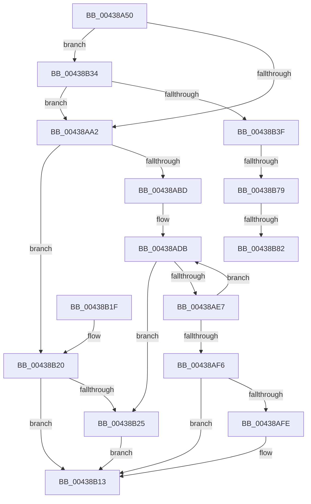

# RtlpQueryLowBoxId

- RVA: `0x00438A50`–`0x00438B95` (길이 `325` bytes)
- VA: `0x0000000140438A50`
- 실행 섹션: `.text`
- PDB 이름 있음: `예`; PDB Function 태그: `예`
- unwind 정보 RVA: `0x000A352C`
- 디코드: `78`개 명령, `325/325` bytes 표시
- 미해석 바이트: `0` (있으면 어셈블리에 `.byte`로 보존)

> 이 문서는 커널 이미지의 기계어와 PDB 기호를 분석해 생성했습니다. 4번과 5번은 함수 원형과 자료형을 바이너리 사용 방식에서 추정한 C 해석이며 원본 소스 복구 결과는 아닙니다.

## 1. Dependencies

- 직접 호출 지점: **7**; 고유 호출 대상: **5**
- 직접 호출자로 확인된 함수: **3**
- RIP 상대 이미지 참조: **1**

### Outgoing calls
- `0x00438A8D` → [PsReferenceEffectiveToken](../../page/9A/PsReferenceEffectiveToken_function_009A2B40.md) (function, `0x009A2B40`)
- `0x00438AB3` → [SeQueryInformationToken](../../page/8B/SeQueryInformationToken_function_008B5090.md) (function, `0x008B5090`)
- `0x00438B0E` → [ObpPushStackInfo](../21/ObpPushStackInfo_function_002109E4.md) (function, `0x002109E4`)
- `0x00438B2D` → [ObfDereferenceObjectWithTag](../2F/ObfDereferenceObjectWithTag_function_002F78E0.md) (function, `0x002F78E0`)
- `0x00438B54` → [PsReferencePrimaryTokenWithTag](../20/PsReferencePrimaryTokenWithTag_function_0020FF80.md) (function, `0x0020FF80`)
- `0x00438B69` → [SeQueryInformationToken](../../page/8B/SeQueryInformationToken_function_008B5090.md) (function, `0x008B5090`)
- `0x00438B8A` → [ObfDereferenceObjectWithTag](../2F/ObfDereferenceObjectWithTag_function_002F78E0.md) (function, `0x002F78E0`)

### Direct callers
- [RtlpAllocateAtomTableEntry](RtlpAllocateAtomTableEntry_function_004387CC.md) at `0x0043882E`
- [RtlpLookupLowBox](RtlpLookupLowBox_function_004388AC.md) at `0x004388D3`
- [RtlpLookupOrCreateLowBox](RtlpLookupOrCreateLowBox_function_00438940.md) at `0x00438962`

### Static image references
- `0x00438AF6` → RVA `0x00FC5010` (`ALMOSTRO`; read)

## 2. Other-region calls and transfers

- 다른 실행 섹션으로 향하는 call: **3**
  - `0x00438A8D` → [PsReferenceEffectiveToken](../../page/9A/PsReferenceEffectiveToken_function_009A2B40.md) (`.text` → `PAGE`)
  - `0x00438AB3` → [SeQueryInformationToken](../../page/8B/SeQueryInformationToken_function_008B5090.md) (`.text` → `PAGE`)
  - `0x00438B69` → [SeQueryInformationToken](../../page/8B/SeQueryInformationToken_function_008B5090.md) (`.text` → `PAGE`)
- call이 아닌 외부 분기/꼬리 이동: **3**
  - `0x00438B73` → [sub_006EF382 + 0x11](../6E/Unknown_function_006EF382.md) (`tail-transfer`)
  - `0x00438B7C` → [sub_006EF382](../6E/Unknown_function_006EF382.md) (`tail-transfer`)
  - `0x00438B90` → [sub_006EF382](../6E/Unknown_function_006EF382.md) (`tail-transfer`)

## 3. Assembly (complete function range)

```asm
00438A50  40 53                           push rbx
00438A52  56                              push rsi
00438A53  57                              push rdi
00438A54  48 83 EC 40                     sub rsp, 0x40
00438A58  33 F6                           xor esi, esi
00438A5A  48 8D 44 24 78                  lea rax, [rsp + 0x78]
00438A5F  89 74 24 30                     mov dword ptr [rsp + 0x30], esi
00438A63  4C 8D 4C 24 60                  lea r9, [rsp + 0x60]
00438A68  65 48 8B 0C 25 88 01 00 00      mov rcx, qword ptr gs:[0x188]
00438A71  4C 8D 44 24 70                  lea r8, [rsp + 0x70]
00438A76  48 89 74 24 28                  mov qword ptr [rsp + 0x28], rsi
00438A7B  BA 41 74 6F 6D                  mov edx, 0x6d6f7441
00438A80  89 74 24 70                     mov dword ptr [rsp + 0x70], esi
00438A84  89 74 24 78                     mov dword ptr [rsp + 0x78], esi
00438A88  48 89 44 24 20                  mov qword ptr [rsp + 0x20], rax
00438A8D  E8 AE A0 56 00                  call 0x1409a2b40
00438A92  8B 7C 24 70                     mov edi, dword ptr [rsp + 0x70]
00438A96  48 8B D8                        mov rbx, rax
00438A99  83 FF 02                        cmp edi, 2
00438A9C  0F 84 92 00 00 00               je 0x140438b34
00438AA2  4C 8D 44 24 68                  lea r8, [rsp + 0x68]
00438AA7  89 74 24 68                     mov dword ptr [rsp + 0x68], esi
00438AAB  BA 20 00 00 00                  mov edx, 0x20
00438AB0  48 8B CB                        mov rcx, rbx
00438AB3  E8 D8 C5 47 00                  call 0x1408b5090
00438AB8  83 FF 01                        cmp edi, 1
00438ABB  75 63                           jne 0x140438b20
00438ABD  65 48 8B 14 25 88 01 00 00      mov rdx, qword ptr gs:[0x188]
00438AC6  48 8B 92 B8 00 00 00            mov rdx, qword ptr [rdx + 0xb8]
00438ACD  0F 0D 8A 48 02 00 00            prefetchw byte ptr [rdx + 0x248]
00438AD4  48 8B 82 48 02 00 00            mov rax, qword ptr [rdx + 0x248]
00438ADB  48 8B C8                        mov rcx, rax
00438ADE  48 33 CB                        xor rcx, rbx
00438AE1  48 83 F9 0F                     cmp rcx, 0xf
00438AE5  73 3E                           jae 0x140438b25
00438AE7  48 8D 48 01                     lea rcx, [rax + 1]
00438AEB  F0 48 0F B1 8A 48 02 00 00      lock cmpxchg qword ptr [rdx + 0x248], rcx
00438AF4  75 E5                           jne 0x140438adb
00438AF6  39 35 14 C5 B8 00               cmp dword ptr [rip + 0xb8c514], esi
00438AFC  74 15                           je 0x140438b13
00438AFE  33 D2                           xor edx, edx
00438B00  48 8D 4B D0                     lea rcx, [rbx - 0x30]
00438B04  41 B9 41 74 6F 6D               mov r9d, 0x6d6f7441
00438B0A  44 8D 42 01                     lea r8d, [rdx + 1]
00438B0E  E8 D1 7E DD FF                  call 0x1402109e4
00438B13  8B 44 24 68                     mov eax, dword ptr [rsp + 0x68]
00438B17  48 83 C4 40                     add rsp, 0x40
00438B1B  5F                              pop rdi
00438B1C  5E                              pop rsi
00438B1D  5B                              pop rbx
00438B1E  C3                              ret
00438B1F  CC                              int3
00438B20  48 85 DB                        test rbx, rbx
00438B23  74 EE                           je 0x140438b13
00438B25  BA 41 74 6F 6D                  mov edx, 0x6d6f7441
00438B2A  48 8B CB                        mov rcx, rbx
00438B2D  E8 AE ED EB FF                  call 0x1402f78e0
00438B32  EB DF                           jmp 0x140438b13
00438B34  83 7C 24 78 02                  cmp dword ptr [rsp + 0x78], 2
00438B39  0F 8D 63 FF FF FF               jge 0x140438aa2
00438B3F  65 48 8B 0C 25 88 01 00 00      mov rcx, qword ptr gs:[0x188]
00438B48  BA 41 74 6F 6D                  mov edx, 0x6d6f7441
00438B4D  48 8B 89 B8 00 00 00            mov rcx, qword ptr [rcx + 0xb8]
00438B54  E8 27 74 DD FF                  call 0x14020ff80
00438B59  4C 8D 44 24 30                  lea r8, [rsp + 0x30]
00438B5E  BA 1D 00 00 00                  mov edx, 0x1d
00438B63  48 8B C8                        mov rcx, rax
00438B66  48 8B F8                        mov rdi, rax
00438B69  E8 22 C5 47 00                  call 0x1408b5090
00438B6E  83 7C 24 30 01                  cmp dword ptr [rsp + 0x30], 1
00438B73  0F 85 1A 68 2B 00               jne 0x1406ef393
00438B79  48 85 DB                        test rbx, rbx
00438B7C  0F 84 00 68 2B 00               je 0x1406ef382
00438B82  BA 41 74 6F 6D                  mov edx, 0x6d6f7441
00438B87  48 8B CB                        mov rcx, rbx
00438B8A  E8 51 ED EB FF                  call 0x1402f78e0
00438B8F  90                              nop
00438B90  E9 ED 67 2B 00                  jmp 0x1406ef382
```

## 4. C-style interpretation (structured pseudocode)

```c
__int64 __fastcall RtlpQueryLowBoxId(void)
{
    __int64 result;
    __int64 v_rsi;
    __int64 v_rsp;
    unsigned int v_stack_m28;
    unsigned __int64 v_stack_m30;
    unsigned __int64 v_stack_m38;
    unsigned __int64 v_stack_p10;
    unsigned __int64 v_stack_p18;
    unsigned __int64 v_stack_p20;
    unsigned __int64 v_stack_p30;
    unsigned int v_stack_p78;
    unsigned __int64 v_stack_p8;

    v_rsp = (v_rsp) - (64);
    v_rsi = 0;
    v_stack_m28 = 0;
    v_stack_m30 = 0;
    v_stack_p18 = 0;
    v_stack_p20 = 0;
    v_stack_m38 = v_stack_p20;
    result = PsReferenceEffectiveToken(*(unsigned __int64 *)(gs_base + (0 + 392)), (unsigned int)(0x6D6F7441ULL), v_stack_p18, v_stack_p8);
    if (((unsigned int)((unsigned int)(v_stack_p18))) == 2) goto loc_00438B34;
loc_00438AA2:
    v_stack_p10 = 0;
    result = SeQueryInformationToken(result, 32, v_stack_p10, v_stack_p8);
    if (((unsigned int)((unsigned int)(v_stack_p18))) != 1) goto loc_00438B20;
loc_00438ADB:
    a1 = (*(unsigned __int64 *)(*(unsigned __int64 *)(*(unsigned __int64 *)(gs_base + (0 + 392)) + 184) + 584)) ^ (result);
    if (a1 >= 15) goto loc_00438B25;
    if (a1 != 15) goto loc_00438ADB;
    result = *(unsigned __int64 *)(*(unsigned __int64 *)(*(unsigned __int64 *)(gs_base + (0 + 392)) + 184) + 584);
    if ((*(unsigned int *)(v_rip + 12109076)) != 0) {
        a2 = 0;
        a1 = result - 48;
        a4 = 0x6D6F7441ULL;
        a3 = a2 + 1;
        result = ObpPushStackInfo(a1, a2, a3, a4);
    }
    v_rsp = (v_rsp) + (64);
    return (unsigned int)(v_stack_p10);
loc_00438B20:
    if (result == 0) goto loc_00438B13;
loc_00438B25:
    result = ObfDereferenceObjectWithTag(result, (unsigned int)(0x6D6F7441ULL), a3, a4);
    goto loc_00438B13;
loc_00438B34:
    if (v_stack_p78 >= 2) goto loc_00438AA2;
    result = PsReferencePrimaryTokenWithTag(*(unsigned __int64 *)(*(unsigned __int64 *)(gs_base + (0 + 392)) + 184), (unsigned int)(0x6D6F7441ULL), a3, a4);
    result = SeQueryInformationToken(result, 29, v_stack_p30, a4);
    result = ObfDereferenceObjectWithTag(result, (unsigned int)(0x6D6F7441ULL), v_stack_p30, a4);
}
```

## 5. (Beta) C Style

```c
void RtlpQueryLowBoxId(void)
{
    int64_t result;
    int64_t local_rsi;
    int64_t local_rsp;
    uint32_t v_stack_m28;
    uint64_t v_stack_m30;
    uint64_t v_stack_m38;
    uint64_t v_stack_p10;
    uint64_t v_stack_p18;
    uint64_t v_stack_p20;
    uint64_t v_stack_p30;
    uint32_t v_stack_p78;
    uint64_t v_stack_p8;

    local_rsp = (local_rsp) - (64);
    local_rsi = 0;
    v_stack_m28 = 0;
    v_stack_m30 = 0;
    v_stack_p18 = 0;
    v_stack_p20 = 0;
    v_stack_m38 = v_stack_p20;
    result = PsReferenceEffectiveToken(*(uint64_t *)(gs_base + (0 + 0x188)), (uint32_t)(0x6D6F7441ULL), v_stack_p18, v_stack_p8);
    if (((uint32_t)((uint32_t)(v_stack_p18))) == 2) goto loc_00438B34;
loc_00438AA2:
    v_stack_p10 = 0;
    result = SeQueryInformationToken(result, 32, v_stack_p10, v_stack_p8);
    if (((uint32_t)((uint32_t)(v_stack_p18))) != 1) goto loc_00438B20;
loc_00438ADB:
    a1 = (*(uint64_t *)(*(uint64_t *)(*(uint64_t *)(gs_base + (0 + 0x188)) + 0xB8) + 0x248)) ^ (result);
    if (a1 >= 15) goto loc_00438B25;
    if (a1 != 15) goto loc_00438ADB;
    result = *(uint64_t *)(*(uint64_t *)(*(uint64_t *)(gs_base + (0 + 0x188)) + 0xB8) + 0x248);
    if ((*(uint32_t *)(v_rip + 0xB8C514)) != 0) {
        a2 = 0;
        a1 = result - 48;
        a4 = 0x6D6F7441ULL;
        a3 = a2 + 1;
        result = ObpPushStackInfo(a1, a2, a3, a4);
    }
    local_rsp = (local_rsp) + (64);
    return (uint32_t)(v_stack_p10);
loc_00438B20:
    if (result == 0) goto loc_00438B13;
loc_00438B25:
    result = ObfDereferenceObjectWithTag(result, (uint32_t)(0x6D6F7441ULL), a3, a4);
    goto loc_00438B13;
loc_00438B34:
    if (v_stack_p78 >= 2) goto loc_00438AA2;
    result = PsReferencePrimaryTokenWithTag(*(uint64_t *)(*(uint64_t *)(gs_base + (0 + 0x188)) + 0xB8), (uint32_t)(0x6D6F7441ULL), a3, a4);
    result = SeQueryInformationToken(result, 29, v_stack_p30, a4);
    result = ObfDereferenceObjectWithTag(result, (uint32_t)(0x6D6F7441ULL), v_stack_p30, a4);
}
```

## 6. Execution-region graph

[열기: 2D/3D 그래프와 함수 탐색 컨트롤 패널](../../../control-panel.html?section=text&rva=0x00438A50&view=graph)

- 2D 그래프는 위에서 아래로 흐르고, 3D 그래프는 빈 공간을 드래그해 회전합니다. Shift+드래그는 이동, 휠은 확대·축소, 함수 노드 선택은 대상 보고서 이동입니다.

### Static fallback


