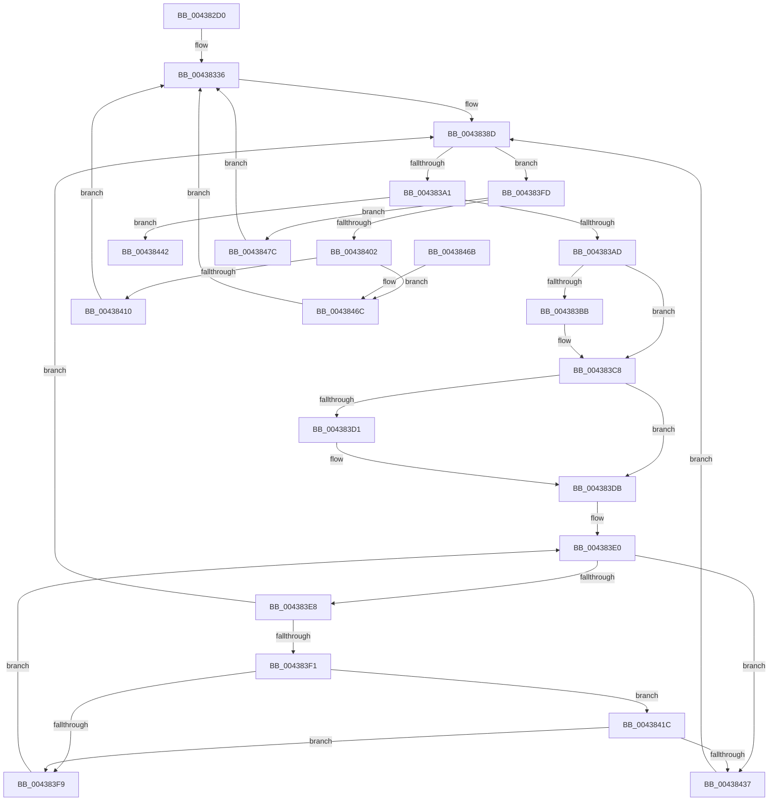

# SMKM_STORE_MGR&lt;SM_TRAITS&gt;::SmAsyncReadQueueWorker

- RVA: `0x004382D0`–`0x00438488` (길이 `440` bytes)
- VA: `0x00000001404382D0`
- 실행 섹션: `.text`
- PDB 이름 있음: `예`; PDB Function 태그: `아니요`
- unwind 정보 RVA: `0x000A3470`
- 디코드: `127`개 명령, `440/440` bytes 표시
- 미해석 바이트: `0` (있으면 어셈블리에 `.byte`로 보존)

> 이 문서는 커널 이미지의 기계어와 PDB 기호를 분석해 생성했습니다. 4번과 5번은 함수 원형과 자료형을 바이너리 사용 방식에서 추정한 C 해석이며 원본 소스 복구 결과는 아닙니다.

## 1. Dependencies

- 직접 호출 지점: **11**; 고유 호출 대상: **6**
- 직접 호출자로 확인된 함수: **0**
- RIP 상대 이미지 참조: **1**

### Outgoing calls
- `0x00438328` → [KeAcquireSpinLockRaiseToDpc](../20/KeAcquireSpinLockRaiseToDpc_function_00208470.md) (function, `0x00208470`)
- `0x00438339` → [KeReleaseSpinLock](../39/KeReleaseSpinLock_function_00392BA0.md) (function, `0x00392BA0`)
- `0x00438343` → [KeQueryPerformanceCounter](../37/KeQueryPerformanceCounter_function_0037E7E0.md) (function, `0x0037E7E0`)
- `0x0043835A` → [SmWorkItemQueue](../31/SmWorkItemQueue_function_0031799C.md) (function, `0x0031799C`)
- `0x00438361` → [KeQueryPerformanceCounter](../37/KeQueryPerformanceCounter_function_0037E7E0.md) (function, `0x0037E7E0`)
- `0x00438390` → [KeAcquireSpinLockRaiseToDpc](../20/KeAcquireSpinLockRaiseToDpc_function_00208470.md) (function, `0x00208470`)
- `0x004383AD` → [KxReleaseSpinLock](../20/KxReleaseSpinLock_function_00206670.md) (function, `0x00206670`)
- `0x004383C3` → [KiLowerIrqlProcessIrqlFlags](../4F/KiLowerIrqlProcessIrqlFlags_function_004F5698.md) (function, `0x004F5698`)
- `0x004383D3` → [KeQueryPerformanceCounter](../37/KeQueryPerformanceCounter_function_0037E7E0.md) (function, `0x0037E7E0`)
- `0x0043841E` → [KeQueryPerformanceCounter](../37/KeQueryPerformanceCounter_function_0037E7E0.md) (function, `0x0037E7E0`)
- `0x00438449` → [KeReleaseSpinLock](../39/KeReleaseSpinLock_function_00392BA0.md) (function, `0x00392BA0`)

### Direct callers
- 이 함수 시작 RVA로 연결되는 직접 call은 확인되지 않았습니다. 간접 호출은 완전히 역산할 수 없습니다.

### Static image references
- `0x004383B2` → RVA `0x00FC6D20` (`ALMOSTRO`; read)

## 2. Other-region calls and transfers

- 다른 실행 섹션으로 향하는 call: **0**
- 별도 외부 분기/꼬리 이동을 확인하지 못했습니다.

## 3. Assembly (complete function range)

```asm
004382D0  48 89 5C 24 10                  mov qword ptr [rsp + 0x10], rbx
004382D5  48 89 6C 24 18                  mov qword ptr [rsp + 0x18], rbp
004382DA  48 89 74 24 20                  mov qword ptr [rsp + 0x20], rsi
004382DF  57                              push rdi
004382E0  41 54                           push r12
004382E2  41 55                           push r13
004382E4  41 56                           push r14
004382E6  41 57                           push r15
004382E8  48 83 EC 20                     sub rsp, 0x20
004382EC  48 8B 51 28                     mov rdx, qword ptr [rcx + 0x28]
004382F0  45 33 ED                        xor r13d, r13d
004382F3  8B 41 20                        mov eax, dword ptr [rcx + 0x20]
004382F6  4C 8B C2                        mov r8, rdx
004382F9  83 E0 07                        and eax, 7
004382FC  4C 89 6C 24 50                  mov qword ptr [rsp + 0x50], r13
00438301  49 83 E0 FC                     and r8, 0xfffffffffffffffc
00438305  83 E2 03                        and edx, 3
00438308  48 C1 E2 03                     shl rdx, 3
0043830C  45 8D 65 64                     lea r12d, [r13 + 0x64]
00438310  48 0B C2                        or rax, rdx
00438313  48 8B F9                        mov rdi, rcx
00438316  4D 8D B0 00 03 00 00            lea r14, [r8 + 0x300]
0043831D  49 8B CE                        mov rcx, r14
00438320  48 8D 04 40                     lea rax, [rax + rax*2]
00438324  49 8D 34 C0                     lea rsi, [r8 + rax*8]
00438328  E8 43 01 DD FF                  call 0x140208470
0043832D  FF 4E 10                        dec dword ptr [rsi + 0x10]
00438330  0F B6 D0                        movzx edx, al
00438333  FF 46 14                        inc dword ptr [rsi + 0x14]
00438336  49 8B CE                        mov rcx, r14
00438339  E8 62 A8 F5 FF                  call 0x140392ba0
0043833E  48 8D 4C 24 50                  lea rcx, [rsp + 0x50]
00438343  E8 98 64 F4 FF                  call 0x14037e7e0
00438348  48 8B 4F 20                     mov rcx, qword ptr [rdi + 0x20]
0043834C  48 8D 57 D8                     lea rdx, [rdi - 0x28]
00438350  48 83 E1 F8                     and rcx, 0xfffffffffffffff8
00438354  45 33 C0                        xor r8d, r8d
00438357  48 8B D8                        mov rbx, rax
0043835A  E8 3D F6 ED FF                  call 0x14031799c
0043835F  33 C9                           xor ecx, ecx
00438361  E8 7A 64 F4 FF                  call 0x14037e7e0
00438366  48 8B 7C 24 50                  mov rdi, qword ptr [rsp + 0x50]
0043836B  48 2B C3                        sub rax, rbx
0043836E  48 69 C0 40 42 0F 00            imul rax, rax, 0xf4240
00438375  41 8B CC                        mov ecx, r12d
00438378  49 8B DD                        mov rbx, r13
0043837B  48 99                           cqo
0043837D  45 8B FD                        mov r15d, r13d
00438380  48 F7 FF                        idiv rdi
00438383  48 3B C1                        cmp rax, rcx
00438386  41 0F 43 C4                     cmovae eax, r12d
0043838A  44 8B E0                        mov r12d, eax
0043838D  49 8B CE                        mov rcx, r14
00438390  E8 DB 00 DD FF                  call 0x140208470
00438395  48 8B 4E 08                     mov rcx, qword ptr [rsi + 8]
00438399  0F B6 E8                        movzx ebp, al
0043839C  4C 39 29                        cmp qword ptr [rcx], r13
0043839F  75 5C                           jne 0x1404383fd
004383A1  49 8B CE                        mov rcx, r14
004383A4  45 85 FF                        test r15d, r15d
004383A7  0F 85 95 00 00 00               jne 0x140438442
004383AD  E8 BE E2 DC FF                  call 0x140206670
004383B2  44 39 2D 67 E9 B8 00            cmp dword ptr [rip + 0xb8e967], r13d
004383B9  74 0D                           je 0x1404383c8
004383BB  44 0F 20 C1                     mov rcx, cr8
004383BF  40 0F B6 D5                     movzx edx, bpl
004383C3  E8 D0 D2 0B 00                  call 0x1404f5698
004383C8  44 0F 22 C5                     mov cr8, rbp
004383CC  48 85 DB                        test rbx, rbx
004383CF  75 0A                           jne 0x1404383db
004383D1  33 C9                           xor ecx, ecx
004383D3  E8 08 64 F4 FF                  call 0x14037e7e0
004383D8  48 8B D8                        mov rbx, rax
004383DB  41 8B ED                        mov ebp, r13d
004383DE  66 90                           nop
004383E0  8B 46 14                        mov eax, dword ptr [rsi + 0x14]
004383E3  39 46 10                        cmp dword ptr [rsi + 0x10], eax
004383E6  77 4F                           ja 0x140438437
004383E8  48 8B 46 08                     mov rax, qword ptr [rsi + 8]
004383EC  4C 39 28                        cmp qword ptr [rax], r13
004383EF  75 9C                           jne 0x14043838d
004383F1  FF C5                           inc ebp
004383F3  40 F6 C5 7F                     test bpl, 0x7f
004383F7  74 23                           je 0x14043841c
004383F9  F3 90                           pause
004383FB  EB E3                           jmp 0x1404383e0
004383FD  48 3B CE                        cmp rcx, rsi
00438400  74 7A                           je 0x14043847c
00438402  48 8B 3E                        mov rdi, qword ptr [rsi]
00438405  48 8B 07                        mov rax, qword ptr [rdi]
00438408  48 89 06                        mov qword ptr [rsi], rax
0043840B  48 3B F9                        cmp rdi, rcx
0043840E  74 5C                           je 0x14043846c
00438410  48 FF 09                        dec qword ptr [rcx]
00438413  40 0F B6 D5                     movzx edx, bpl
00438417  E9 1A FF FF FF                  jmp 0x140438336
0043841C  33 C9                           xor ecx, ecx
0043841E  E8 BD 63 F4 FF                  call 0x14037e7e0
00438423  48 2B C3                        sub rax, rbx
00438426  48 69 C0 40 42 0F 00            imul rax, rax, 0xf4240
0043842D  48 99                           cqo
0043842F  48 F7 FF                        idiv rdi
00438432  49 3B C4                        cmp rax, r12
00438435  72 C2                           jb 0x1404383f9
00438437  41 BF 01 00 00 00               mov r15d, 1
0043843D  E9 4B FF FF FF                  jmp 0x14043838d
00438442  FF 4E 14                        dec dword ptr [rsi + 0x14]
00438445  40 0F B6 D5                     movzx edx, bpl
00438449  E8 52 A7 F5 FF                  call 0x140392ba0
0043844E  48 8B 5C 24 58                  mov rbx, qword ptr [rsp + 0x58]
00438453  48 8B 6C 24 60                  mov rbp, qword ptr [rsp + 0x60]
00438458  48 8B 74 24 68                  mov rsi, qword ptr [rsp + 0x68]
0043845D  48 83 C4 20                     add rsp, 0x20
00438461  41 5F                           pop r15
00438463  41 5E                           pop r14
00438465  41 5D                           pop r13
00438467  41 5C                           pop r12
00438469  5F                              pop rdi
0043846A  C3                              ret
0043846B  CC                              int3
0043846C  48 89 76 08                     mov qword ptr [rsi + 8], rsi
00438470  40 0F B6 D5                     movzx edx, bpl
00438474  4C 89 2E                        mov qword ptr [rsi], r13
00438477  E9 BA FE FF FF                  jmp 0x140438336
0043847C  49 8B FD                        mov rdi, r13
0043847F  40 0F B6 D5                     movzx edx, bpl
00438483  E9 AE FE FF FF                  jmp 0x140438336
```

## 4. C-style interpretation (structured pseudocode)

```c
__int64 __fastcall SMKM_STORE_MGR_SM_TRAITS___SmAsyncReadQueueWorker(__int64 a1)
{
    __int64 result;
    __int64 v_r13;
    __int64 v_rbp;
    __int64 v_rbx;
    __int64 v_rsp;
    unsigned __int64 v_stack_p10;
    unsigned __int64 v_stack_p18;
    unsigned __int64 v_stack_p20;
    unsigned __int64 v_stack_p8;

    v_stack_p10 = v_rbx;
    v_stack_p18 = v_rbp;
    v_stack_p20 = v_rsi;
    v_rsp = (v_rsp) - (32);
    v_r13 = 0;
    result = (unsigned int)(((unsigned int)(*(unsigned int *)(a1 + 32))) & (7));
    v_stack_p8 = 0;
    a3 = (*(unsigned __int64 *)(a1 + 40)) & (-4);
    a2 = (unsigned int)((*(unsigned __int64 *)(a1 + 40)) & (3));
    a2 = (a2) << (3);
    result = (result) | (a2);
    result = KeAcquireSpinLockRaiseToDpc(a3 + 768, a2, a3, a4);
loc_00438336:
    result = KeReleaseSpinLock(a3 + 768, (unsigned __int8)(result), a3, a4);
    result = KeQueryPerformanceCounter(v_stack_p8, (unsigned __int8)(result), a3, a4);
    a1 = (*(unsigned __int64 *)(a1 + 32)) & (-8);
    a3 = 0;
    result = SmWorkItemQueue(a1, a1 - 40, a3, a4);
    a1 = 0;
    result = KeQueryPerformanceCounter(a1, a1 - 40, a3, a4);
    result = (result) - (result);
    result = (result) * (result);
    if (result >= ((unsigned int)((unsigned int)(v_r13 + 100)))) { result = (unsigned int)(v_r13 + 100); }
loc_0043838D:
    result = KeAcquireSpinLockRaiseToDpc(a3 + 768, a1 - 40, a3, a4);
    if ((*(unsigned __int64 *)(*(unsigned __int64 *)(a3 + result + result * 2 * 8 + 8))) != 0) goto loc_004383FD;
    if (0 != 0) goto loc_00438442;
    result = KxReleaseSpinLock(a3 + 768, a1 - 40, a3, a4);
    if ((*(unsigned int *)(v_rip + 12118375)) != 0) {
        a1 = v_cr8;
        a2 = (unsigned __int8)((unsigned __int8)(result));
        result = KiLowerIrqlProcessIrqlFlags(a1, a2, a3, a4);
    }
    v_rbx = 0;
    if (0 == 0) {
        a1 = 0;
        result = KeQueryPerformanceCounter(a1, a2, a3, a4);
        v_rbx = result;
    }
loc_004383E0:
    if ((*(unsigned int *)(a3 + result + result * 2 * 8 + 16)) > ((unsigned int)((unsigned int)(*(unsigned int *)(a3 + result + result * 2 * 8 + 20))))) goto loc_00438437;
    if ((*(unsigned __int64 *)(*(unsigned __int64 *)(a3 + result + result * 2 * 8 + 8))) != 0) goto loc_0043838D;
    v_rbp = (unsigned int)((0) + 1);
    if ((((unsigned __int8)(v_rbp)) & (127)) == 0) goto loc_0043841C;
loc_004383F9:
    goto loc_004383E0;
loc_004383FD:
    if (0 == (a3 + result + result * 2 * 8)) goto loc_0043847C;
    *(unsigned __int64 *)(a3 + result + result * 2 * 8) = *(unsigned __int64 *)(*(unsigned __int64 *)(a3 + result + result * 2 * 8));
    if ((*(unsigned __int64 *)(a3 + result + result * 2 * 8)) == 0) goto loc_0043846C;
    goto loc_00438336;
loc_0043841C:
    a1 = 0;
    result = KeQueryPerformanceCounter(a1, (unsigned __int8)(v_rbp), a3, a4);
    result = (result) - (v_rbx);
    result = (result) * (result);
    if (result < ((unsigned int)((unsigned int)(result)))) goto loc_004383F9;
loc_00438437:
    goto loc_0043838D;
loc_00438442:
    result = KeReleaseSpinLock(a1, (unsigned __int8)(v_rbp), a3, a4);
    v_rsp = (v_rsp) + (32);
    return result;
loc_0043846C:
    *(unsigned __int64 *)(v_stack_p20 + 8) = v_stack_p20;
    *(unsigned __int64 *)(v_stack_p20) = 0;
    goto loc_00438336;
loc_0043847C:
    goto loc_00438336;
}
```

## 5. (Beta) C Style

```c
int64_t SMKM_STORE_MGR_SM_TRAITS___SmAsyncReadQueueWorker(void *Arg1)
{
    uint8_t *arg1 = (uint8_t *)Arg1;

    int64_t result;
    int64_t local_r13;
    int64_t local_rbp;
    int64_t local_rbx;
    int64_t local_rsp;
    uint64_t v_stack_p10;
    uint64_t v_stack_p18;
    uint64_t v_stack_p20;
    uint64_t v_stack_p8;

    v_stack_p10 = local_rbx;
    v_stack_p18 = local_rbp;
    v_stack_p20 = local_rsi;
    local_rsp = (local_rsp) - (32);
    local_r13 = 0;
    result = (uint32_t)(((uint32_t)(*(uint32_t *)(arg1 + 0x20))) & (7));
    v_stack_p8 = 0;
    a3 = (*(uint64_t *)(arg1 + 0x28)) & (-4);
    a2 = (uint32_t)((*(uint64_t *)(arg1 + 0x28)) & (3));
    a2 = (a2) << (3);
    result = (result) | (a2);
    result = KeAcquireSpinLockRaiseToDpc(a3 + 768, a2, a3, a4);
loc_00438336:
    result = KeReleaseSpinLock(a3 + 768, (uint8_t)(result), a3, a4);
    result = KeQueryPerformanceCounter(v_stack_p8, (uint8_t)(result), a3, a4);
    Arg1 = (*(uint64_t *)(arg1 + 0x20)) & (-8);
    a3 = 0;
    result = SmWorkItemQueue(Arg1, Arg1 - 40, a3, a4);
    Arg1 = 0;
    result = KeQueryPerformanceCounter(Arg1, Arg1 - 40, a3, a4);
    result = (result) - (result);
    result = (result) * (result);
    if (result >= ((uint32_t)((uint32_t)(local_r13 + 100)))) { result = (uint32_t)(local_r13 + 100); }
loc_0043838D:
    result = KeAcquireSpinLockRaiseToDpc(a3 + 768, Arg1 - 40, a3, a4);
    if ((*(uint64_t *)(*(uint64_t *)(a3 + result + result * 2 * 8 + 0x8))) != 0) goto loc_004383FD;
    if (0 != 0) goto loc_00438442;
    result = KxReleaseSpinLock(a3 + 768, Arg1 - 40, a3, a4);
    if ((*(uint32_t *)(v_rip + 0xB8E967)) != 0) {
        Arg1 = v_cr8;
        a2 = (uint8_t)((uint8_t)(result));
        result = KiLowerIrqlProcessIrqlFlags(Arg1, a2, a3, a4);
    }
    local_rbx = 0;
    if (0 == 0) {
        Arg1 = 0;
        result = KeQueryPerformanceCounter(Arg1, a2, a3, a4);
        local_rbx = result;
    }
loc_004383E0:
    if ((*(uint32_t *)(a3 + result + result * 2 * 8 + 0x10)) > ((uint32_t)((uint32_t)(*(uint32_t *)(a3 + result + result * 2 * 8 + 0x14))))) goto loc_00438437;
    if ((*(uint64_t *)(*(uint64_t *)(a3 + result + result * 2 * 8 + 0x8))) != 0) goto loc_0043838D;
    local_rbp = (uint32_t)((0) + 1);
    if ((((uint8_t)(local_rbp)) & (127)) == 0) goto loc_0043841C;
loc_004383F9:
    goto loc_004383E0;
loc_004383FD:
    if (0 == (a3 + result + result * 2 * 8)) goto loc_0043847C;
    *(uint64_t *)(a3 + result + result * 2 * 8) = *(uint64_t *)(*(uint64_t *)(a3 + result + result * 2 * 8));
    if ((*(uint64_t *)(a3 + result + result * 2 * 8)) == 0) goto loc_0043846C;
    goto loc_00438336;
loc_0043841C:
    Arg1 = 0;
    result = KeQueryPerformanceCounter(Arg1, (uint8_t)(local_rbp), a3, a4);
    result = (result) - (local_rbx);
    result = (result) * (result);
    if (result < ((uint32_t)((uint32_t)(result)))) goto loc_004383F9;
loc_00438437:
    goto loc_0043838D;
loc_00438442:
    result = KeReleaseSpinLock(Arg1, (uint8_t)(local_rbp), a3, a4);
    local_rsp = (local_rsp) + (32);
    return result;
loc_0043846C:
    *(uint64_t *)(v_stack_p20 + 0x8) = v_stack_p20;
    *(uint64_t *)(v_stack_p20) = 0;
    goto loc_00438336;
loc_0043847C:
    goto loc_00438336;
}
```

### 관측된 메모리 오프셋

구조체 형식이 확인되지 않은 접근은 인자 기준의 오프셋으로만 기록했습니다.

| 기준 인자 | 오프셋 표현 | 폭 (bit) | 접근 |
|---|---:|---:|---|
| `Arg1` | `+ 0x20` | `32` | `R` |
| `Arg1` | `+ 0x28` | `64` | `R` |

## 6. Execution-region graph

[열기: 2D/3D 그래프와 함수 탐색 컨트롤 패널](../../../control-panel.html?section=text&rva=0x004382D0&view=graph)

- 2D 그래프는 위에서 아래로 흐르고, 3D 그래프는 빈 공간을 드래그해 회전합니다. Shift+드래그는 이동, 휠은 확대·축소, 함수 노드 선택은 대상 보고서 이동입니다.

### Static fallback


