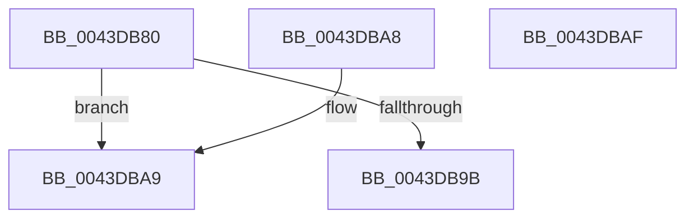

# SMKM_STORE&lt;SM_TRAITS&gt;::SmStIsRegionBusy

- RVA: `0x0043DB80`–`0x0043DBB0` (길이 `48` bytes)
- VA: `0x000000014043DB80`
- 실행 섹션: `.text`
- PDB 이름 있음: `예`; PDB Function 태그: `아니요`
- unwind 정보 RVA: `0x000DB714`
- 디코드: `15`개 명령, `48/48` bytes 표시
- 미해석 바이트: `0` (있으면 어셈블리에 `.byte`로 보존)

> 이 문서는 커널 이미지의 기계어와 PDB 기호를 분석해 생성했습니다. 4번과 5번은 함수 원형과 자료형을 바이너리 사용 방식에서 추정한 C 해석이며 원본 소스 복구 결과는 아닙니다.

## 1. Dependencies

- 직접 호출 지점: **0**; 고유 호출 대상: **0**
- 직접 호출자로 확인된 함수: **6**
- RIP 상대 이미지 참조: **0**

### Outgoing calls
- 직접 디코드된 call 명령이 없습니다.

### Direct callers
- [SMKM_STORE&lt;SM_TRAITS&gt;::SmStReleaseVirtualRegion](../3A/SMKM_STORE_SM_TRAITS_SmStReleaseVirtualRegion_function_003AF338.md) at `0x003AF3C6`
- [ST_STORE&lt;SM_TRAITS&gt;::StDmReuseCurrentRegion](../3B/ST_STORE_SM_TRAITS_StDmReuseCurrentRegion_function_003B107C.md) at `0x003B10C0`
- [ST_STORE&lt;SM_TRAITS&gt;::StCompactionPerformInMem](../41/ST_STORE_SM_TRAITS_StCompactionPerformInMem_function_004111D8.md) at `0x004112A6`
- [ST_STORE&lt;SM_TRAITS&gt;::StCompactionPerformInMem](../41/ST_STORE_SM_TRAITS_StCompactionPerformInMem_function_004111D8.md) at `0x00411349`
- [ST_STORE&lt;SM_TRAITS&gt;::StCompactionPerformInMem](../41/ST_STORE_SM_TRAITS_StCompactionPerformInMem_function_004111D8.md) at `0x00411393`
- [ST_STORE&lt;SM_TRAITS&gt;::StCompactionPerformEmergency](../4E/ST_STORE_SM_TRAITS_StCompactionPerformEmergency_function_004EB170.md) at `0x004EB27D`
- [ST_STORE&lt;SM_TRAITS&gt;::StMapAndLockRegion](../4E/ST_STORE_SM_TRAITS_StMapAndLockRegion_function_004EC090.md) at `0x004EC1A7`
- [sub_006F84D2](../6F/Unknown_function_006F84D2.md) at `0x006F8574`

### Static image references
- 디코드된 RIP-relative 메모리 참조가 없습니다.

## 2. Other-region calls and transfers

- 다른 실행 섹션으로 향하는 call: **0**
- 별도 외부 분기/꼬리 이동을 확인하지 못했습니다.

## 3. Assembly (complete function range)

```asm
0043DB80  48 8B 81 68 1B 00 00            mov rax, qword ptr [rcx + 0x1b68]
0043DB87  8B D2                           mov edx, edx
0043DB89  4C 8D 04 D0                     lea r8, [rax + rdx*8]
0043DB8D  BA FF 7F 00 00                  mov edx, 0x7fff
0043DB92  41 0F B7 00                     movzx eax, word ptr [r8]
0043DB96  66 85 C2                        test dx, ax
0043DB99  75 0E                           jne 0x14043dba9
0043DB9B  33 C0                           xor eax, eax
0043DB9D  4C 39 81 F8 1C 00 00            cmp qword ptr [rcx + 0x1cf8], r8
0043DBA4  0F 94 C0                        sete al
0043DBA7  C3                              ret
0043DBA8  CC                              int3
0043DBA9  B8 01 00 00 00                  mov eax, 1
0043DBAE  C3                              ret
0043DBAF  CC                              int3
```

## 4. C-style interpretation (structured pseudocode)

```c
__int64 __fastcall SMKM_STORE_SM_TRAITS___SmStIsRegionBusy(__int64 a1, int a2)
{
    __int64 result;

    if ((((unsigned __int16)((unsigned int)(0x7FFFULL))) & ((unsigned __int16)(*(unsigned __int16 *)(*(unsigned __int64 *)(a1 + 7016) + (unsigned int)(a2) * 8)))) != 0) goto loc_0043DBA9;
    result = 0;
    result = ((*(unsigned __int64 *)(a1 + 7416)) == (*(unsigned __int64 *)(a1 + 7016) + (unsigned int)(a2) * 8)) ? 1 : 0;
    return result;
loc_0043DBA9:
    return 1;
}
```

## 5. (Beta) C Style

```c
int64_t SMKM_STORE_SM_TRAITS___SmStIsRegionBusy(void *Arg1, int32_t Arg2)
{
    uint8_t *arg1 = (uint8_t *)Arg1;

    int64_t result;

    if ((((uint16_t)((uint32_t)(0x7FFFULL))) & ((uint16_t)(*(uint16_t *)(*(uint64_t *)(arg1 + 0x1B68) + (uint32_t)(Arg2) * 8)))) != 0) goto loc_0043DBA9;
    result = 0;
    result = ((*(uint64_t *)(arg1 + 0x1CF8)) == (*(uint64_t *)(arg1 + 0x1B68) + (uint32_t)(Arg2) * 8)) ? 1 : 0;
    return result;
loc_0043DBA9:
    return 1;
}
```

### 관측된 메모리 오프셋

구조체 형식이 확인되지 않은 접근은 인자 기준의 오프셋으로만 기록했습니다.

| 기준 인자 | 오프셋 표현 | 폭 (bit) | 접근 |
|---|---:|---:|---|
| `Arg1` | `+ 0x1B68` | `64` | `R` |
| `Arg1` | `+ 0x1CF8` | `64` | `R` |

## 6. Execution-region graph

[열기: 2D/3D 그래프와 함수 탐색 컨트롤 패널](../../../control-panel.html?section=text&rva=0x0043DB80&view=graph)

- 2D 그래프는 위에서 아래로 흐르고, 3D 그래프는 빈 공간을 드래그해 회전합니다. Shift+드래그는 이동, 휠은 확대·축소, 함수 노드 선택은 대상 보고서 이동입니다.

### Static fallback


