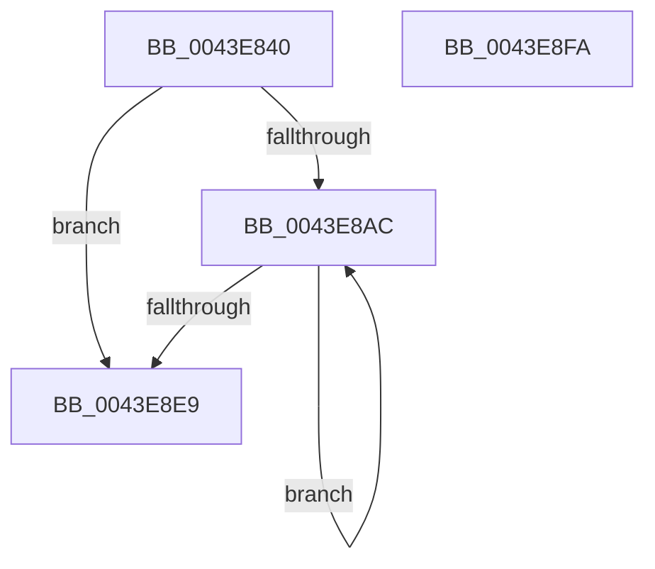

# ST_STORE&lt;SM_TRAITS&gt;::ST_PAGE_RECORD_GET

- RVA: `0x0043E840`–`0x0043E8FB` (길이 `187` bytes)
- VA: `0x000000014043E840`
- 실행 섹션: `.text`
- PDB 이름 있음: `예`; PDB Function 태그: `아니요`
- unwind 정보 RVA: `0x000A4B64`
- 디코드: `51`개 명령, `187/187` bytes 표시
- 미해석 바이트: `0` (있으면 어셈블리에 `.byte`로 보존)

> 이 문서는 커널 이미지의 기계어와 PDB 기호를 분석해 생성했습니다. 4번과 5번은 함수 원형과 자료형을 바이너리 사용 방식에서 추정한 C 해석이며 원본 소스 복구 결과는 아닙니다.

## 1. Dependencies

- 직접 호출 지점: **0**; 고유 호출 대상: **0**
- 직접 호출자로 확인된 함수: **2**
- RIP 상대 이미지 참조: **0**

### Outgoing calls
- 직접 디코드된 call 명령이 없습니다.

### Direct callers
- [ST_STORE&lt;SM_TRAITS&gt;::StDmEtwPageRundown](../60/ST_STORE_SM_TRAITS_StDmEtwPageRundown_function_0060D544.md) at `0x0060D630`
- [ST_STORE&lt;SM_TRAITS&gt;::StDmEtwPageRundown](../60/ST_STORE_SM_TRAITS_StDmEtwPageRundown_function_0060D544.md) at `0x0060D647`
- [ST_STORE&lt;SM_TRAITS&gt;::StDmHandleDecompressionFailure](../60/ST_STORE_SM_TRAITS_StDmHandleDecompressionFailure_function_0060DA74.md) at `0x0060DB5A`

### Static image references
- 디코드된 RIP-relative 메모리 참조가 없습니다.

## 2. Other-region calls and transfers

- 다른 실행 섹션으로 향하는 call: **0**
- 별도 외부 분기/꼬리 이동을 확인하지 못했습니다.

## 3. Assembly (complete function range)

```asm
0043E840  48 89 5C 24 10                  mov qword ptr [rsp + 0x10], rbx
0043E845  48 89 6C 24 18                  mov qword ptr [rsp + 0x18], rbp
0043E84A  48 89 74 24 20                  mov qword ptr [rsp + 0x20], rsi
0043E84F  57                              push rdi
0043E850  44 8B 99 C8 01 00 00            mov r11d, dword ptr [rcx + 0x1c8]
0043E857  4C 8B D1                        mov r10, rcx
0043E85A  44 8B 4A 04                     mov r9d, dword ptr [rdx + 4]
0043E85E  41 8B CB                        mov ecx, r11d
0043E861  41 8B D1                        mov edx, r9d
0043E864  41 B8 01 00 00 00               mov r8d, 1
0043E86A  D3 EA                           shr edx, cl
0043E86C  41 8B 9A CC 01 00 00            mov ebx, dword ptr [r10 + 0x1cc]
0043E873  41 8B BA D0 01 00 00            mov edi, dword ptr [r10 + 0x1d0]
0043E87A  41 8B B2 D8 01 00 00            mov esi, dword ptr [r10 + 0x1d8]
0043E881  0F BD CA                        bsr ecx, edx
0043E884  41 D3 E0                        shl r8d, cl
0043E887  4C 33 C2                        xor r8, rdx
0043E88A  4D 03 C0                        add r8, r8
0043E88D  49 8B 94 CA C0 00 00 00         mov rdx, qword ptr [r10 + rcx*8 + 0xc0]
0043E895  8B CB                           mov ecx, ebx
0043E897  41 23 C9                        and ecx, r9d
0043E89A  0F AF CF                        imul ecx, edi
0043E89D  4A 8B 04 C2                     mov rax, qword ptr [rdx + r8*8]
0043E8A1  48 03 C1                        add rax, rcx
0043E8A4  48 03 C6                        add rax, rsi
0043E8A7  83 38 FF                        cmp dword ptr [rax], -1
0043E8AA  75 3D                           jne 0x14043e8e9
0043E8AC  44 8B 48 04                     mov r9d, dword ptr [rax + 4]
0043E8B0  41 8B CB                        mov ecx, r11d
0043E8B3  41 8B D1                        mov edx, r9d
0043E8B6  41 B8 01 00 00 00               mov r8d, 1
0043E8BC  D3 EA                           shr edx, cl
0043E8BE  0F BD CA                        bsr ecx, edx
0043E8C1  41 D3 E0                        shl r8d, cl
0043E8C4  4C 33 C2                        xor r8, rdx
0043E8C7  4D 03 C0                        add r8, r8
0043E8CA  49 8B 94 CA C0 00 00 00         mov rdx, qword ptr [r10 + rcx*8 + 0xc0]
0043E8D2  8B CB                           mov ecx, ebx
0043E8D4  41 23 C9                        and ecx, r9d
0043E8D7  0F AF CF                        imul ecx, edi
0043E8DA  4A 8B 04 C2                     mov rax, qword ptr [rdx + r8*8]
0043E8DE  48 03 C1                        add rax, rcx
0043E8E1  48 03 C6                        add rax, rsi
0043E8E4  83 38 FF                        cmp dword ptr [rax], -1
0043E8E7  74 C3                           je 0x14043e8ac
0043E8E9  48 8B 5C 24 18                  mov rbx, qword ptr [rsp + 0x18]
0043E8EE  48 8B 6C 24 20                  mov rbp, qword ptr [rsp + 0x20]
0043E8F3  48 8B 74 24 28                  mov rsi, qword ptr [rsp + 0x28]
0043E8F8  5F                              pop rdi
0043E8F9  C3                              ret
0043E8FA  CC                              int3
```

## 4. C-style interpretation (structured pseudocode)

```c
__int64 __fastcall ST_STORE_SM_TRAITS___ST_PAGE_RECORD_GET(__int64 a1, __int64 a2)
{
    __int64 result;
    unsigned __int64 v_stack_p10;
    unsigned __int64 v_stack_p18;
    unsigned __int64 v_stack_p20;

    v_stack_p10 = v_rbx;
    v_stack_p18 = v_rbp;
    v_stack_p20 = v_rsi;
    a2 = (unsigned int)(((unsigned int)((unsigned int)((unsigned int)(*(unsigned int *)(a2 + 4))))) >> ((unsigned __int8)((unsigned int)((unsigned int)((unsigned int)(*(unsigned int *)(a1 + 456)))))));
    a3 = (unsigned int)((1) << ((unsigned __int8)((unsigned int)((unsigned int)((unsigned int)(*(unsigned int *)(a1 + 456)))))));
    a3 = (a3) ^ (a2);
    a3 = (a3) + (a3);
    a1 = (unsigned int)(((unsigned int)((unsigned int)((unsigned int)(*(unsigned int *)(a1 + 460))))) & ((unsigned int)((unsigned int)(*(unsigned int *)(a2 + 4)))));
    a1 = (unsigned int)((a1) * ((unsigned int)((unsigned int)(*(unsigned int *)(a1 + 464)))));
    result = (*(unsigned __int64 *)(*(unsigned __int64 *)(a1 + (unsigned int)((unsigned int)((unsigned int)(*(unsigned int *)(a1 + 456)))) * 8 + 192) + a3 * 8)) + (a1);
    result = (result) + ((unsigned int)(*(unsigned int *)(a1 + 472)));
    if ((*(unsigned int *)(result)) != -1) goto loc_0043E8E9;
loc_0043E8AC:
    a2 = (unsigned int)(((unsigned int)((unsigned int)((unsigned int)(*(unsigned int *)(result + 4))))) >> ((unsigned __int8)((unsigned int)((unsigned int)((unsigned int)(*(unsigned int *)(a1 + 456)))))));
    a3 = (unsigned int)((1) << ((unsigned __int8)((unsigned int)((unsigned int)((unsigned int)(*(unsigned int *)(a1 + 456)))))));
    a3 = (a3) ^ (a2);
    a3 = (a3) + (a3);
    a1 = (unsigned int)(((unsigned int)((unsigned int)((unsigned int)(*(unsigned int *)(a1 + 460))))) & ((unsigned int)((unsigned int)(*(unsigned int *)(result + 4)))));
    a1 = (unsigned int)((a1) * ((unsigned int)((unsigned int)(*(unsigned int *)(a1 + 464)))));
    result = (*(unsigned __int64 *)(*(unsigned __int64 *)(a1 + (unsigned int)((unsigned int)((unsigned int)(*(unsigned int *)(a1 + 456)))) * 8 + 192) + a3 * 8)) + (a1);
    result = (result) + ((unsigned int)(*(unsigned int *)(a1 + 472)));
    if ((*(unsigned int *)(result)) == -1) goto loc_0043E8AC;
loc_0043E8E9:
    return result;
}
```

## 5. (Beta) C Style

```c
int64_t ST_STORE_SM_TRAITS___ST_PAGE_RECORD_GET(void *Arg1, void *Arg2)
{
    uint8_t *arg1 = (uint8_t *)Arg1;
    uint8_t *arg2 = (uint8_t *)Arg2;

    int64_t result;
    uint64_t v_stack_p10;
    uint64_t v_stack_p18;
    uint64_t v_stack_p20;

    v_stack_p10 = local_rbx;
    v_stack_p18 = local_rbp;
    v_stack_p20 = local_rsi;
    Arg2 = (uint32_t)(((uint32_t)((uint32_t)((uint32_t)(*(uint32_t *)(arg2 + 0x4))))) >> ((uint8_t)((uint32_t)((uint32_t)((uint32_t)(*(uint32_t *)(arg1 + 0x1C8)))))));
    a3 = (uint32_t)((1) << ((uint8_t)((uint32_t)((uint32_t)((uint32_t)(*(uint32_t *)(arg1 + 0x1C8)))))));
    a3 = (a3) ^ (Arg2);
    a3 = (a3) + (a3);
    Arg1 = (uint32_t)(((uint32_t)((uint32_t)((uint32_t)(*(uint32_t *)(arg1 + 0x1CC))))) & ((uint32_t)((uint32_t)(*(uint32_t *)(arg2 + 0x4)))));
    Arg1 = (uint32_t)((Arg1) * ((uint32_t)((uint32_t)(*(uint32_t *)(arg1 + 0x1D0)))));
    result = (*(uint64_t *)(*(uint64_t *)(arg1 + (uint32_t)((uint32_t)((uint32_t)(*(uint32_t *)(arg1 + 0x1C8)))) * 8 + 0xC0) + a3 * 8)) + (Arg1);
    result = (result) + ((uint32_t)(*(uint32_t *)(arg1 + 0x1D8)));
    if ((*(uint32_t *)(result)) != -1) goto loc_0043E8E9;
loc_0043E8AC:
    Arg2 = (uint32_t)(((uint32_t)((uint32_t)((uint32_t)(*(uint32_t *)(result + 0x4))))) >> ((uint8_t)((uint32_t)((uint32_t)((uint32_t)(*(uint32_t *)(arg1 + 0x1C8)))))));
    a3 = (uint32_t)((1) << ((uint8_t)((uint32_t)((uint32_t)((uint32_t)(*(uint32_t *)(arg1 + 0x1C8)))))));
    a3 = (a3) ^ (Arg2);
    a3 = (a3) + (a3);
    Arg1 = (uint32_t)(((uint32_t)((uint32_t)((uint32_t)(*(uint32_t *)(arg1 + 0x1CC))))) & ((uint32_t)((uint32_t)(*(uint32_t *)(result + 0x4)))));
    Arg1 = (uint32_t)((Arg1) * ((uint32_t)((uint32_t)(*(uint32_t *)(arg1 + 0x1D0)))));
    result = (*(uint64_t *)(*(uint64_t *)(arg1 + (uint32_t)((uint32_t)((uint32_t)(*(uint32_t *)(arg1 + 0x1C8)))) * 8 + 0xC0) + a3 * 8)) + (Arg1);
    result = (result) + ((uint32_t)(*(uint32_t *)(arg1 + 0x1D8)));
    if ((*(uint32_t *)(result)) == -1) goto loc_0043E8AC;
loc_0043E8E9:
    return result;
}
```

### 관측된 메모리 오프셋

구조체 형식이 확인되지 않은 접근은 인자 기준의 오프셋으로만 기록했습니다.

| 기준 인자 | 오프셋 표현 | 폭 (bit) | 접근 |
|---|---:|---:|---|
| `Arg1` | `+ 0xC0 + rcx*8` | `64` | `R` |
| `Arg1` | `+ 0x1C8` | `32` | `R` |
| `Arg1` | `+ 0x1CC` | `32` | `R` |
| `Arg1` | `+ 0x1D0` | `32` | `R` |
| `Arg1` | `+ 0x1D8` | `32` | `R` |
| `Arg2` | `+ 0x4` | `32` | `R` |

## 6. Execution-region graph

[열기: 2D/3D 그래프와 함수 탐색 컨트롤 패널](../../../control-panel.html?section=text&rva=0x0043E840&view=graph)

- 2D 그래프는 위에서 아래로 흐르고, 3D 그래프는 빈 공간을 드래그해 회전합니다. Shift+드래그는 이동, 휠은 확대·축소, 함수 노드 선택은 대상 보고서 이동입니다.

### Static fallback


