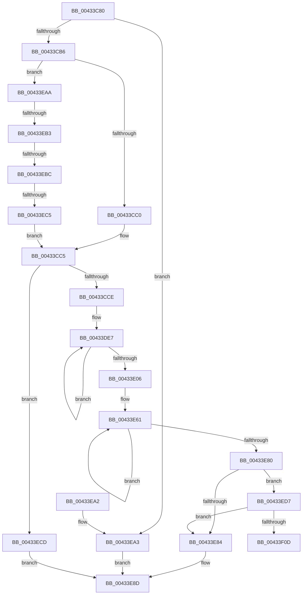

# ST_STORE&lt;SM_TRAITS&gt;::StGetStatsWorker

- RVA: `0x00433C80`–`0x00433F2C` (길이 `684` bytes)
- VA: `0x0000000140433C80`
- 실행 섹션: `.text`
- PDB 이름 있음: `예`; PDB Function 태그: `예`
- unwind 정보 RVA: `0x000A26D8`
- 디코드: `180`개 명령, `684/684` bytes 표시
- 미해석 바이트: `0` (있으면 어셈블리에 `.byte`로 보존)

> 이 문서는 커널 이미지의 기계어와 PDB 기호를 분석해 생성했습니다. 4번과 5번은 함수 원형과 자료형을 바이너리 사용 방식에서 추정한 C 해석이며 원본 소스 복구 결과는 아닙니다.

## 1. Dependencies

- 직접 호출 지점: **6**; 고유 호출 대상: **4**
- 직접 호출자로 확인된 함수: **2**
- RIP 상대 이미지 참조: **0**

### Outgoing calls
- `0x00433D93` → [memset](../6C/memset_function_006C6C40.md) (function, `0x006C6C40`)
- `0x00433DBC` → [RtlNumberOfSetBits](RtlNumberOfSetBits_function_00433F70.md) (function, `0x00433F70`)
- `0x00433E18` → [memset](../6C/memset_function_006C6C40.md) (function, `0x006C6C40`)
- `0x00433E37` → [RtlNumberOfSetBits](RtlNumberOfSetBits_function_00433F70.md) (function, `0x00433F70`)
- `0x00433EE5` → [ST_STORE<SM_TRAITS>::StCopyIoStats](../60/ST_STORE_SM_TRAITS_StCopyIoStats_function_0060CD5C.md) (function, `0x0060CD5C`)
- `0x00433EFF` → [StLcBucketsCopy](../60/StLcBucketsCopy_function_0060F110.md) (function, `0x0060F110`)

### Direct callers
- [SMKM_STORE&lt;SM_TRAITS&gt;::SmStGetStoreStats](../34/SMKM_STORE_SM_TRAITS_SmStGetStoreStats_function_00349F0C.md) at `0x00349F12`
- [ST_STORE&lt;SM_TRAITS&gt;::StGetStats](../4F/ST_STORE_SM_TRAITS_StGetStats_function_004FA058.md) at `0x004FA0E0`

### Static image references
- 디코드된 RIP-relative 메모리 참조가 없습니다.

## 2. Other-region calls and transfers

- 다른 실행 섹션으로 향하는 call: **0**
- call이 아닌 외부 분기/꼬리 이동: **4**
  - `0x00433EAD` → [sub_006EEAD8 + 0x6A](../6E/Unknown_function_006EEAD8.md) (`tail-transfer`)
  - `0x00433EB6` → [sub_006EEAD8 + 0x4E](../6E/Unknown_function_006EEAD8.md) (`tail-transfer`)
  - `0x00433EBF` → [sub_006EEAD8](../6E/Unknown_function_006EEAD8.md) (`tail-transfer`)
  - `0x00433F27` → [sub_006EEAD8 + 0xA3](../6E/Unknown_function_006EEAD8.md) (`tail-transfer`)

## 3. Assembly (complete function range)

```asm
00433C80  48 89 5C 24 10                  mov qword ptr [rsp + 0x10], rbx
00433C85  4C 89 4C 24 20                  mov qword ptr [rsp + 0x20], r9
00433C8A  55                              push rbp
00433C8B  56                              push rsi
00433C8C  57                              push rdi
00433C8D  41 54                           push r12
00433C8F  41 55                           push r13
00433C91  41 56                           push r14
00433C93  41 57                           push r15
00433C95  48 83 EC 20                     sub rsp, 0x20
00433C99  48 83 64 24 60 00               and qword ptr [rsp + 0x60], 0
00433C9F  45 33 E4                        xor r12d, r12d
00433CA2  4D 8B F8                        mov r15, r8
00433CA5  45 8B 01                        mov r8d, dword ptr [r9]
00433CA8  8B EA                           mov ebp, edx
00433CAA  4C 8B F1                        mov r14, rcx
00433CAD  83 FA 04                        cmp edx, 4
00433CB0  0F 8D ED 01 00 00               jge 0x140433ea3
00433CB6  8B CA                           mov ecx, edx
00433CB8  85 D2                           test edx, edx
00433CBA  0F 85 EA 01 00 00               jne 0x140433eaa
00433CC0  BE BC 00 00 00                  mov esi, 0xbc
00433CC5  44 3B C6                        cmp r8d, esi
00433CC8  0F 82 FF 01 00 00               jb 0x140433ecd
00433CCE  41 C6 07 0B                     mov byte ptr [r15], 0xb
00433CD2  49 8D 7F 1C                     lea rdi, [r15 + 0x1c]
00433CD6  41 8B 07                        mov eax, dword ptr [r15]
00433CD9  8B CD                           mov ecx, ebp
00433CDB  C1 E1 08                        shl ecx, 8
00433CDE  33 D2                           xor edx, edx
00433CE0  33 C8                           xor ecx, eax
00433CE2  81 E1 00 0F 00 00               and ecx, 0xf00
00433CE8  33 C8                           xor ecx, eax
00433CEA  41 89 0F                        mov dword ptr [r15], ecx
00433CED  44 8D 42 50                     lea r8d, [rdx + 0x50]
00433CF1  41 8B 06                        mov eax, dword ptr [r14]
00433CF4  C1 E0 0C                        shl eax, 0xc
00433CF7  33 C1                           xor eax, ecx
00433CF9  25 00 F0 00 00                  and eax, 0xf000
00433CFE  33 C1                           xor eax, ecx
00433D00  41 89 07                        mov dword ptr [r15], eax
00433D03  41 8B 0E                        mov ecx, dword ptr [r14]
00433D06  C1 E1 08                        shl ecx, 8
00433D09  33 C8                           xor ecx, eax
00433D0B  81 E1 00 00 01 00               and ecx, 0x10000
00433D11  33 C8                           xor ecx, eax
00433D13  41 89 0F                        mov dword ptr [r15], ecx
00433D16  41 8B 06                        mov eax, dword ptr [r14]
00433D19  C1 E0 07                        shl eax, 7
00433D1C  33 C1                           xor eax, ecx
00433D1E  25 00 00 02 00                  and eax, 0x20000
00433D23  33 C1                           xor eax, ecx
00433D25  41 89 07                        mov dword ptr [r15], eax
00433D28  41 8B 8E F8 12 00 00            mov ecx, dword ptr [r14 + 0x12f8]
00433D2F  C1 E1 15                        shl ecx, 0x15
00433D32  33 C8                           xor ecx, eax
00433D34  81 E1 00 00 FC 3F               and ecx, 0x3ffc0000
00433D3A  33 C8                           xor ecx, eax
00433D3C  41 89 0F                        mov dword ptr [r15], ecx
00433D3F  41 8B 86 58 03 00 00            mov eax, dword ptr [r14 + 0x358]
00433D46  C1 E0 0D                        shl eax, 0xd
00433D49  33 C1                           xor eax, ecx
00433D4B  41 89 77 04                     mov dword ptr [r15 + 4], esi
00433D4F  25 00 00 00 40                  and eax, 0x40000000
00433D54  33 C1                           xor eax, ecx
00433D56  48 8B CF                        mov rcx, rdi
00433D59  41 89 07                        mov dword ptr [r15], eax
00433D5C  41 0F B7 86 C0 12 00 00         movzx eax, word ptr [r14 + 0x12c0]
00433D64  66 41 89 47 08                  mov word ptr [r15 + 8], ax
00433D69  41 8B 46 08                     mov eax, dword ptr [r14 + 8]
00433D6D  41 89 47 0C                     mov dword ptr [r15 + 0xc], eax
00433D71  41 8B 86 B8 0C 00 00            mov eax, dword ptr [r14 + 0xcb8]
00433D78  41 03 86 A8 03 00 00            add eax, dword ptr [r14 + 0x3a8]
00433D7F  41 89 47 10                     mov dword ptr [r15 + 0x10], eax
00433D83  41 8B 46 0C                     mov eax, dword ptr [r14 + 0xc]
00433D87  41 89 47 14                     mov dword ptr [r15 + 0x14], eax
00433D8B  41 C7 47 18 10 00 00 00         mov dword ptr [r15 + 0x18], 0x10
00433D93  E8 A8 2E 29 00                  call 0x1406c6c40
00433D98  41 8B 86 A8 03 00 00            mov eax, dword ptr [r14 + 0x3a8]
00433D9F  49 8D 9E 98 03 00 00            lea rbx, [r14 + 0x398]
00433DA6  89 07                           mov dword ptr [rdi], eax
00433DA8  48 8B CB                        mov rcx, rbx
00433DAB  41 8B 46 58                     mov eax, dword ptr [r14 + 0x58]
00433DAF  89 47 04                        mov dword ptr [rdi + 4], eax
00433DB2  41 8B 86 98 00 00 00            mov eax, dword ptr [r14 + 0x98]
00433DB9  89 47 08                        mov dword ptr [rdi + 8], eax
00433DBC  E8 AF 01 00 00                  call 0x140433f70
00433DC1  8B 0B                           mov ecx, dword ptr [rbx]
00433DC3  4D 8D 4E 50                     lea r9, [r14 + 0x50]
00433DC7  2B C8                           sub ecx, eax
00433DC9  4C 2B CF                        sub r9, rdi
00433DCC  89 4F 0C                        mov dword ptr [rdi + 0xc], ecx
00433DCF  48 8D 4F 10                     lea rcx, [rdi + 0x10]
00433DD3  41 8B 86 58 03 00 00            mov eax, dword ptr [r14 + 0x358]
00433DDA  F6 D8                           neg al
00433DDC  48 1B D2                        sbb rdx, rdx
00433DDF  48 83 E2 F9                     and rdx, 0xfffffffffffffff9
00433DE3  48 83 C2 08                     add rdx, 8
00433DE7  41 8B 84 09 88 08 00 00         mov eax, dword ptr [r9 + rcx + 0x888]
00433DEF  89 01                           mov dword ptr [rcx], eax
00433DF1  41 8B 84 09 8C 08 00 00         mov eax, dword ptr [r9 + rcx + 0x88c]
00433DF9  89 41 04                        mov dword ptr [rcx + 4], eax
00433DFC  48 8D 49 08                     lea rcx, [rcx + 8]
00433E00  48 83 EA 01                     sub rdx, 1
00433E04  75 E1                           jne 0x140433de7
00433E06  49 8D 7F 6C                     lea rdi, [r15 + 0x6c]
00433E0A  48 8B CF                        mov rcx, rdi
00433E0D  44 8D 42 50                     lea r8d, [rdx + 0x50]
00433E11  4D 8D AE 60 09 00 00            lea r13, [r14 + 0x960]
00433E18  E8 23 2E 29 00                  call 0x1406c6c40
00433E1D  41 8B 85 58 03 00 00            mov eax, dword ptr [r13 + 0x358]
00433E24  49 8D 9D 48 03 00 00            lea rbx, [r13 + 0x348]
00433E2B  89 07                           mov dword ptr [rdi], eax
00433E2D  48 8B CB                        mov rcx, rbx
00433E30  41 8B 45 08                     mov eax, dword ptr [r13 + 8]
00433E34  89 47 04                        mov dword ptr [rdi + 4], eax
00433E37  E8 34 01 00 00                  call 0x140433f70
00433E3C  8B 0B                           mov ecx, dword ptr [rbx]
00433E3E  4D 8B C5                        mov r8, r13
00433E41  2B C8                           sub ecx, eax
00433E43  4C 2B C7                        sub r8, rdi
00433E46  89 4F 0C                        mov dword ptr [rdi + 0xc], ecx
00433E49  48 8D 4F 10                     lea rcx, [rdi + 0x10]
00433E4D  41 8B 85 08 03 00 00            mov eax, dword ptr [r13 + 0x308]
00433E54  F6 D8                           neg al
00433E56  48 1B D2                        sbb rdx, rdx
00433E59  48 83 E2 F9                     and rdx, 0xfffffffffffffff9
00433E5D  48 83 C2 08                     add rdx, 8
00433E61  42 8B 84 01 88 08 00 00         mov eax, dword ptr [rcx + r8 + 0x888]
00433E69  89 01                           mov dword ptr [rcx], eax
00433E6B  42 8B 84 01 8C 08 00 00         mov eax, dword ptr [rcx + r8 + 0x88c]
00433E73  89 41 04                        mov dword ptr [rcx + 4], eax
00433E76  48 8D 49 08                     lea rcx, [rcx + 8]
00433E7A  48 83 EA 01                     sub rdx, 1
00433E7E  75 E1                           jne 0x140433e61
00433E80  85 ED                           test ebp, ebp
00433E82  75 53                           jne 0x140433ed7
00433E84  48 8B 44 24 78                  mov rax, qword ptr [rsp + 0x78]
00433E89  89 30                           mov dword ptr [rax], esi
00433E8B  33 C0                           xor eax, eax
00433E8D  48 8B 5C 24 68                  mov rbx, qword ptr [rsp + 0x68]
00433E92  48 83 C4 20                     add rsp, 0x20
00433E96  41 5F                           pop r15
00433E98  41 5E                           pop r14
00433E9A  41 5D                           pop r13
00433E9C  41 5C                           pop r12
00433E9E  5F                              pop rdi
00433E9F  5E                              pop rsi
00433EA0  5D                              pop rbp
00433EA1  C3                              ret
00433EA2  CC                              int3
00433EA3  B8 0D 00 00 C0                  mov eax, 0xc000000d
00433EA8  EB E3                           jmp 0x140433e8d
00433EAA  83 E9 01                        sub ecx, 1
00433EAD  0F 84 8F AC 2B 00               je 0x1406eeb42
00433EB3  83 E9 01                        sub ecx, 1
00433EB6  0F 84 6A AC 2B 00               je 0x1406eeb26
00433EBC  83 F9 01                        cmp ecx, 1
00433EBF  0F 84 13 AC 2B 00               je 0x1406eead8
00433EC5  83 CE FF                        or esi, 0xffffffff
00433EC8  E9 F8 FD FF FF                  jmp 0x140433cc5
00433ECD  41 89 31                        mov dword ptr [r9], esi
00433ED0  B8 23 00 00 C0                  mov eax, 0xc0000023
00433ED5  EB B6                           jmp 0x140433e8d
00433ED7  49 8D 96 B0 13 00 00            lea rdx, [r14 + 0x13b0]
00433EDE  49 8D 8F BC 00 00 00            lea rcx, [r15 + 0xbc]
00433EE5  E8 72 8E 1D 00                  call 0x14060cd5c
00433EEA  45 8B 8E D0 18 00 00            mov r9d, dword ptr [r14 + 0x18d0]
00433EF1  49 8D 8F C0 05 00 00            lea rcx, [r15 + 0x5c0]
00433EF8  4D 8B 86 D8 18 00 00            mov r8, qword ptr [r14 + 0x18d8]
00433EFF  E8 0C B2 1D 00                  call 0x14060f110
00433F04  83 FD 01                        cmp ebp, 1
00433F07  0F 84 77 FF FF FF               je 0x140433e84
00433F0D  4D 8D 87 01 06 00 00            lea r8, [r15 + 0x601]
00433F14  49 83 E0 FE                     and r8, 0xfffffffffffffffe
00433F18  49 8B 4E 38                     mov rcx, qword ptr [r14 + 0x38]
00433F1C  49 8B D0                        mov rdx, r8
00433F1F  41 8B 46 0C                     mov eax, dword ptr [r14 + 0xc]
00433F23  4C 8D 0C 41                     lea r9, [rcx + rax*2]
00433F27  E9 4F AC 2B 00                  jmp 0x1406eeb7b
```

## 4. C-style interpretation (structured pseudocode)

```c
__int64 __fastcall ST_STORE_SM_TRAITS___StGetStatsWorker(__int64 a1, int a2, __int64 a3, __int64 a4)
{
    __int64 result;
    __int64 v_r12;
    __int64 v_rsi;
    __int64 v_rsp;
    unsigned __int64 v_stack_p10;
    unsigned __int64 v_stack_p20;
    unsigned __int64 v_stack_p8;

    v_stack_p10 = v_rbx;
    v_stack_p20 = a4;
    v_rsp = (v_rsp) - (32);
    v_r12 = 0;
    if (a2 >= 4) goto loc_00433EA3;
    if (a2 != 0) goto loc_00433EAA;
loc_00433CC5:
    if (((unsigned int)((unsigned int)(*(unsigned int *)(a4)))) < 188) goto loc_00433ECD;
    *(unsigned __int8 *)(a3) = 11;
    a1 = (unsigned int)(((unsigned int)((unsigned int)((unsigned int)(a2)))) << (8));
    a2 = 0;
    a1 = (unsigned int)((a1) ^ ((unsigned int)((unsigned int)(*(unsigned int *)(a3)))));
    a1 = (unsigned int)((a1) & (0xF00ULL));
    a1 = (unsigned int)((a1) ^ ((unsigned int)((unsigned int)(*(unsigned int *)(a3)))));
    *(unsigned int *)(a3) = (unsigned int)(a1);
    result = (unsigned int)(((unsigned int)(*(unsigned int *)(a1))) << (12));
    result = (unsigned int)((result) ^ ((unsigned int)(a1)));
    result = (unsigned int)((result) & (0xF000ULL));
    result = (unsigned int)((result) ^ ((unsigned int)(a1)));
    *(unsigned int *)(a3) = (unsigned int)(result);
    a1 = (unsigned int)(((unsigned int)(*(unsigned int *)(a1))) << (8));
    a1 = (unsigned int)((a1) ^ ((unsigned int)(result)));
    a1 = (unsigned int)((a1) & (0x10000ULL));
    a1 = (unsigned int)((a1) ^ ((unsigned int)(result)));
    *(unsigned int *)(a3) = (unsigned int)(a1);
    result = (unsigned int)(((unsigned int)(*(unsigned int *)(a1))) << (7));
    result = (unsigned int)((result) ^ ((unsigned int)(a1)));
    result = (unsigned int)((result) & (0x20000ULL));
    result = (unsigned int)((result) ^ ((unsigned int)(a1)));
    *(unsigned int *)(a3) = (unsigned int)(result);
    a1 = (unsigned int)(((unsigned int)(*(unsigned int *)(a1 + 4856))) << (21));
    a1 = (unsigned int)((a1) ^ ((unsigned int)(result)));
    a1 = (unsigned int)((a1) & (0x3FFC0000ULL));
    a1 = (unsigned int)((a1) ^ ((unsigned int)(result)));
    *(unsigned int *)(a3) = (unsigned int)(a1);
    result = (unsigned int)(((unsigned int)(*(unsigned int *)(a1 + 856))) << (13));
    result = (unsigned int)((result) ^ ((unsigned int)(a1)));
    *(unsigned int *)(a3 + 4) = 188;
    result = (unsigned int)((result) & (0x40000000ULL));
    result = (unsigned int)((result) ^ ((unsigned int)(a1)));
    *(unsigned int *)(a3) = (unsigned int)(result);
    *(unsigned __int16 *)(a3 + 8) = (unsigned __int16)(*(unsigned __int16 *)(a1 + 4800));
    *(unsigned int *)(a3 + 12) = (unsigned int)((unsigned int)(*(unsigned int *)(a1 + 8)));
    result = (unsigned int)(((unsigned int)(*(unsigned int *)(a1 + 3256))) + (*(unsigned int *)(a1 + 936)));
    *(unsigned int *)(a3 + 16) = (unsigned int)(result);
    *(unsigned int *)(a3 + 20) = (unsigned int)((unsigned int)(*(unsigned int *)(a1 + 12)));
    *(unsigned int *)(a3 + 24) = 16;
    result = memset(a3 + 28, a2, a2 + 80, a4);
    *(unsigned int *)(a3 + 28) = (unsigned int)((unsigned int)(*(unsigned int *)(a1 + 936)));
    *(unsigned int *)(a3 + 28 + 4) = (unsigned int)((unsigned int)(*(unsigned int *)(a1 + 88)));
    *(unsigned int *)(a3 + 28 + 8) = (unsigned int)((unsigned int)(*(unsigned int *)(a1 + 152)));
    result = RtlNumberOfSetBits(a1 + 920, a2, a2 + 80, a4);
    a1 = (unsigned int)(((unsigned int)(*(unsigned int *)(a1 + 920))) - ((unsigned int)(result)));
    a4 = (a1 + 80) - (a3 + 28);
    *(unsigned int *)(a3 + 28 + 12) = (unsigned int)(a1);
    result = (unsigned __int8)(-((unsigned int)(*(unsigned int *)(a1 + 856))));
    a2 = (a2) & (-7);
    a2 = (a2) + (8);
loc_00433DE7:
    *(unsigned int *)(a3 + 28 + 16) = (unsigned int)((unsigned int)(*(unsigned int *)(a4 + a3 + 28 + 16 * 1 + 2184)));
    *(unsigned int *)(a3 + 28 + 16 + 4) = (unsigned int)((unsigned int)(*(unsigned int *)(a4 + a3 + 28 + 16 * 1 + 2188)));
    a2 = (a2) - (1);
    if (condition_is_not_equal) goto loc_00433DE7;
    result = memset(a3 + 108, a2, a2 + 80, a4);
    *(unsigned int *)(a3 + 108) = (unsigned int)((unsigned int)(*(unsigned int *)(a1 + 2400 + 856)));
    *(unsigned int *)(a3 + 108 + 4) = (unsigned int)((unsigned int)(*(unsigned int *)(a1 + 2400 + 8)));
    result = RtlNumberOfSetBits(a1 + 2400 + 840, a2, a2 + 80, a4);
    a1 = (unsigned int)(((unsigned int)(*(unsigned int *)(a1 + 2400 + 840))) - ((unsigned int)(result)));
    a3 = (a1 + 2400) - (a3 + 108);
    *(unsigned int *)(a3 + 108 + 12) = (unsigned int)(a1);
    result = (unsigned __int8)(-((unsigned int)(*(unsigned int *)(a1 + 2400 + 776))));
    a2 = (a2) & (-7);
    a2 = (a2) + (8);
loc_00433E61:
    *(unsigned int *)(a3 + 108 + 16) = (unsigned int)((unsigned int)(*(unsigned int *)(a3 + 108 + 16 + a3 * 1 + 2184)));
    *(unsigned int *)(a3 + 108 + 16 + 4) = (unsigned int)((unsigned int)(*(unsigned int *)(a3 + 108 + 16 + a3 * 1 + 2188)));
    a2 = (a2) - (1);
    if (condition_is_not_equal) goto loc_00433E61;
    if ((unsigned int)((unsigned int)(a2)) != 0) goto loc_00433ED7;
loc_00433E84:
    *(unsigned int *)(v_stack_p20) = 188;
    result = 0;
loc_00433E8D:
    v_rsp = (v_rsp) + (32);
    return result;
loc_00433EA3:
    goto loc_00433E8D;
loc_00433EAA:
    a1 = (unsigned int)((a3 + 108 + 16 + 8) - (1));
    a1 = (unsigned int)((a1) - (1));
    v_rsi = (unsigned int)((188) | (0xFFFFFFFFULL));
    goto loc_00433CC5;
loc_00433ECD:
    *(unsigned int *)(a4) = (unsigned int)(v_rsi);
    goto loc_00433E8D;
loc_00433ED7:
    result = ST_STORE_SM_TRAITS___StCopyIoStats(a3 + 188, a1 + 5040, a3, a4);
    result = StLcBucketsCopy(a3 + 1472, a1 + 5040, *(unsigned __int64 *)(a1 + 6360), (unsigned int)(*(unsigned int *)(a1 + 6352)));
    if (((unsigned int)((unsigned int)(a2))) == 1) goto loc_00433E84;
    a3 = (a3 + 1537) & (-2);
}
```

## 5. (Beta) C Style

```c
int64_t ST_STORE_SM_TRAITS___StGetStatsWorker(void *Arg1, int32_t Arg2, void *Arg3, void *Arg4)
{
    uint8_t *arg1 = (uint8_t *)Arg1;
    uint8_t *arg3 = (uint8_t *)Arg3;
    uint8_t *arg4 = (uint8_t *)Arg4;

    int64_t result;
    int64_t local_r12;
    int64_t local_rsi;
    int64_t local_rsp;
    uint64_t v_stack_p10;
    uint64_t v_stack_p20;
    uint64_t v_stack_p8;

    v_stack_p10 = local_rbx;
    v_stack_p20 = Arg4;
    local_rsp = (local_rsp) - (32);
    local_r12 = 0;
    if (Arg2 >= 4) goto loc_00433EA3;
    if (Arg2 != 0) goto loc_00433EAA;
loc_00433CC5:
    if (((uint32_t)((uint32_t)(*(uint32_t *)(arg4)))) < 188) goto loc_00433ECD;
    *(uint8_t *)(arg3) = 11;
    Arg1 = (uint32_t)(((uint32_t)((uint32_t)((uint32_t)(Arg2)))) << (8));
    Arg2 = 0;
    Arg1 = (uint32_t)((Arg1) ^ ((uint32_t)((uint32_t)(*(uint32_t *)(arg3)))));
    Arg1 = (uint32_t)((Arg1) & (0xF00ULL));
    Arg1 = (uint32_t)((Arg1) ^ ((uint32_t)((uint32_t)(*(uint32_t *)(arg3)))));
    *(uint32_t *)(arg3) = (uint32_t)(Arg1);
    result = (uint32_t)(((uint32_t)(*(uint32_t *)(arg1))) << (12));
    result = (uint32_t)((result) ^ ((uint32_t)(Arg1)));
    result = (uint32_t)((result) & (0xF000ULL));
    result = (uint32_t)((result) ^ ((uint32_t)(Arg1)));
    *(uint32_t *)(arg3) = (uint32_t)(result);
    Arg1 = (uint32_t)(((uint32_t)(*(uint32_t *)(arg1))) << (8));
    Arg1 = (uint32_t)((Arg1) ^ ((uint32_t)(result)));
    Arg1 = (uint32_t)((Arg1) & (0x10000ULL));
    Arg1 = (uint32_t)((Arg1) ^ ((uint32_t)(result)));
    *(uint32_t *)(arg3) = (uint32_t)(Arg1);
    result = (uint32_t)(((uint32_t)(*(uint32_t *)(arg1))) << (7));
    result = (uint32_t)((result) ^ ((uint32_t)(Arg1)));
    result = (uint32_t)((result) & (0x20000ULL));
    result = (uint32_t)((result) ^ ((uint32_t)(Arg1)));
    *(uint32_t *)(arg3) = (uint32_t)(result);
    Arg1 = (uint32_t)(((uint32_t)(*(uint32_t *)(arg1 + 0x12F8))) << (21));
    Arg1 = (uint32_t)((Arg1) ^ ((uint32_t)(result)));
    Arg1 = (uint32_t)((Arg1) & (0x3FFC0000ULL));
    Arg1 = (uint32_t)((Arg1) ^ ((uint32_t)(result)));
    *(uint32_t *)(arg3) = (uint32_t)(Arg1);
    result = (uint32_t)(((uint32_t)(*(uint32_t *)(arg1 + 0x358))) << (13));
    result = (uint32_t)((result) ^ ((uint32_t)(Arg1)));
    *(uint32_t *)(arg3 + 0x4) = 188;
    result = (uint32_t)((result) & (0x40000000ULL));
    result = (uint32_t)((result) ^ ((uint32_t)(Arg1)));
    *(uint32_t *)(arg3) = (uint32_t)(result);
    *(uint16_t *)(arg3 + 0x8) = (uint16_t)(*(uint16_t *)(arg1 + 0x12C0));
    *(uint32_t *)(arg3 + 0xC) = (uint32_t)((uint32_t)(*(uint32_t *)(arg1 + 0x8)));
    result = (uint32_t)(((uint32_t)(*(uint32_t *)(arg1 + 0xCB8))) + (*(uint32_t *)(arg1 + 0x3A8)));
    *(uint32_t *)(arg3 + 0x10) = (uint32_t)(result);
    *(uint32_t *)(arg3 + 0x14) = (uint32_t)((uint32_t)(*(uint32_t *)(arg1 + 0xC)));
    *(uint32_t *)(arg3 + 0x18) = 16;
    result = memset(Arg3 + 28, Arg2, Arg2 + 80, Arg4);
    *(uint32_t *)(arg3 + 0x1C) = (uint32_t)((uint32_t)(*(uint32_t *)(arg1 + 0x3A8)));
    *(uint32_t *)(arg3 + 0x1C + 0x4) = (uint32_t)((uint32_t)(*(uint32_t *)(arg1 + 0x58)));
    *(uint32_t *)(arg3 + 0x1C + 0x8) = (uint32_t)((uint32_t)(*(uint32_t *)(arg1 + 0x98)));
    result = RtlNumberOfSetBits(Arg1 + 920, Arg2, Arg2 + 80, Arg4);
    Arg1 = (uint32_t)(((uint32_t)(*(uint32_t *)(arg1 + 0x398))) - ((uint32_t)(result)));
    Arg4 = (Arg1 + 80) - (Arg3 + 28);
    *(uint32_t *)(arg3 + 0x1C + 0xC) = (uint32_t)(Arg1);
    result = (uint8_t)(-((uint32_t)(*(uint32_t *)(arg1 + 0x358))));
    Arg2 = (Arg2) & (-7);
    Arg2 = (Arg2) + (8);
loc_00433DE7:
    *(uint32_t *)(arg3 + 0x1C + 0x10) = (uint32_t)((uint32_t)(*(uint32_t *)(arg4 + arg3 + 0x1C + 0x10 * 1 + 0x888)));
    *(uint32_t *)(arg3 + 0x1C + 0x10 + 0x4) = (uint32_t)((uint32_t)(*(uint32_t *)(arg4 + arg3 + 0x1C + 0x10 * 1 + 0x88C)));
    Arg2 = (Arg2) - (1);
    if (condition_is_not_equal) goto loc_00433DE7;
    result = memset(Arg3 + 108, Arg2, Arg2 + 80, Arg4);
    *(uint32_t *)(arg3 + 0x6C) = (uint32_t)((uint32_t)(*(uint32_t *)(arg1 + 0x960 + 0x358)));
    *(uint32_t *)(arg3 + 0x6C + 0x4) = (uint32_t)((uint32_t)(*(uint32_t *)(arg1 + 0x960 + 0x8)));
    result = RtlNumberOfSetBits(Arg1 + 2400 + 840, Arg2, Arg2 + 80, Arg4);
    Arg1 = (uint32_t)(((uint32_t)(*(uint32_t *)(arg1 + 0x960 + 0x348))) - ((uint32_t)(result)));
    Arg3 = (Arg1 + 2400) - (Arg3 + 108);
    *(uint32_t *)(arg3 + 0x6C + 0xC) = (uint32_t)(Arg1);
    result = (uint8_t)(-((uint32_t)(*(uint32_t *)(arg1 + 0x960 + 0x308))));
    Arg2 = (Arg2) & (-7);
    Arg2 = (Arg2) + (8);
loc_00433E61:
    *(uint32_t *)(arg3 + 0x6C + 0x10) = (uint32_t)((uint32_t)(*(uint32_t *)(arg3 + 0x6C + 0x10 + arg3 * 1 + 0x888)));
    *(uint32_t *)(arg3 + 0x6C + 0x10 + 0x4) = (uint32_t)((uint32_t)(*(uint32_t *)(arg3 + 0x6C + 0x10 + arg3 * 1 + 0x88C)));
    Arg2 = (Arg2) - (1);
    if (condition_is_not_equal) goto loc_00433E61;
    if ((uint32_t)((uint32_t)(Arg2)) != 0) goto loc_00433ED7;
loc_00433E84:
    *(uint32_t *)(v_stack_p20) = 188;
    result = 0;
loc_00433E8D:
    local_rsp = (local_rsp) + (32);
    return result;
loc_00433EA3:
    goto loc_00433E8D;
loc_00433EAA:
    Arg1 = (uint32_t)((Arg3 + 108 + 16 + 8) - (1));
    Arg1 = (uint32_t)((Arg1) - (1));
    local_rsi = (uint32_t)((188) | (0xFFFFFFFFULL));
    goto loc_00433CC5;
loc_00433ECD:
    *(uint32_t *)(arg4) = (uint32_t)(local_rsi);
    goto loc_00433E8D;
loc_00433ED7:
    result = ST_STORE_SM_TRAITS___StCopyIoStats(Arg3 + 188, Arg1 + 5040, Arg3, Arg4);
    result = StLcBucketsCopy(Arg3 + 1472, Arg1 + 5040, *(uint64_t *)(arg1 + 0x18D8), (uint32_t)(*(uint32_t *)(arg1 + 0x18D0)));
    if (((uint32_t)((uint32_t)(Arg2))) == 1) goto loc_00433E84;
    Arg3 = (Arg3 + 1537) & (-2);
}
```

### 관측된 메모리 오프셋

구조체 형식이 확인되지 않은 접근은 인자 기준의 오프셋으로만 기록했습니다.

| 기준 인자 | 오프셋 표현 | 폭 (bit) | 접근 |
|---|---:|---:|---|
| `Arg1` | `+ 0x0` | `32` | `R` |
| `Arg1` | `+ 0x8` | `32` | `R` |
| `Arg1` | `+ 0xC` | `32` | `R` |
| `Arg1` | `+ 0x38` | `64` | `R` |
| `Arg1` | `+ 0x50` | `64` | `R` |
| `Arg1` | `+ 0x58` | `32` | `R` |
| `Arg1` | `+ 0x98` | `32` | `R` |
| `Arg1` | `+ 0x308` | `32` | `R` |
| `Arg1` | `+ 0x348` | `64` | `R` |
| `Arg1` | `+ 0x358` | `32` | `R` |
| `Arg1` | `+ 0x398` | `64` | `R` |
| `Arg1` | `+ 0x3A8` | `32` | `R` |
| `Arg1` | `+ 0x888 + rcx*1` | `32` | `R` |
| `Arg1` | `+ 0x88C + rcx*1` | `32` | `R` |
| `Arg1` | `+ 0x960` | `64` | `R` |
| `Arg1` | `+ 0xCB8` | `32` | `R` |
| `Arg1` | `+ 0x12C0` | `16` | `R` |
| `Arg1` | `+ 0x12F8` | `32` | `R` |
| `Arg1` | `+ 0x13B0` | `64` | `R` |
| `Arg1` | `+ 0x18D0` | `32` | `R` |
| `Arg1` | `+ 0x18D8` | `64` | `R` |
| `Arg3` | `+ 0x0` | `8` | `W` |
| `Arg3` | `+ 0x0` | `32` | `R` |
| `Arg3` | `+ 0x0` | `32` | `W` |
| `Arg3` | `+ 0x4` | `32` | `W` |
| `Arg3` | `+ 0x8` | `16` | `W` |
| `Arg3` | `+ 0x8` | `32` | `W` |
| `Arg3` | `+ 0x8` | `64` | `R` |
| `Arg3` | `+ 0xC` | `32` | `W` |
| `Arg3` | `+ 0x10` | `32` | `W` |
| `Arg3` | `+ 0x10` | `64` | `R` |
| `Arg3` | `+ 0x14` | `32` | `W` |

추가 오프셋 10개는 표에서 생략했습니다.

## 6. Execution-region graph

[열기: 2D/3D 그래프와 함수 탐색 컨트롤 패널](../../../control-panel.html?section=text&rva=0x00433C80&view=graph)

- 2D 그래프는 위에서 아래로 흐르고, 3D 그래프는 빈 공간을 드래그해 회전합니다. Shift+드래그는 이동, 휠은 확대·축소, 함수 노드 선택은 대상 보고서 이동입니다.

### Static fallback


