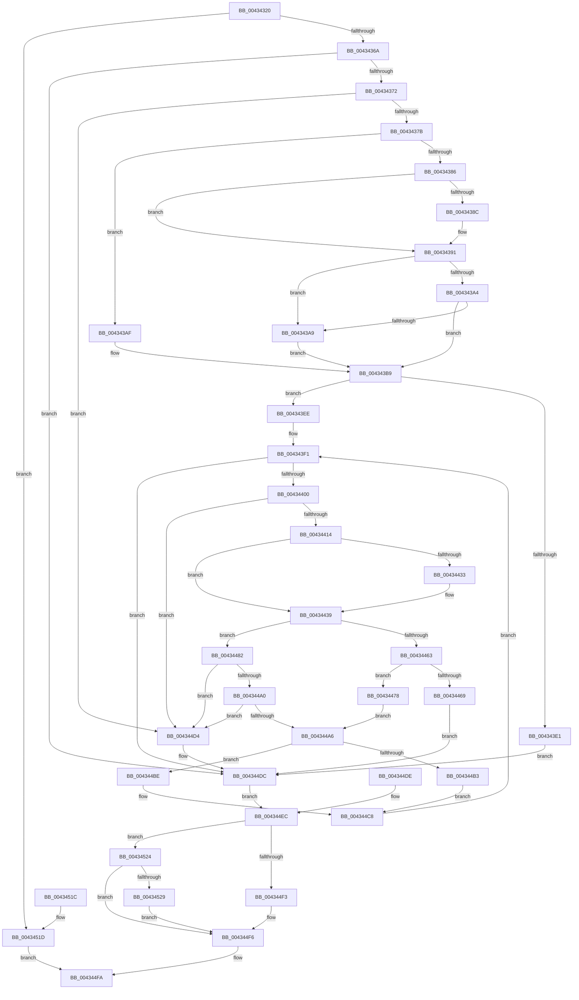

# SeCaptureObjectTypeList

- RVA: `0x00434320`–`0x00434535` (길이 `533` bytes)
- VA: `0x0000000140434320`
- 실행 섹션: `.text`
- PDB 이름 있음: `예`; PDB Function 태그: `아니요`
- unwind 정보 RVA: `0x000A275C`
- 디코드: `145`개 명령, `533/533` bytes 표시
- 미해석 바이트: `0` (있으면 어셈블리에 `.byte`로 보존)

> 이 문서는 커널 이미지의 기계어와 PDB 기호를 분석해 생성했습니다. 4번과 5번은 함수 원형과 자료형을 바이너리 사용 방식에서 추정한 C 해석이며 원본 소스 복구 결과는 아닙니다.

## 1. Dependencies

- 직접 호출 지점: **5**; 고유 호출 대상: **4**
- 직접 호출자로 확인된 함수: **2**
- RIP 상대 이미지 참조: **1**

### Outgoing calls
- `0x0043438C` → [ExRaiseDatatypeMisalignment](../../page/89/ExRaiseDatatypeMisalignment_function_00899FD0.md) (function, `0x00899FD0`)
- `0x004343CC` → [ExAllocatePool2](../../poolcode/B8/ExAllocatePool2_function_00B820F0.md) (function, `0x00B820F0`)
- `0x00434433` → [ExRaiseDatatypeMisalignment](../../page/89/ExRaiseDatatypeMisalignment_function_00899FD0.md) (function, `0x00899FD0`)
- `0x00434502` → [_security_check_cookie](../6A/_security_check_cookie_function_006AC640.md) (function, `0x006AC640`)
- `0x0043452E` → [ExFreePoolWithTag](../../poolcode/B8/ExFreePoolWithTag_function_00B82870.md) (function, `0x00B82870`)

### Direct callers
- [SeAccessCheckByType](../44/SeAccessCheckByType_function_00440BC8.md) at `0x00441173`
- [SepAccessCheckAndAuditAlarm](../../page/A1/SepAccessCheckAndAuditAlarm_function_00A1AF4C.md) at `0x00A1B802`

### Static image references
- `0x00434331` → RVA `0x00E0A740` (`.data`; read)

## 2. Other-region calls and transfers

- 다른 실행 섹션으로 향하는 call: **4**
  - `0x0043438C` → [ExRaiseDatatypeMisalignment](../../page/89/ExRaiseDatatypeMisalignment_function_00899FD0.md) (`.text` → `PAGE`)
  - `0x004343CC` → [ExAllocatePool2](../../poolcode/B8/ExAllocatePool2_function_00B820F0.md) (`.text` → `POOLCODE`)
  - `0x00434433` → [ExRaiseDatatypeMisalignment](../../page/89/ExRaiseDatatypeMisalignment_function_00899FD0.md) (`.text` → `PAGE`)
  - `0x0043452E` → [ExFreePoolWithTag](../../poolcode/B8/ExFreePoolWithTag_function_00B82870.md) (`.text` → `POOLCODE`)
- 별도 외부 분기/꼬리 이동을 확인하지 못했습니다.

## 3. Assembly (complete function range)

```asm
00434320  48 89 5C 24 18                  mov qword ptr [rsp + 0x18], rbx
00434325  56                              push rsi
00434326  57                              push rdi
00434327  41 54                           push r12
00434329  41 56                           push r14
0043432B  41 57                           push r15
0043432D  48 83 EC 60                     sub rsp, 0x60
00434331  48 8B 05 08 64 9D 00            mov rax, qword ptr [rip + 0x9d6408]
00434338  48 33 C4                        xor rax, rsp
0043433B  48 89 44 24 50                  mov qword ptr [rsp + 0x50], rax
00434340  49 8B D9                        mov rbx, r9
00434343  8B FA                           mov edi, edx
00434345  48 8B F1                        mov rsi, rcx
00434348  48 89 5C 24 30                  mov qword ptr [rsp + 0x30], rbx
0043434D  45 33 E4                        xor r12d, r12d
00434350  44 89 64 24 20                  mov dword ptr [rsp + 0x20], r12d
00434355  45 8B CC                        mov r9d, r12d
00434358  4C 89 64 24 28                  mov qword ptr [rsp + 0x28], r12
0043435D  4C 89 23                        mov qword ptr [rbx], r12
00434360  41 80 F8 01                     cmp r8b, 1
00434364  0F 85 B3 01 00 00               jne 0x14043451d
0043436A  85 D2                           test edx, edx
0043436C  0F 84 6A 01 00 00               je 0x1404344dc
00434372  48 85 C9                        test rcx, rcx
00434375  0F 84 59 01 00 00               je 0x1404344d4
0043437B  8B C7                           mov eax, edi
0043437D  48 C1 E0 04                     shl rax, 4
00434381  48 85 C0                        test rax, rax
00434384  74 29                           je 0x1404343af
00434386  40 F6 C6 03                     test sil, 3
0043438A  74 05                           je 0x140434391
0043438C  E8 3F 5C 46 00                  call 0x140899fd0
00434391  48 8D 14 08                     lea rdx, [rax + rcx]
00434395  49 BE 00 00 FF FF FF 7F 00 00   movabs r14, 0x7fffffff0000
0043439F  49 3B D6                        cmp rdx, r14
004343A2  77 05                           ja 0x1404343a9
004343A4  48 3B D6                        cmp rdx, rsi
004343A7  73 10                           jae 0x1404343b9
004343A9  41 0F B6 06                     movzx eax, byte ptr [r14]
004343AD  EB 0A                           jmp 0x1404343b9
004343AF  49 BE 00 00 FF FF FF 7F 00 00   movabs r14, 0x7fffffff0000
004343B9  48 8D 14 7F                     lea rdx, [rdi + rdi*2]
004343BD  48 C1 E2 04                     shl rdx, 4
004343C1  B9 00 01 00 00                  mov ecx, 0x100
004343C6  41 B8 53 65 4F 74               mov r8d, 0x744f6553
004343CC  E8 1F DD 74 00                  call 0x140b820f0
004343D1  4C 8B C8                        mov r9, rax
004343D4  48 89 44 24 28                  mov qword ptr [rsp + 0x28], rax
004343D9  4C 8B F8                        mov r15, rax
004343DC  48 85 C0                        test rax, rax
004343DF  75 0D                           jne 0x1404343ee
004343E1  C7 44 24 20 9A 00 00 C0         mov dword ptr [rsp + 0x20], 0xc000009a
004343E9  E9 EE 00 00 00                  jmp 0x1404344dc
004343EE  41 8B D4                        mov edx, r12d
004343F1  89 54 24 24                     mov dword ptr [rsp + 0x24], edx
004343F5  44 8B DA                        mov r11d, edx
004343F8  3B D7                           cmp edx, edi
004343FA  0F 83 DC 00 00 00               jae 0x1404344dc
00434400  8B CA                           mov ecx, edx
00434402  48 03 D2                        add rdx, rdx
00434405  44 0F B7 04 D6                  movzx r8d, word ptr [rsi + rdx*8]
0043440A  41 83 F8 04                     cmp r8d, 4
0043440E  0F 87 C0 00 00 00               ja 0x1404344d4
00434414  48 8D 0C 49                     lea rcx, [rcx + rcx*2]
00434418  48 C1 E1 04                     shl rcx, 4
0043441C  49 03 C9                        add rcx, r9
0043441F  66 44 89 01                     mov word ptr [rcx], r8w
00434423  66 44 89 61 02                  mov word ptr [rcx + 2], r12w
00434428  4C 8B 4C D6 08                  mov r9, qword ptr [rsi + rdx*8 + 8]
0043442D  41 F6 C1 03                     test r9b, 3
00434431  74 06                           je 0x140434439
00434433  E8 98 5B 46 00                  call 0x140899fd0
00434438  CC                              int3
00434439  49 8B C1                        mov rax, r9
0043443C  4D 3B CE                        cmp r9, r14
0043443F  49 0F 43 C6                     cmovae rax, r14
00434443  90                              nop
00434444  0F B6 00                        movzx eax, byte ptr [rax]
00434447  41 0F 10 01                     movups xmm0, xmmword ptr [r9]
0043444B  0F 11 41 04                     movups xmmword ptr [rcx + 4], xmm0
0043444F  4C 89 61 18                     mov qword ptr [rcx + 0x18], r12
00434453  44 89 61 20                     mov dword ptr [rcx + 0x20], r12d
00434457  4C 89 61 28                     mov qword ptr [rcx + 0x28], r12
0043445B  8B 54 24 24                     mov edx, dword ptr [rsp + 0x24]
0043445F  85 D2                           test edx, edx
00434461  75 1F                           jne 0x140434482
00434463  66 45 85 C0                     test r8w, r8w
00434467  74 0F                           je 0x140434478
00434469  C7 44 24 20 0D 00 00 C0         mov dword ptr [rsp + 0x20], 0xc000000d
00434471  4C 8B 4C 24 28                  mov r9, qword ptr [rsp + 0x28]
00434476  EB 64                           jmp 0x1404344dc
00434478  45 8B D0                        mov r10d, r8d
0043447B  4C 8B 4C 24 28                  mov r9, qword ptr [rsp + 0x28]
00434480  EB 24                           jmp 0x1404344a6
00434482  45 8B D0                        mov r10d, r8d
00434485  8D 42 FF                        lea eax, [rdx - 1]
00434488  48 8D 04 40                     lea rax, [rax + rax*2]
0043448C  48 03 C0                        add rax, rax
0043448F  4C 8B 4C 24 28                  mov r9, qword ptr [rsp + 0x28]
00434494  41 0F B7 04 C1                  movzx eax, word ptr [r9 + rax*8]
00434499  FF C0                           inc eax
0043449B  44 3B C0                        cmp r8d, eax
0043449E  77 34                           ja 0x1404344d4
004344A0  66 45 85 C0                     test r8w, r8w
004344A4  74 2E                           je 0x1404344d4
004344A6  4F 8D 1C 5B                     lea r11, [r11 + r11*2]
004344AA  4D 03 DB                        add r11, r11
004344AD  66 45 85 C0                     test r8w, r8w
004344B1  75 0B                           jne 0x1404344be
004344B3  43 C7 44 DF 14 FF FF FF FF      mov dword ptr [r15 + r11*8 + 0x14], 0xffffffff
004344BC  EB 0A                           jmp 0x1404344c8
004344BE  42 8B 4C 94 34                  mov ecx, dword ptr [rsp + r10*4 + 0x34]
004344C3  43 89 4C DF 14                  mov dword ptr [r15 + r11*8 + 0x14], ecx
004344C8  42 89 54 84 38                  mov dword ptr [rsp + r8*4 + 0x38], edx
004344CD  FF C2                           inc edx
004344CF  E9 1D FF FF FF                  jmp 0x1404343f1
004344D4  C7 44 24 20 0D 00 00 C0         mov dword ptr [rsp + 0x20], 0xc000000d
004344DC  EB 0E                           jmp 0x1404344ec
004344DE  89 44 24 20                     mov dword ptr [rsp + 0x20], eax
004344E2  4C 8B 4C 24 28                  mov r9, qword ptr [rsp + 0x28]
004344E7  48 8B 5C 24 30                  mov rbx, qword ptr [rsp + 0x30]
004344EC  83 7C 24 20 00                  cmp dword ptr [rsp + 0x20], 0
004344F1  7C 31                           jl 0x140434524
004344F3  4C 89 0B                        mov qword ptr [rbx], r9
004344F6  8B 44 24 20                     mov eax, dword ptr [rsp + 0x20]
004344FA  48 8B 4C 24 50                  mov rcx, qword ptr [rsp + 0x50]
004344FF  48 33 CC                        xor rcx, rsp
00434502  E8 39 81 27 00                  call 0x1406ac640
00434507  48 8B 9C 24 A0 00 00 00         mov rbx, qword ptr [rsp + 0xa0]
0043450F  48 83 C4 60                     add rsp, 0x60
00434513  41 5F                           pop r15
00434515  41 5E                           pop r14
00434517  41 5C                           pop r12
00434519  5F                              pop rdi
0043451A  5E                              pop rsi
0043451B  C3                              ret
0043451C  CC                              int3
0043451D  B8 02 00 00 C0                  mov eax, 0xc0000002
00434522  EB D6                           jmp 0x1404344fa
00434524  4D 85 C9                        test r9, r9
00434527  74 CD                           je 0x1404344f6
00434529  33 D2                           xor edx, edx
0043452B  49 8B C9                        mov rcx, r9
0043452E  E8 3D E3 74 00                  call 0x140b82870
00434533  EB C1                           jmp 0x1404344f6
```

## 4. C-style interpretation (structured pseudocode)

```c
__int64 __fastcall SeCaptureObjectTypeList(__int64 a1, int a2, unsigned __int8 a3, __int64 a4)
{
    __int64 result;
    __int64 v_r11;
    __int64 v_r12;
    __int64 v_rsp;
    unsigned __int64 v_stack_m38;
    unsigned __int64 v_stack_m58;
    unsigned __int64 v_stack_m60;
    unsigned int v_stack_m64;
    unsigned int v_stack_m68;
    unsigned __int64 v_stack_p18;

    v_stack_p18 = v_rbx;
    v_rsp = (v_rsp) - (96);
    result = (*(unsigned __int64 *)(v_rip + 10314760)) ^ (v_rsp);
    v_stack_m38 = result;
    v_stack_m58 = a4;
    v_r12 = 0;
    v_stack_m68 = 0;
    v_stack_m60 = 0;
    *(unsigned __int64 *)(a4) = 0;
    if (a3 != 1) goto loc_0043451D;
    if (a2 == 0) goto loc_004344DC;
    if (a1 == 0) goto loc_004344D4;
    result = ((unsigned int)((unsigned int)((unsigned int)(a2)))) << (4);
    if (result == 0) goto loc_004343AF;
    if ((((unsigned __int8)(a1)) & (3)) != 0) {
        result = ExRaiseDatatypeMisalignment(a1, a2, a3, 0);
    }
    if ((result + a1 * 1) > v_r14) goto loc_004343A9;
    if ((result + a1 * 1) >= a1) goto loc_004343B9;
loc_004343A9:
    goto loc_004343B9;
loc_004343AF:
loc_004343B9:
    a2 = ((unsigned int)(a2) + (unsigned int)(a2) * 2) << (4);
    result = ExAllocatePool2(256, a2, (unsigned int)(0x744F6553ULL), 0);
    v_stack_m60 = result;
    if (result != 0) goto loc_004343EE;
    v_stack_m68 = 0xC000009AULL;
    goto loc_004344DC;
loc_004343EE:
loc_004343F1:
    v_stack_m64 = 0;
    if (0 >= ((unsigned int)((unsigned int)(a2)))) goto loc_004344DC;
    a2 = (0) + (0);
    if (((unsigned int)(*(unsigned __int16 *)(a1 + a2 * 8))) > 4) goto loc_004344D4;
    a1 = (0 + 0 * 2) << (4);
    a1 = (a1) + (result);
    *(unsigned __int16 *)(a1) = (unsigned __int16)(*(unsigned __int16 *)(a1 + a2 * 8));
    *(unsigned __int16 *)(a1 + 2) = 0;
    if ((((unsigned __int8)(*(unsigned __int64 *)(a1 + a2 * 8 + 8))) & (3)) != 0) {
        result = ExRaiseDatatypeMisalignment(a1, a2, *(unsigned __int16 *)(a1 + a2 * 8), *(unsigned __int64 *)(a1 + a2 * 8 + 8));
    }
    result = *(unsigned __int64 *)(a1 + a2 * 8 + 8);
    if ((*(unsigned __int64 *)(a1 + a2 * 8 + 8)) >= v_r14) { result = v_r14; }
    *(unsigned __int64 *)(a1 + 4) = v_xmm0;
    *(unsigned __int64 *)(a1 + 24) = 0;
    *(unsigned int *)(a1 + 32) = 0;
    *(unsigned __int64 *)(a1 + 40) = 0;
    if ((unsigned int)((unsigned int)(v_stack_m64)) != 0) goto loc_00434482;
    if ((unsigned __int16)(*(unsigned __int16 *)(a1 + a2 * 8)) == 0) goto loc_00434478;
    v_stack_m68 = 0xC000000DULL;
    goto loc_004344DC;
loc_00434478:
    goto loc_004344A6;
loc_00434482:
    result = ((unsigned int)(v_stack_m64) - 1 + (unsigned int)(v_stack_m64) - 1 * 2) + ((unsigned int)(v_stack_m64) - 1 + (unsigned int)(v_stack_m64) - 1 * 2);
    result = (unsigned int)((*(unsigned __int16 *)(v_stack_m60 + result * 8)) + 1);
    if (((unsigned int)(*(unsigned __int16 *)(a1 + a2 * 8))) > ((unsigned int)(result))) goto loc_004344D4;
    if ((unsigned __int16)(*(unsigned __int16 *)(a1 + a2 * 8)) == 0) goto loc_004344D4;
loc_004344A6:
    v_r11 = (0 + 0 * 2) + (0 + 0 * 2);
    if ((unsigned __int16)(*(unsigned __int16 *)(a1 + a2 * 8)) != 0) goto loc_004344BE;
    *(unsigned int *)(result + v_r11 * 8 + 20) = 0xFFFFFFFFULL;
    goto loc_004344C8;
loc_004344BE:
    *(unsigned int *)(result + v_r11 * 8 + 20) = (unsigned int)((unsigned int)(*(unsigned int *)(v_rsp + (unsigned int)((unsigned int)(*(unsigned __int16 *)(a1 + a2 * 8))) * 4 + 52)));
loc_004344C8:
    *(unsigned int *)(v_rsp + *(unsigned __int16 *)(a1 + a2 * 8) * 4 + 56) = (unsigned int)((unsigned int)(v_stack_m64));
    a2 = (unsigned int)(((unsigned int)(v_stack_m64)) + 1);
    goto loc_004343F1;
loc_004344D4:
    v_stack_m68 = 0xC000000DULL;
loc_004344DC:
    goto loc_004344EC;
loc_004344EC:
    if (v_stack_m68 < 0) goto loc_00434524;
    *(unsigned __int64 *)(a4) = v_stack_m60;
loc_004344F6:
loc_004344FA:
    a1 = (v_stack_m38) ^ (v_rsp);
    result = _security_check_cookie(a1, a2, *(unsigned __int16 *)(a1 + a2 * 8), v_stack_m60);
    v_rsp = (v_rsp) + (96);
    return result;
loc_0043451D:
    goto loc_004344FA;
loc_00434524:
    if (v_stack_m60 == 0) goto loc_004344F6;
    a2 = 0;
    result = ExFreePoolWithTag(v_stack_m60, a2, *(unsigned __int16 *)(a1 + a2 * 8), v_stack_m60);
    goto loc_004344F6;
}
```

## 5. (Beta) C Style

```c
int64_t SeCaptureObjectTypeList(int64_t Arg1, void *Arg2, uint8_t Arg3, void *Arg4)
{
    uint8_t *arg2 = (uint8_t *)Arg2;
    uint8_t *arg4 = (uint8_t *)Arg4;

    int64_t result;
    int64_t local_r11;
    int64_t local_r12;
    int64_t local_rsp;
    uint64_t v_stack_m38;
    uint64_t v_stack_m58;
    uint64_t v_stack_m60;
    uint32_t v_stack_m64;
    uint32_t v_stack_m68;
    uint64_t v_stack_p18;

    v_stack_p18 = local_rbx;
    local_rsp = (local_rsp) - (96);
    result = (*(uint64_t *)(v_rip + 0x9D6408)) ^ (local_rsp);
    v_stack_m38 = result;
    v_stack_m58 = Arg4;
    local_r12 = 0;
    v_stack_m68 = 0;
    v_stack_m60 = 0;
    *(uint64_t *)(arg4) = 0;
    if (Arg3 != 1) goto loc_0043451D;
    if (Arg2 == NULL) goto loc_004344DC;
    if (Arg1 == 0) goto loc_004344D4;
    result = ((uint32_t)((uint32_t)((uint32_t)(Arg2)))) << (4);
    if (result == 0) goto loc_004343AF;
    if ((((uint8_t)(Arg1)) & (3)) != 0) {
        result = ExRaiseDatatypeMisalignment(Arg1, Arg2, Arg3, 0);
    }
    if ((result + Arg1 * 1) > local_r14) goto loc_004343A9;
    if ((result + Arg1 * 1) >= Arg1) goto loc_004343B9;
loc_004343A9:
    goto loc_004343B9;
loc_004343AF:
loc_004343B9:
    Arg2 = ((uint32_t)(Arg2) + (uint32_t)(Arg2) * 2) << (4);
    result = ExAllocatePool2(256, Arg2, (uint32_t)(0x744F6553ULL), 0);
    v_stack_m60 = result;
    if (result != 0) goto loc_004343EE;
    v_stack_m68 = 0xC000009AULL;
    goto loc_004344DC;
loc_004343EE:
loc_004343F1:
    v_stack_m64 = 0;
    if (0 >= ((uint32_t)((uint32_t)(Arg2)))) goto loc_004344DC;
    Arg2 = (0) + (0);
    if (((uint32_t)(*(uint16_t *)(Arg1 + arg2 * 8))) > 4) goto loc_004344D4;
    Arg1 = (0 + 0 * 2) << (4);
    Arg1 = (Arg1) + (result);
    *(uint16_t *)(Arg1) = (uint16_t)(*(uint16_t *)(Arg1 + arg2 * 8));
    *(uint16_t *)(Arg1 + 0x2) = 0;
    if ((((uint8_t)(*(uint64_t *)(Arg1 + arg2 * 8 + 0x8))) & (3)) != 0) {
        result = ExRaiseDatatypeMisalignment(Arg1, Arg2, *(uint16_t *)(Arg1 + arg2 * 8), *(uint64_t *)(Arg1 + arg2 * 8 + 0x8));
    }
    result = *(uint64_t *)(Arg1 + arg2 * 8 + 0x8);
    if ((*(uint64_t *)(Arg1 + arg2 * 8 + 0x8)) >= local_r14) { result = local_r14; }
    *(uint64_t *)(Arg1 + 0x4) = v_xmm0;
    *(uint64_t *)(Arg1 + 0x18) = 0;
    *(uint32_t *)(Arg1 + 0x20) = 0;
    *(uint64_t *)(Arg1 + 0x28) = 0;
    if ((uint32_t)((uint32_t)(v_stack_m64)) != 0) goto loc_00434482;
    if ((uint16_t)(*(uint16_t *)(Arg1 + arg2 * 8)) == 0) goto loc_00434478;
    v_stack_m68 = 0xC000000DULL;
    goto loc_004344DC;
loc_00434478:
    goto loc_004344A6;
loc_00434482:
    result = ((uint32_t)(v_stack_m64) - 1 + (uint32_t)(v_stack_m64) - 1 * 2) + ((uint32_t)(v_stack_m64) - 1 + (uint32_t)(v_stack_m64) - 1 * 2);
    result = (uint32_t)((*(uint16_t *)(v_stack_m60 + result * 8)) + 1);
    if (((uint32_t)(*(uint16_t *)(Arg1 + arg2 * 8))) > ((uint32_t)(result))) goto loc_004344D4;
    if ((uint16_t)(*(uint16_t *)(Arg1 + arg2 * 8)) == 0) goto loc_004344D4;
loc_004344A6:
    local_r11 = (0 + 0 * 2) + (0 + 0 * 2);
    if ((uint16_t)(*(uint16_t *)(Arg1 + arg2 * 8)) != 0) goto loc_004344BE;
    *(uint32_t *)(result + local_r11 * 8 + 0x14) = 0xFFFFFFFFULL;
    goto loc_004344C8;
loc_004344BE:
    *(uint32_t *)(result + local_r11 * 8 + 0x14) = (uint32_t)((uint32_t)(*(uint32_t *)(local_rsp + (uint32_t)((uint32_t)(*(uint16_t *)(Arg1 + arg2 * 8))) * 4 + 0x34)));
loc_004344C8:
    *(uint32_t *)(local_rsp + *(uint16_t *)(Arg1 + arg2 * 8) * 4 + 0x38) = (uint32_t)((uint32_t)(v_stack_m64));
    Arg2 = (uint32_t)(((uint32_t)(v_stack_m64)) + 1);
    goto loc_004343F1;
loc_004344D4:
    v_stack_m68 = 0xC000000DULL;
loc_004344DC:
    goto loc_004344EC;
loc_004344EC:
    if (v_stack_m68 < 0) goto loc_00434524;
    *(uint64_t *)(arg4) = v_stack_m60;
loc_004344F6:
loc_004344FA:
    Arg1 = (v_stack_m38) ^ (local_rsp);
    result = _security_check_cookie(Arg1, Arg2, *(uint16_t *)(Arg1 + arg2 * 8), v_stack_m60);
    local_rsp = (local_rsp) + (96);
    return result;
loc_0043451D:
    goto loc_004344FA;
loc_00434524:
    if (v_stack_m60 == 0) goto loc_004344F6;
    Arg2 = 0;
    result = ExFreePoolWithTag(v_stack_m60, Arg2, *(uint16_t *)(Arg1 + arg2 * 8), v_stack_m60);
    goto loc_004344F6;
}
```

### 관측된 메모리 오프셋

구조체 형식이 확인되지 않은 접근은 인자 기준의 오프셋으로만 기록했습니다.

| 기준 인자 | 오프셋 표현 | 폭 (bit) | 접근 |
|---|---:|---:|---|
| `Arg2` | `+ 0x0 + rdi*2` | `64` | `R` |
| `Arg4` | `+ 0x0` | `64` | `W` |

## 6. Execution-region graph

[열기: 2D/3D 그래프와 함수 탐색 컨트롤 패널](../../../control-panel.html?section=text&rva=0x00434320&view=graph)

- 2D 그래프는 위에서 아래로 흐르고, 3D 그래프는 빈 공간을 드래그해 회전합니다. Shift+드래그는 이동, 휠은 확대·축소, 함수 노드 선택은 대상 보고서 이동입니다.

### Static fallback


