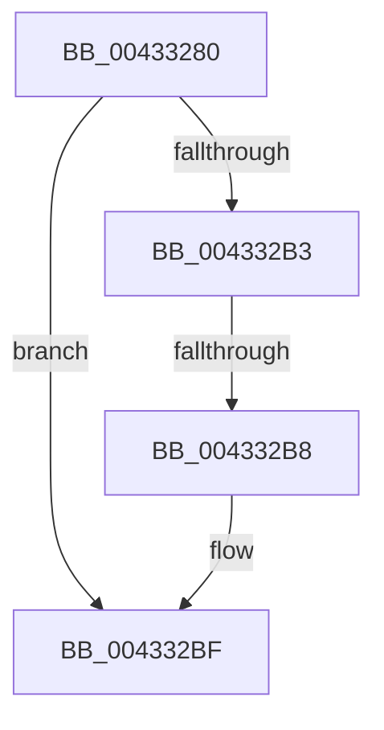

# SeComputeAutoInheritByObjectTypeEx

- RVA: `0x00433280`–`0x004332C5` (길이 `69` bytes)
- VA: `0x0000000140433280`
- 실행 섹션: `.text`
- PDB 이름 있음: `예`; PDB Function 태그: `예`
- unwind 정보 RVA: `0x000A2454`
- 디코드: `20`개 명령, `69/69` bytes 표시
- 미해석 바이트: `0` (있으면 어셈블리에 `.byte`로 보존)

> 이 문서는 커널 이미지의 기계어와 PDB 기호를 분석해 생성했습니다. 4번과 5번은 함수 원형과 자료형을 바이너리 사용 방식에서 추정한 C 해석이며 원본 소스 복구 결과는 아닙니다.

## 1. Dependencies

- 직접 호출 지점: **0**; 고유 호출 대상: **0**
- 직접 호출자로 확인된 함수: **3**
- RIP 상대 이미지 참조: **0**

### Outgoing calls
- 직접 디코드된 call 명령이 없습니다.

### Direct callers
- [SeComputeAutoInheritByObjectType](SeComputeAutoInheritByObjectType_function_00433250.md) at `0x00433264`
- [ObInsertObjectEx](../../page/8B/ObInsertObjectEx_function_008B97A0.md) at `0x008B9A68`
- [ObpAssignSecurity](../../page/8B/ObpAssignSecurity_function_008BA0A0.md) at `0x008BA0F0`

### Static image references
- 디코드된 RIP-relative 메모리 참조가 없습니다.

## 2. Other-region calls and transfers

- 다른 실행 섹션으로 향하는 call: **0**
- call이 아닌 외부 분기/꼬리 이동: **1**
  - `0x004332B6` → [sub_00433311 + 0x1A](Unknown_function_00433311.md) (`tail-transfer`)

## 3. Assembly (complete function range)

```asm
00433280  48 89 5C 24 10                  mov qword ptr [rsp + 0x10], rbx
00433285  48 89 6C 24 18                  mov qword ptr [rsp + 0x18], rbp
0043328A  48 89 74 24 20                  mov qword ptr [rsp + 0x20], rsi
0043328F  57                              push rdi
00433290  41 56                           push r14
00433292  41 57                           push r15
00433294  48 83 EC 20                     sub rsp, 0x20
00433298  48 8B 5C 24 60                  mov rbx, qword ptr [rsp + 0x60]
0043329D  49 8B E8                        mov rbp, r8
004332A0  45 32 C0                        xor r8b, r8b
004332A3  33 FF                           xor edi, edi
004332A5  45 33 FF                        xor r15d, r15d
004332A8  4D 8B F1                        mov r14, r9
004332AB  48 8B F2                        mov rsi, rdx
004332AE  48 85 DB                        test rbx, rbx
004332B1  74 0C                           je 0x1404332bf
004332B3  83 3B 08                        cmp dword ptr [rbx], 8
004332B6  75 73                           jne 0x14043332b
004332B8  C7 43 04 FF FF FF FF            mov dword ptr [rbx + 4], 0xffffffff
004332BF  8B 91 D8 00 00 00               mov edx, dword ptr [rcx + 0xd8]
```

## 4. C-style interpretation (structured pseudocode)

```c
void __fastcall SeComputeAutoInheritByObjectTypeEx(__int64 a1, __int64 a2, __int64 a3, __int64 a4, __int64 a5)
{
    __int64 v_r15;
    __int64 v_rdi;
    __int64 v_rsp;
    unsigned __int64 v_stack_p10;
    unsigned __int64 v_stack_p18;
    unsigned __int64 v_stack_p20;

    v_stack_p10 = v_rbx;
    v_stack_p18 = v_rbp;
    v_stack_p20 = v_rsi;
    v_rsp = (v_rsp) - (32);
    a3 = 0;
    v_rdi = 0;
    v_r15 = 0;
    if (a5 == 0) goto loc_004332BF;
    *(unsigned int *)(a5 + 4) = 0xFFFFFFFFULL;
loc_004332BF:
    return;
}
```

## 5. (Beta) C Style

```c
void SeComputeAutoInheritByObjectTypeEx(void *Arg1, int64_t Arg2, int64_t Arg3, int64_t Arg4, int64_t Arg5)
{
    uint8_t *arg1 = (uint8_t *)Arg1;

    int64_t local_r15;
    int64_t local_rdi;
    int64_t local_rsp;
    uint64_t v_stack_p10;
    uint64_t v_stack_p18;
    uint64_t v_stack_p20;

    v_stack_p10 = local_rbx;
    v_stack_p18 = local_rbp;
    v_stack_p20 = local_rsi;
    local_rsp = (local_rsp) - (32);
    Arg3 = 0;
    local_rdi = 0;
    local_r15 = 0;
    if (Arg5 == 0) goto loc_004332BF;
    *(uint32_t *)(Arg5 + 0x4) = 0xFFFFFFFFULL;
loc_004332BF:
    return;
}
```

### 관측된 메모리 오프셋

구조체 형식이 확인되지 않은 접근은 인자 기준의 오프셋으로만 기록했습니다.

| 기준 인자 | 오프셋 표현 | 폭 (bit) | 접근 |
|---|---:|---:|---|
| `Arg1` | `+ 0xD8` | `32` | `R` |

## 6. Execution-region graph

[열기: 2D/3D 그래프와 함수 탐색 컨트롤 패널](../../../control-panel.html?section=text&rva=0x00433280&view=graph)

- 2D 그래프는 위에서 아래로 흐르고, 3D 그래프는 빈 공간을 드래그해 회전합니다. Shift+드래그는 이동, 휠은 확대·축소, 함수 노드 선택은 대상 보고서 이동입니다.

### Static fallback


