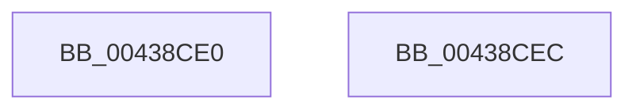

# SeTokenIsRestricted

- RVA: `0x00438CE0`–`0x00438CED` (길이 `13` bytes)
- VA: `0x0000000140438CE0`
- 실행 섹션: `.text`
- PDB 이름 있음: `예`; PDB Function 태그: `아니요`
- unwind 정보 RVA: `0x000DB714`
- 디코드: `5`개 명령, `13/13` bytes 표시
- 미해석 바이트: `0` (있으면 어셈블리에 `.byte`로 보존)

> 이 문서는 커널 이미지의 기계어와 PDB 기호를 분석해 생성했습니다. 4번과 5번은 함수 원형과 자료형을 바이너리 사용 방식에서 추정한 C 해석이며 원본 소스 복구 결과는 아닙니다.

## 1. Dependencies

- 직접 호출 지점: **0**; 고유 호출 대상: **0**
- 직접 호출자로 확인된 함수: **7**
- RIP 상대 이미지 참조: **0**

### Outgoing calls
- 직접 디코드된 call 명령이 없습니다.

### Direct callers
- [sub_008CC5C2](../../page/8C/Unknown_function_008CC5C2.md) at `0x008CC75C`
- [sub_008CC5C2](../../page/8C/Unknown_function_008CC5C2.md) at `0x008CC768`
- [SeCompareTokens](../../page/8F/SeCompareTokens_function_008F6F40.md) at `0x008F7027`
- [SeCompareTokens](../../page/8F/SeCompareTokens_function_008F6F40.md) at `0x008F7031`
- [SeTokenIsAdmin](../../page/9F/SeTokenIsAdmin_function_009FE650.md) at `0x009FE6B3`
- [SepAccessCheckAndAuditAlarm](../../page/A1/SepAccessCheckAndAuditAlarm_function_00A1AF4C.md) at `0x00A1C146`
- [SepAccessCheckAndAuditAlarm](../../page/A1/SepAccessCheckAndAuditAlarm_function_00A1AF4C.md) at `0x00A1C9F9`
- [SepNewTokenAsRestrictedAsProcessToken](../../page/A2/SepNewTokenAsRestrictedAsProcessToken_function_00A20A98.md) at `0x00A20AD8`
- [SepNewTokenAsRestrictedAsProcessToken](../../page/A2/SepNewTokenAsRestrictedAsProcessToken_function_00A20A98.md) at `0x00A20AF8`
- [SepNewTokenAsRestrictedAsProcessToken](../../page/A2/SepNewTokenAsRestrictedAsProcessToken_function_00A20A98.md) at `0x00A20B3A`
- [SepNewTokenAsRestrictedAsProcessToken](../../page/A2/SepNewTokenAsRestrictedAsProcessToken_function_00A20A98.md) at `0x00A20C4A`
- [NtImpersonateAnonymousToken](../../page/A3/NtImpersonateAnonymousToken_function_00A3A150.md) at `0x00A3A34A`
- [sub_00B375D4](../../page/B3/Unknown_function_00B375D4.md) at `0x00B375FF`
- [sub_00B375D4](../../page/B3/Unknown_function_00B375D4.md) at `0x00B37662`
- [sub_00B375D4](../../page/B3/Unknown_function_00B375D4.md) at `0x00B376CA`

### Static image references
- 디코드된 RIP-relative 메모리 참조가 없습니다.

## 2. Other-region calls and transfers

- 다른 실행 섹션으로 향하는 call: **0**
- 별도 외부 분기/꼬리 이동을 확인하지 못했습니다.

## 3. Assembly (complete function range)

```asm
00438CE0  8B 81 C8 00 00 00               mov eax, dword ptr [rcx + 0xc8]
00438CE6  C1 E8 04                        shr eax, 4
00438CE9  24 01                           and al, 1
00438CEB  C3                              ret
00438CEC  CC                              int3
```

## 4. C-style interpretation (structured pseudocode)

```c
__int64 __fastcall SeTokenIsRestricted(__int64 a1)
{
    __int64 result;

    result = (unsigned int)(((unsigned int)(*(unsigned int *)(a1 + 200))) >> (4));
    result = (unsigned __int8)((result) & (1));
    return result;
}
```

## 5. (Beta) C Style

```c
int64_t SeTokenIsRestricted(void *Arg1)
{
    uint8_t *arg1 = (uint8_t *)Arg1;

    int64_t result;

    result = (uint32_t)(((uint32_t)(*(uint32_t *)(arg1 + 0xC8))) >> (4));
    result = (uint8_t)((result) & (1));
    return result;
}
```

### 관측된 메모리 오프셋

구조체 형식이 확인되지 않은 접근은 인자 기준의 오프셋으로만 기록했습니다.

| 기준 인자 | 오프셋 표현 | 폭 (bit) | 접근 |
|---|---:|---:|---|
| `Arg1` | `+ 0xC8` | `32` | `R` |

## 6. Execution-region graph

[열기: 2D/3D 그래프와 함수 탐색 컨트롤 패널](../../../control-panel.html?section=text&rva=0x00438CE0&view=graph)

- 2D 그래프는 위에서 아래로 흐르고, 3D 그래프는 빈 공간을 드래그해 회전합니다. Shift+드래그는 이동, 휠은 확대·축소, 함수 노드 선택은 대상 보고서 이동입니다.

### Static fallback


