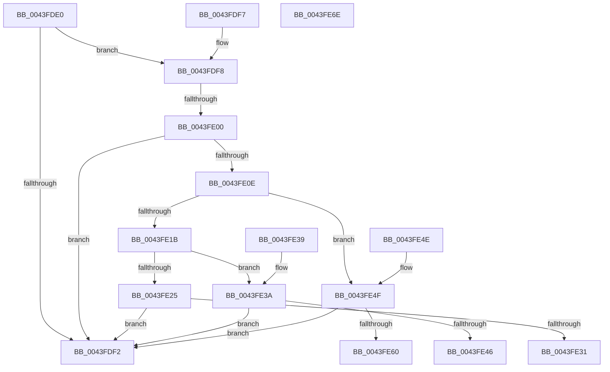

# SepConstrainByConstraintMask

- RVA: `0x0043FDE0`–`0x0043FE6F` (길이 `143` bytes)
- VA: `0x000000014043FDE0`
- 실행 섹션: `.text`
- PDB 이름 있음: `예`; PDB Function 태그: `예`
- unwind 정보 RVA: `0x000A4DFC`
- 디코드: `47`개 명령, `143/143` bytes 표시
- 미해석 바이트: `0` (있으면 어셈블리에 `.byte`로 보존)

> 이 문서는 커널 이미지의 기계어와 PDB 기호를 분석해 생성했습니다. 4번과 5번은 함수 원형과 자료형을 바이너리 사용 방식에서 추정한 C 해석이며 원본 소스 복구 결과는 아닙니다.

## 1. Dependencies

- 직접 호출 지점: **0**; 고유 호출 대상: **0**
- 직접 호출자로 확인된 함수: **4**
- RIP 상대 이미지 참조: **0**

### Outgoing calls
- 직접 디코드된 call 명령이 없습니다.

### Direct callers
- [SeAccessCheckWithHint](../3A/SeAccessCheckWithHint_function_003A6C30.md) at `0x003A75EC`
- [SeAccessCheckWithHint](../3A/SeAccessCheckWithHint_function_003A6C30.md) at `0x003A7613`
- [SeAccessCheckByType](../44/SeAccessCheckByType_function_00440BC8.md) at `0x004423E4`
- [SeAccessCheckByType](../44/SeAccessCheckByType_function_00440BC8.md) at `0x00442418`
- [SepCommonAccessCheckEx](../47/SepCommonAccessCheckEx_function_0047602C.md) at `0x004771A7`
- [SepCommonAccessCheckEx](../47/SepCommonAccessCheckEx_function_0047602C.md) at `0x004771F4`
- [SepAccessCheckAndAuditAlarm](../../page/A1/SepAccessCheckAndAuditAlarm_function_00A1AF4C.md) at `0x00A1CE43`
- [SepAccessCheckAndAuditAlarm](../../page/A1/SepAccessCheckAndAuditAlarm_function_00A1AF4C.md) at `0x00A1CE6E`

### Static image references
- 디코드된 RIP-relative 메모리 참조가 없습니다.

## 2. Other-region calls and transfers

- 다른 실행 섹션으로 향하는 call: **0**
- call이 아닌 외부 분기/꼬리 이동: **1**
  - `0x0043FDFE` → [sub_0043FE6F](Unknown_function_0043FE6F.md) (`tail-transfer`)

## 3. Assembly (complete function range)

```asm
0043FDE0  48 83 EC 08                     sub rsp, 8
0043FDE4  4C 8B 54 24 40                  mov r10, qword ptr [rsp + 0x40]
0043FDE9  41 C6 02 00                     mov byte ptr [r10], 0
0043FDED  83 F9 FF                        cmp ecx, -1
0043FDF0  75 06                           jne 0x14043fdf8
0043FDF2  48 83 C4 08                     add rsp, 8
0043FDF6  C3                              ret
0043FDF7  CC                              int3
0043FDF8  8B 44 24 38                     mov eax, dword ptr [rsp + 0x38]
0043FDFC  85 C0                           test eax, eax
0043FDFE  75 6F                           jne 0x14043fe6f
0043FE00  41 8B 00                        mov eax, dword ptr [r8]
0043FE03  44 8B D8                        mov r11d, eax
0043FE06  44 23 D9                        and r11d, ecx
0043FE09  44 3B D8                        cmp r11d, eax
0043FE0C  74 E4                           je 0x14043fdf2
0043FE0E  41 C6 02 01                     mov byte ptr [r10], 1
0043FE12  45 89 18                        mov dword ptr [r8], r11d
0043FE15  0F BA E2 19                     bt edx, 0x19
0043FE19  73 34                           jae 0x14043fe4f
0043FE1B  48 8B 44 24 30                  mov rax, qword ptr [rsp + 0x30]
0043FE20  45 85 DB                        test r11d, r11d
0043FE23  74 15                           je 0x14043fe3a
0043FE25  41 C7 01 00 00 00 00            mov dword ptr [r9], 0
0043FE2C  48 85 C0                        test rax, rax
0043FE2F  74 C1                           je 0x14043fdf2
0043FE31  C6 00 01                        mov byte ptr [rax], 1
0043FE34  48 83 C4 08                     add rsp, 8
0043FE38  C3                              ret
0043FE39  CC                              int3
0043FE3A  41 C7 01 22 00 00 C0            mov dword ptr [r9], 0xc0000022
0043FE41  48 85 C0                        test rax, rax
0043FE44  74 AC                           je 0x14043fdf2
0043FE46  C6 00 00                        mov byte ptr [rax], 0
0043FE49  48 83 C4 08                     add rsp, 8
0043FE4D  C3                              ret
0043FE4E  CC                              int3
0043FE4F  48 8B 4C 24 30                  mov rcx, qword ptr [rsp + 0x30]
0043FE54  41 C7 01 22 00 00 C0            mov dword ptr [r9], 0xc0000022
0043FE5B  48 85 C9                        test rcx, rcx
0043FE5E  74 92                           je 0x14043fdf2
0043FE60  41 83 38 00                     cmp dword ptr [r8], 0
0043FE64  0F 95 C0                        setne al
0043FE67  88 01                           mov byte ptr [rcx], al
0043FE69  48 83 C4 08                     add rsp, 8
0043FE6D  C3                              ret
0043FE6E  CC                              int3
```

## 4. C-style interpretation (structured pseudocode)

```c
__int64 __fastcall SepConstrainByConstraintMask(int a1, int a2, __int64 a3, __int64 a4, __int64 a5, unsigned int a6, __int64 a7)
{
    __int64 result;
    __int64 v_r11;
    __int64 v_rsp;

    v_rsp = (v_rsp) - (8);
    *(unsigned __int8 *)(a7) = 0;
    if (a1 != -1) goto loc_0043FDF8;
loc_0043FDF2:
    v_rsp = (v_rsp) + (8);
    return result;
loc_0043FDF8:
    v_r11 = (unsigned int)(((unsigned int)((unsigned int)((unsigned int)(*(unsigned int *)(a3))))) & (a1));
    if (((unsigned int)(v_r11)) == ((unsigned int)((unsigned int)(*(unsigned int *)(a3))))) goto loc_0043FDF2;
    *(unsigned __int8 *)(a7) = 1;
    *(unsigned int *)(a3) = (unsigned int)(v_r11);
    if (((unsigned int)(v_r11)) >= ((unsigned int)((unsigned int)(*(unsigned int *)(a3))))) goto loc_0043FE4F;
    if ((unsigned int)(v_r11) == 0) goto loc_0043FE3A;
    *(unsigned int *)(a4) = 0;
    if (a5 == 0) goto loc_0043FDF2;
    *(unsigned __int8 *)(a5) = 1;
    v_rsp = (v_rsp) + (8);
    return a5;
loc_0043FE3A:
    *(unsigned int *)(a4) = 0xC0000022ULL;
    if (a5 == 0) goto loc_0043FDF2;
    *(unsigned __int8 *)(a5) = 0;
    v_rsp = (v_rsp) + (8);
    return a5;
loc_0043FE4F:
    *(unsigned int *)(a4) = 0xC0000022ULL;
    if (a5 == 0) goto loc_0043FDF2;
    result = ((*(unsigned int *)(a3)) != 0) ? 1 : 0;
    *(unsigned __int8 *)(a5) = (unsigned __int8)(result);
    v_rsp = (v_rsp) + (8);
    return result;
}
```

## 5. (Beta) C Style

```c
int64_t SepConstrainByConstraintMask(int32_t Arg1, int32_t Arg2, void *Arg3, void *Arg4, int64_t Arg5, uint32_t Arg6, void *Arg7)
{
    uint8_t *arg3 = (uint8_t *)Arg3;
    uint8_t *arg4 = (uint8_t *)Arg4;
    uint8_t *arg7 = (uint8_t *)Arg7;

    int64_t result;
    int64_t local_r11;
    int64_t local_rsp;

    local_rsp = (local_rsp) - (8);
    *(uint8_t *)(arg7) = 0;
    if (Arg1 != -1) goto loc_0043FDF8;
loc_0043FDF2:
    local_rsp = (local_rsp) + (8);
    return result;
loc_0043FDF8:
    local_r11 = (uint32_t)(((uint32_t)((uint32_t)((uint32_t)(*(uint32_t *)(arg3))))) & (Arg1));
    if (((uint32_t)(local_r11)) == ((uint32_t)((uint32_t)(*(uint32_t *)(arg3))))) goto loc_0043FDF2;
    *(uint8_t *)(arg7) = 1;
    *(uint32_t *)(arg3) = (uint32_t)(local_r11);
    if (((uint32_t)(local_r11)) >= ((uint32_t)((uint32_t)(*(uint32_t *)(arg3))))) goto loc_0043FE4F;
    if ((uint32_t)(local_r11) == 0) goto loc_0043FE3A;
    *(uint32_t *)(arg4) = 0;
    if (Arg5 == 0) goto loc_0043FDF2;
    *(uint8_t *)(Arg5) = 1;
    local_rsp = (local_rsp) + (8);
    return Arg5;
loc_0043FE3A:
    *(uint32_t *)(arg4) = 0xC0000022ULL;
    if (Arg5 == 0) goto loc_0043FDF2;
    *(uint8_t *)(Arg5) = 0;
    local_rsp = (local_rsp) + (8);
    return Arg5;
loc_0043FE4F:
    *(uint32_t *)(arg4) = 0xC0000022ULL;
    if (Arg5 == 0) goto loc_0043FDF2;
    result = ((*(uint32_t *)(arg3)) != 0) ? 1 : 0;
    *(uint8_t *)(Arg5) = (uint8_t)(result);
    local_rsp = (local_rsp) + (8);
    return result;
}
```

### 관측된 메모리 오프셋

구조체 형식이 확인되지 않은 접근은 인자 기준의 오프셋으로만 기록했습니다.

| 기준 인자 | 오프셋 표현 | 폭 (bit) | 접근 |
|---|---:|---:|---|
| `Arg3` | `+ 0x0` | `32` | `R` |
| `Arg3` | `+ 0x0` | `32` | `W` |
| `Arg4` | `+ 0x0` | `32` | `W` |
| `Arg7` | `+ 0x0` | `8` | `W` |

## 6. Execution-region graph

[열기: 2D/3D 그래프와 함수 탐색 컨트롤 패널](../../../control-panel.html?section=text&rva=0x0043FDE0&view=graph)

- 2D 그래프는 위에서 아래로 흐르고, 3D 그래프는 빈 공간을 드래그해 회전합니다. Shift+드래그는 이동, 휠은 확대·축소, 함수 노드 선택은 대상 보고서 이동입니다.

### Static fallback


