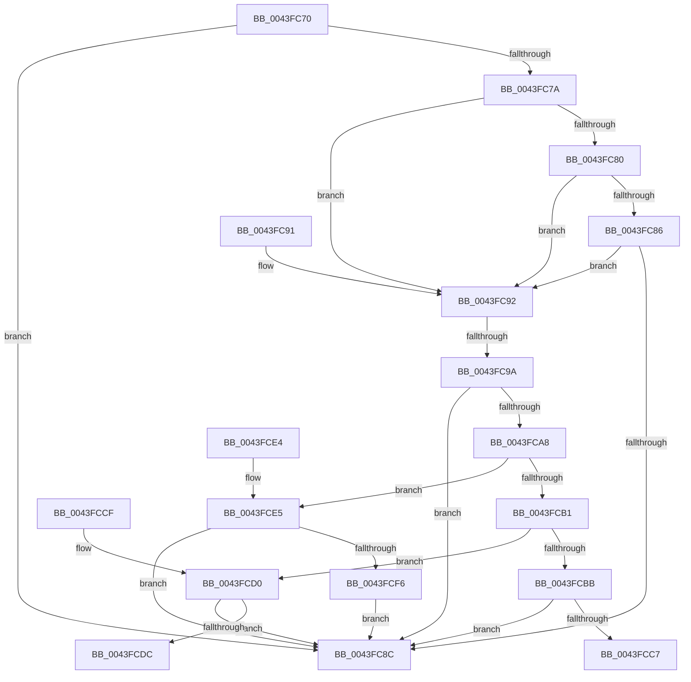

# SepConstrainByMandatory

- RVA: `0x0043FC70`–`0x0043FD01` (길이 `145` bytes)
- VA: `0x000000014043FC70`
- 실행 섹션: `.text`
- PDB 이름 있음: `예`; PDB Function 태그: `아니요`
- unwind 정보 RVA: `0x000A4DBC`
- 디코드: `48`개 명령, `145/145` bytes 표시
- 미해석 바이트: `0` (있으면 어셈블리에 `.byte`로 보존)

> 이 문서는 커널 이미지의 기계어와 PDB 기호를 분석해 생성했습니다. 4번과 5번은 함수 원형과 자료형을 바이너리 사용 방식에서 추정한 C 해석이며 원본 소스 복구 결과는 아닙니다.

## 1. Dependencies

- 직접 호출 지점: **0**; 고유 호출 대상: **0**
- 직접 호출자로 확인된 함수: **4**
- RIP 상대 이미지 참조: **0**

### Outgoing calls
- 직접 디코드된 call 명령이 없습니다.

### Direct callers
- [SeAccessCheckWithHint](../3A/SeAccessCheckWithHint_function_003A6C30.md) at `0x003A756C`
- [SeAccessCheckByType](../44/SeAccessCheckByType_function_00440BC8.md) at `0x0044221C`
- [SepCommonAccessCheckEx](../47/SepCommonAccessCheckEx_function_0047602C.md) at `0x00477041`
- [SepAccessCheckAndAuditAlarm](../../page/A1/SepAccessCheckAndAuditAlarm_function_00A1AF4C.md) at `0x00A1C49F`
- [SepAccessCheckAndAuditAlarm](../../page/A1/SepAccessCheckAndAuditAlarm_function_00A1AF4C.md) at `0x00A1CD5A`

### Static image references
- 디코드된 RIP-relative 메모리 참조가 없습니다.

## 2. Other-region calls and transfers

- 다른 실행 섹션으로 향하는 call: **0**
- call이 아닌 외부 분기/꼬리 이동: **1**
  - `0x0043FC98` → [sub_0043FD01](Unknown_function_0043FD01.md) (`tail-transfer`)

## 3. Assembly (complete function range)

```asm
0043FC70  48 83 EC 08                     sub rsp, 8
0043FC74  83 79 08 00                     cmp dword ptr [rcx + 8], 0
0043FC78  74 12                           je 0x14043fc8c
0043FC7A  80 79 05 00                     cmp byte ptr [rcx + 5], 0
0043FC7E  74 12                           je 0x14043fc92
0043FC80  80 79 04 00                     cmp byte ptr [rcx + 4], 0
0043FC84  74 0C                           je 0x14043fc92
0043FC86  80 79 06 00                     cmp byte ptr [rcx + 6], 0
0043FC8A  74 06                           je 0x14043fc92
0043FC8C  48 83 C4 08                     add rsp, 8
0043FC90  C3                              ret
0043FC91  CC                              int3
0043FC92  8B 44 24 38                     mov eax, dword ptr [rsp + 0x38]
0043FC96  85 C0                           test eax, eax
0043FC98  75 67                           jne 0x14043fd01
0043FC9A  41 8B 00                        mov eax, dword ptr [r8]
0043FC9D  44 8B 11                        mov r10d, dword ptr [rcx]
0043FCA0  44 23 D0                        and r10d, eax
0043FCA3  44 3B D0                        cmp r10d, eax
0043FCA6  74 E4                           je 0x14043fc8c
0043FCA8  45 89 10                        mov dword ptr [r8], r10d
0043FCAB  0F BA E2 19                     bt edx, 0x19
0043FCAF  73 34                           jae 0x14043fce5
0043FCB1  48 8B 44 24 30                  mov rax, qword ptr [rsp + 0x30]
0043FCB6  45 85 D2                        test r10d, r10d
0043FCB9  74 15                           je 0x14043fcd0
0043FCBB  41 C7 01 00 00 00 00            mov dword ptr [r9], 0
0043FCC2  48 85 C0                        test rax, rax
0043FCC5  74 C5                           je 0x14043fc8c
0043FCC7  C6 00 01                        mov byte ptr [rax], 1
0043FCCA  48 83 C4 08                     add rsp, 8
0043FCCE  C3                              ret
0043FCCF  CC                              int3
0043FCD0  41 C7 01 22 00 00 C0            mov dword ptr [r9], 0xc0000022
0043FCD7  48 85 C0                        test rax, rax
0043FCDA  74 B0                           je 0x14043fc8c
0043FCDC  C6 00 00                        mov byte ptr [rax], 0
0043FCDF  48 83 C4 08                     add rsp, 8
0043FCE3  C3                              ret
0043FCE4  CC                              int3
0043FCE5  48 8B 4C 24 30                  mov rcx, qword ptr [rsp + 0x30]
0043FCEA  41 C7 01 22 00 00 C0            mov dword ptr [r9], 0xc0000022
0043FCF1  48 85 C9                        test rcx, rcx
0043FCF4  74 96                           je 0x14043fc8c
0043FCF6  41 83 38 00                     cmp dword ptr [r8], 0
0043FCFA  0F 95 C0                        setne al
0043FCFD  88 01                           mov byte ptr [rcx], al
0043FCFF  EB 8B                           jmp 0x14043fc8c
```

## 4. C-style interpretation (structured pseudocode)

```c
__int64 __fastcall SepConstrainByMandatory(__int64 a1, int a2, __int64 a3, __int64 a4, __int64 a5, unsigned int a6)
{
    __int64 result;
    __int64 v_r10;
    __int64 v_rsp;

    v_rsp = (v_rsp) - (8);
    if ((*(unsigned int *)(a1 + 8)) == 0) goto loc_0043FC8C;
    if ((*(unsigned __int8 *)(a1 + 5)) == 0) goto loc_0043FC92;
    if ((*(unsigned __int8 *)(a1 + 4)) == 0) goto loc_0043FC92;
    if ((*(unsigned __int8 *)(a1 + 6)) == 0) goto loc_0043FC92;
loc_0043FC8C:
    v_rsp = (v_rsp) + (8);
    return result;
loc_0043FC92:
    v_r10 = (unsigned int)(((unsigned int)(*(unsigned int *)(a1))) & ((unsigned int)((unsigned int)(*(unsigned int *)(a3)))));
    if (((unsigned int)(v_r10)) == ((unsigned int)((unsigned int)(*(unsigned int *)(a3))))) goto loc_0043FC8C;
    *(unsigned int *)(a3) = (unsigned int)(v_r10);
    if (((unsigned int)(v_r10)) >= ((unsigned int)((unsigned int)(*(unsigned int *)(a3))))) goto loc_0043FCE5;
    if ((unsigned int)(v_r10) == 0) goto loc_0043FCD0;
    *(unsigned int *)(a4) = 0;
    if (a5 == 0) goto loc_0043FC8C;
    *(unsigned __int8 *)(a5) = 1;
    v_rsp = (v_rsp) + (8);
    return a5;
loc_0043FCD0:
    *(unsigned int *)(a4) = 0xC0000022ULL;
    if (a5 == 0) goto loc_0043FC8C;
    *(unsigned __int8 *)(a5) = 0;
    v_rsp = (v_rsp) + (8);
    return a5;
loc_0043FCE5:
    *(unsigned int *)(a4) = 0xC0000022ULL;
    if (a5 == 0) goto loc_0043FC8C;
    result = ((*(unsigned int *)(a3)) != 0) ? 1 : 0;
    *(unsigned __int8 *)(a5) = (unsigned __int8)(result);
    goto loc_0043FC8C;
}
```

## 5. (Beta) C Style

```c
int64_t SepConstrainByMandatory(void *Arg1, int32_t Arg2, void *Arg3, void *Arg4, int64_t Arg5, uint32_t Arg6)
{
    uint8_t *arg1 = (uint8_t *)Arg1;
    uint8_t *arg3 = (uint8_t *)Arg3;
    uint8_t *arg4 = (uint8_t *)Arg4;

    int64_t result;
    int64_t local_r10;
    int64_t local_rsp;

    local_rsp = (local_rsp) - (8);
    if ((*(uint32_t *)(arg1 + 0x8)) == 0) goto loc_0043FC8C;
    if ((*(uint8_t *)(arg1 + 0x5)) == 0) goto loc_0043FC92;
    if ((*(uint8_t *)(arg1 + 0x4)) == 0) goto loc_0043FC92;
    if ((*(uint8_t *)(arg1 + 0x6)) == 0) goto loc_0043FC92;
loc_0043FC8C:
    local_rsp = (local_rsp) + (8);
    return result;
loc_0043FC92:
    local_r10 = (uint32_t)(((uint32_t)(*(uint32_t *)(arg1))) & ((uint32_t)((uint32_t)(*(uint32_t *)(arg3)))));
    if (((uint32_t)(local_r10)) == ((uint32_t)((uint32_t)(*(uint32_t *)(arg3))))) goto loc_0043FC8C;
    *(uint32_t *)(arg3) = (uint32_t)(local_r10);
    if (((uint32_t)(local_r10)) >= ((uint32_t)((uint32_t)(*(uint32_t *)(arg3))))) goto loc_0043FCE5;
    if ((uint32_t)(local_r10) == 0) goto loc_0043FCD0;
    *(uint32_t *)(arg4) = 0;
    if (Arg5 == 0) goto loc_0043FC8C;
    *(uint8_t *)(Arg5) = 1;
    local_rsp = (local_rsp) + (8);
    return Arg5;
loc_0043FCD0:
    *(uint32_t *)(arg4) = 0xC0000022ULL;
    if (Arg5 == 0) goto loc_0043FC8C;
    *(uint8_t *)(Arg5) = 0;
    local_rsp = (local_rsp) + (8);
    return Arg5;
loc_0043FCE5:
    *(uint32_t *)(arg4) = 0xC0000022ULL;
    if (Arg5 == 0) goto loc_0043FC8C;
    result = ((*(uint32_t *)(arg3)) != 0) ? 1 : 0;
    *(uint8_t *)(Arg5) = (uint8_t)(result);
    goto loc_0043FC8C;
}
```

### 관측된 메모리 오프셋

구조체 형식이 확인되지 않은 접근은 인자 기준의 오프셋으로만 기록했습니다.

| 기준 인자 | 오프셋 표현 | 폭 (bit) | 접근 |
|---|---:|---:|---|
| `Arg1` | `+ 0x0` | `32` | `R` |
| `Arg1` | `+ 0x4` | `8` | `R` |
| `Arg1` | `+ 0x5` | `8` | `R` |
| `Arg1` | `+ 0x6` | `8` | `R` |
| `Arg1` | `+ 0x8` | `32` | `R` |
| `Arg3` | `+ 0x0` | `32` | `R` |
| `Arg3` | `+ 0x0` | `32` | `W` |
| `Arg4` | `+ 0x0` | `32` | `W` |

## 6. Execution-region graph

[열기: 2D/3D 그래프와 함수 탐색 컨트롤 패널](../../../control-panel.html?section=text&rva=0x0043FC70&view=graph)

- 2D 그래프는 위에서 아래로 흐르고, 3D 그래프는 빈 공간을 드래그해 회전합니다. Shift+드래그는 이동, 휠은 확대·축소, 함수 노드 선택은 대상 보고서 이동입니다.

### Static fallback


