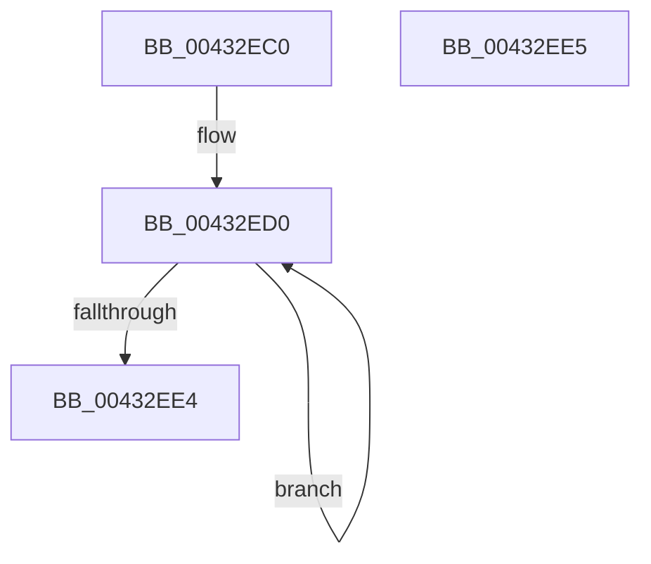

# SepTokenPrivilegeCount

- RVA: `0x00432EC0`–`0x00432EE6` (길이 `38` bytes)
- VA: `0x0000000140432EC0`
- 실행 섹션: `.text`
- PDB 이름 있음: `예`; PDB Function 태그: `아니요`
- unwind 정보 RVA: `0x000DB714`
- 디코드: `14`개 명령, `38/38` bytes 표시
- 미해석 바이트: `0` (있으면 어셈블리에 `.byte`로 보존)

> 이 문서는 커널 이미지의 기계어와 PDB 기호를 분석해 생성했습니다. 4번과 5번은 함수 원형과 자료형을 바이너리 사용 방식에서 추정한 C 해석이며 원본 소스 복구 결과는 아닙니다.

## 1. Dependencies

- 직접 호출 지점: **0**; 고유 호출 대상: **0**
- 직접 호출자로 확인된 함수: **4**
- RIP 상대 이미지 참조: **0**

### Outgoing calls
- 직접 디코드된 call 명령이 없습니다.

### Direct callers
- [SeQueryInformationToken](../../page/8B/SeQueryInformationToken_function_008B5090.md) at `0x008B5253`
- [SeQueryInformationToken](../../page/8B/SeQueryInformationToken_function_008B5090.md) at `0x008B558B`
- [SeQueryInformationToken](../../page/8B/SeQueryInformationToken_function_008B5090.md) at `0x008B592A`
- [SepRemoveDisabledGroupsAndPrivileges](../../page/9D/SepRemoveDisabledGroupsAndPrivileges_function_009D48B4.md) at `0x009D4A30`
- [SepRemoveDisabledGroupsAndPrivileges](../../page/9D/SepRemoveDisabledGroupsAndPrivileges_function_009D48B4.md) at `0x009D4A70`
- [SepGetTokenAccessInformationBufferSize](../../page/9E/SepGetTokenAccessInformationBufferSize_function_009E995C.md) at `0x009E9981`
- [NtQueryInformationToken](../../page/AE/NtQueryInformationToken_function_00AECDD0.md) at `0x00AED1B2`
- [NtQueryInformationToken](../../page/AE/NtQueryInformationToken_function_00AECDD0.md) at `0x00AEDC05`
- [NtQueryInformationToken](../../page/AE/NtQueryInformationToken_function_00AECDD0.md) at `0x00AEE2C9`

### Static image references
- 디코드된 RIP-relative 메모리 참조가 없습니다.

## 2. Other-region calls and transfers

- 다른 실행 섹션으로 향하는 call: **0**
- 별도 외부 분기/꼬리 이동을 확인하지 못했습니다.

## 3. Assembly (complete function range)

```asm
00432EC0  4C 8B 49 40                     mov r9, qword ptr [rcx + 0x40]
00432EC4  33 C0                           xor eax, eax
00432EC6  B9 01 00 00 00                  mov ecx, 1
00432ECB  44 8D 40 25                     lea r8d, [rax + 0x25]
00432ECF  90                              nop
00432ED0  4C 85 C9                        test rcx, r9
00432ED3  8D 50 01                        lea edx, [rax + 1]
00432ED6  0F 44 D0                        cmove edx, eax
00432ED9  48 D1 C1                        rol rcx, 1
00432EDC  8B C2                           mov eax, edx
00432EDE  49 83 E8 01                     sub r8, 1
00432EE2  75 EC                           jne 0x140432ed0
00432EE4  C3                              ret
00432EE5  CC                              int3
```

## 4. C-style interpretation (structured pseudocode)

```c
__int64 __fastcall SepTokenPrivilegeCount(__int64 a1)
{
    __int64 result;

    result = 0;
loc_00432ED0:
    a2 = result + 1;
    if (((1) & (*(unsigned __int64 *)(a1 + 64))) == 0) { a2 = 0; }
    a3 = (result + 37) - (1);
    if (condition_is_not_equal) goto loc_00432ED0;
    return (unsigned int)((unsigned int)(a2));
}
```

## 5. (Beta) C Style

```c
int64_t SepTokenPrivilegeCount(void *Arg1)
{
    uint8_t *arg1 = (uint8_t *)Arg1;

    int64_t result;

    result = 0;
loc_00432ED0:
    a2 = result + 1;
    if (((1) & (*(uint64_t *)(arg1 + 0x40))) == 0) { a2 = 0; }
    a3 = (result + 37) - (1);
    if (condition_is_not_equal) goto loc_00432ED0;
    return (uint32_t)((uint32_t)(a2));
}
```

### 관측된 메모리 오프셋

구조체 형식이 확인되지 않은 접근은 인자 기준의 오프셋으로만 기록했습니다.

| 기준 인자 | 오프셋 표현 | 폭 (bit) | 접근 |
|---|---:|---:|---|
| `Arg1` | `+ 0x40` | `64` | `R` |

## 6. Execution-region graph

[열기: 2D/3D 그래프와 함수 탐색 컨트롤 패널](../../../control-panel.html?section=text&rva=0x00432EC0&view=graph)

- 2D 그래프는 위에서 아래로 흐르고, 3D 그래프는 빈 공간을 드래그해 회전합니다. Shift+드래그는 이동, 휠은 확대·축소, 함수 노드 선택은 대상 보고서 이동입니다.

### Static fallback


