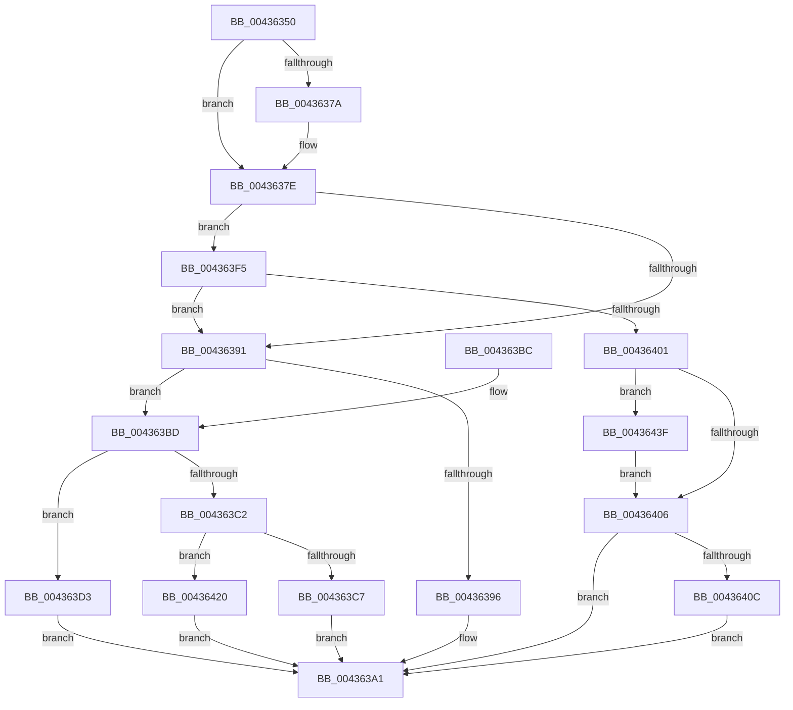

# SmFpFree

- RVA: `0x00436350`–`0x00436451` (길이 `257` bytes)
- VA: `0x0000000140436350`
- 실행 섹션: `.text`
- PDB 이름 있음: `예`; PDB Function 태그: `아니요`
- unwind 정보 RVA: `0x000A2DC4`
- 디코드: `75`개 명령, `257/257` bytes 표시
- 미해석 바이트: `0` (있으면 어셈블리에 `.byte`로 보존)

> 이 문서는 커널 이미지의 기계어와 PDB 기호를 분석해 생성했습니다. 4번과 5번은 함수 원형과 자료형을 바이너리 사용 방식에서 추정한 C 해석이며 원본 소스 복구 결과는 아닙니다.

## 1. Dependencies

- 직접 호출 지점: **8**; 고유 호출 대상: **6**
- 직접 호출자로 확인된 함수: **4**
- RIP 상대 이미지 참조: **0**

### Outgoing calls
- `0x0043639C` → [MmUnmapLockedPages](../24/MmUnmapLockedPages_function_00246E60.md) (function, `0x00246E60`)
- `0x004363CC` → [ExFreePoolWithTag](../../poolcode/B8/ExFreePoolWithTag_function_00B82870.md) (function, `0x00B82870`)
- `0x004363E4` → [SmAcquireReleaseCharges](../28/SmAcquireReleaseCharges_function_00285C40.md) (function, `0x00285C40`)
- `0x004363EE` → [ExFreePoolWithTag](../../poolcode/B8/ExFreePoolWithTag_function_00B82870.md) (function, `0x00B82870`)
- `0x004363F8` → [SmpFpReleaseResource](../4F/SmpFpReleaseResource_function_004FAC90.md) (function, `0x004FAC90`)
- `0x00436419` → [KeSetEvent](../33/KeSetEvent_function_0033F310.md) (function, `0x0033F310`)
- `0x00436435` → [SmAcquireReleaseCharges](../28/SmAcquireReleaseCharges_function_00285C40.md) (function, `0x00285C40`)
- `0x0043644A` → [MmUnmapReservedMapping](../3E/MmUnmapReservedMapping_function_003E7BE0.md) (function, `0x003E7BE0`)

### Direct callers
- [SMKM_STORE_MGR&lt;SM_TRAITS&gt;::SmpPageEvict](../24/SMKM_STORE_MGR_SM_TRAITS_SmpPageEvict_function_0024A5F4.md) at `0x0024A7A6`
- [SmKmUnlockMdl](../37/SmKmUnlockMdl_function_00372A44.md) at `0x00372AF5`
- [SmKmStoreHelperCommandCleanup](../4D/SmKmStoreHelperCommandCleanup_function_004D03FC.md) at `0x004D0481`
- [sub_006E8004](../6E/Unknown_function_006E8004.md) at `0x006E807B`

### Static image references
- 디코드된 RIP-relative 메모리 참조가 없습니다.

## 2. Other-region calls and transfers

- 다른 실행 섹션으로 향하는 call: **2**
  - `0x004363CC` → [ExFreePoolWithTag](../../poolcode/B8/ExFreePoolWithTag_function_00B82870.md) (`.text` → `POOLCODE`)
  - `0x004363EE` → [ExFreePoolWithTag](../../poolcode/B8/ExFreePoolWithTag_function_00B82870.md) (`.text` → `POOLCODE`)
- 별도 외부 분기/꼬리 이동을 확인하지 못했습니다.

## 3. Assembly (complete function range)

```asm
00436350  48 89 5C 24 08                  mov qword ptr [rsp + 8], rbx
00436355  48 89 6C 24 10                  mov qword ptr [rsp + 0x10], rbp
0043635A  48 89 74 24 18                  mov qword ptr [rsp + 0x18], rsi
0043635F  48 89 7C 24 20                  mov qword ptr [rsp + 0x20], rdi
00436364  41 56                           push r14
00436366  48 83 EC 20                     sub rsp, 0x20
0043636A  49 8B F9                        mov rdi, r9
0043636D  8B DA                           mov ebx, edx
0043636F  48 8B E9                        mov rbp, rcx
00436372  49 8B F1                        mov rsi, r9
00436375  83 FA 05                        cmp edx, 5
00436378  7C 04                           jl 0x14043637e
0043637A  49 8B 79 18                     mov rdi, qword ptr [r9 + 0x18]
0043637E  48 8B 41 70                     mov rax, qword ptr [rcx + 0x70]
00436382  45 33 F6                        xor r14d, r14d
00436385  83 FB 05                        cmp ebx, 5
00436388  49 0F 4C F6                     cmovl rsi, r14
0043638C  49 3B C0                        cmp rax, r8
0043638F  74 64                           je 0x1404363f5
00436391  83 FB 05                        cmp ebx, 5
00436394  7C 27                           jl 0x1404363bd
00436396  48 8B D6                        mov rdx, rsi
00436399  48 8B CF                        mov rcx, rdi
0043639C  E8 BF 0A E1 FF                  call 0x140246e60
004363A1  48 8B 5C 24 30                  mov rbx, qword ptr [rsp + 0x30]
004363A6  48 8B 6C 24 38                  mov rbp, qword ptr [rsp + 0x38]
004363AB  48 8B 74 24 40                  mov rsi, qword ptr [rsp + 0x40]
004363B0  48 8B 7C 24 48                  mov rdi, qword ptr [rsp + 0x48]
004363B5  48 83 C4 20                     add rsp, 0x20
004363B9  41 5E                           pop r14
004363BB  C3                              ret
004363BC  CC                              int3
004363BD  83 FB 02                        cmp ebx, 2
004363C0  74 11                           je 0x1404363d3
004363C2  83 FB 03                        cmp ebx, 3
004363C5  74 59                           je 0x140436420
004363C7  33 D2                           xor edx, edx
004363C9  48 8B CF                        mov rcx, rdi
004363CC  E8 9F C4 74 00                  call 0x140b82870
004363D1  EB CE                           jmp 0x1404363a1
004363D3  8B 57 28                        mov edx, dword ptr [rdi + 0x28]
004363D6  41 B9 01 00 00 00               mov r9d, 1
004363DC  48 8B 4D 20                     mov rcx, qword ptr [rbp + 0x20]
004363E0  45 8D 41 02                     lea r8d, [r9 + 2]
004363E4  E8 57 F8 E4 FF                  call 0x140285c40
004363E9  33 D2                           xor edx, edx
004363EB  48 8B CF                        mov rcx, rdi
004363EE  E8 7D C4 74 00                  call 0x140b82870
004363F3  EB AC                           jmp 0x1404363a1
004363F5  4C 8B C7                        mov r8, rdi
004363F8  E8 93 48 0C 00                  call 0x1404fac90
004363FD  85 C0                           test eax, eax
004363FF  74 90                           je 0x140436391
00436401  83 FB 05                        cmp ebx, 5
00436404  7D 39                           jge 0x14043643f
00436406  44 38 75 5E                     cmp byte ptr [rbp + 0x5e], r14b
0043640A  75 95                           jne 0x1404363a1
0043640C  4C 87 75 70                     xchg qword ptr [rbp + 0x70], r14
00436410  48 8D 4D 08                     lea rcx, [rbp + 8]
00436414  45 33 C0                        xor r8d, r8d
00436417  33 D2                           xor edx, edx
00436419  E8 F2 8E F0 FF                  call 0x14033f310
0043641E  EB 81                           jmp 0x1404363a1
00436420  0F B7 55 66                     movzx edx, word ptr [rbp + 0x66]
00436424  41 B9 01 00 00 00               mov r9d, 1
0043642A  48 8B 4D 20                     mov rcx, qword ptr [rbp + 0x20]
0043642E  45 8B C1                        mov r8d, r9d
00436431  48 C1 E2 0C                     shl rdx, 0xc
00436435  E8 06 F8 E4 FF                  call 0x140285c40
0043643A  E9 62 FF FF FF                  jmp 0x1404363a1
0043643F  4C 8B C6                        mov r8, rsi
00436442  BA 73 6D 52 6D                  mov edx, 0x6d526d73
00436447  48 8B CF                        mov rcx, rdi
0043644A  E8 91 17 FB FF                  call 0x1403e7be0
0043644F  EB B5                           jmp 0x140436406
```

## 4. C-style interpretation (structured pseudocode)

```c
__int64 __fastcall SmFpFree(__int64 a1, int a2, __int64 a3, __int64 a4)
{
    __int64 result;
    __int64 v_r14;
    __int64 v_rdi;
    __int64 v_rsp;
    unsigned __int64 v_stack_p10;
    unsigned __int64 v_stack_p18;
    unsigned __int64 v_stack_p20;
    unsigned __int64 v_stack_p8;

    v_stack_p8 = v_rbx;
    v_stack_p10 = v_rbp;
    v_stack_p18 = v_rsi;
    v_stack_p20 = v_rdi;
    v_rsp = (v_rsp) - (32);
    v_rdi = a4;
    if (a2 >= 5) {
        v_rdi = *(unsigned __int64 *)(a4 + 24);
    }
    v_r14 = 0;
    if (((unsigned int)((unsigned int)(a2))) < 5) { a4 = 0; }
    if ((*(unsigned __int64 *)(a1 + 112)) == a3) goto loc_004363F5;
loc_00436391:
    if (((unsigned int)((unsigned int)(a2))) < 5) goto loc_004363BD;
    result = MmUnmapLockedPages(v_rdi, a4, a3, a4);
loc_004363A1:
    v_rsp = (v_rsp) + (32);
    return result;
loc_004363BD:
    if (((unsigned int)(v_stack_p8)) == 2) goto loc_004363D3;
    if (((unsigned int)(v_stack_p8)) == 3) goto loc_00436420;
    a2 = 0;
    result = ExFreePoolWithTag(v_stack_p20, a2, a3, a4);
    goto loc_004363A1;
loc_004363D3:
    result = SmAcquireReleaseCharges(*(unsigned __int64 *)(v_stack_p10 + 32), (unsigned int)(*(unsigned int *)(v_stack_p20 + 40)), 1 + 2, 1);
    a2 = 0;
    result = ExFreePoolWithTag(v_stack_p20, a2, 1 + 2, 1);
    goto loc_004363A1;
loc_004363F5:
    result = SmpFpReleaseResource(v_stack_p20, a2, v_stack_p20, 1);
    if ((unsigned int)(result) == 0) goto loc_00436391;
    if (((unsigned int)(v_stack_p8)) >= 5) goto loc_0043643F;
loc_00436406:
    if ((*(unsigned __int8 *)(v_stack_p10 + 94)) != 0) goto loc_004363A1;
    a3 = 0;
    a2 = 0;
    result = KeSetEvent(v_stack_p10 + 8, a2, a3, 1);
    goto loc_004363A1;
loc_00436420:
    a2 = (*(unsigned __int16 *)(v_stack_p10 + 102)) << (12);
    result = SmAcquireReleaseCharges(*(unsigned __int64 *)(v_stack_p10 + 32), a2, 1, 1);
    goto loc_004363A1;
loc_0043643F:
    result = MmUnmapReservedMapping(v_stack_p20, (unsigned int)(0x6D526D73ULL), v_stack_p18, 1);
    goto loc_00436406;
}
```

## 5. (Beta) C Style

```c
int64_t SmFpFree(void *Arg1, int32_t Arg2, int64_t Arg3, void *Arg4)
{
    uint8_t *arg1 = (uint8_t *)Arg1;
    uint8_t *arg4 = (uint8_t *)Arg4;

    int64_t result;
    int64_t local_r14;
    int64_t local_rdi;
    int64_t local_rsp;
    uint64_t v_stack_p10;
    uint64_t v_stack_p18;
    uint64_t v_stack_p20;
    uint64_t v_stack_p8;

    v_stack_p8 = local_rbx;
    v_stack_p10 = local_rbp;
    v_stack_p18 = local_rsi;
    v_stack_p20 = local_rdi;
    local_rsp = (local_rsp) - (32);
    local_rdi = Arg4;
    if (Arg2 >= 5) {
        local_rdi = *(uint64_t *)(arg4 + 0x18);
    }
    local_r14 = 0;
    if (((uint32_t)((uint32_t)(Arg2))) < 5) { Arg4 = 0; }
    if ((*(uint64_t *)(arg1 + 0x70)) == Arg3) goto loc_004363F5;
loc_00436391:
    if (((uint32_t)((uint32_t)(Arg2))) < 5) goto loc_004363BD;
    result = MmUnmapLockedPages(local_rdi, Arg4, Arg3, Arg4);
loc_004363A1:
    local_rsp = (local_rsp) + (32);
    return result;
loc_004363BD:
    if (((uint32_t)(v_stack_p8)) == 2) goto loc_004363D3;
    if (((uint32_t)(v_stack_p8)) == 3) goto loc_00436420;
    Arg2 = 0;
    result = ExFreePoolWithTag(v_stack_p20, Arg2, Arg3, Arg4);
    goto loc_004363A1;
loc_004363D3:
    result = SmAcquireReleaseCharges(*(uint64_t *)(v_stack_p10 + 0x20), (uint32_t)(*(uint32_t *)(v_stack_p20 + 0x28)), 1 + 2, 1);
    Arg2 = 0;
    result = ExFreePoolWithTag(v_stack_p20, Arg2, 1 + 2, 1);
    goto loc_004363A1;
loc_004363F5:
    result = SmpFpReleaseResource(v_stack_p20, Arg2, v_stack_p20, 1);
    if ((uint32_t)(result) == 0) goto loc_00436391;
    if (((uint32_t)(v_stack_p8)) >= 5) goto loc_0043643F;
loc_00436406:
    if ((*(uint8_t *)(v_stack_p10 + 0x5E)) != 0) goto loc_004363A1;
    Arg3 = 0;
    Arg2 = 0;
    result = KeSetEvent(v_stack_p10 + 8, Arg2, Arg3, 1);
    goto loc_004363A1;
loc_00436420:
    Arg2 = (*(uint16_t *)(v_stack_p10 + 0x66)) << (12);
    result = SmAcquireReleaseCharges(*(uint64_t *)(v_stack_p10 + 0x20), Arg2, 1, 1);
    goto loc_004363A1;
loc_0043643F:
    result = MmUnmapReservedMapping(v_stack_p20, (uint32_t)(0x6D526D73ULL), v_stack_p18, 1);
    goto loc_00436406;
}
```

### 관측된 메모리 오프셋

구조체 형식이 확인되지 않은 접근은 인자 기준의 오프셋으로만 기록했습니다.

| 기준 인자 | 오프셋 표현 | 폭 (bit) | 접근 |
|---|---:|---:|---|
| `Arg1` | `+ 0x8` | `64` | `R` |
| `Arg1` | `+ 0x20` | `64` | `R` |
| `Arg1` | `+ 0x5E` | `8` | `R` |
| `Arg1` | `+ 0x66` | `16` | `R` |
| `Arg1` | `+ 0x70` | `64` | `R` |
| `Arg1` | `+ 0x70` | `64` | `R/W` |
| `Arg4` | `+ 0x18` | `64` | `R` |

## 6. Execution-region graph

[열기: 2D/3D 그래프와 함수 탐색 컨트롤 패널](../../../control-panel.html?section=text&rva=0x00436350&view=graph)

- 2D 그래프는 위에서 아래로 흐르고, 3D 그래프는 빈 공간을 드래그해 회전합니다. Shift+드래그는 이동, 휠은 확대·축소, 함수 노드 선택은 대상 보고서 이동입니다.

### Static fallback


