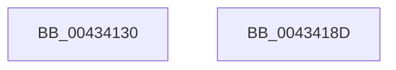

# SmKmStoreDeleteWhenEmptyWorker

- RVA: `0x00434130`–`0x0043418E` (길이 `94` bytes)
- VA: `0x0000000140434130`
- 실행 섹션: `.text`
- PDB 이름 있음: `예`; PDB Function 태그: `아니요`
- unwind 정보 RVA: `0x0005CAAC`
- 디코드: `27`개 명령, `94/94` bytes 표시
- 미해석 바이트: `0` (있으면 어셈블리에 `.byte`로 보존)

> 이 문서는 커널 이미지의 기계어와 PDB 기호를 분석해 생성했습니다. 4번과 5번은 함수 원형과 자료형을 바이너리 사용 방식에서 추정한 C 해석이며 원본 소스 복구 결과는 아닙니다.

## 1. Dependencies

- 직접 호출 지점: **4**; 고유 호출 대상: **4**
- 직접 호출자로 확인된 함수: **0**
- RIP 상대 이미지 참조: **0**

### Outgoing calls
- `0x0043414A` → [KeSetEvent](../33/KeSetEvent_function_0033F310.md) (function, `0x0033F310`)
- `0x00434154` → [SmKmStoreRefFromStoreIndex](SmKmStoreRefFromStoreIndex_function_004341A0.md) (function, `0x004341A0`)
- `0x00434168` → [SmKmStoreDelete](../../page/A6/SmKmStoreDelete_function_00A6D7D0.md) (function, `0x00A6D7D0`)
- `0x0043417D` → [guard_dispatch_icall](../6B/guard_dispatch_icall_function_006BAAD0.md) (function, `0x006BAAD0`)

### Direct callers
- 이 함수 시작 RVA로 연결되는 직접 call은 확인되지 않았습니다. 간접 호출은 완전히 역산할 수 없습니다.

### Static image references
- 디코드된 RIP-relative 메모리 참조가 없습니다.

## 2. Other-region calls and transfers

- 다른 실행 섹션으로 향하는 call: **1**
  - `0x00434168` → [SmKmStoreDelete](../../page/A6/SmKmStoreDelete_function_00A6D7D0.md) (`.text` → `PAGE`)
- 별도 외부 분기/꼬리 이동을 확인하지 못했습니다.

## 3. Assembly (complete function range)

```asm
00434130  48 89 5C 24 08                  mov qword ptr [rsp + 8], rbx
00434135  57                              push rdi
00434136  48 83 EC 20                     sub rsp, 0x20
0043413A  48 8B 79 38                     mov rdi, qword ptr [rcx + 0x38]
0043413E  45 33 C0                        xor r8d, r8d
00434141  8B 59 40                        mov ebx, dword ptr [rcx + 0x40]
00434144  33 D2                           xor edx, edx
00434146  48 83 C1 20                     add rcx, 0x20
0043414A  E8 C1 B1 F0 FF                  call 0x14033f310
0043414F  8B D3                           mov edx, ebx
00434151  48 8B CF                        mov rcx, rdi
00434154  E8 47 00 00 00                  call 0x1404341a0
00434159  45 33 C0                        xor r8d, r8d
0043415C  48 8B CF                        mov rcx, rdi
0043415F  48 8B 10                        mov rdx, qword ptr [rax]
00434162  8B 92 90 1A 00 00               mov edx, dword ptr [rdx + 0x1a90]
00434168  E8 63 96 63 00                  call 0x140a6d7d0
0043416D  48 8B 87 00 01 00 00            mov rax, qword ptr [rdi + 0x100]
00434174  33 D2                           xor edx, edx
00434176  48 8B CF                        mov rcx, rdi
00434179  44 8D 42 09                     lea r8d, [rdx + 9]
0043417D  E8 4E 69 28 00                  call 0x1406baad0
00434182  48 8B 5C 24 30                  mov rbx, qword ptr [rsp + 0x30]
00434187  48 83 C4 20                     add rsp, 0x20
0043418B  5F                              pop rdi
0043418C  C3                              ret
0043418D  CC                              int3
```

## 4. C-style interpretation (structured pseudocode)

```c
__int64 __fastcall SmKmStoreDeleteWhenEmptyWorker(__int64 a1, int a2, int a3)
{
    __int64 result;
    __int64 v_rsp;
    unsigned __int64 v_stack_p8;

    v_stack_p8 = v_rbx;
    v_rsp = (v_rsp) - (32);
    a3 = 0;
    a2 = 0;
    a1 = (a1) + (32);
    result = KeSetEvent(a1, a2, a3, a4);
    result = SmKmStoreRefFromStoreIndex(*(unsigned __int64 *)(a1 + 56), (unsigned int)((unsigned int)((unsigned int)(*(unsigned int *)(a1 + 64)))), a3, a4);
    a3 = 0;
    result = SmKmStoreDelete(*(unsigned __int64 *)(a1 + 56), (unsigned int)(*(unsigned int *)(*(unsigned __int64 *)(result) + 6800)), a3, a4);
    a2 = 0;
    result = guard_dispatch_icall(*(unsigned __int64 *)(a1 + 56), a2, a2 + 9, a4);
    v_rsp = (v_rsp) + (32);
    return result;
}
```

## 5. (Beta) C Style

```c
int64_t SmKmStoreDeleteWhenEmptyWorker(void *Arg1, int32_t Arg2, int32_t Arg3)
{
    uint8_t *arg1 = (uint8_t *)Arg1;

    int64_t result;
    int64_t local_rsp;
    uint64_t v_stack_p8;

    v_stack_p8 = local_rbx;
    local_rsp = (local_rsp) - (32);
    Arg3 = 0;
    Arg2 = 0;
    Arg1 = (Arg1) + (32);
    result = KeSetEvent(Arg1, Arg2, Arg3, a4);
    result = SmKmStoreRefFromStoreIndex(*(uint64_t *)(arg1 + 0x38), (uint32_t)((uint32_t)((uint32_t)(*(uint32_t *)(arg1 + 0x40)))), Arg3, a4);
    Arg3 = 0;
    result = SmKmStoreDelete(*(uint64_t *)(arg1 + 0x38), (uint32_t)(*(uint32_t *)(*(uint64_t *)(result) + 0x1A90)), Arg3, a4);
    Arg2 = 0;
    result = guard_dispatch_icall(*(uint64_t *)(arg1 + 0x38), Arg2, Arg2 + 9, a4);
    local_rsp = (local_rsp) + (32);
    return result;
}
```

### 관측된 메모리 오프셋

구조체 형식이 확인되지 않은 접근은 인자 기준의 오프셋으로만 기록했습니다.

| 기준 인자 | 오프셋 표현 | 폭 (bit) | 접근 |
|---|---:|---:|---|
| `Arg1` | `+ 0x38` | `64` | `R` |
| `Arg1` | `+ 0x40` | `32` | `R` |

## 6. Execution-region graph

[열기: 2D/3D 그래프와 함수 탐색 컨트롤 패널](../../../control-panel.html?section=text&rva=0x00434130&view=graph)

- 2D 그래프는 위에서 아래로 흐르고, 3D 그래프는 빈 공간을 드래그해 회전합니다. Shift+드래그는 이동, 휠은 확대·축소, 함수 노드 선택은 대상 보고서 이동입니다.

### Static fallback


