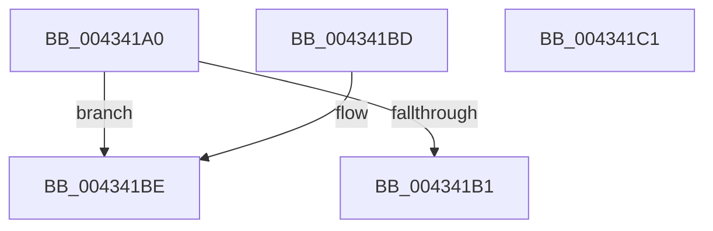

# SmKmStoreRefFromStoreIndex

- RVA: `0x004341A0`–`0x004341C2` (길이 `34` bytes)
- VA: `0x00000001404341A0`
- 실행 섹션: `.text`
- PDB 이름 있음: `예`; PDB Function 태그: `아니요`
- unwind 정보 RVA: `0x000DB714`
- 디코드: `14`개 명령, `34/34` bytes 표시
- 미해석 바이트: `0` (있으면 어셈블리에 `.byte`로 보존)

> 이 문서는 커널 이미지의 기계어와 PDB 기호를 분석해 생성했습니다. 4번과 5번은 함수 원형과 자료형을 바이너리 사용 방식에서 추정한 C 해석이며 원본 소스 복구 결과는 아닙니다.

## 1. Dependencies

- 직접 호출 지점: **0**; 고유 호출 대상: **0**
- 직접 호출자로 확인된 함수: **5**
- RIP 상대 이미지 참조: **0**

### Outgoing calls
- 직접 디코드된 call 명령이 없습니다.

### Direct callers
- [SmKmStoreDeleteWhenEmptyWorker](SmKmStoreDeleteWhenEmptyWorker_function_00434130.md) at `0x00434154`
- [SmGetStoreOwnerProcessId](../61/SmGetStoreOwnerProcessId_function_00610E4C.md) at `0x00610EA4`
- [SmProcessListRequest](../../page/7A/SmProcessListRequest_function_007A67A8.md) at `0x007A692F`
- [SmProcessCompressionInfoRequest](../../page/A0/SmProcessCompressionInfoRequest_function_00A0E980.md) at `0x00A0ECBD`
- [SmKmStoreDelete](../../page/A6/SmKmStoreDelete_function_00A6D7D0.md) at `0x00A6D807`

### Static image references
- 디코드된 RIP-relative 메모리 참조가 없습니다.

## 2. Other-region calls and transfers

- 다른 실행 섹션으로 향하는 call: **0**
- 별도 외부 분기/꼬리 이동을 확인하지 못했습니다.

## 3. Assembly (complete function range)

```asm
004341A0  8B C2                           mov eax, edx
004341A2  8B D2                           mov edx, edx
004341A4  48 C1 EA 05                     shr rdx, 5
004341A8  4C 8B 04 D1                     mov r8, qword ptr [rcx + rdx*8]
004341AC  4D 85 C0                        test r8, r8
004341AF  74 0D                           je 0x1404341be
004341B1  83 E0 1F                        and eax, 0x1f
004341B4  48 8D 0C 80                     lea rcx, [rax + rax*4]
004341B8  49 8D 04 C8                     lea rax, [r8 + rcx*8]
004341BC  C3                              ret
004341BD  CC                              int3
004341BE  33 C0                           xor eax, eax
004341C0  C3                              ret
004341C1  CC                              int3
```

## 4. C-style interpretation (structured pseudocode)

```c
__int64 __fastcall SmKmStoreRefFromStoreIndex(__int64 a1, int a2)
{
    __int64 result;

    a2 = ((unsigned int)(a2)) >> (5);
    if (*(unsigned __int64 *)(a1 + a2 * 8) == 0) goto loc_004341BE;
    result = (unsigned int)(((unsigned int)(a2)) & (31));
    return *(unsigned __int64 *)(a1 + a2 * 8) + result + result * 4 * 8;
loc_004341BE:
    result = 0;
    return result;
}
```

## 5. (Beta) C Style

```c
int64_t SmKmStoreRefFromStoreIndex(void *Arg1, void *Arg2)
{
    uint8_t *arg1 = (uint8_t *)Arg1;
    uint8_t *arg2 = (uint8_t *)Arg2;

    int64_t result;

    Arg2 = ((uint32_t)(Arg2)) >> (5);
    if (*(uint64_t *)(arg1 + arg2 * 8) == 0) goto loc_004341BE;
    result = (uint32_t)(((uint32_t)(Arg2)) & (31));
    return *(uint64_t *)(arg1 + arg2 * 8) + result + result * 4 * 8;
loc_004341BE:
    result = 0;
    return result;
}
```

### 관측된 메모리 오프셋

구조체 형식이 확인되지 않은 접근은 인자 기준의 오프셋으로만 기록했습니다.

| 기준 인자 | 오프셋 표현 | 폭 (bit) | 접근 |
|---|---:|---:|---|
| `Arg1` | `+ 0x0 + rdx*8` | `64` | `R` |
| `Arg2` | `+ 0x0 + rax*4` | `64` | `R` |

## 6. Execution-region graph

[열기: 2D/3D 그래프와 함수 탐색 컨트롤 패널](../../../control-panel.html?section=text&rva=0x004341A0&view=graph)

- 2D 그래프는 위에서 아래로 흐르고, 3D 그래프는 빈 공간을 드래그해 회전합니다. Shift+드래그는 이동, 휠은 확대·축소, 함수 노드 선택은 대상 보고서 이동입니다.

### Static fallback


