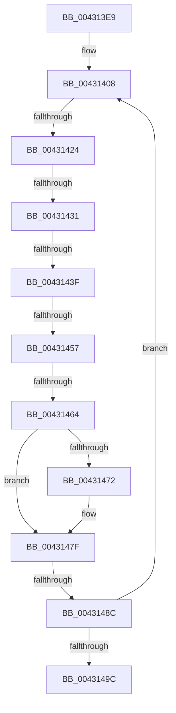

# sub_004313E9

- RVA: `0x004313E9`–`0x004314B5` (길이 `204` bytes)
- VA: `0x00000001404313E9`
- 실행 섹션: `.text`
- PDB 이름 있음: `아니요`; PDB Function 태그: `아니요`
- unwind 정보 RVA: `0x000A217C`
- 디코드: `42`개 명령, `204/204` bytes 표시
- 미해석 바이트: `0` (있으면 어셈블리에 `.byte`로 보존)

> 이 문서는 커널 이미지의 기계어와 PDB 기호를 분석해 생성했습니다. 4번과 5번은 함수 원형과 자료형을 바이너리 사용 방식에서 추정한 C 해석이며 원본 소스 복구 결과는 아닙니다.

## 1. Dependencies

- 직접 호출 지점: **2**; 고유 호출 대상: **2**
- 직접 호출자로 확인된 함수: **0**
- RIP 상대 이미지 참조: **3**

### Outgoing calls
- `0x00431443` → [KiAcquireSpinLockInstrumented](../20/KiAcquireSpinLockInstrumented_function_002084F0.md) (function, `0x002084F0`)
- `0x0043147A` → [KiLowerIrqlProcessIrqlFlags](../4F/KiLowerIrqlProcessIrqlFlags_function_004F5698.md) (function, `0x004F5698`)

### Direct callers
- 이 함수 시작 RVA로 연결되는 직접 call은 확인되지 않았습니다. 간접 호출은 완전히 역산할 수 없습니다.

### Static image references
- `0x00431417` → RVA `0x00FC6D20` (`ALMOSTRO`; read)
- `0x00431424` → RVA `0x00FC6B06` (`ALMOSTRO`; read)
- `0x00431431` → RVA `0x00F0DE58` (`.data`; read)

## 2. Other-region calls and transfers

- 다른 실행 섹션으로 향하는 call: **0**
- call이 아닌 외부 분기/꼬리 이동: **6**
  - `0x0043141E` → [sub_004314C3 + 0x29](Unknown_function_004314C3.md) (`tail-transfer`)
  - `0x0043142B` → [sub_004314C3](Unknown_function_004314C3.md) (`tail-transfer`)
  - `0x00431439` → [sub_004314C3](Unknown_function_004314C3.md) (`tail-transfer`)
  - `0x00431451` → [sub_004314C3 + 0x1B](Unknown_function_004314C3.md) (`tail-transfer`)
  - `0x0043145E` → [sub_004314C3 + 0x60](Unknown_function_004314C3.md) (`tail-transfer`)
  - `0x0043148A` → [sub_004314C3 + 0x3B](Unknown_function_004314C3.md) (`tail-transfer`)

## 3. Assembly (complete function range)

```asm
004313E9  48 89 6C 24 50                  mov qword ptr [rsp + 0x50], rbp
004313EE  48 89 74 24 58                  mov qword ptr [rsp + 0x58], rsi
004313F3  48 89 7C 24 60                  mov qword ptr [rsp + 0x60], rdi
004313F8  4C 89 6C 24 28                  mov qword ptr [rsp + 0x28], r13
004313FD  41 BD 02 00 00 00               mov r13d, 2
00431403  4C 89 74 24 20                  mov qword ptr [rsp + 0x20], r14
00431408  48 8D B3 E8 05 00 00            lea rsi, [rbx + 0x5e8]
0043140F  45 0F 20 C6                     mov r14, cr8
00431413  45 0F 22 C5                     mov cr8, r13
00431417  44 39 3D 02 59 B9 00            cmp dword ptr [rip + 0xb95902], r15d
0043141E  0F 85 C8 00 00 00               jne 0x1404314ec
00431424  F6 05 DB 56 B9 00 21            test byte ptr [rip + 0xb956db], 0x21
0043142B  0F 84 92 00 00 00               je 0x1404314c3
00431431  8B 05 21 CA AD 00               mov eax, dword ptr [rip + 0xadca21]
00431437  85 C0                           test eax, eax
00431439  0F 85 84 00 00 00               jne 0x1404314c3
0043143F  48 8D 4E 10                     lea rcx, [rsi + 0x10]
00431443  E8 A8 70 DD FF                  call 0x1402084f0
00431448  48 8B 06                        mov rax, qword ptr [rsi]
0043144B  49 8B FF                        mov rdi, r15
0043144E  48 3B C6                        cmp rax, rsi
00431451  0F 85 87 00 00 00               jne 0x1404314de
00431457  F6 05 A8 56 B9 00 01            test byte ptr [rip + 0xb956a8], 1
0043145E  0F 85 BF 00 00 00               jne 0x140431523
00431464  F0 4C 21 7E 10                  lock and qword ptr [rsi + 0x10], r15
00431469  44 39 3D B0 58 B9 00            cmp dword ptr [rip + 0xb958b0], r15d
00431470  74 0D                           je 0x14043147f
00431472  44 0F 20 C1                     mov rcx, cr8
00431476  41 0F B6 D6                     movzx edx, r14b
0043147A  E8 19 42 0C 00                  call 0x1404f5698
0043147F  41 0F B6 C6                     movzx eax, r14b
00431483  44 0F 22 C0                     mov cr8, rax
00431487  48 85 FF                        test rdi, rdi
0043148A  75 72                           jne 0x1404314fe
0043148C  48 8B 9B 18 05 00 00            mov rbx, qword ptr [rbx + 0x518]
00431493  48 85 DB                        test rbx, rbx
00431496  0F 85 6C FF FF FF               jne 0x140431408
0043149C  4C 8B 6C 24 28                  mov r13, qword ptr [rsp + 0x28]
004314A1  48 8B 7C 24 60                  mov rdi, qword ptr [rsp + 0x60]
004314A6  48 8B 74 24 58                  mov rsi, qword ptr [rsp + 0x58]
004314AB  48 8B 6C 24 50                  mov rbp, qword ptr [rsp + 0x50]
004314B0  4C 8B 74 24 20                  mov r14, qword ptr [rsp + 0x20]
```

## 4. C-style interpretation (structured pseudocode)

```c
__int64 __fastcall sub_004313E9(__int64 a1, __int64 a2, __int64 a3, __int64 a4, __int64 a5, __int64 a6, __int64 a7, __int64 a8, __int64 a9, __int64 a10, __int64 a11, __int64 a12)
{
    __int64 result;
    unsigned __int64 v_stack_p20;
    unsigned __int64 v_stack_p28;
    unsigned __int64 v_stack_p50;
    unsigned __int64 v_stack_p58;
    unsigned __int64 v_stack_p60;

    v_stack_p50 = v_rbp;
    v_stack_p58 = v_rsi;
    v_stack_p60 = v_rdi;
    v_stack_p28 = v_r13;
    v_stack_p20 = v_r14;
loc_00431408:
    result = KiAcquireSpinLockInstrumented(v_rbx + 1512 + 16, a2, a3, a4);
    result = *(unsigned __int64 *)(v_rbx + 1512);
    if ((*(unsigned int *)(v_rip + 12146864)) != ((unsigned int)(v_r15))) {
        a1 = 2;
        a2 = (unsigned __int8)(v_cr8);
        result = KiLowerIrqlProcessIrqlFlags(a1, a2, a3, a4);
    }
    if (*(unsigned __int64 *)(v_rbx + 1304) != 0) goto loc_00431408;
    return (unsigned __int8)(v_cr8);
}
```

## 5. (Beta) C Style

```c
int64_t sub_004313E9(int64_t Arg1, int64_t Arg2, int64_t Arg3, int64_t Arg4, int64_t Arg5, uint64_t Arg6, uint64_t Arg7, uint64_t Arg8, uint64_t Arg9, int64_t Arg10, int64_t Arg11, int64_t Arg12)
{
    int64_t result;
    uint64_t v_stack_p20;
    uint64_t v_stack_p28;
    uint64_t v_stack_p50;
    uint64_t v_stack_p58;
    uint64_t v_stack_p60;

    v_stack_p50 = local_rbp;
    v_stack_p58 = local_rsi;
    v_stack_p60 = local_rdi;
    v_stack_p28 = local_r13;
    v_stack_p20 = local_r14;
loc_00431408:
    result = KiAcquireSpinLockInstrumented(local_rbx + 1512 + 16, Arg2, Arg3, Arg4);
    result = *(uint64_t *)(local_rbx + 0x5E8);
    if ((*(uint32_t *)(v_rip + 0xB958B0)) != ((uint32_t)(local_r15))) {
        Arg1 = 2;
        Arg2 = (uint8_t)(v_cr8);
        result = KiLowerIrqlProcessIrqlFlags(Arg1, Arg2, Arg3, Arg4);
    }
    if (*(uint64_t *)(local_rbx + 0x518) != 0) goto loc_00431408;
    return (uint8_t)(v_cr8);
}
```

## 6. Execution-region graph

[열기: 2D/3D 그래프와 함수 탐색 컨트롤 패널](../../../control-panel.html?section=text&rva=0x004313E9&view=graph)

- 2D 그래프는 위에서 아래로 흐르고, 3D 그래프는 빈 공간을 드래그해 회전합니다. Shift+드래그는 이동, 휠은 확대·축소, 함수 노드 선택은 대상 보고서 이동입니다.

### Static fallback


