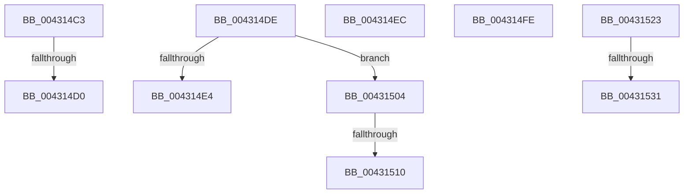

# sub_004314C3

- RVA: `0x004314C3`–`0x00431544` (길이 `129` bytes)
- VA: `0x00000001404314C3`
- 실행 섹션: `.text`
- PDB 이름 있음: `아니요`; PDB Function 태그: `아니요`
- unwind 정보 RVA: `0x000A21B4`
- 디코드: `29`개 명령, `129/129` bytes 표시
- 미해석 바이트: `0` (있으면 어셈블리에 `.byte`로 보존)

> 이 문서는 커널 이미지의 기계어와 PDB 기호를 분석해 생성했습니다. 4번과 5번은 함수 원형과 자료형을 바이너리 사용 방식에서 추정한 C 해석이며 원본 소스 복구 결과는 아닙니다.

## 1. Dependencies

- 직접 호출 지점: **4**; 고유 호출 대상: **4**
- 직접 호출자로 확인된 함수: **0**
- RIP 상대 이미지 참조: **1**

### Outgoing calls
- `0x004314D4` → [KxWaitForSpinLockAndAcquire](../20/KxWaitForSpinLockAndAcquire_function_002085C0.md) (function, `0x002085C0`)
- `0x004314F4` → [KiRaiseIrqlProcessIrqlFlags](../4F/KiRaiseIrqlProcessIrqlFlags_function_004F56FC.md) (function, `0x004F56FC`)
- `0x00431519` → [ObfReferenceObjectWithTag](../21/ObfReferenceObjectWithTag_function_00210710.md) (function, `0x00210710`)
- `0x0043153A` → [KiReleaseSpinLockInstrumented](../39/KiReleaseSpinLockInstrumented_function_00392EF0.md) (function, `0x00392EF0`)

### Direct callers
- 이 함수 시작 RVA로 연결되는 직접 call은 확인되지 않았습니다. 간접 호출은 완전히 역산할 수 없습니다.

### Static image references
- `0x00431523` → RVA `0x00F0DE58` (`.data`; read)

## 2. Other-region calls and transfers

- 다른 실행 섹션으로 향하는 call: **0**
- call이 아닌 외부 분기/꼬리 이동: **9**
  - `0x004314CA` → [sub_004313E9 + 0x5F](Unknown_function_004313E9.md) (`tail-transfer`)
  - `0x004314D9` → [sub_004313E9 + 0x5F](Unknown_function_004313E9.md) (`tail-transfer`)
  - `0x004314E7` → [sub_004313E9 + 0x65](Unknown_function_004313E9.md) (`tail-transfer`)
  - `0x004314F9` → [sub_004313E9 + 0x3B](Unknown_function_004313E9.md) (`tail-transfer`)
  - `0x00431502` → [sub_004313E9 + 0xB3](Unknown_function_004313E9.md) (`tail-transfer`)
  - `0x0043150A` → [sub_004313E9 + 0x6E](Unknown_function_004313E9.md) (`tail-transfer`)
  - `0x0043151E` → [sub_004313E9 + 0x6E](Unknown_function_004313E9.md) (`tail-transfer`)
  - `0x0043152B` → [sub_004313E9 + 0x7B](Unknown_function_004313E9.md) (`tail-transfer`)
  - `0x0043153F` → [sub_004313E9 + 0x80](Unknown_function_004313E9.md) (`tail-transfer`)

## 3. Assembly (complete function range)

```asm
004314C3  F0 48 0F BA 6E 10 00            lock bts qword ptr [rsi + 0x10], 0
004314CA  0F 83 78 FF FF FF               jae 0x140431448
004314D0  48 8D 4E 10                     lea rcx, [rsi + 0x10]
004314D4  E8 E7 70 DD FF                  call 0x1402085c0
004314D9  E9 6A FF FF FF                  jmp 0x140431448
004314DE  4C 39 60 10                     cmp qword ptr [rax + 0x10], r12
004314E2  74 20                           je 0x140431504
004314E4  48 8B 00                        mov rax, qword ptr [rax]
004314E7  E9 62 FF FF FF                  jmp 0x14043144e
004314EC  41 0F B6 D5                     movzx edx, r13b
004314F0  41 0F B6 CE                     movzx ecx, r14b
004314F4  E8 03 42 0C 00                  call 0x1404f56fc
004314F9  E9 26 FF FF FF                  jmp 0x140431424
004314FE  4C 8B 7F 18                     mov r15, qword ptr [rdi + 0x18]
00431502  EB 98                           jmp 0x14043149c
00431504  48 8B F8                        mov rdi, rax
00431507  48 85 C0                        test rax, rax
0043150A  0F 84 47 FF FF FF               je 0x140431457
00431510  48 8B 48 18                     mov rcx, qword ptr [rax + 0x18]
00431514  BA 50 73 50 72                  mov edx, 0x72507350
00431519  E8 F2 F1 DD FF                  call 0x140210710
0043151E  E9 34 FF FF FF                  jmp 0x140431457
00431523  8B 05 2F C9 AD 00               mov eax, dword ptr [rip + 0xadc92f]
00431529  85 C0                           test eax, eax
0043152B  0F 85 33 FF FF FF               jne 0x140431464
00431531  48 8B 54 24 48                  mov rdx, qword ptr [rsp + 0x48]
00431536  48 8D 4E 10                     lea rcx, [rsi + 0x10]
0043153A  E8 B1 19 F6 FF                  call 0x140392ef0
0043153F  E9 25 FF FF FF                  jmp 0x140431469
```

## 4. C-style interpretation (structured pseudocode)

```c
__int64 __fastcall sub_004314C3(void)
{
    __int64 result;
    unsigned __int64 v_stack_p48;

    result = KxWaitForSpinLockAndAcquire(v_rsi + 16, a2, a3, a4);
}
```

## 5. (Beta) C Style

```c
void sub_004314C3(void)
{
    int64_t result;
    uint64_t v_stack_p48;

    result = KxWaitForSpinLockAndAcquire(local_rsi + 16, a2, a3, a4);
}
```

## 6. Execution-region graph

[열기: 2D/3D 그래프와 함수 탐색 컨트롤 패널](../../../control-panel.html?section=text&rva=0x004314C3&view=graph)

- 2D 그래프는 위에서 아래로 흐르고, 3D 그래프는 빈 공간을 드래그해 회전합니다. Shift+드래그는 이동, 휠은 확대·축소, 함수 노드 선택은 대상 보고서 이동입니다.

### Static fallback


