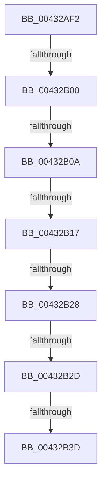

# sub_00432AF2

- RVA: `0x00432AF2`–`0x00432B49` (길이 `87` bytes)
- VA: `0x0000000140432AF2`
- 실행 섹션: `.text`
- PDB 이름 있음: `아니요`; PDB Function 태그: `아니요`
- unwind 정보 RVA: `0x000A2340`
- 디코드: `22`개 명령, `87/87` bytes 표시
- 미해석 바이트: `0` (있으면 어셈블리에 `.byte`로 보존)

> 이 문서는 커널 이미지의 기계어와 PDB 기호를 분석해 생성했습니다. 4번과 5번은 함수 원형과 자료형을 바이너리 사용 방식에서 추정한 C 해석이며 원본 소스 복구 결과는 아닙니다.

## 1. Dependencies

- 직접 호출 지점: **0**; 고유 호출 대상: **0**
- 직접 호출자로 확인된 함수: **0**
- RIP 상대 이미지 참조: **0**

### Outgoing calls
- 직접 디코드된 call 명령이 없습니다.

### Direct callers
- 이 함수 시작 RVA로 연결되는 직접 call은 확인되지 않았습니다. 간접 호출은 완전히 역산할 수 없습니다.

### Static image references
- 디코드된 RIP-relative 메모리 참조가 없습니다.

## 2. Other-region calls and transfers

- 다른 실행 섹션으로 향하는 call: **0**
- call이 아닌 외부 분기/꼬리 이동: **6**
  - `0x00432AFA` → [sub_00432B9F + 0x17](Unknown_function_00432B9F.md) (`tail-transfer`)
  - `0x00432B08` → [sub_00432B5C + 0x20](Unknown_function_00432B5C.md) (`tail-transfer`)
  - `0x00432B15` → [sub_00432B5C + 0x20](Unknown_function_00432B5C.md) (`tail-transfer`)
  - `0x00432B26` → [sub_00432B5C](Unknown_function_00432B5C.md) (`tail-transfer`)
  - `0x00432B2B` → [sub_00432B9F](Unknown_function_00432B9F.md) (`tail-transfer`)
  - `0x00432B3B` → [sub_00432B5C + 0x7](Unknown_function_00432B5C.md) (`tail-transfer`)

## 3. Assembly (complete function range)

```asm
00432AF2  48 89 74 24 48                  mov qword ptr [rsp + 0x48], rsi
00432AF7  66 3B C2                        cmp ax, dx
00432AFA  0F 84 B6 00 00 00               je 0x140432bb6
00432B00  BA 0B 02 00 00                  mov edx, 0x20b
00432B05  66 3B C2                        cmp ax, dx
00432B08  75 72                           jne 0x140432b7c
00432B0A  41 0F B7 C0                     movzx eax, r8w
00432B0E  41 3B 81 84 00 00 00            cmp eax, dword ptr [r9 + 0x84]
00432B15  73 65                           jae 0x140432b7c
00432B17  41 0F B7 C0                     movzx eax, r8w
00432B1B  45 8B 84 C1 88 00 00 00         mov r8d, dword ptr [r9 + rax*8 + 0x88]
00432B23  45 85 C0                        test r8d, r8d
00432B26  74 34                           je 0x140432b5c
00432B28  48 3B CD                        cmp rcx, rbp
00432B2B  76 72                           jbe 0x140432b9f
00432B2D  41 8B 84 C1 8C 00 00 00         mov eax, dword ptr [r9 + rax*8 + 0x8c]
00432B35  41 89 03                        mov dword ptr [r11], eax
00432B38  45 84 D2                        test r10b, r10b
00432B3B  74 26                           je 0x140432b63
00432B3D  49 8D 04 08                     lea rax, [r8 + rcx]
00432B41  48 89 07                        mov qword ptr [rdi], rax
00432B44  48 8B 74 24 48                  mov rsi, qword ptr [rsp + 0x48]
```

## 4. C-style interpretation (structured pseudocode)

```c
__int64 __fastcall sub_00432AF2(__int64 a1, unsigned __int16 a2, unsigned __int16 a3, __int64 a4, __int64 a5, __int64 a6, __int64 a7, __int64 a8, __int64 a9)
{
    unsigned __int64 v_stack_p48;

    v_stack_p48 = v_rsi;
    *(unsigned int *)(v_r11) = (unsigned int)((unsigned int)(*(unsigned int *)(a4 + a3 * 8 + 140)));
    *(unsigned __int64 *)(v_rdi) = (unsigned int)(*(unsigned int *)(a4 + a3 * 8 + 136)) + a1 * 1;
    return (unsigned int)(*(unsigned int *)(a4 + a3 * 8 + 136)) + a1 * 1;
}
```

## 5. (Beta) C Style

```c
int64_t sub_00432AF2(int64_t Arg1, uint16_t Arg2, uint16_t Arg3, void *Arg4, uint64_t Arg5, uint64_t Arg6, uint64_t Arg7, uint64_t Arg8, int64_t Arg9)
{
    uint8_t *arg4 = (uint8_t *)Arg4;

    uint64_t v_stack_p48;

    v_stack_p48 = local_rsi;
    *(uint32_t *)(local_r11) = (uint32_t)((uint32_t)(*(uint32_t *)(arg4 + Arg3 * 8 + 0x8C)));
    *(uint64_t *)(local_rdi) = (uint32_t)(*(uint32_t *)(arg4 + Arg3 * 8 + 0x88)) + Arg1 * 1;
    return (uint32_t)(*(uint32_t *)(arg4 + Arg3 * 8 + 0x88)) + Arg1 * 1;
}
```

### 관측된 메모리 오프셋

구조체 형식이 확인되지 않은 접근은 인자 기준의 오프셋으로만 기록했습니다.

| 기준 인자 | 오프셋 표현 | 폭 (bit) | 접근 |
|---|---:|---:|---|
| `Arg4` | `+ 0x84` | `32` | `R` |
| `Arg4` | `+ 0x88 + rax*8` | `32` | `R` |
| `Arg4` | `+ 0x8C + rax*8` | `32` | `R` |

## 6. Execution-region graph

[열기: 2D/3D 그래프와 함수 탐색 컨트롤 패널](../../../control-panel.html?section=text&rva=0x00432AF2&view=graph)

- 2D 그래프는 위에서 아래로 흐르고, 3D 그래프는 빈 공간을 드래그해 회전합니다. Shift+드래그는 이동, 휠은 확대·축소, 함수 노드 선택은 대상 보고서 이동입니다.

### Static fallback


