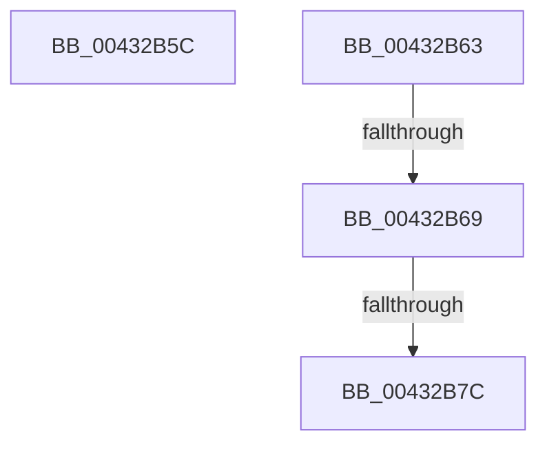

# sub_00432B5C

- RVA: `0x00432B5C`–`0x00432B83` (길이 `39` bytes)
- VA: `0x0000000140432B5C`
- 실행 섹션: `.text`
- PDB 이름 있음: `아니요`; PDB Function 태그: `아니요`
- unwind 정보 RVA: `0x000A2368`
- 디코드: `12`개 명령, `39/39` bytes 표시
- 미해석 바이트: `0` (있으면 어셈블리에 `.byte`로 보존)

> 이 문서는 커널 이미지의 기계어와 PDB 기호를 분석해 생성했습니다. 4번과 5번은 함수 원형과 자료형을 바이너리 사용 방식에서 추정한 C 해석이며 원본 소스 복구 결과는 아닙니다.

## 1. Dependencies

- 직접 호출 지점: **1**; 고유 호출 대상: **1**
- 직접 호출자로 확인된 함수: **0**
- RIP 상대 이미지 참조: **0**

### Outgoing calls
- `0x00432B6F` → [RtlAddressInSectionTable](RtlAddressInSectionTable_function_00432C90.md) (function, `0x00432C90`)

### Direct callers
- 이 함수 시작 RVA로 연결되는 직접 call은 확인되지 않았습니다. 간접 호출은 완전히 역산할 수 없습니다.

### Static image references
- 디코드된 RIP-relative 메모리 참조가 없습니다.

## 2. Other-region calls and transfers

- 다른 실행 섹션으로 향하는 call: **0**
- call이 아닌 외부 분기/꼬리 이동: **4**
  - `0x00432B61` → [sub_00432AF2 + 0x52](Unknown_function_00432AF2.md) (`tail-transfer`)
  - `0x00432B67` → [sub_00432AF2 + 0x4B](Unknown_function_00432AF2.md) (`tail-transfer`)
  - `0x00432B7A` → [sub_00432AF2 + 0x52](Unknown_function_00432AF2.md) (`tail-transfer`)
  - `0x00432B81` → [sub_00432AF2 + 0x52](Unknown_function_00432AF2.md) (`tail-transfer`)

## 3. Assembly (complete function range)

```asm
00432B5C  BB 02 00 00 C0                  mov ebx, 0xc0000002
00432B61  EB E1                           jmp 0x140432b44
00432B63  45 3B 41 54                     cmp r8d, dword ptr [r9 + 0x54]
00432B67  72 D4                           jb 0x140432b3d
00432B69  48 8B D1                        mov rdx, rcx
00432B6C  49 8B C9                        mov rcx, r9
00432B6F  E8 1C 01 00 00                  call 0x140432c90
00432B74  48 89 07                        mov qword ptr [rdi], rax
00432B77  48 85 C0                        test rax, rax
00432B7A  75 C8                           jne 0x140432b44
00432B7C  BB 0D 00 00 C0                  mov ebx, 0xc000000d
00432B81  EB C1                           jmp 0x140432b44
```

## 4. C-style interpretation (structured pseudocode)

```c
__int64 __fastcall sub_00432B5C(__int64 a1, __int64 a2, int a3, __int64 a4)
{
}
```

## 5. (Beta) C Style

```c
int64_t sub_00432B5C(int64_t Arg1, int64_t Arg2, int32_t Arg3, int64_t Arg4)
{
}
```

## 6. Execution-region graph

[열기: 2D/3D 그래프와 함수 탐색 컨트롤 패널](../../../control-panel.html?section=text&rva=0x00432B5C&view=graph)

- 2D 그래프는 위에서 아래로 흐르고, 3D 그래프는 빈 공간을 드래그해 회전합니다. Shift+드래그는 이동, 휠은 확대·축소, 함수 노드 선택은 대상 보고서 이동입니다.

### Static fallback


