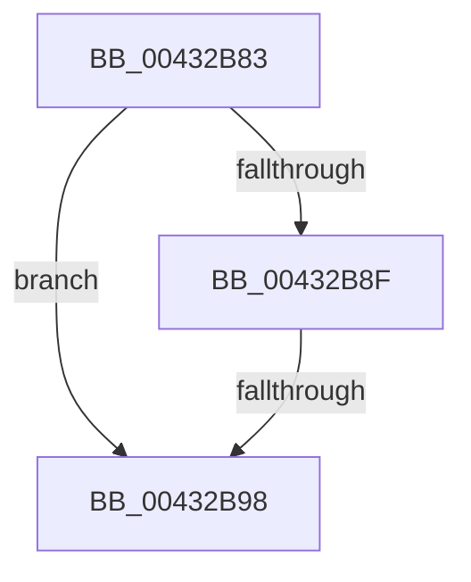

# sub_00432B83

- RVA: `0x00432B83`–`0x00432B9F` (길이 `28` bytes)
- VA: `0x0000000140432B83`
- 실행 섹션: `.text`
- PDB 이름 있음: `아니요`; PDB Function 태그: `아니요`
- unwind 정보 RVA: `0x000A237C`
- 디코드: `7`개 명령, `28/28` bytes 표시
- 미해석 바이트: `0` (있으면 어셈블리에 `.byte`로 보존)

> 이 문서는 커널 이미지의 기계어와 PDB 기호를 분석해 생성했습니다. 4번과 5번은 함수 원형과 자료형을 바이너리 사용 방식에서 추정한 C 해석이며 원본 소스 복구 결과는 아닙니다.

## 1. Dependencies

- 직접 호출 지점: **0**; 고유 호출 대상: **0**
- 직접 호출자로 확인된 함수: **0**
- RIP 상대 이미지 참조: **0**

### Outgoing calls
- 직접 디코드된 call 명령이 없습니다.

### Direct callers
- 이 함수 시작 RVA로 연결되는 직접 call은 확인되지 않았습니다. 간접 호출은 완전히 역산할 수 없습니다.

### Static image references
- 디코드된 RIP-relative 메모리 참조가 없습니다.

## 2. Other-region calls and transfers

- 다른 실행 섹션으로 향하는 call: **0**
- call이 아닌 외부 분기/꼬리 이동: **2**
  - `0x00432B92` → [RtlpImageDirectoryEntryToDataEx + 0x7B](RtlpImageDirectoryEntryToDataEx_function_00432A60.md) (`tail-transfer`)
  - `0x00432B9D` → [sub_00432B49](Unknown_function_00432B49.md) (`tail-transfer`)

## 3. Assembly (complete function range)

```asm
00432B83  49 8D 81 07 01 00 00            lea rax, [r9 + 0x107]
00432B8A  49 3B C1                        cmp rax, r9
00432B8D  72 09                           jb 0x140432b98
00432B8F  48 3B C5                        cmp rax, rbp
00432B92  0F 86 43 FF FF FF               jbe 0x140432adb
00432B98  BB 7B 00 00 C0                  mov ebx, 0xc000007b
00432B9D  EB AA                           jmp 0x140432b49
```

## 4. C-style interpretation (structured pseudocode)

```c
__int64 __fastcall sub_00432B83(__int64 a1, __int64 a2, __int64 a3, __int64 a4)
{
    if ((a4 + 263) < a4) goto loc_00432B98;
loc_00432B98:
}
```

## 5. (Beta) C Style

```c
int64_t sub_00432B83(int64_t Arg1, int64_t Arg2, int64_t Arg3, void *Arg4)
{
    uint8_t *arg4 = (uint8_t *)Arg4;

    if ((Arg4 + 263) < Arg4) goto loc_00432B98;
loc_00432B98:
}
```

### 관측된 메모리 오프셋

구조체 형식이 확인되지 않은 접근은 인자 기준의 오프셋으로만 기록했습니다.

| 기준 인자 | 오프셋 표현 | 폭 (bit) | 접근 |
|---|---:|---:|---|
| `Arg4` | `+ 0x107` | `64` | `R` |

## 6. Execution-region graph

[열기: 2D/3D 그래프와 함수 탐색 컨트롤 패널](../../../control-panel.html?section=text&rva=0x00432B83&view=graph)

- 2D 그래프는 위에서 아래로 흐르고, 3D 그래프는 빈 공간을 드래그해 회전합니다. Shift+드래그는 이동, 휠은 확대·축소, 함수 노드 선택은 대상 보고서 이동입니다.

### Static fallback


