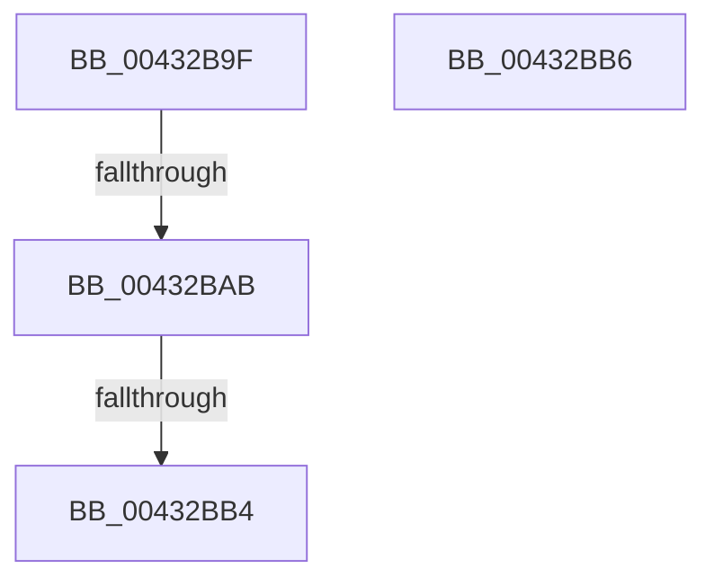

# sub_00432B9F

- RVA: `0x00432B9F`–`0x00432BD3` (길이 `52` bytes)
- VA: `0x0000000140432B9F`
- 실행 섹션: `.text`
- PDB 이름 있음: `아니요`; PDB Function 태그: `아니요`
- unwind 정보 RVA: `0x000A238C`
- 디코드: `14`개 명령, `52/52` bytes 표시
- 미해석 바이트: `0` (있으면 어셈블리에 `.byte`로 보존)

> 이 문서는 커널 이미지의 기계어와 PDB 기호를 분석해 생성했습니다. 4번과 5번은 함수 원형과 자료형을 바이너리 사용 방식에서 추정한 C 해석이며 원본 소스 복구 결과는 아닙니다.

## 1. Dependencies

- 직접 호출 지점: **1**; 고유 호출 대상: **1**
- 직접 호출자로 확인된 함수: **0**
- RIP 상대 이미지 참조: **0**

### Outgoing calls
- `0x00432BC7` → [RtlpImageDirectoryEntryToData32](RtlpImageDirectoryEntryToData32_function_00432BE4.md) (function, `0x00432BE4`)

### Direct callers
- 이 함수 시작 RVA로 연결되는 직접 call은 확인되지 않았습니다. 간접 호출은 완전히 역산할 수 없습니다.

### Static image references
- 디코드된 RIP-relative 메모리 참조가 없습니다.

## 2. Other-region calls and transfers

- 다른 실행 섹션으로 향하는 call: **0**
- call이 아닌 외부 분기/꼬리 이동: **4**
  - `0x00432BA9` → [sub_00432B5C + 0x20](Unknown_function_00432B5C.md) (`tail-transfer`)
  - `0x00432BAE` → [sub_00432AF2 + 0x3B](Unknown_function_00432AF2.md) (`tail-transfer`)
  - `0x00432BB4` → [sub_00432B5C + 0x20](Unknown_function_00432B5C.md) (`tail-transfer`)
  - `0x00432BCE` → [sub_00432AF2 + 0x52](Unknown_function_00432AF2.md) (`tail-transfer`)

## 3. Assembly (complete function range)

```asm
00432B9F  49 8D 70 FF                     lea rsi, [r8 - 1]
00432BA3  48 03 F1                        add rsi, rcx
00432BA6  48 3B F5                        cmp rsi, rbp
00432BA9  77 D1                           ja 0x140432b7c
00432BAB  48 3B F1                        cmp rsi, rcx
00432BAE  0F 83 79 FF FF FF               jae 0x140432b2d
00432BB4  EB C6                           jmp 0x140432b7c
00432BB6  48 89 7C 24 28                  mov qword ptr [rsp + 0x28], rdi
00432BBB  41 0F B6 D2                     movzx edx, r10b
00432BBF  4C 89 4C 24 20                  mov qword ptr [rsp + 0x20], r9
00432BC4  4D 8B CB                        mov r9, r11
00432BC7  E8 18 00 00 00                  call 0x140432be4
00432BCC  8B D8                           mov ebx, eax
00432BCE  E9 71 FF FF FF                  jmp 0x140432b44
```

## 4. C-style interpretation (structured pseudocode)

```c
__int64 __fastcall sub_00432B9F(__int64 a1, __int64 a2, __int64 a3, __int64 a4)
{
    __int64 v_rsi;
    unsigned __int64 v_stack_p20;
    unsigned __int64 v_stack_p28;

    v_rsi = (a3 - 1) + (a1);
}
```

## 5. (Beta) C Style

```c
int64_t sub_00432B9F(int64_t Arg1, int64_t Arg2, void *Arg3, int64_t Arg4)
{
    uint8_t *arg3 = (uint8_t *)Arg3;

    int64_t local_rsi;
    uint64_t v_stack_p20;
    uint64_t v_stack_p28;

    local_rsi = (Arg3 - 1) + (Arg1);
}
```

### 관측된 메모리 오프셋

구조체 형식이 확인되지 않은 접근은 인자 기준의 오프셋으로만 기록했습니다.

| 기준 인자 | 오프셋 표현 | 폭 (bit) | 접근 |
|---|---:|---:|---|
| `Arg3` | `- 0x1` | `64` | `R` |

## 6. Execution-region graph

[열기: 2D/3D 그래프와 함수 탐색 컨트롤 패널](../../../control-panel.html?section=text&rva=0x00432B9F&view=graph)

- 2D 그래프는 위에서 아래로 흐르고, 3D 그래프는 빈 공간을 드래그해 회전합니다. Shift+드래그는 이동, 휠은 확대·축소, 함수 노드 선택은 대상 보고서 이동입니다.

### Static fallback


