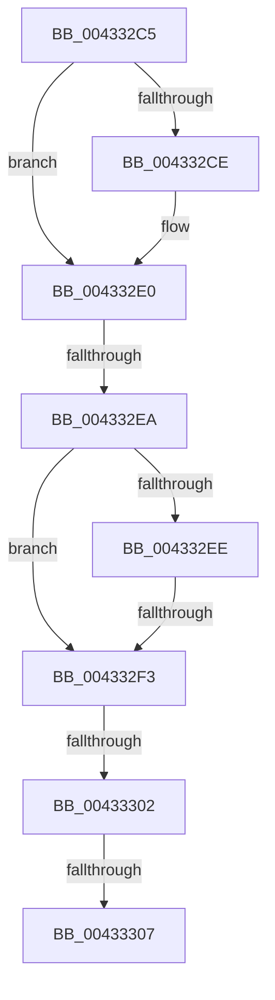

# sub_004332C5

- RVA: `0x004332C5`–`0x00433311` (길이 `76` bytes)
- VA: `0x00000001404332C5`
- 실행 섹션: `.text`
- PDB 이름 있음: `아니요`; PDB Function 태그: `아니요`
- unwind 정보 RVA: `0x000A246C`
- 디코드: `24`개 명령, `76/76` bytes 표시
- 미해석 바이트: `0` (있으면 어셈블리에 `.byte`로 보존)

> 이 문서는 커널 이미지의 기계어와 PDB 기호를 분석해 생성했습니다. 4번과 5번은 함수 원형과 자료형을 바이너리 사용 방식에서 추정한 C 해석이며 원본 소스 복구 결과는 아닙니다.

## 1. Dependencies

- 직접 호출 지점: **0**; 고유 호출 대상: **0**
- 직접 호출자로 확인된 함수: **0**
- RIP 상대 이미지 참조: **0**

### Outgoing calls
- 직접 디코드된 call 명령이 없습니다.

### Direct callers
- 이 함수 시작 RVA로 연결되는 직접 call은 확인되지 않았습니다. 간접 호출은 완전히 역산할 수 없습니다.

### Static image references
- 디코드된 RIP-relative 메모리 참조가 없습니다.

## 2. Other-region calls and transfers

- 다른 실행 섹션으로 향하는 call: **0**
- call이 아닌 외부 분기/꼬리 이동: **4**
  - `0x004332E4` → [sub_00433332 + 0x89](Unknown_function_00433332.md) (`tail-transfer`)
  - `0x004332F1` → [sub_00433332](Unknown_function_00433332.md) (`tail-transfer`)
  - `0x004332FC` → [sub_00433332 + 0xA1](Unknown_function_00433332.md) (`tail-transfer`)
  - `0x00433305` → [sub_00433332 + 0x42](Unknown_function_00433332.md) (`tail-transfer`)

## 3. Assembly (complete function range)

```asm
004332C5  4C 89 64 24 40                  mov qword ptr [rsp + 0x40], r12
004332CA  85 D2                           test edx, edx
004332CC  74 12                           je 0x1404332e0
004332CE  8B FA                           mov edi, edx
004332D0  8B C2                           mov eax, edx
004332D2  83 E7 01                        and edi, 1
004332D5  83 E0 06                        and eax, 6
004332D8  C1 E7 08                        shl edi, 8
004332DB  C1 E0 08                        shl eax, 8
004332DE  0B F8                           or edi, eax
004332E0  F6 41 43 02                     test byte ptr [rcx + 0x43], 2
004332E4  0F 85 D1 00 00 00               jne 0x1404333bb
004332EA  85 D2                           test edx, edx
004332EC  74 05                           je 0x1404332f3
004332EE  48 85 F6                        test rsi, rsi
004332F1  75 3F                           jne 0x140433332
004332F3  41 BC 00 08 00 00               mov r12d, 0x800
004332F9  45 84 C0                        test r8b, r8b
004332FC  0F 85 D1 00 00 00               jne 0x1404333d3
00433302  48 85 ED                        test rbp, rbp
00433305  75 6D                           jne 0x140433374
00433307  4C 8B 64 24 40                  mov r12, qword ptr [rsp + 0x40]
0043330C  33 C0                           xor eax, eax
0043330E  41 89 3E                        mov dword ptr [r14], edi
```

## 4. C-style interpretation (structured pseudocode)

```c
__int64 __fastcall sub_004332C5(__int64 a1, int a2, unsigned __int8 a3, __int64 a4, __int64 a5, __int64 a6, __int64 a7, __int64 a8)
{
    __int64 result;
    __int64 v_rdi;
    unsigned __int64 v_stack_p40;

    v_stack_p40 = v_r12;
    if (a2 != 0) {
        v_rdi = a2;
        result = a2;
        v_rdi = (unsigned int)((v_rdi) & (1));
        result = (unsigned int)((result) & (6));
        v_rdi = (unsigned int)((v_rdi) << (8));
        result = (unsigned int)((result) << (8));
        v_rdi = (unsigned int)((v_rdi) | ((unsigned int)(result)));
    }
    if (a2 == 0) goto loc_004332F3;
loc_004332F3:
    result = 0;
    *(unsigned int *)(v_r14) = (unsigned int)(v_rdi);
    return result;
}
```

## 5. (Beta) C Style

```c
int64_t sub_004332C5(void *Arg1, int32_t Arg2, uint8_t Arg3, int64_t Arg4, uint64_t Arg5, uint64_t Arg6, uint64_t Arg7, int64_t Arg8)
{
    uint8_t *arg1 = (uint8_t *)Arg1;

    int64_t result;
    int64_t local_rdi;
    uint64_t v_stack_p40;

    v_stack_p40 = local_r12;
    if (Arg2 != 0) {
        local_rdi = Arg2;
        result = Arg2;
        local_rdi = (uint32_t)((local_rdi) & (1));
        result = (uint32_t)((result) & (6));
        local_rdi = (uint32_t)((local_rdi) << (8));
        result = (uint32_t)((result) << (8));
        local_rdi = (uint32_t)((local_rdi) | ((uint32_t)(result)));
    }
    if (Arg2 == 0) goto loc_004332F3;
loc_004332F3:
    result = 0;
    *(uint32_t *)(local_r14) = (uint32_t)(local_rdi);
    return result;
}
```

### 관측된 메모리 오프셋

구조체 형식이 확인되지 않은 접근은 인자 기준의 오프셋으로만 기록했습니다.

| 기준 인자 | 오프셋 표현 | 폭 (bit) | 접근 |
|---|---:|---:|---|
| `Arg1` | `+ 0x43` | `8` | `R` |

## 6. Execution-region graph

[열기: 2D/3D 그래프와 함수 탐색 컨트롤 패널](../../../control-panel.html?section=text&rva=0x004332C5&view=graph)

- 2D 그래프는 위에서 아래로 흐르고, 3D 그래프는 빈 공간을 드래그해 회전합니다. Shift+드래그는 이동, 휠은 확대·축소, 함수 노드 선택은 대상 보고서 이동입니다.

### Static fallback


