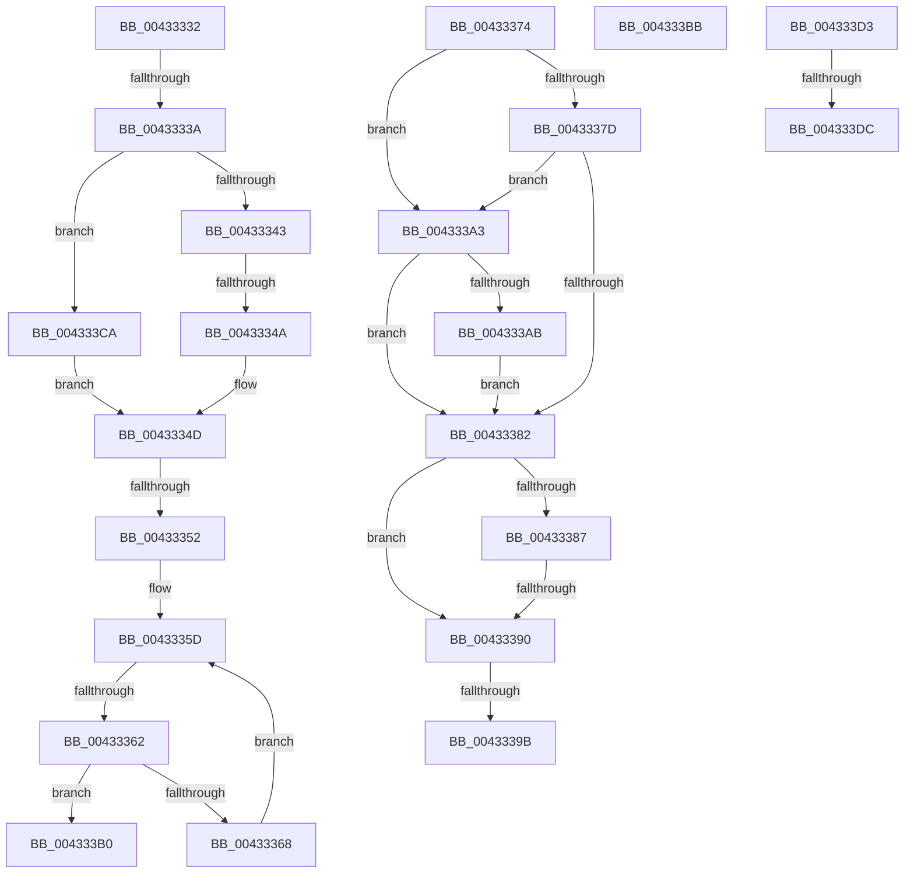

# sub_00433332

- RVA: `0x00433332`–`0x004333E9` (길이 `183` bytes)
- VA: `0x0000000140433332`
- 실행 섹션: `.text`
- PDB 이름 있음: `아니요`; PDB Function 태그: `아니요`
- unwind 정보 RVA: `0x000A2494`
- 디코드: `51`개 명령, `183/183` bytes 표시
- 미해석 바이트: `0` (있으면 어셈블리에 `.byte`로 보존)

> 이 문서는 커널 이미지의 기계어와 PDB 기호를 분석해 생성했습니다. 4번과 5번은 함수 원형과 자료형을 바이너리 사용 방식에서 추정한 C 해석이며 원본 소스 복구 결과는 아닙니다.

## 1. Dependencies

- 직접 호출 지점: **0**; 고유 호출 대상: **0**
- 직접 호출자로 확인된 함수: **0**
- RIP 상대 이미지 참조: **0**

### Outgoing calls
- 직접 디코드된 call 명령이 없습니다.

### Direct callers
- 이 함수 시작 RVA로 연결되는 직접 call은 확인되지 않았습니다. 간접 호출은 완전히 역산할 수 없습니다.

### Static image references
- 디코드된 RIP-relative 메모리 참조가 없습니다.

## 2. Other-region calls and transfers

- 다른 실행 섹션으로 향하는 call: **0**
- call이 아닌 외부 분기/꼬리 이동: **11**
  - `0x00433338` → [sub_004332C5 + 0x2E](Unknown_function_004332C5.md) (`tail-transfer`)
  - `0x00433348` → [sub_004332C5 + 0x2E](Unknown_function_004332C5.md) (`tail-transfer`)
  - `0x00433350` → [sub_004332C5 + 0x2E](Unknown_function_004332C5.md) (`tail-transfer`)
  - `0x00433360` → [sub_004332C5 + 0x2E](Unknown_function_004332C5.md) (`tail-transfer`)
  - `0x0043338A` → [sub_004332C5 + 0x42](Unknown_function_004332C5.md) (`tail-transfer`)
  - `0x00433395` → [sub_004332C5 + 0x42](Unknown_function_004332C5.md) (`tail-transfer`)
  - `0x0043339E` → [sub_004332C5 + 0x42](Unknown_function_004332C5.md) (`tail-transfer`)
  - `0x004333B6` → [sub_004332C5 + 0x2E](Unknown_function_004332C5.md) (`tail-transfer`)
  - `0x004333C5` → [sub_004332C5 + 0x25](Unknown_function_004332C5.md) (`tail-transfer`)
  - `0x004333D6` → [sub_006EEA5C + 0x52](../6E/Unknown_function_006EEA5C.md) (`tail-transfer`)
  - `0x004333E4` → [sub_006EEA5C](../6E/Unknown_function_006EEA5C.md) (`tail-transfer`)

## 3. Assembly (complete function range)

```asm
00433332  0F B7 46 02                     movzx eax, word ptr [rsi + 2]
00433336  A8 10                           test al, 0x10
00433338  74 B9                           je 0x1404332f3
0043333A  66 85 C0                        test ax, ax
0043333D  0F 89 87 00 00 00               jns 0x1404333ca
00433343  8B 46 0C                        mov eax, dword ptr [rsi + 0xc]
00433346  85 C0                           test eax, eax
00433348  74 A9                           je 0x1404332f3
0043334A  48 03 C6                        add rax, rsi
0043334D  48 85 C0                        test rax, rax
00433350  74 A1                           je 0x1404332f3
00433352  44 0F B7 48 04                  movzx r9d, word ptr [rax + 4]
00433357  4C 8D 50 08                     lea r10, [rax + 8]
0043335B  33 C9                           xor ecx, ecx
0043335D  41 3B C9                        cmp ecx, r9d
00433360  73 91                           jae 0x1404332f3
00433362  41 80 3A 11                     cmp byte ptr [r10], 0x11
00433366  74 48                           je 0x1404333b0
00433368  41 0F B7 42 02                  movzx eax, word ptr [r10 + 2]
0043336D  FF C1                           inc ecx
0043336F  4C 03 D0                        add r10, rax
00433372  EB E9                           jmp 0x14043335d
00433374  48 8D 4E 02                     lea rcx, [rsi + 2]
00433378  48 85 F6                        test rsi, rsi
0043337B  74 26                           je 0x1404333a3
0043337D  F6 01 04                        test byte ptr [rcx], 4
00433380  74 21                           je 0x1404333a3
00433382  48 85 F6                        test rsi, rsi
00433385  74 09                           je 0x140433390
00433387  F6 01 10                        test byte ptr [rcx], 0x10
0043338A  0F 85 77 FF FF FF               jne 0x140433307
00433390  66 44 85 65 02                  test word ptr [rbp + 2], r12w
00433395  0F 84 6C FF FF FF               je 0x140433307
0043339B  83 CF 02                        or edi, 2
0043339E  E9 64 FF FF FF                  jmp 0x140433307
004333A3  66 0F BA 65 02 0A               bt word ptr [rbp + 2], 0xa
004333A9  73 D7                           jae 0x140433382
004333AB  83 CF 01                        or edi, 1
004333AE  EB D2                           jmp 0x140433382
004333B0  41 09 52 04                     or dword ptr [r10 + 4], edx
004333B4  33 FF                           xor edi, edi
004333B6  E9 38 FF FF FF                  jmp 0x1404332f3
004333BB  44 8B B9 DC 00 00 00            mov r15d, dword ptr [rcx + 0xdc]
004333C2  41 B0 01                        mov r8b, 1
004333C5  E9 20 FF FF FF                  jmp 0x1404332ea
004333CA  48 8B 46 18                     mov rax, qword ptr [rsi + 0x18]
004333CE  E9 7A FF FF FF                  jmp 0x14043334d
004333D3  48 85 F6                        test rsi, rsi
004333D6  0F 84 D2 B6 2B 00               je 0x1406eeaae
004333DC  C7 44 24 60 00 00 00 00         mov dword ptr [rsp + 0x60], 0
004333E4  E9 73 B6 2B 00                  jmp 0x1406eea5c
```

## 4. C-style interpretation (structured pseudocode)

```c
__int64 __fastcall sub_00433332(int a1, int a2)
{
    __int64 result;
    __int64 v_r10;
    __int64 v_rdi;
    unsigned int v_stack_p60;

    if (!sign_flag) goto loc_004333CA;
    result = ((unsigned int)(*(unsigned int *)(v_rsi + 12))) + (v_rsi);
loc_0043334D:
    a1 = 0;
loc_0043335D:
    if ((*(unsigned __int8 *)(result + 8)) == 17) goto loc_004333B0;
    a1 = (unsigned int)((a1) + 1);
    v_r10 = (result + 8) + (*(unsigned __int16 *)(result + 8 + 2));
    goto loc_0043335D;
loc_004333B0:
    v_rdi = 0;
loc_004333CA:
    goto loc_0043334D;
}
```

## 5. (Beta) C Style

```c
int64_t sub_00433332(int32_t Arg1, int32_t Arg2)
{
    int64_t result;
    int64_t local_r10;
    int64_t local_rdi;
    uint32_t v_stack_p60;

    if (!sign_flag) goto loc_004333CA;
    result = ((uint32_t)(*(uint32_t *)(local_rsi + 0xC))) + (local_rsi);
loc_0043334D:
    Arg1 = 0;
loc_0043335D:
    if ((*(uint8_t *)(result + 0x8)) == 17) goto loc_004333B0;
    Arg1 = (uint32_t)((Arg1) + 1);
    local_r10 = (result + 8) + (*(uint16_t *)(result + 0x8 + 0x2));
    goto loc_0043335D;
loc_004333B0:
    local_rdi = 0;
loc_004333CA:
    goto loc_0043334D;
}
```

## 6. Execution-region graph

[열기: 2D/3D 그래프와 함수 탐색 컨트롤 패널](../../../control-panel.html?section=text&rva=0x00433332&view=graph)

- 2D 그래프는 위에서 아래로 흐르고, 3D 그래프는 빈 공간을 드래그해 회전합니다. Shift+드래그는 이동, 휠은 확대·축소, 함수 노드 선택은 대상 보고서 이동입니다.

### Static fallback


