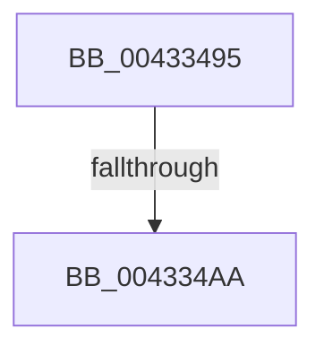

# sub_00433495

- RVA: `0x00433495`–`0x004334ED` (길이 `88` bytes)
- VA: `0x0000000140433495`
- 실행 섹션: `.text`
- PDB 이름 있음: `아니요`; PDB Function 태그: `아니요`
- unwind 정보 RVA: `0x000A2508`
- 디코드: `21`개 명령, `88/88` bytes 표시
- 미해석 바이트: `0` (있으면 어셈블리에 `.byte`로 보존)

> 이 문서는 커널 이미지의 기계어와 PDB 기호를 분석해 생성했습니다. 4번과 5번은 함수 원형과 자료형을 바이너리 사용 방식에서 추정한 C 해석이며 원본 소스 복구 결과는 아닙니다.

## 1. Dependencies

- 직접 호출 지점: **3**; 고유 호출 대상: **3**
- 직접 호출자로 확인된 함수: **0**
- RIP 상대 이미지 참조: **0**

### Outgoing calls
- `0x0043349D` → [ExAllocatePool2](../../poolcode/B8/ExAllocatePool2_function_00B820F0.md) (function, `0x00B820F0`)
- `0x004334C7` → [KeAcquireSpinLockRaiseToDpc](../20/KeAcquireSpinLockRaiseToDpc_function_00208470.md) (function, `0x00208470`)
- `0x004334DE` → [KeReleaseSpinLock](../39/KeReleaseSpinLock_function_00392BA0.md) (function, `0x00392BA0`)

### Direct callers
- 이 함수 시작 RVA로 연결되는 직접 call은 확인되지 않았습니다. 간접 호출은 완전히 역산할 수 없습니다.

### Static image references
- 디코드된 RIP-relative 메모리 참조가 없습니다.

## 2. Other-region calls and transfers

- 다른 실행 섹션으로 향하는 call: **1**
  - `0x0043349D` → [ExAllocatePool2](../../poolcode/B8/ExAllocatePool2_function_00B820F0.md) (`.text` → `POOLCODE`)
- call이 아닌 외부 분기/꼬리 이동: **2**
  - `0x004334A8` → [sub_004334ED](Unknown_function_004334ED.md) (`tail-transfer`)
  - `0x004334E8` → [IoAcquireRemoveLockEx + 0x30](IoAcquireRemoveLockEx_function_00433420.md) (`tail-transfer`)

## 3. Assembly (complete function range)

```asm
00433495  4C 89 74 24 30                  mov qword ptr [rsp + 0x30], r14
0043349A  8D 4A 18                        lea ecx, [rdx + 0x18]
0043349D  E8 4E EC 74 00                  call 0x140b820f0
004334A2  4C 8B F0                        mov r14, rax
004334A5  48 85 C0                        test rax, rax
004334A8  74 43                           je 0x1404334ed
004334AA  48 89 68 08                     mov qword ptr [rax + 8], rbp
004334AE  48 8D 4B 48                     lea rcx, [rbx + 0x48]
004334B2  48 89 70 18                     mov qword ptr [rax + 0x18], rsi
004334B6  89 78 20                        mov dword ptr [rax + 0x20], edi
004334B9  48 A1 20 03 00 00 80 F7 FF FF   movabs rax, qword ptr [0xfffff78000000320]
004334C3  49 89 46 10                     mov qword ptr [r14 + 0x10], rax
004334C7  E8 A4 4F DD FF                  call 0x140208470
004334CC  48 8B 53 70                     mov rdx, qword ptr [rbx + 0x70]
004334D0  48 8D 4B 48                     lea rcx, [rbx + 0x48]
004334D4  49 89 16                        mov qword ptr [r14], rdx
004334D7  0F B6 D0                        movzx edx, al
004334DA  4C 89 73 70                     mov qword ptr [rbx + 0x70], r14
004334DE  E8 BD F6 F5 FF                  call 0x140392ba0
004334E3  4C 8B 74 24 30                  mov r14, qword ptr [rsp + 0x30]
004334E8  E9 63 FF FF FF                  jmp 0x140433450
```

## 4. C-style interpretation (structured pseudocode)

```c
__int64 __fastcall sub_00433495(__int64 a1, __int64 a2, __int64 a3, __int64 a4, __int64 a5, __int64 a6)
{
    __int64 result;
    unsigned __int64 v_stack_p30;

    v_stack_p30 = v_r14;
    result = ExAllocatePool2(a2 + 24, a2, a3, a4);
    *(unsigned __int64 *)(result + 8) = v_rbp;
    *(unsigned __int64 *)(result + 24) = v_rsi;
    *(unsigned int *)(result + 32) = (unsigned int)(v_rdi);
    *(unsigned __int64 *)(result + 16) = result;
    result = KeAcquireSpinLockRaiseToDpc(v_rbx + 72, a2, a3, a4);
    *(unsigned __int64 *)(result) = *(unsigned __int64 *)(v_rbx + 112);
    *(unsigned __int64 *)(v_rbx + 112) = result;
    result = KeReleaseSpinLock(v_rbx + 72, (unsigned __int8)(result), a3, a4);
}
```

## 5. (Beta) C Style

```c
int64_t sub_00433495(int64_t Arg1, void *Arg2, int64_t Arg3, int64_t Arg4, uint64_t Arg5, int64_t Arg6)
{
    uint8_t *arg2 = (uint8_t *)Arg2;

    int64_t result;
    uint64_t v_stack_p30;

    v_stack_p30 = local_r14;
    result = ExAllocatePool2(Arg2 + 24, Arg2, Arg3, Arg4);
    *(uint64_t *)(result + 0x8) = local_rbp;
    *(uint64_t *)(result + 0x18) = local_rsi;
    *(uint32_t *)(result + 0x20) = (uint32_t)(local_rdi);
    *(uint64_t *)(result + 0x10) = result;
    result = KeAcquireSpinLockRaiseToDpc(local_rbx + 72, Arg2, Arg3, Arg4);
    *(uint64_t *)(result) = *(uint64_t *)(local_rbx + 0x70);
    *(uint64_t *)(local_rbx + 0x70) = result;
    result = KeReleaseSpinLock(local_rbx + 72, (uint8_t)(result), Arg3, Arg4);
}
```

### 관측된 메모리 오프셋

구조체 형식이 확인되지 않은 접근은 인자 기준의 오프셋으로만 기록했습니다.

| 기준 인자 | 오프셋 표현 | 폭 (bit) | 접근 |
|---|---:|---:|---|
| `Arg2` | `+ 0x18` | `32` | `R` |

## 6. Execution-region graph

[열기: 2D/3D 그래프와 함수 탐색 컨트롤 패널](../../../control-panel.html?section=text&rva=0x00433495&view=graph)

- 2D 그래프는 위에서 아래로 흐르고, 3D 그래프는 빈 공간을 드래그해 회전합니다. Shift+드래그는 이동, 휠은 확대·축소, 함수 노드 선택은 대상 보고서 이동입니다.

### Static fallback


